<h1 align="center">
<picture>
<source media="(prefers-color-scheme: dark)" srcset="integration/custom_components/casa_mia/brand/dark_logo@2x.png">
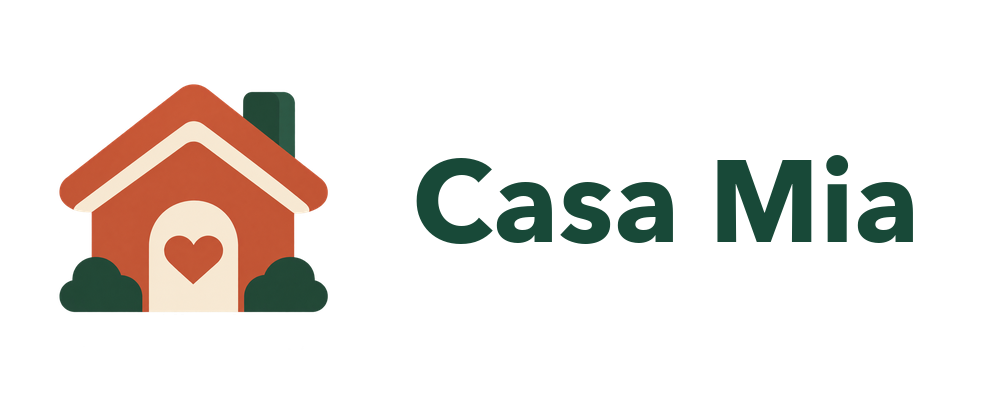
</picture>
</h1>

<p align="center">

<a href="https://github.com/gazoodle/casa-mia/pkgs/container/casa-mia-amd64"></a>
<a href="https://github.com/gazoodle/casa-mia/releases/latest"></a>
<a href="https://github.com/gazoodle/casa-mia/actions/workflows/release.yml"></a>
<a href="#licence"></a>
</p>

Casa Mia is a Home Assistant app and integration: the things I've built for my own house,
mostly for wall tablets, cameras, guests and keeping an eye on sensors. Click a picture for its
documentation.

<table>
<tr>
<td width="25%" valign="top">
<h4><a href="docs/tablet-layout.md">Tablet Layout</a> <a href="docs/README.md#maturity"></a><!--tablet_layout--></h4>
<a href="docs/tablet-layout.md">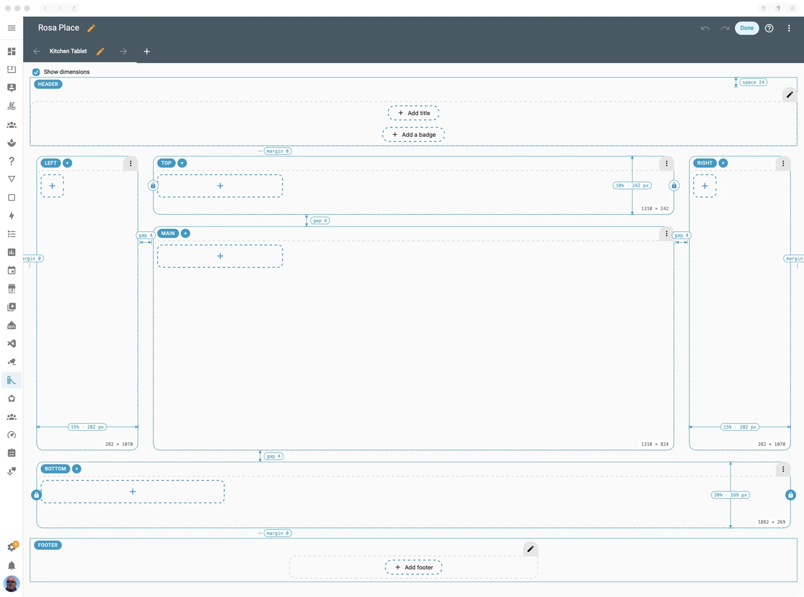</a>
<p>A view type for wall tablets. It's Home Assistant's Sections view fitted to the screen: it never scrolls, and the panels resize as cards appear and disappear.</p>
</td>
<td width="25%" valign="top">
<h4><a href="docs/tablet-layout.md#showing-and-hiding">Garnish</a> <a href="docs/README.md#maturity"></a><!--garnish--></h4>
<a href="docs/tablet-layout.md#showing-and-hiding">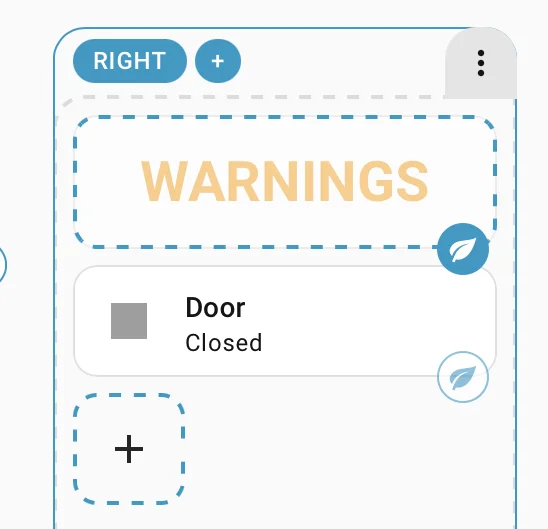</a>
<p>Mark a section's heading as garnish and it no longer keeps an otherwise empty section on screen. Works on any Sections dashboard.</p>
</td>
<td width="25%" valign="top">
<h4><a href="docs/over-layer.md">Over layer</a> <a href="docs/README.md#maturity"></a><!--over_layer--></h4>
<a href="docs/over-layer.md">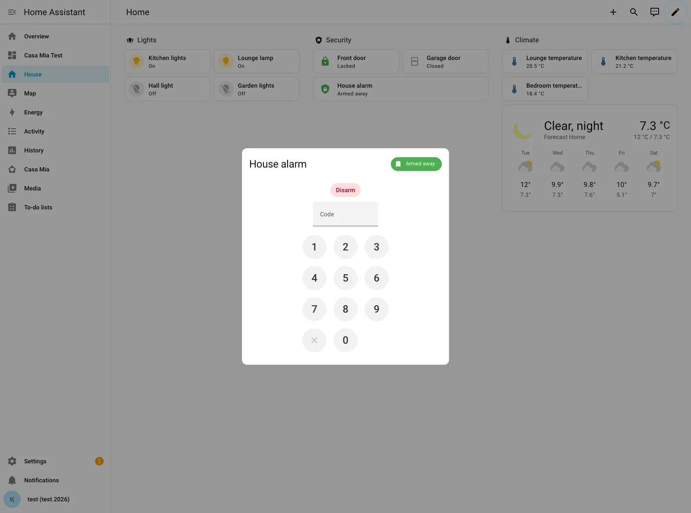</a>
<p>One card shown over a whole dashboard while its conditions hold, such as the alarm's keypad while it's armed. The dashboard can be seen underneath, but not used.</p>
</td>
<td width="25%" valign="top">
<h4><a href="docs/heating-flow.md">Heating Flow card</a></h4>
<a href="docs/heating-flow.md">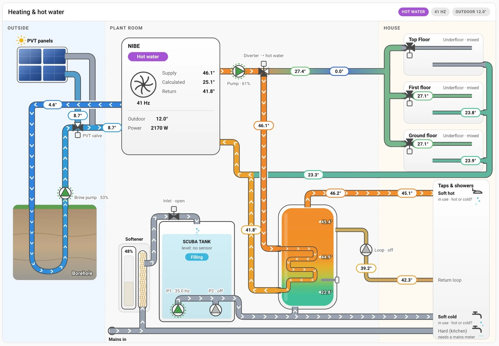</a>
<p>A card that draws your heating and hot water as a diagram. Pipe colour shows temperature and moving markers show flow.</p>
</td>
</tr>
<tr>
<td width="25%" valign="top">
<h4><a href="docs/applets/sensor-watch.md">Sensor Watch</a> <a href="docs/README.md#maturity"></a><!--sensor_watch--></h4>
<a href="docs/applets/sensor-watch.md">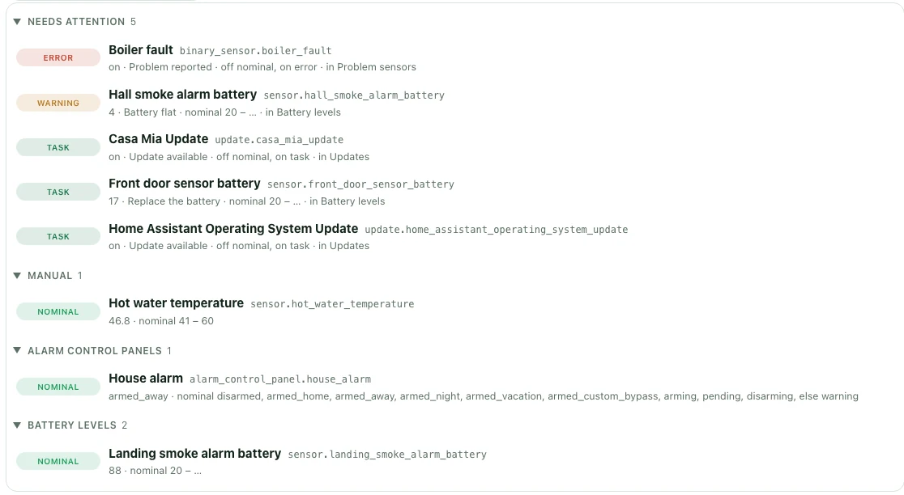</a>
<p>Gives every sensor a level (nominal, task, warning, error or critical) and tells you when one changes. A group covers a whole class of device, so new ones are watched automatically.</p>
</td>
<td width="25%" valign="top">
<h4><a href="docs/applets/sensor-watch.md#the-card">Sensor Watch card</a></h4>
<a href="docs/applets/sensor-watch.md#the-card">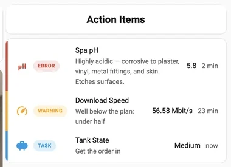</a>
<p>A card listing only what needs looking at, worst first. On a quiet day it isn't there at all.</p>
</td>
<td width="25%" valign="top">
<h4><a href="docs/applets/sensor-watch.md#the-eye-in-an-entitys-dialog">Sensor Watch's eye</a></h4>
<a href="docs/applets/sensor-watch.md#the-eye-in-an-entitys-dialog">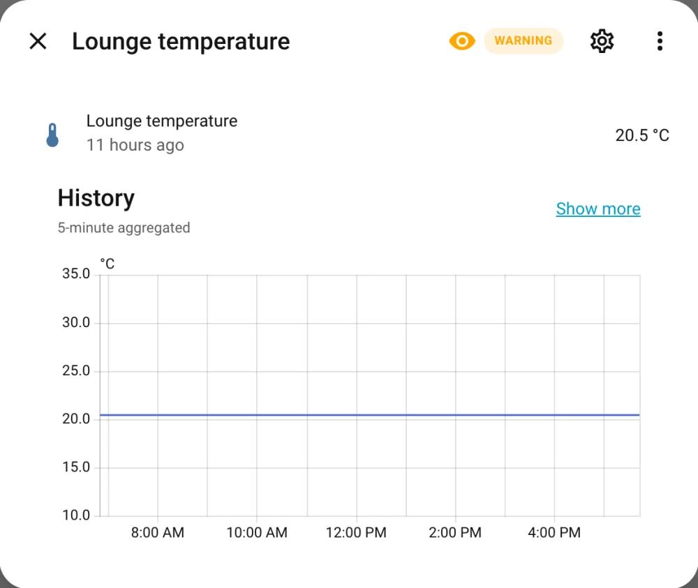</a>
<p>An eye in every entity's Home Assistant dialog shows whether it's watched and how it is. Tap it to open the watch, or start one.</p>
</td>
<td width="25%" valign="top">
<h4><a href="docs/applets/guest-login.md">Guest login</a> <a href="docs/README.md#maturity"></a><!--guest_login--></h4>
<a href="docs/applets/guest-login.md">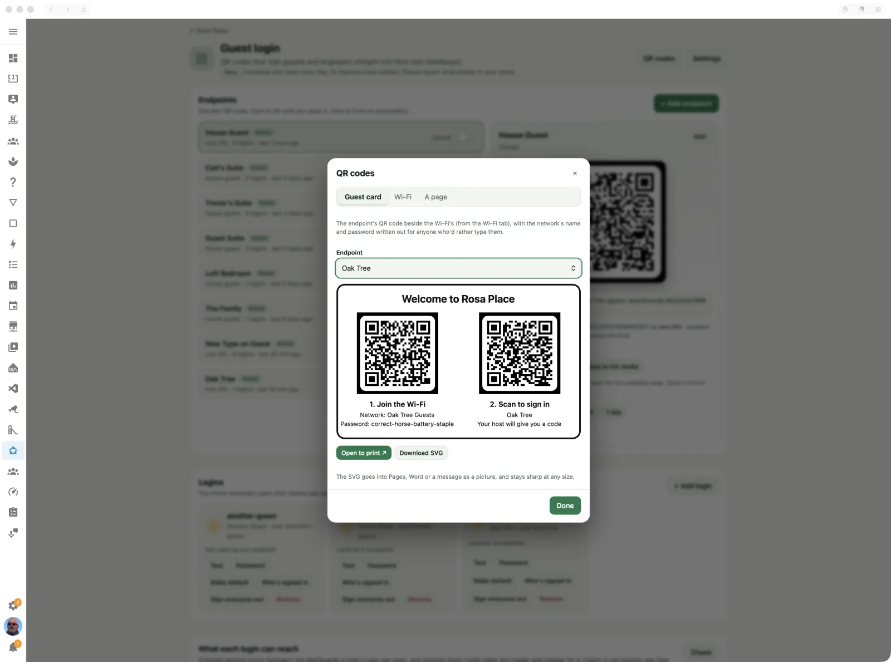</a>
<p>A QR code signs a guest into their own dashboard without typing a password. Each code can be opened and closed by hand or by an automation.</p>
</td>
</tr>
<tr>
<td width="25%" valign="top">
<h4><a href="docs/applets/guest-login.md#the-qr-code-card">QR code card</a></h4>
<a href="docs/applets/guest-login.md#the-qr-code-card">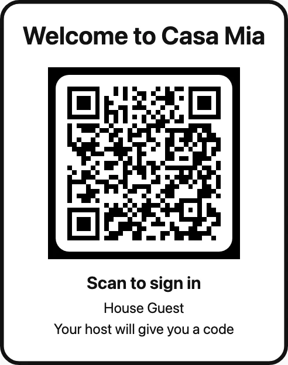</a>
<p>Shows a guest login code on a dashboard while its code is open, or the code for any page you like.</p>
</td>
<td width="25%" valign="top">
<h4><a href="docs/applets/camera-commander.md">Camera Commander</a> <a href="docs/README.md#maturity"></a><!--commander--></h4>
<a href="docs/applets/camera-commander.md">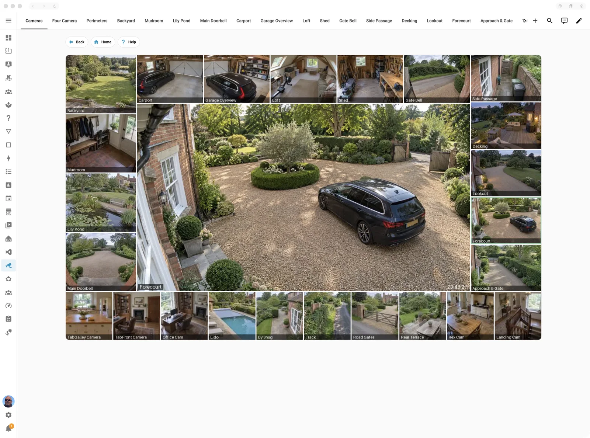</a>
<p>All your cameras in one live picture, with a main camera surrounded by the others. Tap one to make it the main camera, or let it follow motion.</p>
</td>
<td width="25%" valign="top">
<h4><a href="docs/applets/camera-compositor.md">Camera compositor</a> <a href="docs/README.md#maturity"></a><!--compositor--></h4>
<a href="docs/applets/camera-compositor.md">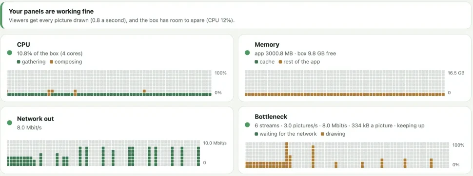</a>
<p>Draws each commander on the Home Assistant box, so a wall tablet plays one stream instead of one per camera.</p>
</td>
<td width="25%" valign="top">
<h4><a href="docs/applets/cameras.md">Cameras</a> <a href="docs/README.md#maturity"></a><!--cameras--></h4>
<a href="docs/applets/cameras.md">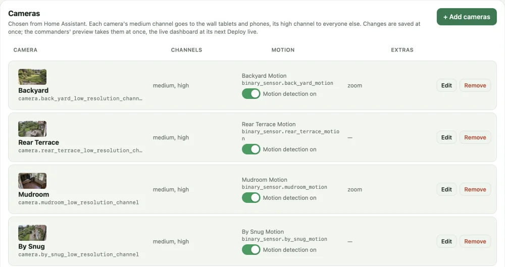</a>
<p>Choose which of Home Assistant's cameras Casa Mia uses, with their names, streams and controls.</p>
</td>
</tr>
<tr>
<td width="25%" valign="top">
<h4><a href="docs/applets/auto-dashboards.md">Auto Dashboards</a> <a href="docs/README.md#maturity"></a><!--auto_dashboards--></h4>
<a href="docs/applets/auto-dashboards.md">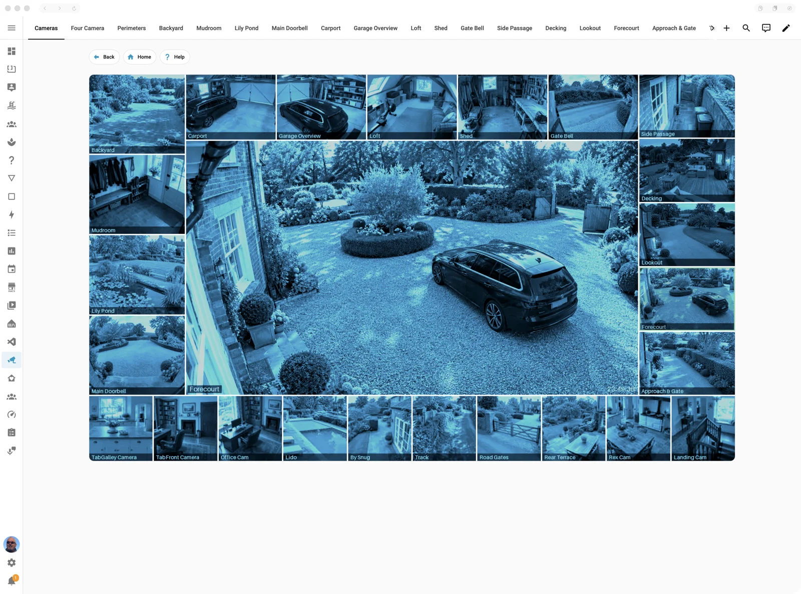</a>
<p>Makes the camera dashboard for you from your cameras and commanders, and puts it into Home Assistant.</p>
</td>
<td width="25%" valign="top">
<h4><a href="docs/applets/kiosk-satellites.md">Kiosk Satellites</a> <a href="docs/README.md#maturity"></a><!--kiosks--></h4>
<a href="docs/applets/kiosk-satellites.md">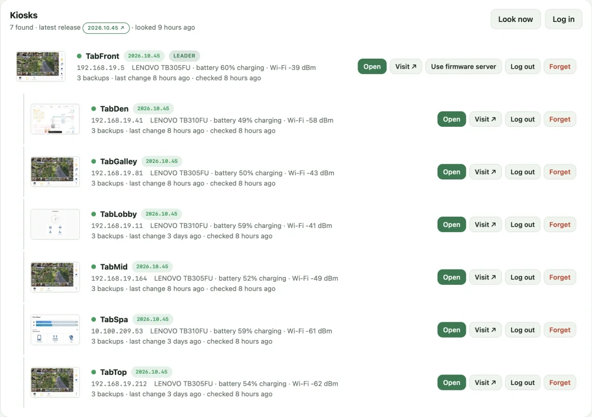</a>
<p>Every Kiosk Satellite tablet on one page, with its version, battery, backups and a picture of its screen.</p>
</td>
<td width="25%" valign="top">
<h4><a href="docs/run-the-house-from-your-desk.md">Remote control</a></h4>
<a href="docs/run-the-house-from-your-desk.md">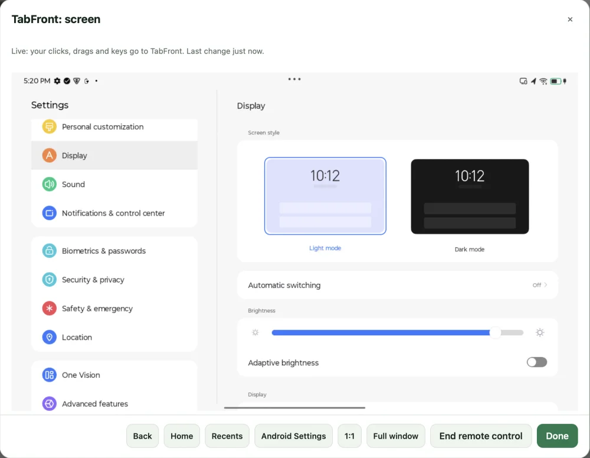</a>
<p>With droidVNC-NG on each tablet, you can see and use any tablet's screen from the Kiosk Satellites page, at home or away.</p>
</td>
<td width="25%" valign="top">
<h4><a href="docs/applets/firmware-server.md">Firmware server</a> <a href="docs/README.md#maturity"></a><!--gitproxy--></h4>
<a href="docs/applets/firmware-server.md">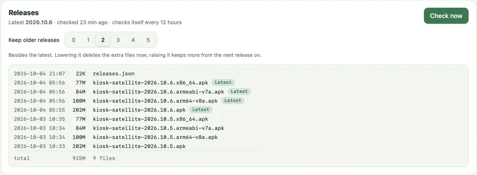</a>
<p>Mirrors Kiosk Satellite's releases and serves them to your tablets locally, so they can update without the internet.</p>
</td>
</tr>
<tr>
<td width="25%" valign="top">
<h4><a href="docs/applets/kiosk-mode.md">Kiosk mode</a> <a href="docs/README.md#maturity"></a><!--kiosk_mode--></h4>
<a href="docs/applets/kiosk-mode.md">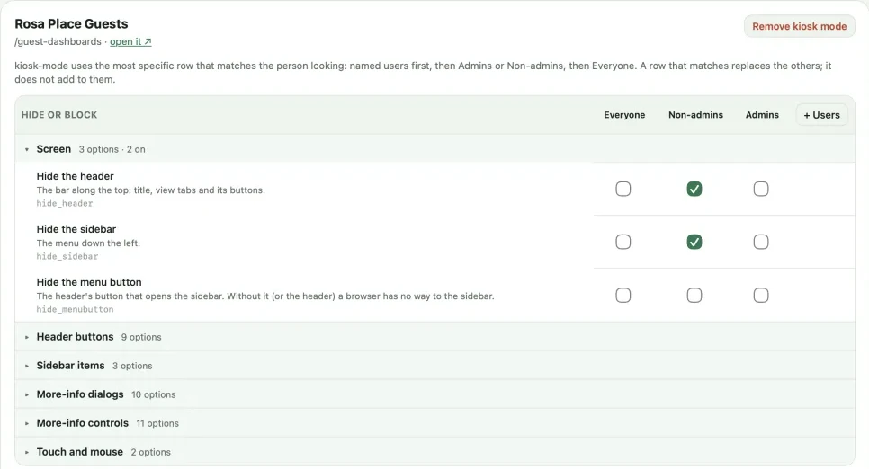</a>
<p>Choose what each dashboard hides (the header, the sidebar and more) and from whom, using kiosk-mode, without editing YAML.</p>
</td>
<td width="25%" valign="top">
<h4><a href="docs/applets/settings.md#dashboard-helpers">Dashboard helpers</a></h4>
<a href="docs/applets/settings.md#dashboard-helpers">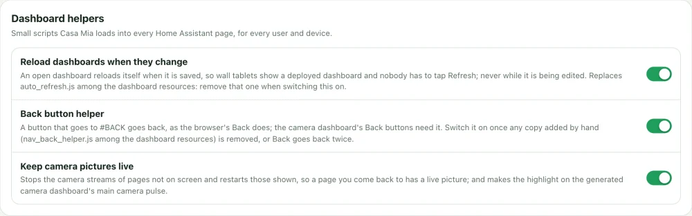</a>
<p>A <code>#BACK</code> button, dashboards that reload when they're saved, and camera pictures kept live. Each is a switch in Settings.</p>
</td>
<td width="25%" valign="top">
<h4><a href="docs/README.md#working-together">Pages that keep up</a></h4>
<a href="docs/README.md#working-together">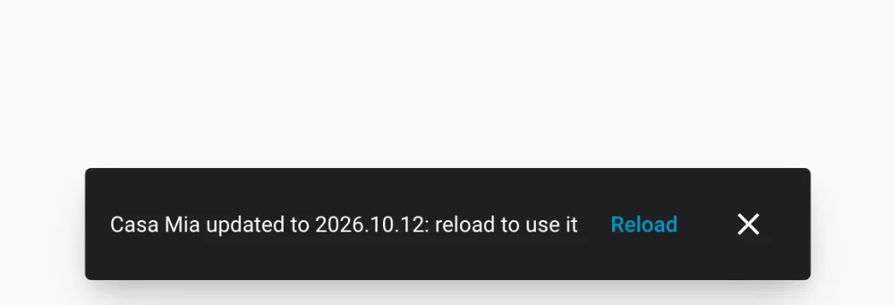</a>
<p>After an update, a page that's been open all along offers a Reload, and wall tablets reload by themselves.</p>
</td>
<td width="25%" valign="top">
<h4><a href="docs/applets/home.md">The Casa Mia panel</a></h4>
<a href="docs/applets/home.md">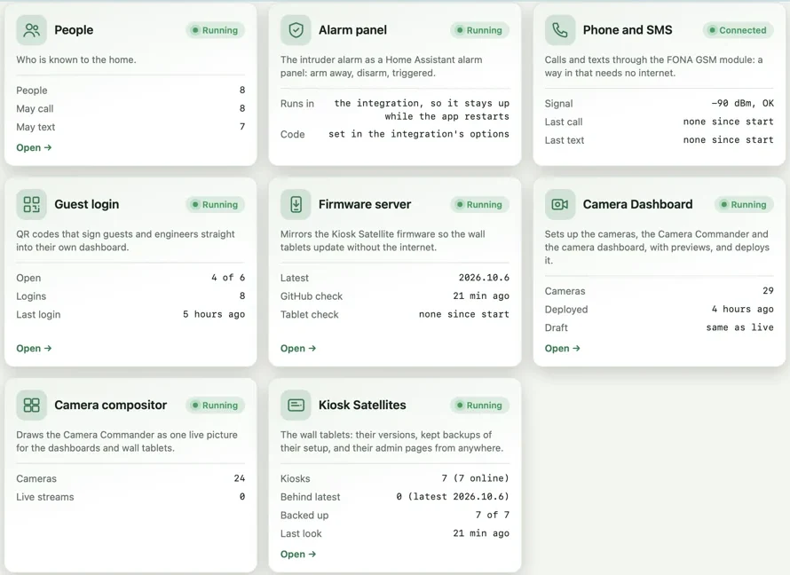</a>
<p>Casa Mia's page in Home Assistant's sidebar, with a tile per module showing whether it's working. It works wherever Home Assistant does.</p>
</td>
</tr>
<tr>
<td width="25%" valign="top">
<h4><a href="docs/applets/people.md">People</a> <a href="docs/README.md#maturity"></a><!--people--></h4>
<a href="docs/applets/people.md">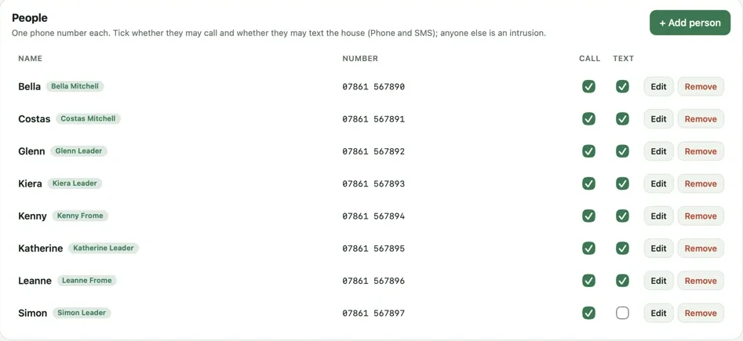</a>
<p>Who may call and text the house, and whose cars may open the gates, each linked to their Home Assistant person.</p>
</td>
<td width="25%" valign="top">
<h4><a href="docs/applets/phone-and-sms.md">Phone and SMS</a> <a href="docs/README.md#maturity"></a><!--fona--></h4>
<a href="docs/applets/phone-and-sms.md">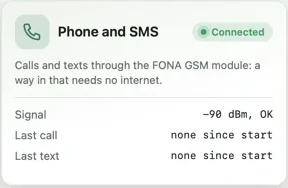</a>
<p>Call or text the house through a GSM board, so you can still get in when the internet is down. Built for my house; you probably don't need it.</p>
</td>
<td width="25%" valign="top">
<h4><a href="docs/applets/alarm-panel.md">Alarm panel</a> <a href="docs/README.md#maturity"></a><!--alarm--></h4>
<a href="docs/applets/alarm-panel.md">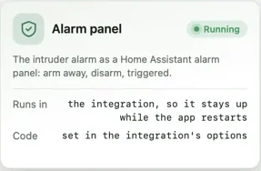</a>
<p>An intruder alarm as a Home Assistant alarm panel that refuses to work until it has a code. Built for my house; you probably don't need it.</p>
</td>
<td width="25%"></td>
</tr>
</table>

Each part's setup and options are in the [documentation](docs/README.md).

## Installation

You need **Home Assistant 2026.3 or later**, on Home Assistant OS or a Supervised install
(apps need the Supervisor), on a 64-bit machine (aarch64 or amd64).

1. **Add the repository.** The quick way is this button, which opens your Home Assistant with
   the repository filled in:

   [](https://my.home-assistant.io/redirect/supervisor_add_addon_repository/?repository_url=https%3A%2F%2Fgithub.com%2Fgazoodle%2Fcasa-mia)

   Or do it by hand: go to **Settings → Apps → App store**, open the **⋮** menu at the top
   right, choose **Repositories**, and add:

   ```text
   https://github.com/gazoodle/casa-mia
   ```

2. **Install the app.** Close the dialog, find **Casa Mia** in the store (refresh the page if
   it isn't there yet), open it and press **Install**. It downloads the ready-built app from
   the GitHub Container Registry, so there's nothing to compile.

3. **Choose your modules.** On the app's **Configuration** tab, give your house its name and
   switch on the modules you want (they all start off): Sensor Watch, guest login, Camera
   Commander and Auto Dashboards, Kiosk Satellites, the firmware server, phone and SMS
   (FONA), the alarm panel. Press **Save**. You can come back and change these at any time.

4. **Start it.** On the **Info** tab, switch on **Show in sidebar** and press **Start**.
   **Casa Mia** appears in the sidebar.

5. **Restart Home Assistant.** On its first start the app installs its integrations into your
   `custom_components` folder, and Home Assistant only loads it after a restart: **Settings →
   System → ⋮ → Restart Home Assistant**. A Repair tells you whenever an update needs another.

6. **Add the integration.** Go to **Settings → Devices & services → Add integration**, search
   for **Casa Mia**, and press **Submit**: it finds the app by itself. (If it doesn't, copy the
   **Integration URL** from the foot of the Casa Mia panel's home page and paste it in.)
   Guest login and Camera Commander each have an integration of their own, **Casa Mia Guest
   Login** and **Casa Mia Camera Commander**: while the module is on, Casa Mia offers it
   under **Discovered** on the same page. Press **Add**.

7. **Make yourself at home.** Open **Casa Mia** from the sidebar and visit each module's page
   to set it up. Its devices and entities appear in Home Assistant as you go.

Updates arrive like any other app's: Home Assistant offers them under **Settings → Updates**,
and the integrations are updated along with the app.

**Leaning on Home Assistant's frontend.** Some parts reach into Home Assistant's own pages
where there is no public API for it, as many community cards do: the Tablet Layout,
garnish, the Over layer, Sensor Watch's eye in an entity's dialog and its Status
sensor's colour. A Home Assistant update can change what they lean on. If it does, that
part says so in the browser's console and stays out of the way, and a Casa Mia update
follows.

## Thanks

- [Thomas Lovén (thomasloven)](https://github.com/thomasloven), for [card-mod](https://github.com/thomasloven/lovelace-card-mod),
  [browser_mod](https://github.com/thomasloven/hass-browser_mod) and layout-card, which showed
  how far Home Assistant's frontend can be pushed, and inspired the Over layer.
- [Erik Lemcke](https://www.tindie.com/products/ErikLemcke/salt-sentry-water-softener-monitor/), for the Salt Sentry,
  the little laser-ranging gadget that tells Home Assistant how much salt is left in the
  water softener, and the example that gave Sensor Watch its **task** level.
- [Xavier Larrea (jxlarrea)](https://github.com/jxlarrea), for [Kiosk Satellite](https://kiosksatellite.com),
  and for adding the custom update source that made the firmware server possible.
- [Nathan Orick (cnorick)](https://github.com/cnorick), for [ha-auto-guest-login](https://github.com/cnorick/ha-auto-guest-login),
  which guest login grew out of.
- [Dermot Duffy (dermotduffy)](https://github.com/dermotduffy), for the [Advanced Camera Card](https://github.com/dermotduffy/advanced-camera-card),
  which the camera dashboards are built on.
- [NemesisRE](https://github.com/NemesisRE), for [kiosk-mode](https://github.com/NemesisRE/kiosk-mode),
  which the Kiosk mode page sets up for you.
- [slipx06](https://github.com/slipx06), for the [Sunsynk Power Flow Card](https://github.com/slipx06/sunsynk-power-flow-card),
  whose live diagram of an inverter's flows inspired the Heating Flow card.
- [Franck Nijhof (frenck)](https://github.com/frenck), for [Spook](https://spook.boo), a
  toolkit of the bits Home Assistant doesn't ship, and the idea that Casa Mia could be one too.
- [Adafruit](https://www.adafruit.com), for the FONA GSM board and its Arduino library, the
  heart of the phone and SMS line.
- The [Home Assistant](https://www.home-assistant.io) project and its community, for the
  platform all of this plugs into.

## Licence

[MIT](LICENSE). © 2026 Gazoodle.

## Footnote

🦶 🎵
