<h1 align="center">
<picture>
<source media="(prefers-color-scheme: dark)" srcset="integration/custom_components/casa_mia/brand/dark_logo@2x.png">
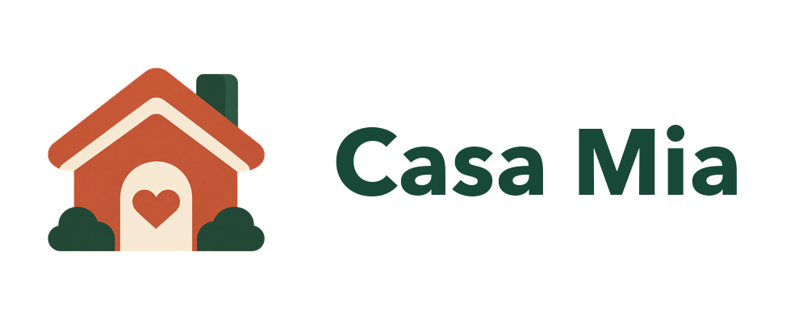
</picture>
</h1>

<p align="center"><strong><em>Make yourself at home, assistant!</em></strong></p>

<p align="center">
A Home Assistant app and integration that take your home from smart to spectacular.<br>
Dazzling home pages for every wall tablet.<br>
Alarm set? Every tablet becomes a window you can look through but not touch.<br>
Every sensor in the house watched, and you told only when it matters.<br>
Guests signed in with a single scan.<br>
Camera dashboards MI5 would envy, snappy on the humblest tablet.<br>
Every Kiosk Satellite managed from one place, and at your fingertips wherever you are.<br>
Secure phone and SMS access to your home, even when the internet has left the building.<br>
And that's just <a href="#what-does-the-future-hold">the start</a>.
</p>

<p align="center">

<a href="https://github.com/gazoodle/casa-mia/pkgs/container/casa-mia-amd64"></a>
<a href="https://github.com/gazoodle/casa-mia/releases/latest"></a>
<a href="https://github.com/gazoodle/casa-mia/actions/workflows/release.yml"></a>
<a href="#licence"></a>
</p>

<p align="center">
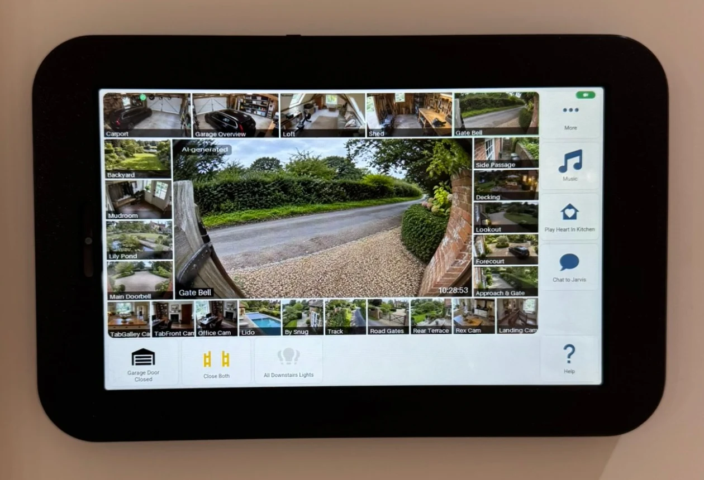<br>
<em>A wall tablet, live (in screenshot mode, so the camera pictures are AI-generated stand-ins)</em>
</p>

<p align="center"><strong>Free and open source, MIT licensed. Forever.</strong><br>
No premium tier, no subscription, no catch. <a href="#licence">Here's the promise.</a></p>

<p align="center"><a href="docs/README.md"><strong>📖 Documentation</strong></a> · <a href="docs/tablet-layout.md">Tablet Layout</a> · <a href="#working-together">Working together</a> · <a href="#installation">Installation</a></p>

## What is it?

In order of how likely you are to want it, each with how far along it is
([the levels](docs/README.md#maturity)):

* <a href="docs/README.md#maturity"></a><!--tablet_layout--> **[Tablet Layout](#tablet-layout):** Home Assistant's Sections view, locked to the screen: no scrolling, ever, and panels that make room as cards come and go.
* <a href="docs/README.md#maturity"></a><!--garnish--> **[Garnish](#garnish-for-every-dashboard):** a heading that no longer keeps an empty section showing, on every Sections dashboard.
* <a href="docs/README.md#maturity"></a><!--over_layer--> **[The Over layer](#the-over-layer):** one card over the whole dashboard while its conditions hold; everything beneath seen, not touched.
* <a href="docs/README.md#maturity"></a><!--sensor_watch--> **[Sensor Watch](#sensor-watch):** a level for every sensor in the house, set up a whole class of things at a time, and you told only when one changes.
* <a href="docs/README.md#maturity"></a><!--guest_login--> **[Guest login](#guest-login):** a QR scan signs a guest into their own dashboard, no password typed.
* <a href="docs/README.md#maturity"></a><!--commander--> **[Camera Commander](#camera-commander):** every camera in one live picture, drawn in the app by the <a href="docs/README.md#maturity"></a><!--compositor--> [compositor](#camera-compositor), so a low-power tablet plays one stream instead of a dozen.
* <a href="docs/README.md#maturity"></a><!--kiosks--> **[Kiosk Satellites](#kiosk-satellite)** and <a href="docs/README.md#maturity"></a><!--gitproxy--> **[their firmware server](#kiosk-satellite):** every wall tablet's version, backups and control page in one place, and updates without the internet.
* <a href="docs/README.md#maturity"></a><!--kiosk_mode--> **[Kiosk mode](#kiosk-mode):** what each dashboard hides (the header, the sidebar and more), and from whom, without touching YAML.
* **[Built for my house](#built-for-my-house):** an <a href="docs/README.md#maturity"></a><!--alarm--> [alarm panel](#alarm-panel) and <a href="docs/README.md#maturity"></a><!--fona--> [phone and SMS access](#phone-and-sms-fona) through a GSM board. You almost certainly don't need them, and they're off unless you switch them on.

## Your house, at a glance

<p align="center">
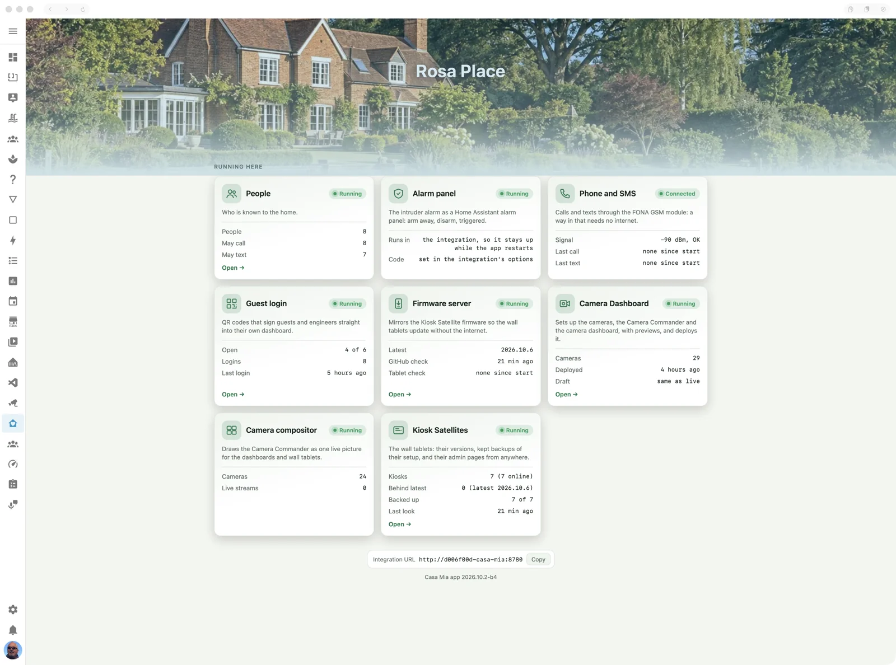
</p>

Everything lives in one panel in Home Assistant's sidebar: your own house across the top,
then a tile for every module with its vital signs, so one look tells you the whole place is
humming. It's served through ingress, so it's there wherever Home Assistant is: on the sofa,
at the office, or on a beach on the other side of the world. No ports to open, no extra
logins, no VPN.

## Tablet Layout

<a href="docs/README.md#maturity"></a><!--tablet_layout-->

A wall tablet should show its dashboard the way a picture frame shows a picture: all of it,
edge to edge, nothing hanging off the bottom, and no scrolling. Ever. Home Assistant's views
are built for scrolling, so getting one to *just* fit a tablet meant an evening of CSS
tweaks ... and then a conditional card popped up, the page scrolled again, and the evening
started over. And don't even get me started on using stack cards in section views ...

The Tablet Layout is a new view type that ends all that. It *is* Home Assistant's own
Sections view, so every card, editor, visibility condition and badge works as it always has,
but its sections become panels round a main area, locked to the screen. A bigger screen, a
smaller screen, portrait, landscape: it fits. A card shows or hides: the panels make room,
or close up, by themselves.

<table>
<tr>
<td width="50%" valign="top">
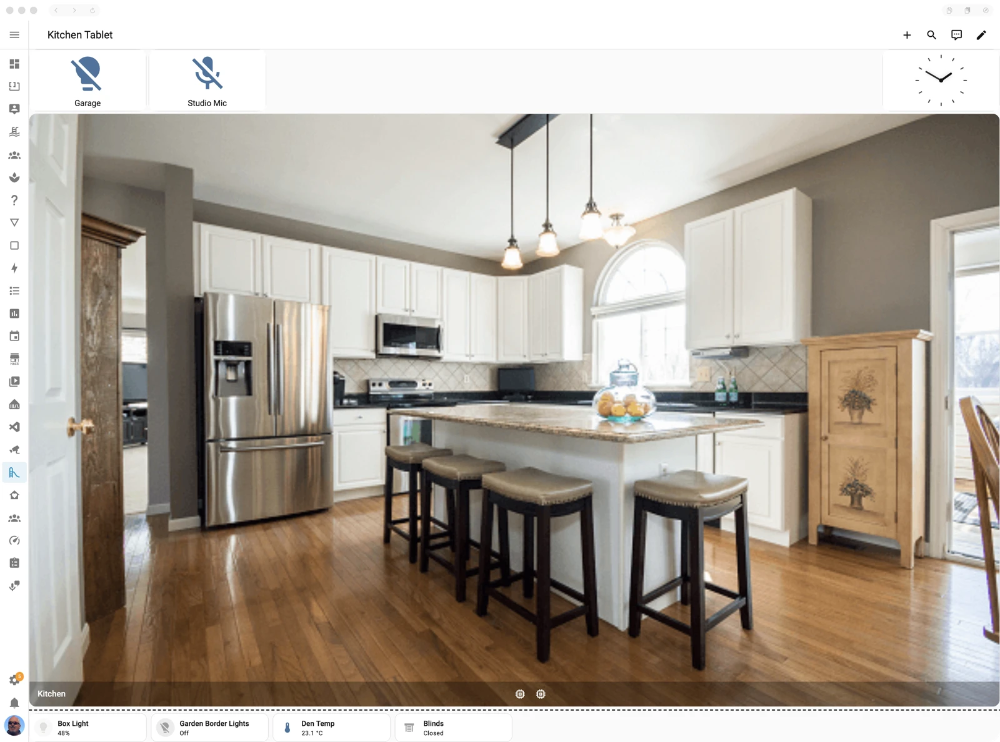
<h3>Fits the screen, exactly</h3>
Buttons across the top, the clock held to the right, a picture filling the middle, tiles along the bottom. Every pixel of the screen used, and not one more.
</td>
<td width="50%" valign="top">
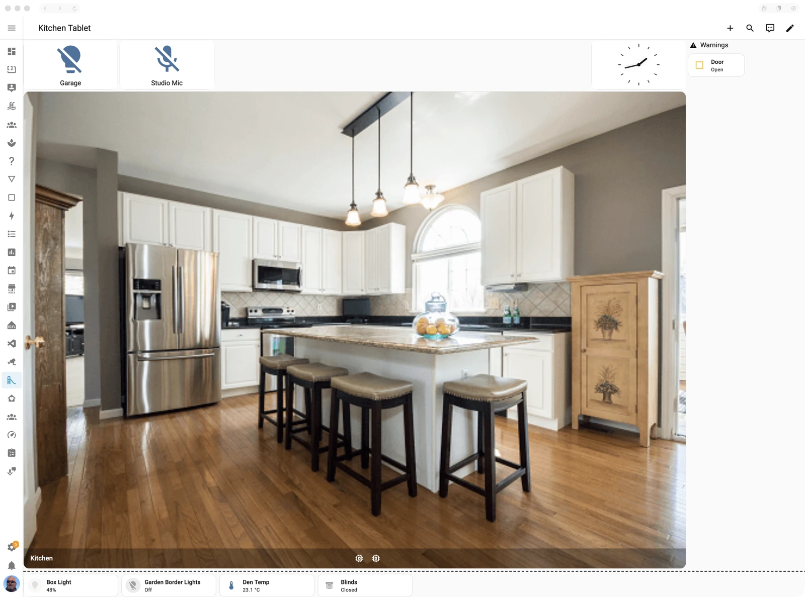
<h3>Panels that come and go</h3>
A door left open? A Warnings panel slides in at the side and everything else makes room. Close the door and it's gone, no gap left behind. Just Home Assistant's own visibility conditions, nothing new to learn.
</td>
</tr>
<tr>
<td width="50%" valign="top">
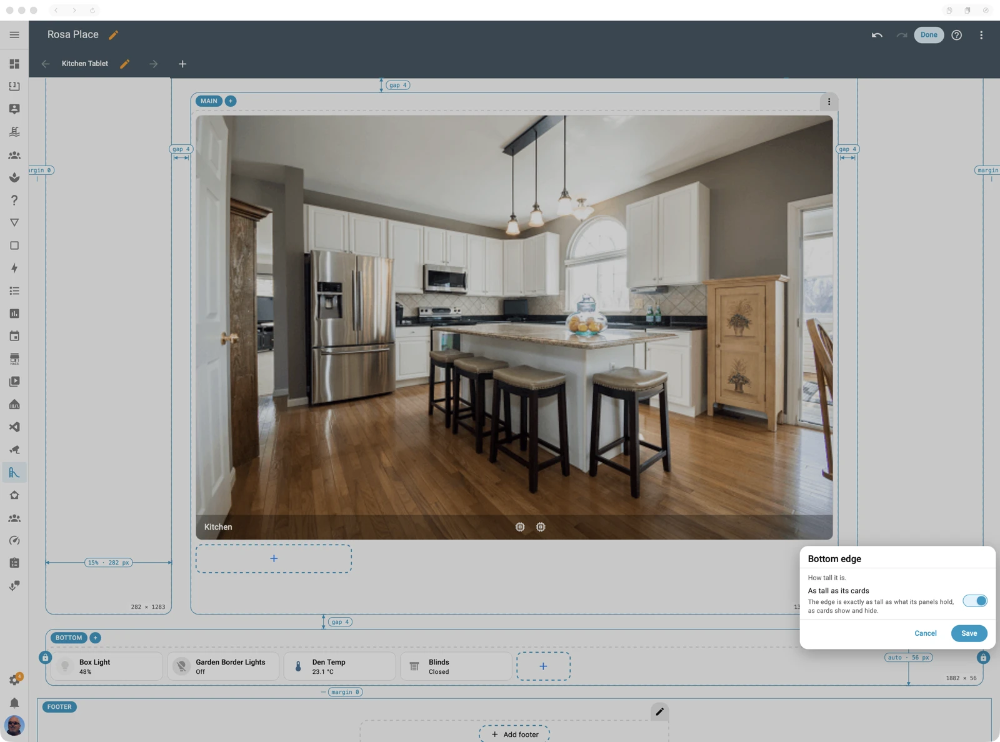
<h3>Edit it like a drawing</h3>
In edit mode the layout is a technical drawing: every panel, gap, margin and size, measured. Click any of them to change it, and watch the view change as you do.
</td>
<td width="50%" valign="top">
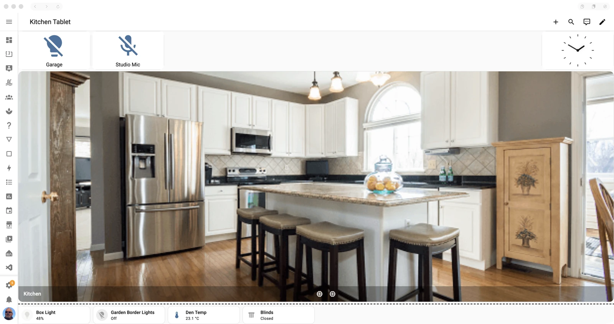
<h3>Any screen, no changes</h3>
The very same view in a wide desktop window, or on a tablet held upright. Nothing to set per screen: it simply fits.
</td>
</tr>
</table>

Panels in stacks, layers inside layers, gaps with lines in them, edges that hug their cards:
[the Tablet Layout guide](docs/tablet-layout.md) has the lot.

## Garnish, for every dashboard

<a href="docs/README.md#maturity"></a><!--garnish-->

Home Assistant quietly does something clever: when every card in a section is hidden, the
section goes too, and the rest of the dashboard closes up. So a section of warnings, each
card visible only while it has something to say, simply isn't there on a quiet day. Lovely,
until you give that section a heading. Now the heading is always showing, so the section
always shows: a proud **WARNINGS** with nothing under it, every hour of every day.

Garnish fixes that. Mark the heading (or any card that only dresses a section) as garnish,
with one tap on the sprig in its corner in edit mode, and it no longer keeps its section
showing. The warnings come, the heading comes with them; they go, and the whole section
goes, gap and all. One switch on Casa Mia's Settings page, **Enable garnish on all section
dashboards**, and it works on every Sections dashboard you have, not just Casa Mia's Tablet
Layout, where it was born.

<p align="center">
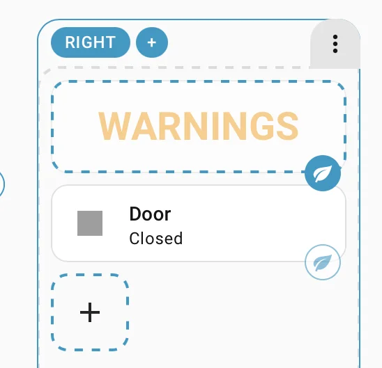
</p>

It's the kind of small thing that makes a dashboard feel like it knows what it's doing.

## The Over layer

<a href="docs/README.md#maturity"></a><!--over_layer-->

The alarm is set. The wall tablet in the hall still shows the house as it always does,
lights, heating, cameras, but every tap goes nowhere, and in the middle, the alarm's disarm
panel waits for its code. Disarm it, and the tablet is a tablet again.

That's the Over layer: one card of your choosing, floating over the whole dashboard while
its Visibility conditions hold, its backdrop dimming or blurring what's beneath, and taking
every tap, so the dashboard can be seen, not touched. A visiting engineer gets a look at
everything and a hand on nothing. A cover keeps little fingers off at night. A warning
floats up until it's dealt with. It's an ordinary card: Home Assistant's own conditions say
when, its own card picker says what, and while you edit the dashboard it sits in its place
like any other. Or it can lift a whole panel: a section of warnings, headings and all,
floating over the dashboard in one piece.

And the way out is for admins alone. There's no magic word in the address; instead, over the
whole window, a small lid pulses gently over Home Assistant's own edit button, and only an
admin gets it. Everyone else gets the wall. [The guide](docs/over-layer.md).

## Sensor Watch

<a href="docs/README.md#maturity"></a><!--sensor_watch-->

Home Assistant knows the state of everything and the health of almost nothing. Is 198 V
on that plug fine? Is the freezer at −12 °C a problem? Has that bulb been unavailable
since the spring? It will show you the number, cheerfully, forever, and you find out when
the ice cream is soup.

Sensor Watch gives everything a level: **nominal**, a **task** (top up the softener's salt, as Erik Lemcke's
[Salt Sentry](https://www.tindie.com/products/ErikLemcke/salt-sentry-water-softener-monitor/) measures it), a
**warning**, an **error**, **critical**, and says so only when one changes, in its own
words. The trick is saying it once, not fifty times:

- **Groups for whole classes of thing.** Every Shelly plug's voltage, every leak sensor,
  every Hue light: a saved filter and a profile. Everything matching is watched, and the
  plug you put in next month joins by itself. More than two of the same kind is a group;
  a single thing is a watch.
- **A library of 85 profiles,** each saying where its numbers come from: mains voltage
  and frequency for the UK (today's law and the ENA's 2026 proposal), the US, the EU,
  Japan, China and Australia; inverter trip limits; batteries, broadband, pool and hot tub
  chemistry, indoor air, freezers, the boiler, the garden, computers; and reminders coming
  due, read as days until the date (a hot tub's Rinse filter, from the
  [Gecko integration](https://github.com/gazoodle/gecko-home-assistant)).
- **Watches for the one-offs,** with bands suggested from each sensor's own history: a
  number by bands, on/off, exact states, an attribute (a thermostat's temperature, not
  its mode), or just "is it there?", either way round.
- **Home Assistant itself:** the Recorder, History, and every integration that fails to
  set up.
- **From any entity:** an eye in its own Home Assistant dialog says whether it's watched
  and how it is; a tap opens its watch, or starts one.
- **Told once, properly:** a blueprint sends it to your phone at the level you choose or
  worse, colour-coded, and clears it when it's sorted; a card shows what needs looking at
  and vanishes on a quiet day; an event and a service for everything else.

<table>
<tr>
<td width="50%" valign="top">

<h3>Only what needs looking at</h3>
The card on the kitchen tablet: worst first, each in its own words, its value live. On a quiet day it isn't there at all.
</td>
<td width="50%" valign="top">

<h3>Everything watched, in one place</h3>
Every watch with its level, grouped, filtered with chips; groups take in whole classes of thing, and new ones join by themselves.
</td>
</tr>
</table>

Half an hour, and the house has plant-level monitoring. I tripped a breaker to test it,
and a dozen lights turned up on the wall tablet, each saying where it was.
([The guide](docs/applets/sensor-watch.md))

## Guest login

<a href="docs/README.md#maturity"></a><!--guest_login-->

QR codes that sign a guest straight into their own dashboard, no password typing on a
stranger's phone. This started life as [ha-auto-guest-login](https://github.com/cnorick/ha-auto-guest-login)
by [Nathan Orick](https://github.com/cnorick), which I used for years (thank you!). Casa Mia's
version keeps the idea and adds:

- **A switch for every code.** Each QR code is an endpoint you can open and close from
  Home Assistant, so an automation can open it when guests arrive and close it when they
  leave.
- **Codes for everyone.** Family, friends, the engineer who needs the heating dashboard:
  each code chooses which login a visitor gets and which dashboard they land on.
- **A proper welcome.** While they're signed in, guests see your house and a welcome, not a
  login screen; preview it on a phone, a small phone or a tablet first.
- **Locked down as far as Home Assistant allows.** Closing a code can sign its visitors
  out, a code can ask for a passcode you send with the booking, an engineer's code can get
  a new address after every visit or ask for a two-factor code, and a check shows what each
  login can reach and what's left open, with a button to fix it.
- **A sign-in log** of every scan and what came of it, kept by the app across restarts.
- **House rules**, shown before guests sign in, and a **goodbye** when they're signed out.
- **A guest card to print:** join the Wi-Fi, then scan to sign in, side by side.
- **A QR code card for the dashboard:** a code on the wall tablet, shown while its endpoint
  is open, or any page's code for a directory of your own. With an Over layer and the
  endpoint's Waiting for first login sensor, the tablets stay covered until the guest's
  first scan.
- **A nicer front end**, all in the Casa Mia panel.
- **Your old cards still work.** If you've already printed QR cards for
  ha-auto-guest-login, tick **Legacy QR code** and they keep working.

<table>
<tr>
<td width="50%" valign="top">
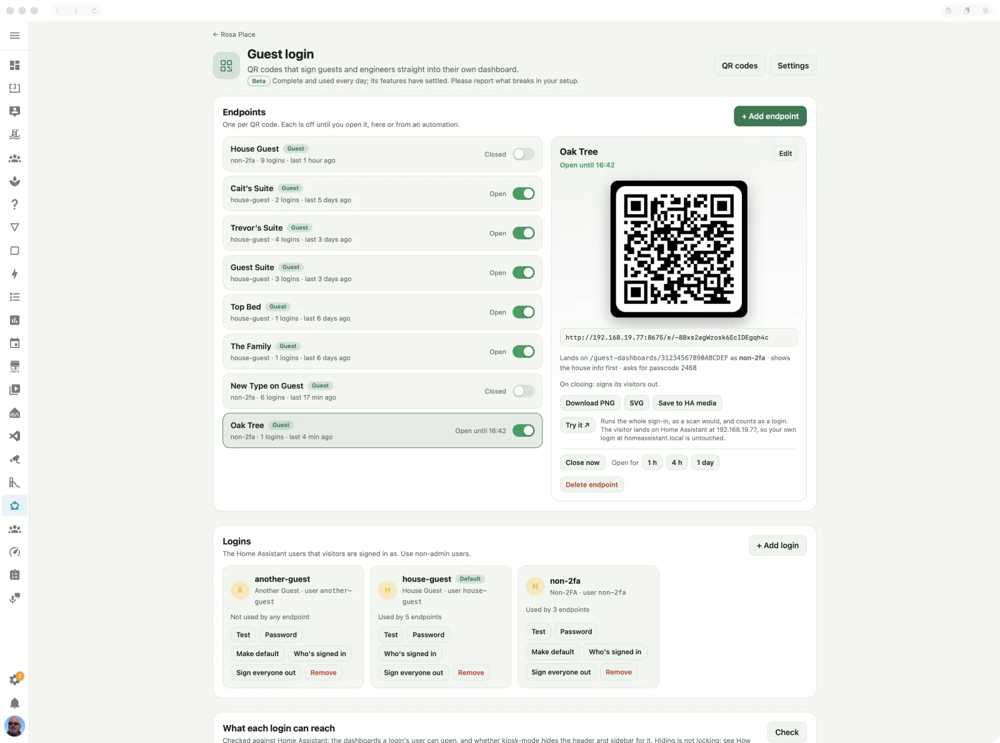
<h3>Guests, signed in with a scan</h3>
One QR code per kind of visitor, each with its switch. Guests scan it and land on their own dashboard: no app, no password, no fuss.
</td>
<td width="50%" valign="top">
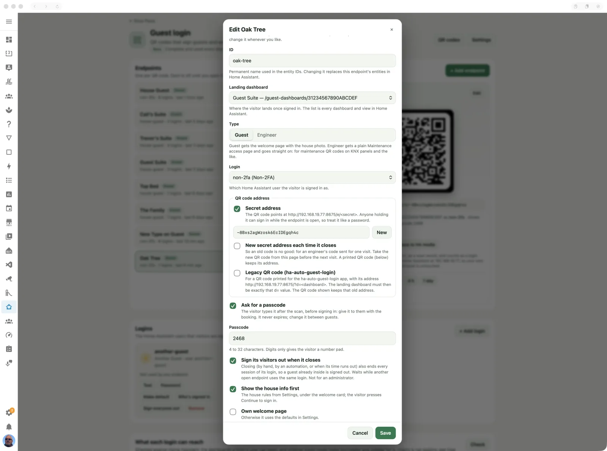
<h3>A code for every visitor</h3>
Each code's login, landing dashboard and secret address, and how tight it is: a passcode, its visitors signed out when it closes, your house rules first.
</td>
</tr>
<tr>
<td width="50%" valign="top">
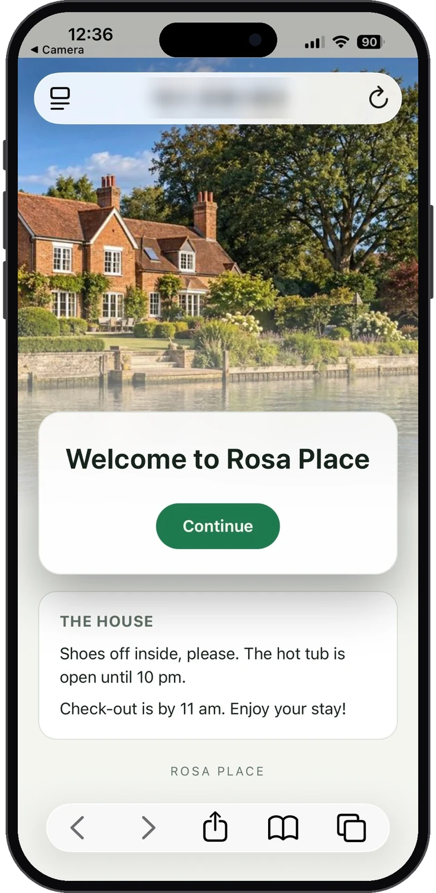
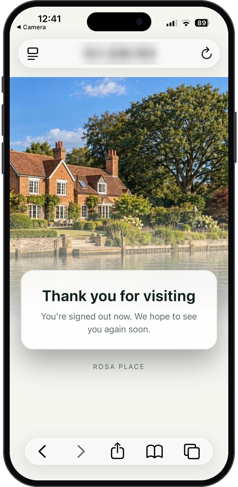
<h3>A proper welcome, and a goodbye</h3>
Your house, a warm welcome and your house rules as they arrive; a thank-you when their stay ends and they're signed out.
</td>
<td width="50%" valign="top">
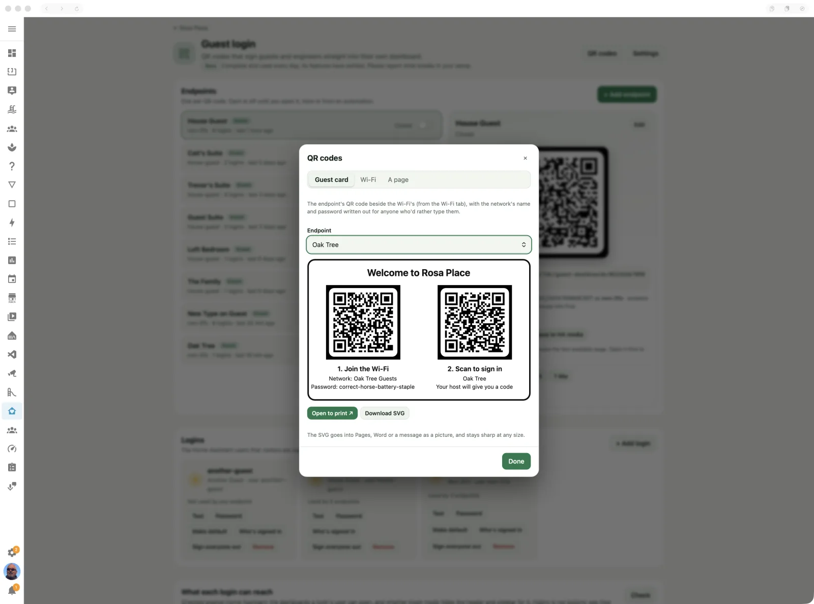
<h3>A card for the room</h3>
Join the Wi-Fi, then scan to sign in: one card to print or send, and a sign-in log of everyone who did.
</td>
</tr>
</table>

## Camera commander

<a href="docs/README.md#maturity"></a><!--commander-->

What I wanted was simple to say and surprisingly hard to get: a home page on the wall
tablets that looks great, shows the cameras I choose, laid out how I like, and responds the
moment you touch it. Not a grid of spinners, not a tablet that lags behind every tap, not
an afternoon of YAML every time a camera is added. Quick, good-looking, and configurable.

Every camera in the house in one live picture: a big main camera framed by all the others.
Tap a tile and it's on the big screen; tap the big screen and it plays live. You design it
in the Casa Mia panel, and Save puts it on every wall tablet at once. And this is only the
beginning: there's plenty more to come on this feature.

<table>
<tr>
<td width="50%" valign="top">
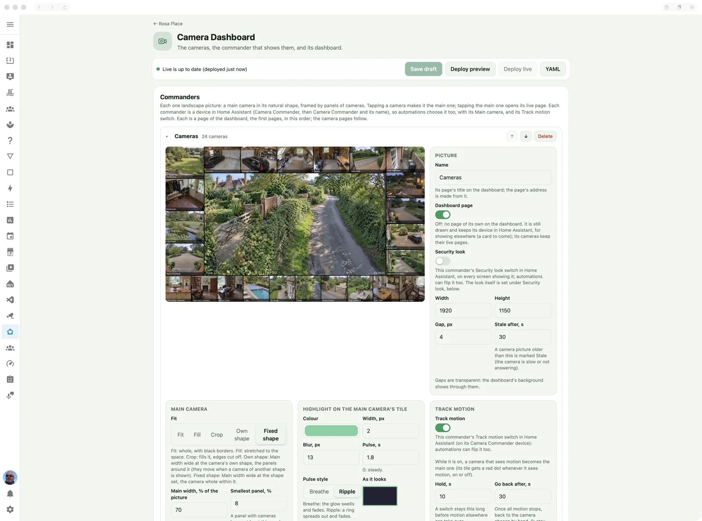
<h3>Design your control room</h3>
Lay out a commander in the Casa Mia panel: which cameras go where, how big the main one is, the highlight on its tile and the motion tracking. Its preview follows every change; Save puts it live.
</td>
<td width="50%" valign="top">
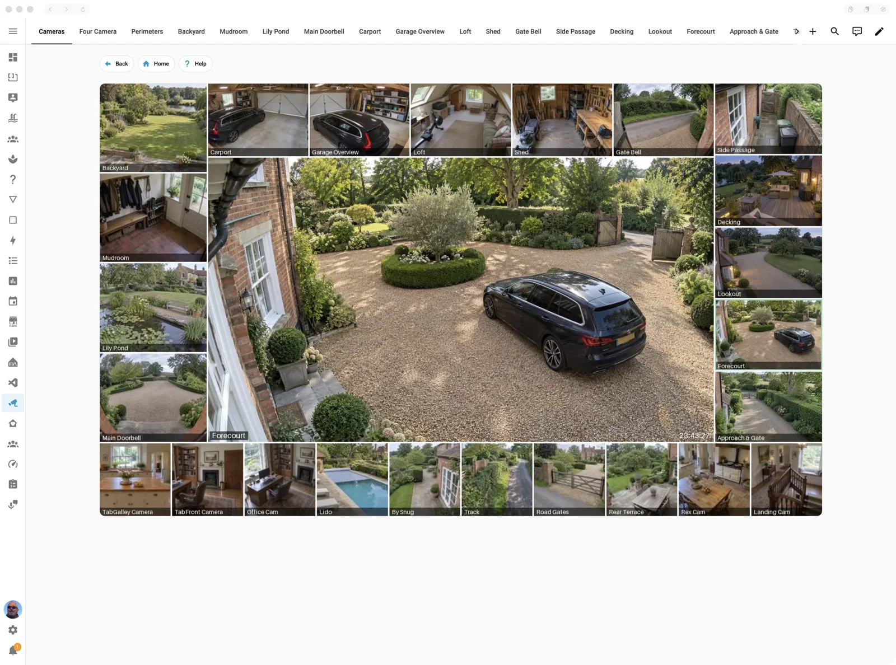
<h3>On your dashboard</h3>
The commander on a Home Assistant dashboard: every camera in one picture, and only one stream for the tablet to play, so even a modest wall tablet stays snappy.
</td>
</tr>
<tr>
<td width="50%" valign="top">
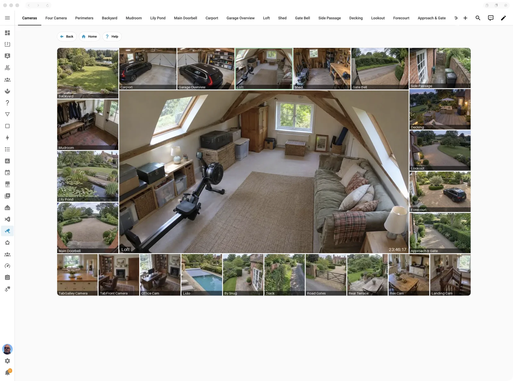
<h3>Tap, and it's on the big screen</h3>
Tap any tile and it becomes the main camera, in a moment. Switch on Track motion and the commander does it for you, following whatever moves around your home; a pulsing dot marks each camera seeing motion.
</td>
<td width="50%" valign="top">
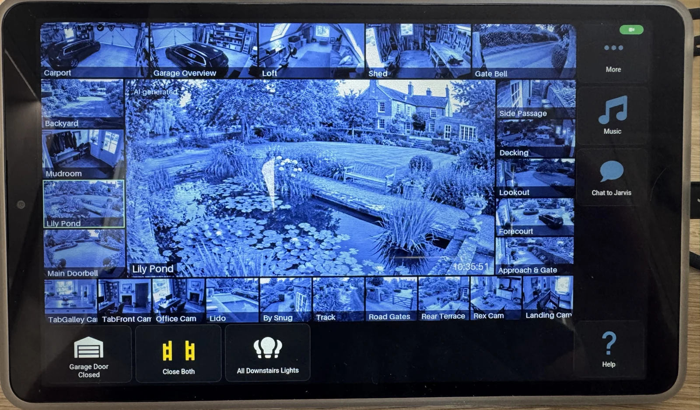
<h3>You want to feel like you work for MI5!</h3>
Switch on the Camera Commander card's Security look and every camera takes on the cool blue of a government control room, or any tint you choose. Here on a test tablet, in Home Assistant's dark theme. Coming next: switching it by a template, so it follows the night, the alarm, or just because.
</td>
</tr>
</table>

### Camera compositor

<a href="docs/README.md#maturity"></a><!--compositor-->

The engine behind the camera commander. The [Advanced Camera Card](https://github.com/dermotduffy/advanced-camera-card)
is great, and it's still what plays a camera's own live page. But ask one of my poor
low-power wall tablets to play a dozen camera streams at once and it struggles; then the
streams struggle; then the tablet stops responding altogether. No one in the house likes
this.

So the compositor does the heavy lifting in the app instead. It gathers a picture from every
camera through Home Assistant, tiles them into one composite, and serves that as a single
stream: each commander is one stream for the tablet to play, however many cameras are in it.
The commander on the dashboard is just that picture with tap zones over it, and choosing the
main camera is a Home Assistant select, so a tap (or an automation) only asks the app to draw
the next picture differently. Nothing new has to start on the tablet, so the update is
quick, and those not-so-powerful tablets stay nice and snappy.

There's much more to come on this one.

## Building on others' work

Some of the best things in my house are other people's work. These parts don't replace
them; they make them easier to live with.

### Kiosk Satellite

<a href="docs/README.md#maturity"></a><!--kiosks--> <a href="docs/README.md#maturity"></a><!--gitproxy-->

<a href="https://kiosksatellite.com"></a>

[Kiosk Satellite](https://kiosksatellite.com) is [Xavier Larrea](https://github.com/jxlarrea)'s
wonderful app for putting Home Assistant on wall tablets ([source on GitHub](https://github.com/jxlarrea/kiosk-satellite)).
I've got a bunch of tablets around the house and it is, by far, the best way to run them.
Casa Mia looks after them for you. Kiosk Satellite and its logo are Xavier's (licensed
[CC BY-NC-ND 4.0](https://creativecommons.org/licenses/by-nc-nd/4.0/)); Casa Mia is a
separate project, not affiliated with it, and doesn't include any of it.

<br clear="left">

My tablets came with a bunch of nonsense pre-installed, so I deleted that, then had to put
them on a LAN with no internet access so they didn't download it all again ... but then they
couldn't update Kiosk Satellite. Xavier kindly added a custom update source, so Casa Mia
mirrors his releases and serves them to the tablets locally. Painless now.

Remembering to download each tablet's settings after I'd changed them was the one thing I
thought I could automate ... I was right. Casa Mia finds every tablet, keeps its settings
whenever they change, and Home Assistant's backups take them along. It also opens each
tablet's own control page through Home Assistant, so you can look after your wall tablets
when you're not at home. Nice!

<table>
<tr>
<td width="50%" valign="top">
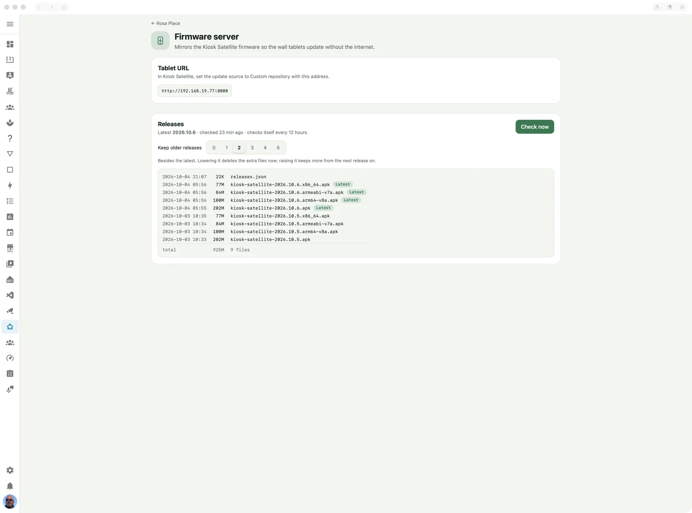
<h3>Firmware, on tap</h3>
Every Kiosk Satellite release, fetched and served to your tablets on your own network. They update themselves, and never need the internet.
</td>
<td width="50%" valign="top">
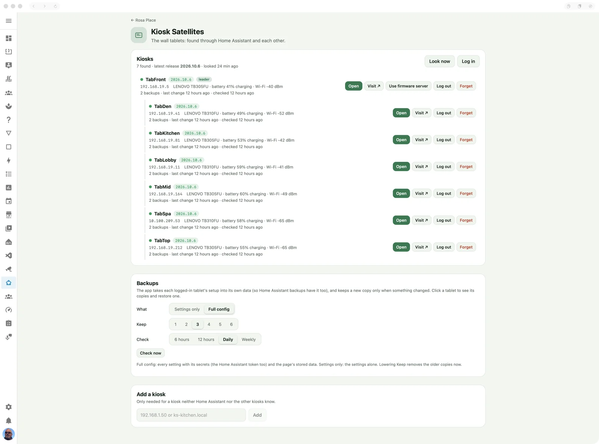
<h3>Every tablet, one page</h3>
Every Kiosk Satellite in the house, found by itself: its version, battery, Wi-Fi and last backup. Bring any of them up to date with a single press.
</td>
</tr>
<tr>
<td width="50%" valign="top">
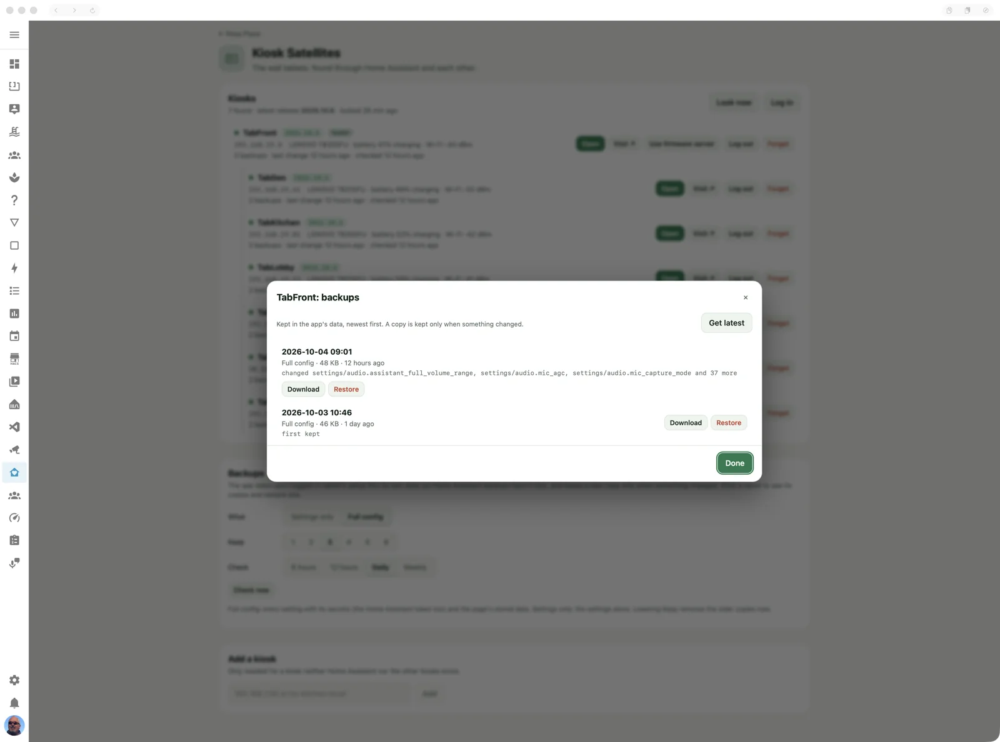
<h3>Backups that tell you what changed</h3>
Each tablet's settings are kept whenever they change, and every backup says exactly what changed. Fiddled with something and regretted it? Restore it in one click.
</td>
<td width="50%" valign="top">
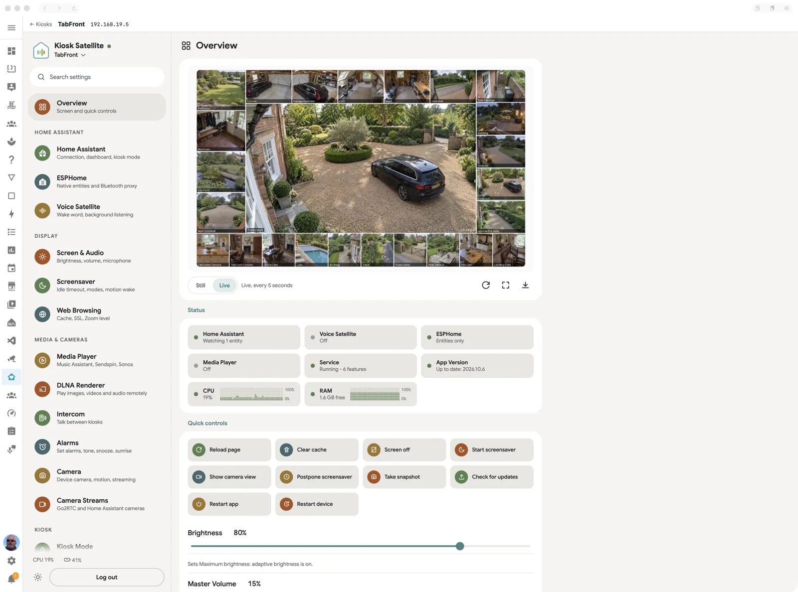
<h3>Your tablet, from anywhere</h3>
Any tablet's own Kiosk Satellite control page, straight through Home Assistant: its screen, its status, its quick controls and every setting. From your kitchen, or from another continent.
</td>
</tr>
</table>

### Kiosk mode

<a href="docs/README.md#maturity"></a><!--kiosk_mode-->

[kiosk-mode](https://github.com/NemesisRE/kiosk-mode) hides Home Assistant's header,
sidebar, menus and more, so a wall tablet or a guest's dashboard shows only its controls.
It's set in each dashboard's YAML; Casa Mia gives you a grid instead: tick what's hidden
for everyone, for admins or non-admins, or for people by name, dashboard by dashboard.
Install kiosk-mode yourself (it's in HACS); Casa Mia doesn't include it.
([The guide](docs/applets/kiosk-mode.md))

<p align="center">
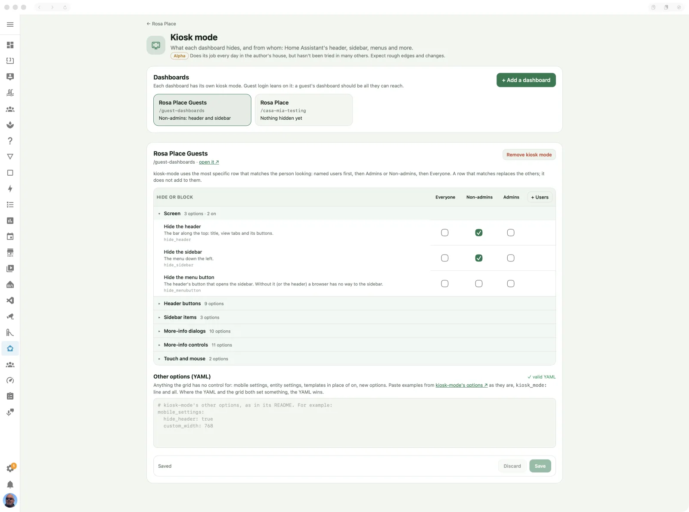
</p>

## Dashboard helpers

A few small scripts Casa Mia can load into Home Assistant's frontend for you. Each one has
its own switch on the Casa Mia panel's Settings page (the cog by the house photo).

- **Back button (`#BACK`).** A dashboard button that navigates to `#BACK` goes back, like
  the browser's own Back. The camera dashboard's Back buttons use it.
- **Reload dashboards when they change.** A wall tablet shows a newly deployed dashboard
  without anyone touching it. It holds off while you're editing: some time ago, if you were
  editing in several places and something tweaked the dashboard elsewhere, the frontend
  reloaded and your edits were lost. Home Assistant may well have fixed that since, but this
  is careful either way.
- **Keep camera pictures live.** Stops the camera streams of pages that aren't on screen and
  restarts the ones that are, so a page you come back to has a live picture.

## Working together

Each module works on its own, but they all live in one app and one integration, so they
know about each other, and that shared knowledge lets the whole do things no single piece
could.

- **Pages that keep up with updates.** After an update, a page that was open all along is
  still running the old cards, so a new feature looks missing until someone thinks to
  refresh. The integration knows which cards it now serves, and every page checks after
  Home Assistant restarts: an out-of-date one offers a **Reload** in Home Assistant's own
  toast.
- **Wall tablets that reload themselves.** Nobody is there to press Reload on a wall
  tablet, so when Home Assistant starts serving new cards, the Kiosk Satellites module asks
  every tablet it looks after to reload.
- **The camera compositor knows its viewers.** On the Camera compositor page, each stream
  sent to a wall tablet shows the tablet's name from Kiosk Satellites beside its address,
  so a slow or stuck one is easy to place.
- **What needs attention, and only then.** Sensor Watch's status, counts and problem sensor
  drive a panel of what needs doing on a Tablet Layout edge; [garnish](#garnish-for-every-dashboard)
  keeps the panel's heading from holding it open, so on a quiet day the panel isn't there
  at all, and the rest of the screen closes up. A critical can come up over everything with
  the Over layer, and the Home tile shows the house's health at a glance.

Coming next:

- **Who's looking:** the integration knows each page's logged-in user, so the panels can say
  who and where.
- **Guests who say who they are:** an identify-yourself page with a PIN, so the house knows
  which guest is in.

## Built for my house

These exist because my house needs them. You almost certainly don't: they're off unless
you switch them on, and you'll never know they're there. But they're mine, I use them
every day, and here they are.

### Alarm panel

<a href="docs/README.md#maturity"></a><!--alarm-->

I've got a KNX system with a couple of sensors and switches, but I wanted a nice alarm panel
with a code; you'd think that would be easy ... it's really not. My first go fell back to a
default code if you hadn't set one, silently ignored a wrong code, and (my favourite) arming
it while it was going off pressed the toggle, which disarmed it. This one refuses to do
anything until you've set a code, tells you when the code is wrong, and leaves a triggered
alarm well alone. It lives in the integration, so it keeps working while the app restarts.

### Phone and SMS (FONA)

<a href="docs/README.md#maturity"></a><!--fona-->

This one's a bit esoteric. What happens when the internet goes down and you're on the wrong
side of the gate? An Arduino with an Adafruit FONA GSM board on the end of a USB cable,
that's what. Ring the house or text it, and if your number is on the list, Home Assistant
gets an "authorised" event and your automations do the rest (mine open the gates). Anyone
else is an intrusion, which you can also do something about. Text it PING and every layer
answers PONG, so you can tell exactly where things stopped working, and Home Assistant can
text back through it too. It has to be bulletproof, so it copes with the Arduino resetting,
the USB port moving and the line dropping, and it says so in the log when it does. Build
details (the Arduino sketch and how I built mine) are on their way into this repo, so you
can make your own.

<table>
<tr>
<td width="50%" valign="top">
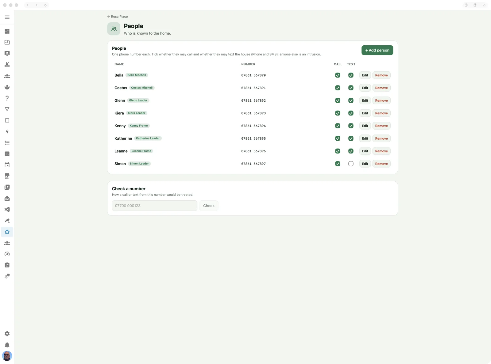
<h3>Who can call the house</h3>
The guest list for your home's own phone line: who may ring it and who may text it, one number each, linked to their Home Assistant person. Type a number the way you'd dial it; Casa Mia works out the rest, and there's a box to check what would happen before someone tries it for real.
</td>
<td width="50%" valign="top">
</td>
</tr>
</table>

## What does the future hold?

Plenty. These are the ideas at the top of the [backlog](BACKLOG.md), none of them started
yet, so there's no promise on when (or, honestly, whether):

- **Love it or Loathe it.** Your radio station plays something you love, or something you
  loathe, and the house notices. Tell it the songs and artists either way, and it watches
  any media player you choose: a match fires an event for your automations, or it acts by
  itself. Love it? It bumps the volume up 10%, so you can sing along like no one's
  listening. Loathe it? It fades that player over to your own house radio station,
  playing your playlist 24/7/365, and nobody has to hear it.
- **Cameras that fix themselves.** Stale or missing streams named on the Home page, with a
  **Try to fix** button that works from the lightest fix to the heaviest.
- **Commanders that follow the house.** A commander's layout as entities your automations
  can change (the main camera filling the screen while the tablet sleeps, say), and
  cameras placed for you instead of panel by panel.
- **Tablets in distress, noticed and fixed.** Casa Mia knowing when a wall tablet's view
  has broken, whatever the cause, and a way for whoever is standing in front of it to put
  it right, with no admin, laptop or know-how.
- **Install from any GitHub repository,** private ones too: apps, integrations and cards
  that aren't in an App store or HACS, downloaded, installed and kept up to date.
- **All your Casa Mia settings in git,** every change a commit, optionally pushed to a
  private repository: a history of what changed, and a house you can rebuild.
- **A tidier Home Assistant.** Orphaned and disabled entities found and removed, and
  what's eating your recorder's database, entity by entity.
- **A heating flow card.** Your boiler or heat pump, hot water, pumps and every heating
  circuit as one animated diagram, in the style of the Sunsynk power flow card.
- **The app's log, live in the panel,** followed, filtered and searched, without a trip
  to Settings.
- **A clean way out.** If Casa Mia isn't for you, one button takes out everything it put
  into Home Assistant.

Got an idea? [Open an issue](https://github.com/gazoodle/casa-mia/issues).

## Installation

You need **Home Assistant 2026.3 or later**, on Home Assistant OS or a Supervised install
(apps need the Supervisor), on a 64-bit machine (aarch64 or amd64).

1. **Add the repository.** The quick way is this button, which opens your Home Assistant with
   the repository filled in:

   [](https://my.home-assistant.io/redirect/supervisor_add_addon_repository/?repository_url=https%3A%2F%2Fgithub.com%2Fgazoodle%2Fcasa-mia)

   Or do it by hand: go to **Settings → Apps → App store**, open the **⋮** menu at the top
   right, choose **Repositories**, and add:

   ```text
   https://github.com/gazoodle/casa-mia
   ```

2. **Install the app.** Close the dialog, find **Casa Mia** in the store (refresh the page if
   it isn't there yet), open it and press **Install**. It downloads the ready-built app from
   the GitHub Container Registry, so there's nothing to compile.

3. **Choose your modules.** On the app's **Configuration** tab, give your house its name and
   switch on the modules you want (they all start off): Sensor Watch, guest login, Camera
   Commander and Auto Dashboards, Kiosk Satellites, the firmware server, phone and SMS
   (FONA), the alarm panel. Press **Save**. You can come back and change these at any time.

4. **Start it.** On the **Info** tab, switch on **Show in sidebar** and press **Start**.
   **Casa Mia** appears in the sidebar.

5. **Restart Home Assistant.** On its first start the app installs its integrations into your
   `custom_components` folder, and Home Assistant only loads it after a restart: **Settings →
   System → ⋮ → Restart Home Assistant**. A Repair tells you whenever an update needs another.

6. **Add the integration.** Go to **Settings → Devices & services → Add integration**, search
   for **Casa Mia**, and press **Submit**: it finds the app by itself. (If it doesn't, copy the
   **Integration URL** from the foot of the Casa Mia panel's home page and paste it in.)
   Guest login and Camera Commander each have an integration of their own, **Casa Mia Guest
   Login** and **Casa Mia Camera Commander**: while the module is on, Casa Mia offers it
   under **Discovered** on the same page. Press **Add**.

7. **Make yourself at home.** Open **Casa Mia** from the sidebar and visit each module's page
   to set it up. Its devices and entities appear in Home Assistant as you go.

Updates arrive like any other app's: Home Assistant offers them under **Settings → Updates**,
and the integrations are updated along with the app.

**Leaning on Home Assistant's frontend.** Some parts reach into Home Assistant's own pages
where there is no public API for it, as many community cards do: the Tablet Layout,
garnish, the Over layer and Sensor Watch's eye in an entity's dialog. A Home Assistant
update can change what they lean on. If it does, that part says so in the browser's
console and stays out of the way, and a Casa Mia update follows.

## Documentation

The [documentation](docs/README.md) has a page for each part of the Casa Mia panel, the full
Tablet Layout reference, and, [behind the scenes](docs/architecture.md), how it's all built.

## Thanks

- [Thomas Lovén (thomasloven)](https://github.com/thomasloven), for [card-mod](https://github.com/thomasloven/lovelace-card-mod),
  [browser_mod](https://github.com/thomasloven/hass-browser_mod) and layout-card, which showed
  how far Home Assistant's frontend can be pushed, and inspired the Over layer.
- [Erik Lemcke](https://www.tindie.com/products/ErikLemcke/salt-sentry-water-softener-monitor/), for the Salt Sentry,
  the little laser-ranging gadget that tells Home Assistant how much salt is left in the
  water softener, and the example that gave Sensor Watch its **task** level.
- [Xavier Larrea (jxlarrea)](https://github.com/jxlarrea), for [Kiosk Satellite](https://kiosksatellite.com),
  and for adding the custom update source that made the firmware server possible.
- [Nathan Orick (cnorick)](https://github.com/cnorick), for [ha-auto-guest-login](https://github.com/cnorick/ha-auto-guest-login),
  which guest login grew out of.
- [Dermot Duffy (dermotduffy)](https://github.com/dermotduffy), for the [Advanced Camera Card](https://github.com/dermotduffy/advanced-camera-card),
  which the camera dashboards are built on.
- [NemesisRE](https://github.com/NemesisRE), for [kiosk-mode](https://github.com/NemesisRE/kiosk-mode),
  which the Kiosk mode page sets up for you.
- [Franck Nijhof (frenck)](https://github.com/frenck), for [Spook](https://spook.boo), a
  toolkit of the bits Home Assistant doesn't ship, and the idea that Casa Mia could be one too.
- [Adafruit](https://www.adafruit.com), for the FONA GSM board and its Arduino library, the
  heart of the phone and SMS line.
- The [Home Assistant](https://www.home-assistant.io) project and its community, for the
  platform all of this plugs into.

## Licence

**Casa Mia is free, open source, and MIT licensed. Forever.**

No "community edition". No premium tier waiting in the wings. No gathering users now and
slapping a licence fee on it later, like so much else on the internet. There's nothing to
buy, nothing to subscribe to, and no account to sign up for; every line of it is right here.

Use it, change it, share it, fork it, build on it; just keep the [MIT](LICENSE) notice.
© 2026 Gazoodle.

## Footnote

🦶 🎵
