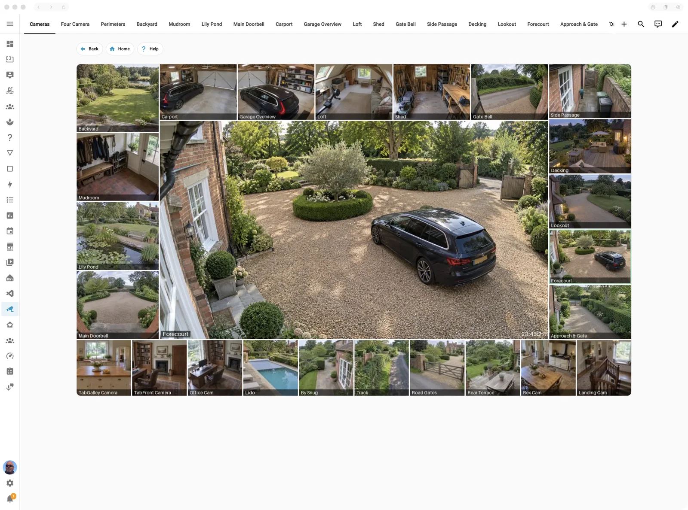

# Camera Commander

The commanders: each a main camera framed by panels of cameras, one live picture for the
Camera Commander card and the camera dashboard.

> **Maturity: Beta.** Complete and used every day; its features have settled. Please report what breaks in your setup. ([The levels](../README.md#maturity))



## What it's for

What I wanted was simple to say and surprisingly hard to get: a home page on the wall
tablets that looks great, shows the cameras I choose, laid out how I like, and responds the
moment you touch it, without an afternoon of YAML every time a camera is added.

A wall tablet showing a grid of camera cards plays a stream for each, and soon stutters.
A commander is drawn instead by the app's compositor as one picture: a big main camera
framed by all the others. The tablet plays a single picture, so even a modest one stays
quick. Tap a tile and it becomes the main camera; switch on Track motion and the
commander follows whatever moves.

## Switching it on

Turn on **Camera Commander** in the app's Configuration tab (Settings → Apps → Casa Mia →
Configuration); **Auto Dashboards** adds the camera dashboard. Add the cameras on the
[Cameras](cameras.md) page first.

The first time it starts, it takes the commanders from what the Camera Dashboard (now Auto Dashboards) last
deployed live (not its draft, so nothing unfinished reaches the walls), and logs
`commander: moved N commanders`.

## On the page

There is no draft: **Save** shows your changes live at once, on every Camera Commander
card. **Discard** throws away what you haven't saved. A commander with a problem (no
cameras, a bad size) is refused, with what to fix, rather than shown broken on the wall.

The commanders are a list at the top. Pick one and its preview appears under the list,
drawn from your unsaved changes, with its settings below it; the preview stays in view
while you scroll through them. Move the commanders up and down (the camera dashboard's
pages follow), delete one, or add a copy of the one picked or a blank one. Each has:

- **Picture:** its name (its page's title on the dashboard), whether it has a dashboard
  page, the gap and margin, and **Stale after**: a camera picture older than this is
  marked Stale.
- **Main camera:** how it fits its space (Fit, Fill, Crop, Own shape, Fixed shape), its
  width and shape for the last two, and the camera it starts on.
- **Highlight** on the main camera's tile: colour, width, blur, and a pulse (Breathe or
  Ripple).
- **Track motion:** its switch, and how it behaves. **Hold:** a switch stays this long
  before motion elsewhere takes over. **Go back after:** once all motion stops, back to
  the camera chosen by hand (0: stay). **Pause after a choice:** a tap pauses tracking
  this long. **Never takes over:** the cameras whose motion should not take over (a busy
  road, a tree in the wind); **+ Add…** picks from the commander's cameras. The card still marks their motion with the dot, a
  tap still makes one the main camera, and their motion never holds off Go back after.
- **Panels** (left, top, right, bottom): the cameras in each, in order; its size; how its
  tiles fit; rows or columns; and whether it is shown. **Same size** makes every tile in
  the panel the same size, at the panel's **Tile shape** (square unless you change it), as
  thick as the panel (shared between its rows or columns), grouped in the middle; **Same
  size, spread** shares the spare room evenly between them and at both ends. A camera is
  cropped to fill its tile, so a 16:9 camera in a square tile loses some of each side.
  With more than one row or column, the tiles line up as a grid.

**Arrange…**, under the settings, lays all the commander's cameras out for you as tiles of
one size around the main camera, with as little of the picture left unused as it can find.
It uses the bottom first, then the left, the right and the top, and shares the cameras so
that opposite edges differ by at most one, with the spacing between tiles as even as it
can make it on every edge. Choose the tile shape
(16:9 by default), the edges it may use, and **One row or column per edge** (on by default;
switch it off to be offered two rows or columns of tiles on an edge as well); **Bigger main** and **Bigger tiles** step
between the best layouts it found, drawn as a sketch. **Apply** replaces the panels'
cameras, sizes and fits and the main camera's fit, and nothing is saved until you Save.
With 16:9 tiles on a 16:9 picture some counts fit with nothing left over (7 cameras: 4
along the bottom and 3 up the side); otherwise the spare room is shared between the tiles,
or the main camera loses a few per cent off its edges.

**Pictures:** the **Compositor host**, the address the cards and the dashboard fetch the
pictures from. Blank: this box's own address.

## In Home Assistant

The commanders come into Home Assistant through the **Casa Mia Camera Commander**
integration: once Casa Mia's own integration is set up and Camera Commander is on, it is
offered under **Discovered** in Settings → Devices & services. The Camera Commander card
needs it too, for its pictures away from home.

Each commander is a device: **Camera Commander** for the first, then **Camera Commander
<name>**. Each has:

- **Main camera**, a select: its options are the commander's cameras, and choosing one
  (a tap on the card, or an automation) makes it the main camera.
- **Track motion**, a switch: while it is on, a camera that sees motion becomes the main
  one.

## The Camera Commander card

In Home Assistant's Add to dashboard dialog, choose **Casa Mia Camera Commander**. Its
preview uses the first commander, so you see its layout before adding it. In a Tablet
Layout panel it takes the full width by default.

Its options (each left at its default unless you change it):

- **Commander:** which one.
- **A tap on the main camera:** opens its **more-info**, Home Assistant's camera dialog
  with live video (the default); or **its page on the camera dashboard** (more-info when
  there is no dashboard); or nothing.
- **The picture:** direct at home and through Home Assistant away (the default); always
  direct; or always through Home Assistant. **Sharpness through Home Assistant:** from
  Full to Data saver.
- **Main camera as live video:** the main camera plays as live video over the picture
  (Home Assistant's WebRTC, decoded by the tablet), when the compositor's **Live main
  camera** switch is on.
- **Picture kept running once out of sight:** seconds, so the back button finds it
  running.
- **Security look:** every picture in tinted monochrome, like a control room, with its
  tint, strength and darkness.
- **Motion dot:** a small dot pulsing on a camera's tile while its motion sensor sees
  motion, and for a while after; hover it for when. Its colour, size, pulse (0: steady),
  how long it stays after the motion, and its corner. A camera whose own motion detection
  is off (see [Cameras](cameras.md)) never shows one.
- **Talk button:** shown over a doorbell's live video (see below). Turn it off if you use
  your own buttons.

### Talking to a doorbell

When the main camera is a doorbell with a call sensor from the Intercom talkback
integration, and it is playing as live video, the card can talk to it. The page must be
on an https address, because browsers only give a microphone to secure pages.

- **Talk** asks for this device's microphone and opens a sound-only connection to the
  doorbell, so the visitor hears you and you hear them. A red **Live to …** label shows
  while the microphone is on. You can still tap other cameras during the call: the main
  camera changes on every device showing the commander, as it always does, and the call
  carries on. The label and Hang up stay over the main camera, and a tap on the
  doorbell's tile brings it back.
- **Hang up** stops the microphone, and the call ends. Leaving the page, scrolling the
  card away or switching to another app hangs up at once.
- Every device shows the call: **Ringing**, **Answered by …** (the Home Assistant user
  who answered) or **Missed**. While one device has answered, Talk on another is refused
  and that device keeps its live video.

To use one of your own dashboard buttons instead of the card's, give it this tap action:

```yaml
tap_action:
  action: fire-dom-event
  casa_mia_commander:
    talk: toggle            # or "on" / "off"
    entity: select.oak_door_commander   # optional: only this commander's card
```

The button can show the call sensor's state. This device is talking when the sensor is
`answered` and its `answered_by` attribute is this device's Home Assistant user.

### The Talk tile

A plain tile can't say whether this tablet is the one talking, so Casa Mia has a card
for it: **Casa Mia Talk tile** in the Add to dashboard dialog. It is Home Assistant's own
tile card on the doorbell's call sensor, so it looks like your other tiles and takes
every tile option, but its name and icon follow the call:

| The call | Name | Icon |
|---|---|---|
| Answered on this tablet | Hang up | `mdi:phone-hangup` |
| Answered by another user | Answered by … | `mdi:microphone-off` |
| Ringing | Talk | `mdi:bell-ring` |
| No call, or the sensor unavailable | Talk | `mdi:microphone` |

"This tablet" means this tablet's Home Assistant user, so give each tablet its own user.
A tap turns Talk on or off on the Commander card showing the doorbell; pick a
**Commander** to send it to that one only. In the editor:

- **Name** replaces "Talk" only. "Hang up" and "Answered by …" always show, because they
  say what a tap will do.
- **Icon** sets one icon for every state. Under **Icon for each state** you can change
  just one of the icons above instead.
- **Colour** sets one colour for every state. Under **Colour for each state** you can
  set one per state; a state without one keeps the tile's normal colouring.
- **Layout** and **Interactions** are the tile's own. A tap action you set replaces Talk,
  and the icon's tap does the same as the tap unless you set it too.

```yaml
type: custom:casa-mia-talk-tile
entity: sensor.gate_doorbell_call
colors:
  hang_up: red
  ringing: amber
```

## Troubleshooting

- **Taps on the commander do nothing:** the page says so when Home Assistant has no Main
  camera select for it yet: add the Casa Mia Camera Commander integration (see "In Home
  Assistant"), or restart Home Assistant if it was just updated (Settings → Repairs).
- **A tap on the main camera opens a dashboard page, not the camera:** the card was saved
  with "its page on the camera dashboard" chosen; choose more-info in its editor.
- **No motion dot on a camera:** check its motion detection on the [Cameras](cameras.md)
  page.
- **The log** has a line for every save (`commander: saved N commanders (changed: …)`)
  and every main camera chosen (`commander '…': main camera … (from Home Assistant)`).
