# Camera Commander

The commanders: each a main camera framed by panels of cameras, one live picture for the
Camera Commander card and the camera dashboard.

> **Maturity: Beta.** Complete and used every day; its features have settled. Please report what breaks in your setup. ([The levels](../README.md#maturity))

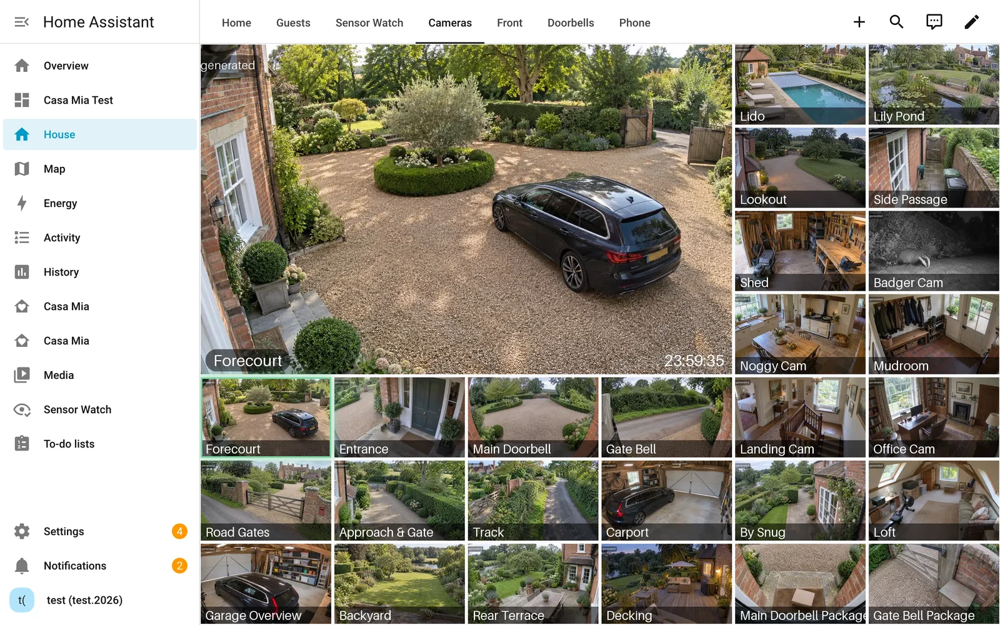

The pictures in this guide are of an invented house. Its camera pictures are AI-generated,
as the mark in their corner says, and the names are made up.

## What it's for

What I wanted was simple to say and surprisingly hard to get: a home page on the wall
tablets that looks great, shows the cameras I choose, laid out how I like, and responds the
moment you touch it, without an afternoon of YAML every time a camera is added.

A wall tablet showing a grid of camera cards plays a stream for each, and soon stutters.
A commander is drawn instead by the app's compositor as one picture: a big main camera
framed by all the others. The tablet plays a single picture, so even a modest one stays
quick. Tap a tile and it becomes the main camera; switch on Track motion and the
commander follows whatever moves.

## Fixed or Responsive?

A commander is laid out in one of two ways, chosen with **Layout** on its page. It keeps
both sets of settings, so you can change and change back.

| | Fixed | Responsive |
|---|---|---|
| You set | Four panels (left, top, right, bottom), each with its cameras and its size | One list of cameras, and a few limits |
| It suits | One shape of space, such as a wall tablet that never changes | Any space: a wide tablet, a narrow column, a phone |
| Tiles | Whatever size each panel gives them | All one size, near the shape you choose |
| A camera added | You put it in a panel | It takes the next place by itself |
| A space of another shape | The same arrangement, squeezed or stretched to fit | Laid out again for that space |
| Best with | A few cameras placed just so | Many cameras, or more than one kind of screen |

Start with Responsive unless you want to place every camera by hand. A commander you
already have stays Fixed until you change it.

## Worked examples

Each of these is a commander on the invented house, with the settings that made it.

### Every camera on a wall tablet

The picture at the top of this page: 26 cameras, one main camera, nothing set by hand
beyond the list.

- **Layout:** Responsive.
- **Cameras:** all 26, in the order they should fill. The front of the house comes first,
  so those tiles are nearest the main camera.
- **Edges, in the order they fill:** Bottom, then Right. The spare cells, if there are
  any, are left in the bottom right corner.
- Everything else as it comes: the main camera between 40% and 60% of the biggest it
  could be, tiles of 16:9 and no narrower than 110 px.

Add a camera to the list and it appears as one more tile. Nothing else needs changing.

### The same commander on a phone

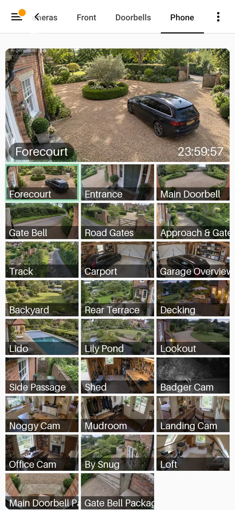

The same commander, with no settings of its own for the phone, in a dashboard view of one
column.

- **Different when the space is taller than wide:** on, with **Bottom** as its only edge.
  A tall space then has the main camera on top and every tile under it.
- The card does the rest. In a narrow column it takes the height of the screen, so the
  commander is laid out for a tall space and not for a short strip.

On the page, the **Phone upright** button above the preview shows this before you pick up
the phone.

### A doorbell whose date and time stay in view

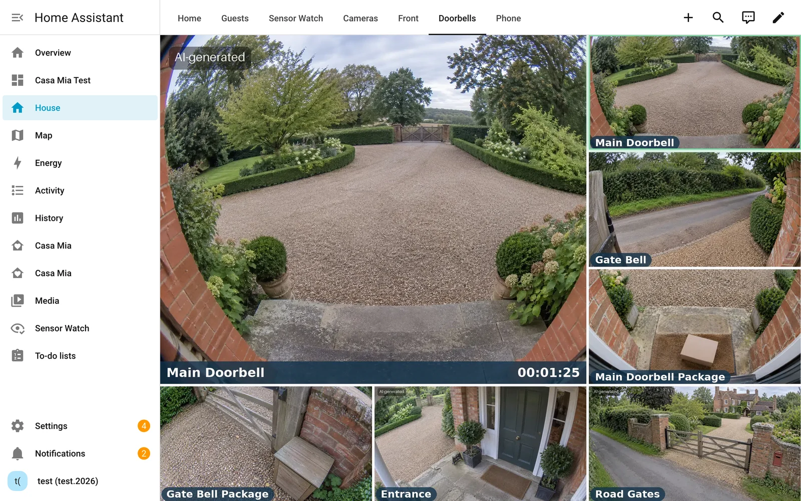

Doorbells and some other cameras have a 4:3 picture, and most cameras write the date and
time in a corner. This commander is made for one.

- **A main camera of another shape:** **Fit the layout to it**. The layout is made for the
  main camera's own shape, so a 4:3 doorbell gets a place that is 4:3 and loses almost
  nothing. The tiles can move when another camera becomes the main one.
- **Main camera at most:** 100%, so the main camera takes the room six cameras leave.
- **Keep this part of the main camera:** top left. What little is cropped comes off the
  bottom and the right, and the corner where the camera writes stays whole.
- **Camera names:** DejaVu Sans Bold, a **Bar** for the main camera and a **Pill** for the
  tiles, on dark blue at 80%.

### A few cameras, placed by hand

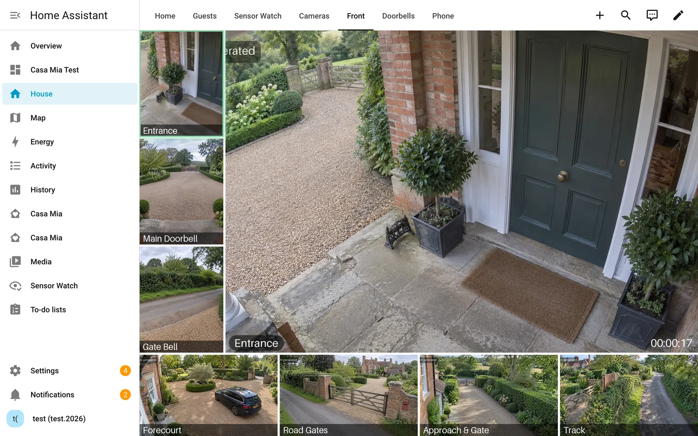

Seven cameras at the front of the house, each where it was put.

- **Layout:** Fixed.
- **Left:** Entrance, Main Doorbell and Gate Bell. **Bottom:** Forecourt, Road Gates,
  Approach & Gate and Track. **Top** and **Right** hold nothing, so they take no room.
- **Main camera:** **Crop**, so it fills its place.

It looks exactly like this on the tablet it was made for. On a screen of another shape
the panels keep their shares of the space, which is why a commander for several kinds of
screen is better Responsive.

## Switching it on

Turn on **Camera Commander** in the app's Configuration tab (Settings → Apps → Casa Mia →
Configuration). Add the cameras on the [Cameras](cameras.md) page first. **Auto
Dashboards** is not needed to show a commander: it adds a dashboard with a live page for
each camera.

New to it? [A camera commander on your home page](../how-to/commander-on-your-home-page.md)
goes from installing Casa Mia to a commander on a dashboard, step by step.

The first time it starts, it takes the commanders from what the Camera Dashboard (now Auto Dashboards) last
deployed live (not its draft, so nothing unfinished reaches the walls), and logs
`commander: moved N commanders`.

## On the page

There is no draft: **Save** shows your changes live at once, on every Camera Commander
card. **Discard** throws away what you haven't saved. A commander with a problem (no
cameras, a bad size) is refused, with what to fix, rather than shown broken on the wall.

The commanders are a list at the top. Pick one and its preview appears under the list,
drawn from your unsaved changes, with its settings below it.

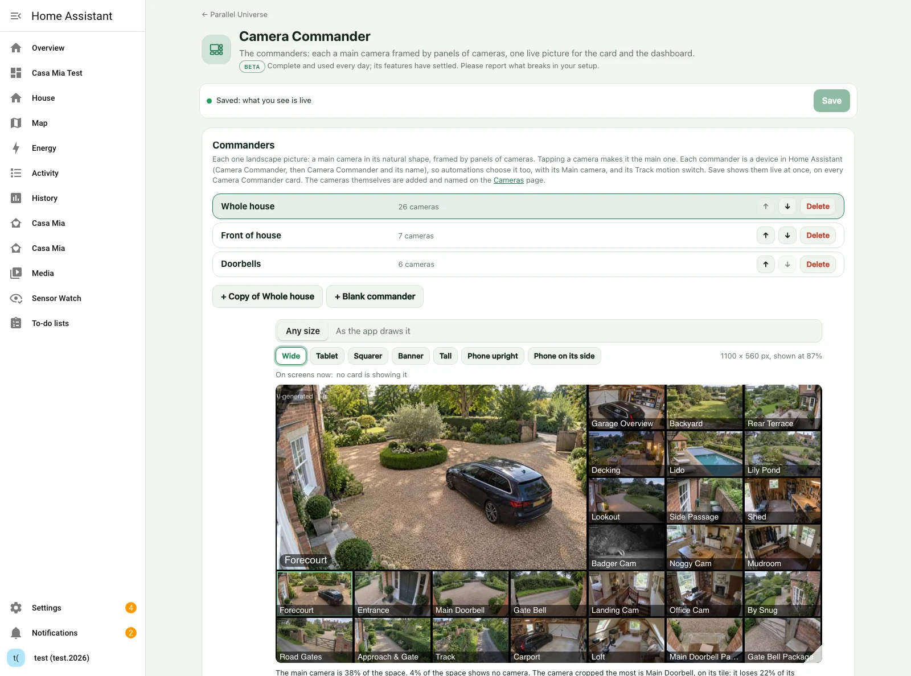

The preview is a stage that you can make any size, because a commander is given a
different space on each dashboard and device.

- **Change its size:** drag its bottom right corner, or pick a common space with the
  buttons above it (Wide, Tablet, Squarer, Banner, Tall, Phone upright, Phone on its
  side). The commander is laid out again as the size changes, by the same layout the card
  uses.
- **On screens now** lists the sizes the commander is being shown at on your dashboards
  and tablets at the moment, read when you open the commander, so you can see it here as
  each of them shows it. Hover over one for which device it is.
- **The line under it** says how much of the space the main camera takes, how much shows
  no camera, which camera is cropped the most (by name, whether it is the main camera or
  a tile, how much of its picture it loses, and the two shapes that cause it), and how
  many tiles are taller than wide. A camera is cropped when its own shape is not the
  shape of its place.
- **Click a tile** to make it the main camera in the preview.
- **As the app draws it** shows the compositor's own picture instead, with its marks, at
  the commander's own size.
- The preview stays in view while you scroll through the settings, unless you have made
  it tall.

A Fixed commander's panels are set for one shape of space, so try the spaces you use
before you rely on them.

Move the commanders up and down, delete one, or add a copy of the one picked or a blank
one. Each has:

- **Picture:** its name, the gap and margin, and **Stale after**: a camera picture older
  than this is marked Stale.
- **Main camera:** how it fits its space (Fit, Fill, Crop, Own shape, Fixed shape), its
  width and shape for the last two, and the camera it starts on.
- **Highlight** on the main camera's tile: colour, width, blur, and a pulse (Breathe or
  Ripple).
- **Track motion:** its switch, and how it behaves. **Hold:** a switch stays this long
  before motion elsewhere takes over. **Go back after:** once all motion stops, back to
  the camera chosen by hand (0: stay). **Pause after a choice:** a tap pauses tracking
  this long. **Never takes over:** the cameras whose motion should not take over (a busy
  road, a tree in the wind); **+ Add…** picks from the commander's cameras. The card still marks their motion with the dot, a
  tap still makes one the main camera, and their motion never holds off Go back after.
- **Layout:** **Fixed** or **Responsive**, described below. A commander keeps both sets
  of settings, so you can change and change back.

### Fixed: panels set by hand

- **Panels** (left, top, right, bottom): the cameras in each, in order; its size; how its
  tiles fit; rows or columns; and whether it is shown. **Same size** makes every tile in
  the panel the same size, at the panel's **Tile shape** (square unless you change it), as
  thick as the panel (shared between its rows or columns), grouped in the middle; **Same
  size, spread** shares the spare room evenly between them and at both ends. A camera is
  cropped to fill its tile, so a 16:9 camera in a square tile loses some of each side.
  With more than one row or column, the tiles line up as a grid.

A Fixed commander suits one shape of space. Drag the preview to the spaces you use to see
what it does in them.

### Responsive: worked out for the space

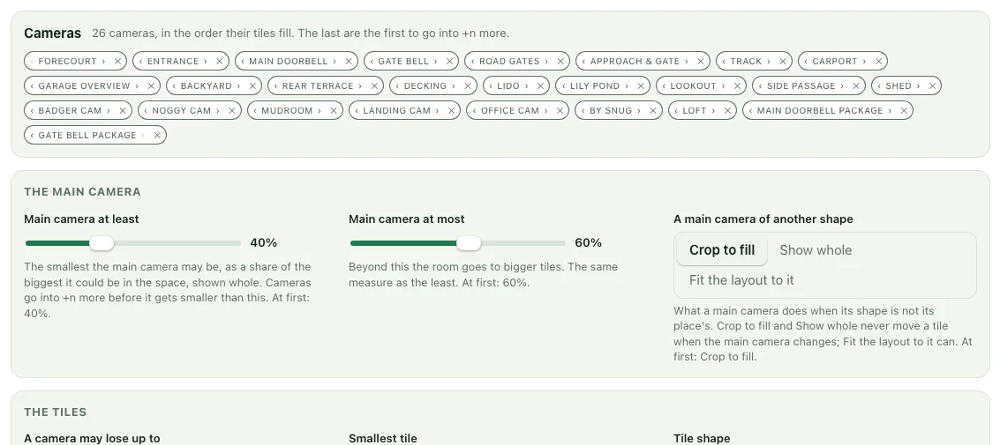

A Responsive commander is laid out afresh for whatever space it is given. The picture is
a grid of equal tiles, each near the tile shape, and the main camera is a block of them.
Every grid your limits allow is tried, and the one that leaves the least space unused and
crops the cameras least is used.

- **Cameras:** one list, in the order the tiles fill, 32 at most. The first time a
  commander is made Responsive it starts as the cameras of its panels. The main camera
  keeps its own tile, outlined, so no tile moves when the main camera changes.
- **Main camera at least** and **at most:** how small and how large it may be, as shares
  of the biggest it could be in the space when shown whole. Room beyond its most goes to
  bigger tiles when there are tiles to take it.
- **A main camera of another shape:** **Crop to fill** crops it about its centre to fill
  its place. **Show whole** shows it whole with bars, unless it would lose less than 5%.
  **Fit the layout to it** makes the layout for that camera, so the tiles can move
  when the main camera changes; the other two never move them.
- **A camera may lose up to:** how far a tile may be from the tile shape, and the main
  camera's place from 16:9. A camera is cropped about its centre and never squeezed.
- **Smallest tile:** the narrowest a tile may be.
- **Tile shape:** 16:9, 3:2, 4:3 or square.
- **Edges, in the order they fill:** the edges the tiles go on. An edge in the list is
  used whenever there are tiles for it, and the first cameras go on the first edge.
  Bottom and Right gives tiles below, on the right, or both as a corner, whichever suits
  the space; add Left for tiles on both sides. Where two edges meet, the corner belongs
  to the later edge, so tiles to spare are left at its end, in the corner of the picture.
  ‹ and › move an edge earlier or later, ✕
  takes it out and **+ Add…** puts one back.
- **Different when the space is taller than wide:** a second list of edges for a tall
  space, such as a phone held upright.
- **Keep the last place for a card:** the last place, in the corner of the picture, is
  left clear of cameras, and each Camera Commander card showing this commander can draw
  a card of its own there, such as a clock or a few buttons (see
  [Cards in the last place](#cards-in-the-last-place)). The place is never given to a
  camera: when there are too many, **+n more** takes the place before it. A size that
  shows the main camera alone has no such place.
- **When the limits can't all be met:** **Find something that fits** uses other edges,
  then lets the main camera go below its least, then the tiles below the smallest. Each
  time, your own edges are tried before any other, and an edge that didn't help is not
  kept.
  **Keep to my limits** shows the main camera alone, and the card says why.
- **Reset to defaults** puts every Responsive setting back and leaves the cameras.

When there are more cameras than the space can hold, the last in the list go into a
**+n more** tile. The page names them at the preview's size, and motion on one of them
marks that tile. Two to four cameras in a tall or very wide space leave room empty,
because equal tiles can't fill it; Fixed suits those better.

**Pictures:** the **Compositor host**, the address the cards and the dashboard fetch the
pictures from. Blank: this box's own address.

### Which part of a cropped main camera is kept

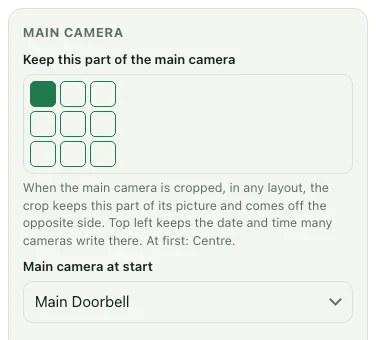

**Keep this part of the main camera** is a grid of nine places: the corners, the middle of
each edge and the centre. When the main camera is cropped, the crop keeps that part of its
picture and comes off the opposite side. Many cameras write the date and time in the top
left of their own picture, and **Top left** keeps it whole. It applies in either layout,
whenever the main camera is cropped, including the small crop that **Show whole** and
**Fit the layout to it** make in place of thin bars. Tiles are always cropped about their
centre.

### Camera names and Talk chips

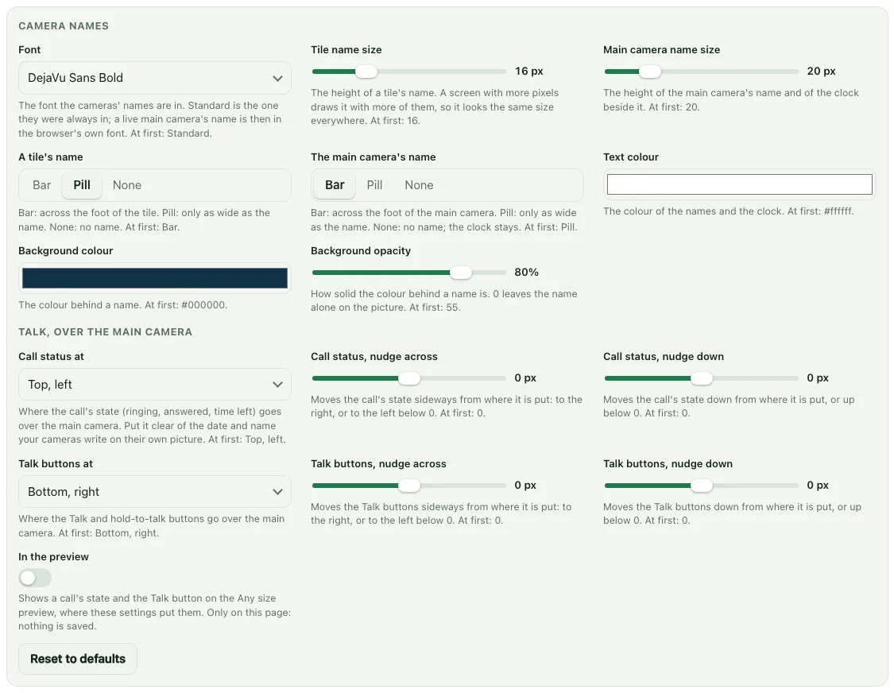

Each commander has a box of settings for how its cameras' names look, in either layout.
The **Any size** preview shows the names as you change them.

- **Font:** Standard (the font the names were always in), DejaVu Sans, DejaVu Sans Bold or
  DejaVu Sans Mono, which is fixed width. With Standard, the name over a live main camera
  is in the browser's own font, which is a little different from the drawn one; with the
  DejaVu fonts the two are the same.
- **Tile name size:** a % of the tiles' names' size, 100% at first. At 100% they are
  11 px, the same on a phone, a tablet and a computer. A name too long for its tile is
  cut short with "…". The motion dot is half the size of the tiles' names.
- **Main camera name size:** a % of the main camera's name's size, 100% at first. At
  100% it is 14 px on every device. The clock is the same size as the name.
- **A tile's name** and **The main camera's name:** a **Bar** across the foot, a **Pill**
  with rounded ends, only as wide as the name, or **None**. With None on the main camera the clock stays.
- **Text colour**, **Background colour** and **Background opacity:** the colour of the
  names and the clock, and the colour behind a name and how solid it is.
- **Call status at** and **Talk buttons at:** where the call's state and the Talk buttons
  go over the main camera when you [talk to a doorbell](#talking-to-a-doorbell): top or
  bottom, and left, centre or right. Many cameras write the date and their name across
  the top of their own picture, so move the call's state if it covers them. Each has a
  **nudge across** and a **nudge down**, in px, to move it a little from that place:
  below 0 moves it left or up. **Show where they go** puts a sample of each on the
  preview; it isn't saved.
- **Reset to defaults** puts every one of these back to what it was at first.

### Tuning the sizes on one device

With a commander's **debug** on, every card showing it has a box of figures, in the
middle of the card or of the main camera's full screen. The **−** at its top left folds
it down to its buttons, so you can see the tiles past it; **+** shows the figures again. It says where the card is (in
the page, with the whole screen, or with the main camera full screen), the main
camera's place and the smallest tile in px, and for each of the tile names, the main
camera's name and the motion dot the size in use and how it was worked out.

**EDIT** opens a small dialog you can drag by its title bar, and fold down to that bar
with its own **−**. Choose one of the three, and
set its size with the slider or the number box: the card shows it at once. Each place
the card can be is set on its own. The sizes are kept only on this device and only
until the page is refreshed; **Back to the rule** returns one to the size its setting
gives. The controls are not in the dialog: they are one size everywhere.
While the dialog is open the commander's **Track motion** is off, so the main camera
doesn't change under you. That switch is every device's, and the box says so in red; it
is turned on again when the dialog is closed.

**RECORD** writes this device's figures, the worked-out sizes and every size set by hand
to the Casa Mia log, under a reference such as `T-1127-143205-KQZ`, which the box then
shows. Quote it when you talk about the result. It works only while the commander's debug
is on.

## In Home Assistant

The commanders come into Home Assistant through the **Casa Mia Camera Commander**
integration: once Casa Mia's own integration is set up and Camera Commander is on, it is
offered under **Discovered** in Settings → Devices & services. The Camera Commander card
needs it too, for its pictures away from home.

Each commander is a device: **Camera Commander** for the first, then **Camera Commander
<name>**. Each has:

- **Main camera**, a select: its options are the commander's cameras, and choosing one
  (a tap on the card, or an automation) makes it the main camera.
- **Track motion**, a switch: while it is on, a camera that sees motion becomes the main
  one.

## The Camera Commander card

In Home Assistant's Add to dashboard dialog, choose **Casa Mia Camera Commander**. Its
preview uses the first commander, so you see its layout before adding it. In a Tablet
Layout panel it takes the full width by default.

Where the dashboard gives the card a height (a Tablet Layout panel, a cell with its rows
set, a panel view), the card fills it. Elsewhere it takes the commander's own shape for
its width. A Responsive commander in a narrow column, such as a phone held upright, takes
the height of the screen below it instead, so it is laid out as a tall space and not as a
short strip.

The editor has the **Commander** select at the top and the other options in sections
that start collapsed, so they all fit on a phone's screen: **View** (live video and the
security look), **Behaviour** (a tap on the main camera and the buttons over it),
**Intercom**, **Notifications** (the motion dot), **Last place** and **Connection and
performance**. Press a section's header to open it. Security look and Motion dot show
their colour and adjustment controls only while their switches are on.
Hidden choices are kept, so switching a feature back on restores them. Colour controls
stay compact, with adjustments alongside on wider screens and below on narrow screens.

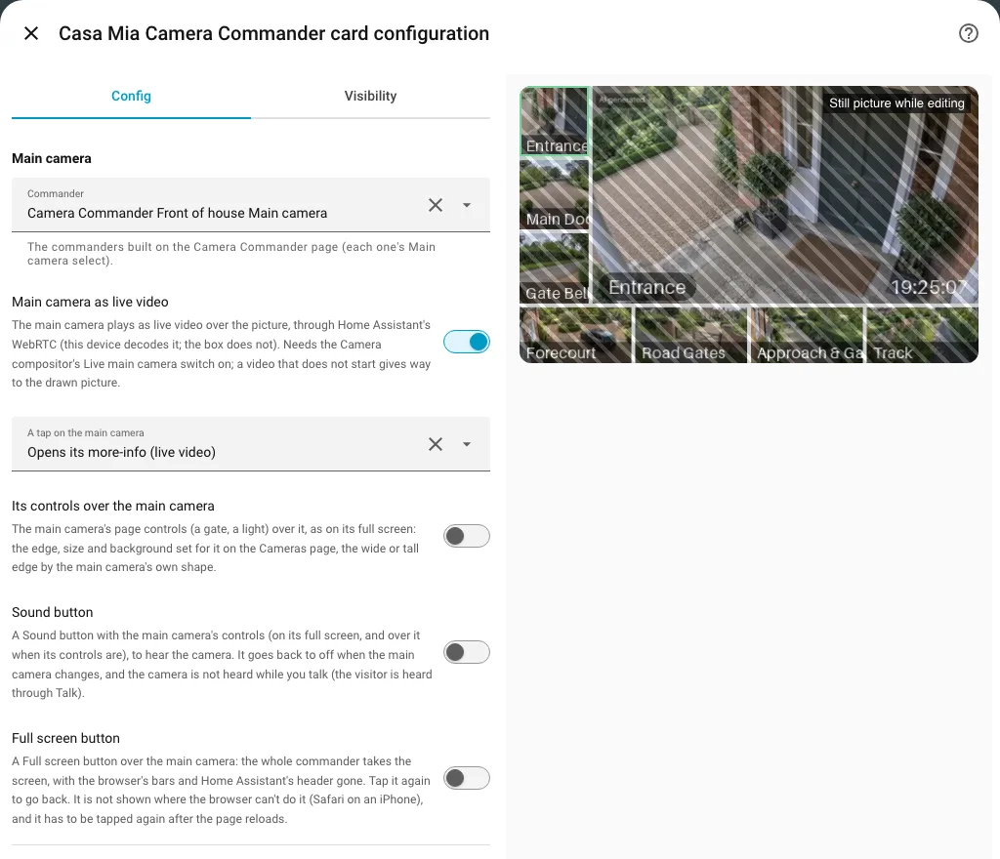

Its options (each left at its default unless you change it):

- **Commander:** which one.
- **A tap on the main camera:** opens its **more-info**, Home Assistant's camera dialog
  with live video (the default); or **its page on the camera dashboard** (more-info when
  there is no dashboard); or **full screen, with its controls**; or nothing. Full screen
  shows the camera live over the whole screen, with its page controls as buttons along
  the edge set on the Cameras page. Pinch the picture, or turn the mouse wheel over it,
  to enlarge it, and drag to move it about; a chip beside the camera's name says by how
  much (2.4×, say), and the card plays a larger channel of the camera where it has one,
  so the detail is there. The picture goes back to whole a minute after the last touch,
  or at a tap on the picture or the chip, and a tap on the whole picture leaves full
  screen. This enlarges the picture on the screen; the camera's own zoom is the **Zoom**
  button. Talk carries on through it. Where the camera can't play live on the device, the
  tap opens more-info.
- **Its controls over the main camera**, **Sound button** and **Full screen button:**
  buttons over the main camera. See
  [Controls and buttons over the main camera](#controls-and-buttons-over-the-main-camera).
- **Last place:** cards of your own in the commander's last place. See
  [Cards in the last place](#cards-in-the-last-place).
- **The picture:** direct at home and through Home Assistant away (the default); always
  direct; or always through Home Assistant. Direct means the app's own address, on port
  8099. With the default, a page at home that gets no picture from that address within
  10 seconds (a guest network that may reach Home Assistant but not that port, say) takes
  it through Home Assistant instead, until the app next restarts. **Sharpness through Home Assistant:** from
  Full to Data saver, hidden when **Always direct** is selected.
- **Main camera as live video:** the main camera plays as live video over the picture
  (Home Assistant's WebRTC, decoded by the tablet), when the compositor's **Live main
  camera** switch is on. Its title says **(live)** while video is arriving, after the
  letter of the UniFi Protect channel playing: **H**, **M** or **L** for high, medium or
  low (its size shows when you point at it). A chip beside the title says **Starting M**
  while the video starts, **H coming** while a sharper channel gets ready behind the one
  shown, and **H failed** when that channel wouldn't play, with the reason and when it is
  tried again when you point at it. When a channel
  of the camera won't play, the card plays another of its channels, and when none plays
  it shows the drawn picture and says **Live lost … ago** with the reason, and tries
  again by itself (see Troubleshooting).
- **Picture kept running once out of sight:** seconds, so the back button finds it
  running.
- **Security look:** every picture in tinted monochrome, like a control room, with its
  tint, strength and darkness.
- **Motion dot:** a small dot pulsing on a camera's tile while its motion sensor sees
  motion, and for a while after; hover it for when. Its colour, pulse (0: steady), how
  long it stays after the motion (a detection chip stays as long, see below), and its
  corner. It is half the size of the tiles'
  names, so it is in proportion on every screen (the commander's **Tile name size**). A camera whose own motion detection
  is off (see [Cameras](cameras.md)) never shows one.
- **Talk button:** shown over a doorbell's live video (see below). Turn it off if you use
  your own buttons.
- **Intercom → Mode:** full duplex (the default), where your voice goes out as soon as
  you answer, or half duplex, where it goes out only while you hold a button (see below).

### What the main camera reports

When the main camera reports something, the card shows a chip beside its name: a person,
a vehicle (its number plate, when the camera read one), an animal, a package, a face, a
doorbell ring, or a sound such as a smoke alarm, glass breaking or a dog barking. A chip
stays for as long as the motion dot does after motion (10 seconds unless you changed it),
newest first, and at most three are shown, then **+1** and so on. Hover a chip for what
it was and when.

The chips come from the event entities Home Assistant has on the camera's device. UniFi
Protect makes these for its cameras and doorbells, and any other integration that makes
event entities on a camera's device works too. Motion has no chip, as the motion dot
already shows it.

The card draws the main camera's name itself, and the clock beside it while the main
camera isn't playing live, so the chips have a name to sit beside. The commander's
picture leaves both out for the card.

### Its recordings

For a UniFi Protect camera, a press on the main camera's name, or on one of its chips,
opens its recordings. While the camera reports nothing, a grey chip beside its name says
its latest detection and when (such as **Person 12:04** or **Doorbell yesterday 18:02**),
so you can see there is something to watch. It says **Recordings** when no detection is
known yet. A chip opens the dialog on its own kind: a doorbell ring on Doorbell, a sound
on Sounds, the rest on Detections.

The chosen recording is shown at the camera's own shape, so its picture fills its space.
On a landscape screen at least 700 px wide, the recordings are listed on the left and the
one chosen is shown on the right, and the dialog is as tall as that picture needs (up to
the screen's height). On a portrait screen the dialog fills the screen, up to 1280 px each
way, and the chosen recording is shown above the list, no taller than 480 px. It starts
on the newest recording's picture, which plays when you press **Play**. Press any
recording in the list to play it there.

The chips along the top choose what is listed: **Detections** (people, vehicles, animals
and packages), **Doorbell** (its rings, for a doorbell), **Sounds** or **Motion**. The two
round chips beside **Close** show the list as tiles or as rows; each device remembers
which. The list starts with today, newest first, and fetches the day before by itself
whenever you reach its end, or while there is room for more. A run of days with nothing
recorded is said in one line. After 7 such days in a row it stops, and **Look further
back** goes on. **Close**, a press outside the dialog, or Escape closes it and stops the
clip.

Guests don't get the recordings: for a user that a [Guest Login](guest-login.md)
endpoint signs visitors in as, the name and chips do what a press on the main camera
does, and the grey chip isn't shown. This is the card's limit only. Home Assistant has no
permission for its media library, so anyone signed in can still reach the recordings
through Home Assistant's own Media browser, which Guest Login's kiosk options hide from
visitors along with the sidebar.

They are the recordings Home Assistant's UniFi Protect integration lists in its media
library (Media in the sidebar). For each day it lists at most its **max media** option's
number of events (1,000 unless you changed it) across all of the console's cameras, so
on a busy day the list can be incomplete, and the dialog says so when it is. For a camera
without recordings there, a press on its name or a chip does what a press on the main
camera does.

### Cards in the last place

A Responsive commander can keep its last place, in the corner of the picture, clear of
cameras (**Keep the last place for a card**, on the Camera Commander page). The card then
draws Lovelace cards of your choosing there. They are set in the card's editor, under
**Last place**, which shows them only when the commander chosen keeps the place, and
otherwise says where to switch it on. Two dashboards showing the same commander can each
have their own cards there.

The cards are a list, in order, and the first one that is showing fills the place. So the
order is the priority: put an alert first and a clock last, and the clock shows whenever
the alert has nothing to say. Whether a card is showing is decided by Home Assistant, as on
any dashboard: by the conditions on the card's **Visibility** tab, or by the card itself
when it has nothing to show. While the dashboard is being edited, every card counts as
showing, so the first one fills the place.

In the editor each card is a chip, numbered in the list's order. **+ Add card** opens Home
Assistant's card picker. For the chosen card, **‹ Earlier** and **Later ›** move it,
**✕ Remove** takes it out, and **Card** and **Visibility** open Home Assistant's own editor
for the card and for its visibility conditions, as in Home Assistant's own edit dialog.

Some cards that suit the place: [Casa Mia Clock](../clock-and-buttons.md#casa-mia-clock),
which fills it; [Casa Mia Buttons](../clock-and-buttons.md#casa-mia-buttons), four of
which fit it on a phone; a card that shows alerts only when there are any. With many cameras the place is one tile, and a
card made for a wide column may not fit it: anything that doesn't fit is cut off at its
edge.

A tap in the place goes to the card in it and never changes the main camera. The place is
clear in the picture itself, so anything that shows the commander's picture without this
card has nothing there. While the dashboard is being edited, the place says that cards go
there when none are set, and the card says so when it has cards and the commander keeps no
place for them.

### Controls and buttons over the main camera

A camera can have page controls: entities you choose for it on the
[Cameras](cameras.md) page, such as a gate, a lock or a light. The card can show them as
buttons over the main camera, in one bar with two buttons of its own.

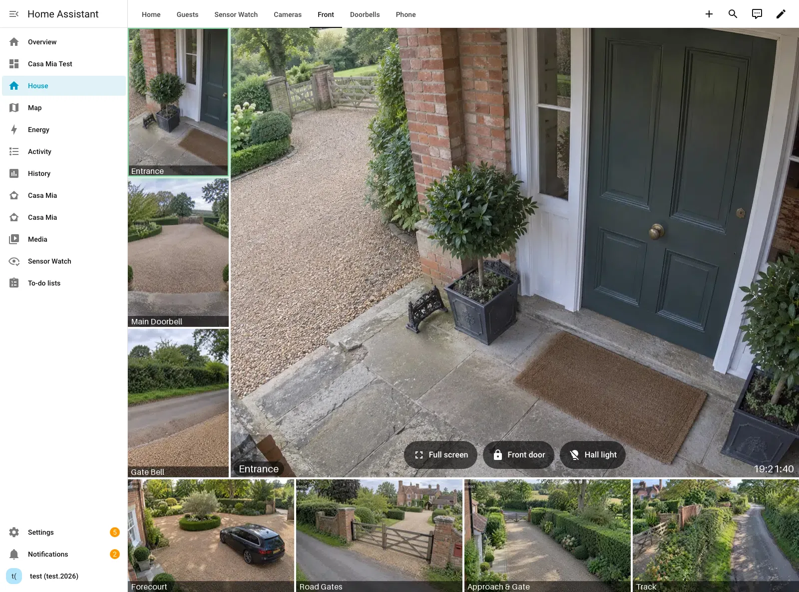

- **The buttons** have Casa Mia's chip size, font and shape: the same on every device,
  in capitals, and always with their names. They are white on a see-through black.
- **The camera's controls.** Each button shows the entity's own icon and the name you
  gave it, and is coloured while the entity is on, open or unlocked. A tap is Home
  Assistant's toggle, the same as a tap on the entity's tile on a dashboard: a light
  switches, a lock locks or unlocks, a cover opens or closes. An entity that Home
  Assistant can't find, or that is unavailable, has a dimmed button that says so. The
  controls belong to the camera, so they change when the main camera does.
- **Two taps.** A control with **Two taps** ticked on the Cameras page (a lock, a gate
  or a garage door, unless you untick it) is not worked by its first tap. That tap turns
  the button amber and adds "tap again" to its name, and a second tap on it works it. A
  tap anywhere else, or six seconds without the second tap, lets it be. If the entity
  changes in the meantime (someone opens the gate from elsewhere), the button is no
  longer ready, and the next tap starts again.
- **The camera's PTZ presets.** They are in the same bar, after the controls. A camera
  with up to three presets has a button for each, named as the preset is on the Cameras
  page. A camera with more has one **PTZ** button: a tap opens all its presets as a
  second line beside the bar, on the picture's side of it (under a bar along the top, to
  the left of a bar down the right), and another tap on it, or a tap anywhere else on the camera, puts them away. A tap on a preset
  moves the camera. If Home Assistant refuses, the reason is shown with the controls for
  ten seconds.
- **The camera's zoom.** A camera with a zoom entity has a **Zoom** button in the same
  bar, showing its level as a share of the zoom's range. A tap opens a line beside the
  bar: **Out** and **In** move a tenth of the range each, the level is between them, and
  **Reset** zooms all the way out. The level is the camera's own, so it follows a PTZ
  preset that moves the lens, and a level asked for and not yet reached is shown as on
  its way. The presets and the zoom are never both opened out: opening one puts the
  other away.
- **Where they show.** With **Its controls over the main camera** on, over the main
  camera on the commander. They are always on the main camera's full screen (**A tap on
  the main camera: full screen, with its controls**), whatever that switch says.
- **Where they go.** The edge they go along, where along it they sit and how solid their
  background is are set for each camera on the Cameras page, under **Controls on a full
  screen**. There is one edge for a wide space and one for a tall
  one. Over the main camera, wide or tall goes by the shape of the main camera's area,
  not by the screen's.
- **Sound button.** Off by default. A button to hear the main camera, shown wherever the
  camera's controls are, when the main camera is playing as live video. Sound goes back
  to off when the main camera changes, so a camera is never heard without a tap of its
  own. The camera is not heard while you talk to a doorbell, because the visitor is heard
  through Talk.
- **Full screen button.** Off by default. A button named **Full** that puts the whole
  commander over the entire screen. It shows over the main camera whether or not the
  camera's controls do.

#### The commander full screen

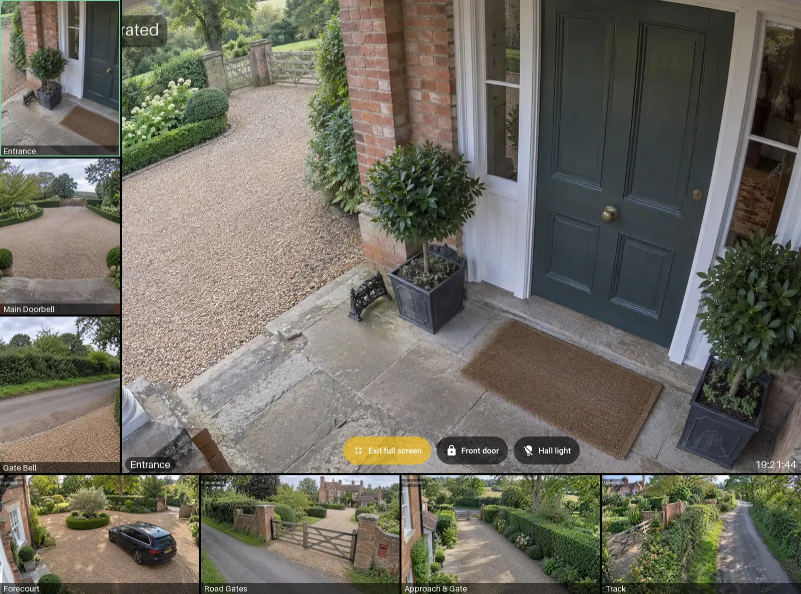

A tap on **Full** asks the browser to show the card by itself. The browser's
address bar and tabs go, and so do Home Assistant's header and sidebar. The commander is
drawn again for the larger space. The button is shown pressed; tap it again to go back, or use the
browser's own way out (Esc on a keyboard, or the close button Safari shows).

- It works in a browser on a computer or a tablet, Safari on an iPad included.
- Safari on an iPhone, the Home Assistant app on an iPad or an iPhone, and a frame that
  doesn't allow full screen can't give a page the whole screen. There the commander
  fills the app's window instead, over Home Assistant's header and sidebar. In Safari on
  an iPhone, Safari's own bars stay.
- A kiosk app that zooms its pages (to 1.6×, say) loses the zoom in the browser's full
  screen, so everything there would be smaller than on the page. The card sees the zoom,
  and there it fills the kiosk's window instead, which already fills the screen, so the
  zoom stays. It also asks for the picture at the zoomed size, so it is sharp.
- An iPad keeps its status bar (the time, the date, the battery) on top of a full screen
  page. The commander leaves a black strip at the top for it, so the status bar doesn't
  sit over the picture.
- A browser only allows full screen from a tap, so after the page reloads it has to be
  tapped again. For a tablet that is left on one page,
  add the page to its Home Screen instead (Safari: Share, then **Add to Home Screen**),
  which opens it without the browser's bars every time.
- A tap on the main camera that opens its more-info leaves full screen first, because
  Home Assistant's dialog would otherwise open underneath the card.
- This is not the same as **A tap on the main camera: full screen, with its controls**.
  That shows one camera, live, over the browser's window. The Full screen button shows
  the whole commander over the entire screen. The two work together: the button is on
  the camera's full screen too.

### Talking to a doorbell

When the main camera is a doorbell with a call sensor from the [Intercom](intercom.md),
and the card shows its main camera as live video, the card can talk to it, even while the
video itself is lost: talking uses a connection of its own. The page must be
on an https address, because browsers only give a microphone to secure pages.

- **Talk** asks for this device's microphone and opens a sound-only connection to the
  doorbell, so the visitor hears you and you hear them. A red **Live to …** label shows
  while the microphone is on. You can still tap other cameras during the call: the main
  camera changes on every device showing the commander, as it always does, and the call
  carries on. The label and Hang up stay over the main camera, and a tap on the
  doorbell's tile brings it back.
- **Hang up** stops the microphone, and the call ends. Leaving the page, scrolling the
  card away or switching to another app hangs up at once.
- Every device shows the call: **Ringing**, **Answered by …** (the Home Assistant user
  who answered) or **Missed**. While one device has answered, Talk on another is refused
  and that device keeps its live video.

#### Half duplex: hold to talk

With **Mode** under **Intercom** set to half duplex, the button says **Answer**. Answering
opens the call with the microphone silent: you hear the visitor, and the door hears nothing. A **Hold to
talk** button appears next to Hang up, and your voice goes out only while you hold it,
like a walkie-talkie. While you hold it the button says **Live**, and the visitor's
sound is muted on this device, so your own voice doesn't come back to you. The call is
already connected, so your first word isn't lost.

The voice stops when you lift your finger anywhere on the screen, when the browser loses
focus, and when you lock the phone or switch app (which also hangs up). The browser's
microphone indicator stays on for the whole call, because the page holds the microphone
between holds.

In half duplex the call ends after **2 minutes** without a hold. The timer stops while
you hold the button and starts again from 2 minutes when you let go, so a long
conversation carries on as long as you keep using it. A single hold counts for at most 2
minutes, so a finger resting on the screen can't keep a call open forever. In full
duplex the limit is 10 minutes, and any touch on the screen of the device that answered
starts it again. Only the device that answered can extend a call: nothing the visitor
does, such as ringing again, changes the timer. Every device showing the doorbell has a
pill with the time left (**Hangs up in 1:42**, amber in the last 30 seconds), or
**Held** while the button is held. The timer is the [Intercom](intercom.md)'s.

Half duplex suits phones, where a call left answered could otherwise play your voice at
the door without your knowing. Each card has its own setting, so one dashboard can use
half duplex on the phones and full duplex on the wall tablets: give each a card and show
it with Home Assistant's **User** visibility condition.

To use one of your own dashboard buttons instead of the card's, give it this tap action:

```yaml
tap_action:
  action: fire-dom-event
  casa_mia_commander:
    talk: toggle            # or "on" / "off"
    duplex: half            # optional: answer in half duplex
    call: sensor.oak_door_call          # optional: answer this doorbell, whatever is on screen
    entity: select.oak_door_commander   # optional: only this commander's card
```

Without `call`, the button talks to the main camera's doorbell, and only while its live
video is shown. With `call`, it answers that doorbell even when another camera is the
main one: the call is sound only, so the doorbell needn't be on screen, and one Commander
card on the page answers it. A toggle with `call` hangs up when this device has the call
and answers otherwise.

The button can show the call sensor's state. This device is talking when the sensor is
`answered` and its `answered_by` attribute is this device's Home Assistant user.

### The Talk tile

A plain tile can't say whether this tablet is the one talking, so Casa Mia has a card
for it: **Casa Mia Talk tile** in the Add to dashboard dialog. It is Home Assistant's own
tile card on the doorbell's call sensor, so it looks like your other tiles and takes
every tile option, but its name and icon follow the call:

| The call | Name | Icon |
|---|---|---|
| Answered on this tablet | Hang up | `mdi:phone-hangup` |
| Answered by another user | Answered by … | `mdi:microphone-off` |
| Ringing | Talk | `mdi:bell-ring` |
| No call, or the sensor unavailable | Talk | `mdi:microphone` |

"This tablet" means this tablet's Home Assistant user, so give each tablet its own user.
A tap answers or hangs up through a Commander card on the page, even when the doorbell
isn't its main camera (the page needs a Commander card, which owns the microphone); pick
a **Commander** to send it to that one only. In the editor:

- **Name** replaces "Talk" only. "Hang up" and "Answered by …" always show, because they
  say what a tap will do.
- **Icon** sets one icon for every state. Under **Icon for each state** you can change
  just one of the icons above instead.
- **Colour** sets one colour for every state. Under **Colour for each state** you can
  set one per state; a state without one keeps the tile's normal colouring.
- **Layout** and **Interactions** are the tile's own. A tap action you set replaces Talk,
  and the icon's tap does the same as the tap unless you set it too.

```yaml
type: custom:casa-mia-talk-tile
entity: sensor.gate_doorbell_call
colors:
  hang_up: red
  ringing: amber
```

Two more options make it a half duplex pair:

```yaml
button: answer   # or hold
duplex: full     # or half; only for button: answer
```

- **`duplex: half`** answers in half duplex (see above), and the tile says **Answer**
  rather than Talk.
- **`button: hold`** makes it the **Hold to talk** button. Your voice goes out while you
  hold it, and it says **Live** while the voice is actually going out. It is enabled only
  on the device that answered in half duplex; everywhere else it is greyed out and
  ignores presses, but stays in place, so you know where it is before you need it. Its
  states for `icons:` and `colors:` are `hold` and `live` (red unless you set one). It
  takes no tap actions. A plain tile can't do this, because a tile's hold action fires
  once and nothing tells it when the finger lifts.

```yaml
- type: custom:casa-mia-talk-tile
  entity: sensor.gate_doorbell_call
  duplex: half
- type: custom:casa-mia-talk-tile
  entity: sensor.gate_doorbell_call
  button: hold
```

## Troubleshooting

- **"Picture failing for … : retrying" over the card:** the browser keeps refusing or
  cutting off the picture, and the card keeps asking for a new one. It goes once no
  failure has come for 15 seconds. A picture that shows nothing for 10 seconds counts as
  a failure too, as does Home Assistant giving no token for it. The browser's console
  has a `casa-mia: the picture failed` line, and the app's log says how each stream
  ended.
- **"Live lost … ago" in red under the main camera:** none of the camera's channels is
  playing as live video on this device, and the drawn picture is shown instead. The
  reason follows the time. Each channel is tried again after 30 seconds, then after
  longer each time up to 10 minutes; choosing another main camera and coming back tries
  at once. Home Assistant's log has a line for each loss and return, under
  `casa_mia_commander`: the user, the channel, the reason and the video formats the
  device plays.
- **"The camera's video is in a format this device can't play":** the camera sends a
  format, usually H.265, that this device's browser can't decode over WebRTC. The log
  line lists what the device does play. On Android, update Android System WebView first:
  a 2026 tablet still on its factory WebView 131 couldn't play H.265 live video, and
  played it after an update to WebView 157 with nothing else changed. A tablet without
  the Play Store never updates it by itself, so install the update with
  `adb install -r`. Otherwise set the camera to H.264 (in UniFi Protect,
  the camera's encoding setting: Standard is H.264, Enhanced is H.265), or leave it: the
  drawn picture is the same camera.
- **A tablet plays the medium channel (M) on full screen, not the high one:** the tablet
  says it can't decode the high channel smoothly, so the card doesn't try it. Many
  tablets decode H.265 only up to 2560 x 1440, and a 4K or 2688 x 1512 high channel is
  larger. Trying it anyway never showed a frame there, and stopped the channel already
  on screen too. The browser's console has a `casa-mia:` line for each size it rules
  out.

- **Taps on the commander do nothing:** the page says so when Home Assistant has no Main
  camera select for it yet: add the Casa Mia Camera Commander integration (see "In Home
  Assistant"), or restart Home Assistant if it was just updated (Settings → Repairs).
- **A tap on the main camera opens a dashboard page, not the camera:** the card was saved
  with "its page on the camera dashboard" chosen; choose more-info in its editor.
- **No motion dot on a camera:** check its motion detection on the [Cameras](cameras.md)
  page.
- **No chips when the camera sees someone:** the card shows what the camera's event
  entities report. In Developer tools, States, the commander's Main camera select has a
  `detections` attribute that lists each camera's event entities; a camera missing from
  it has none on its device (in UniFi Protect, check its smart detections are on).
- **A press on the main camera's name opens nothing:** its recordings are offered only for
  a UniFi Protect camera that Protect's media library has a folder for (Media in Home
  Assistant's sidebar, then UniFi Protect), and never to a guest. The card looks once
  each time the page loads, so for a camera added since, reload the page.
- **A clip doesn't play:** the dialog says why, and the browser's console has a
  `casa-mia:` line for each step. When a browser can't play a clip from Home Assistant's
  address, the card fetches the whole clip first, saying how much has arrived, and plays
  it from there.
- **The log** has a line for every save (`commander: saved N commanders (changed: …)`)
  and every main camera chosen (`commander '…': main camera … (from Home Assistant)`).
