# Dash-Bored — YADD

**Yet Another Dashboard Designer**

> **Maturity: In development.** Being built: parts work, it changes often, and an update may break it. For the curious. ([The levels](../README.md#maturity))

> **This is a work in progress.** Of the eighteen, one runs in Home Assistant today (the
> Gazette) and a second is about half built (Bakelite). The other sixteen are mock-ups:
> designs that work against an invented house but don't talk to Home Assistant yet. They
> are being built one at a time, and what is here changes often.

Aren't you bored with the endless proliferation of Home Assistant dashboards being churned
out by AI? Often by well-meaning folk, mostly similar, all beautiful, but sadly forgettable
in today's ecosystem.

I was.

But taking the pee is much more fun than shouting into the wind.

So I decided to have some fun.

Eighteen wildly different ways of controlling the same house. From a mechanical watch
movement to a Heath Robinson contraption, a 1980s circuit board, a railway departures
board, a modular synthesiser, and even a newspaper that reports on the goings-on in your
house.

Some are beautiful. Some are bonkers. A few might actually be useful.

And they're not just pictures. The switches switch, the levers lever, the lights light, and
the house responds.

It's free, it's open source, and there's no business model lurking behind it.

Dash-Bored. Because the world clearly needed another dashboard designer.

Part of Casa Mia.

Dash-Bored is an integration of its own. It installs without the Casa Mia app and without
the Casa Mia integration.

## The eighteen, and where each has got to

The first two can be used. The pictures of the others are of their mock-ups.

<table>
<tr>
<td width="33%" valign="top">
<a href="#the-gazette">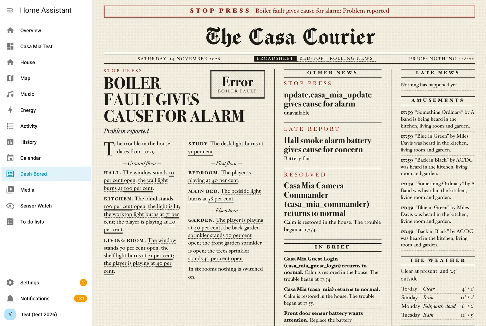</a>
<p><b><a href="#the-gazette">Gazette</a></b> · Being built<br>The house as a newspaper. Stories are ranked, so what matters most leads; a Sensor Watch alert is breaking news. Three papers from the same stories: a broadsheet, a red-top and a rolling news channel. One column on a phone.</p>
</td>
<td width="33%" valign="top">
<a href="#bakelite">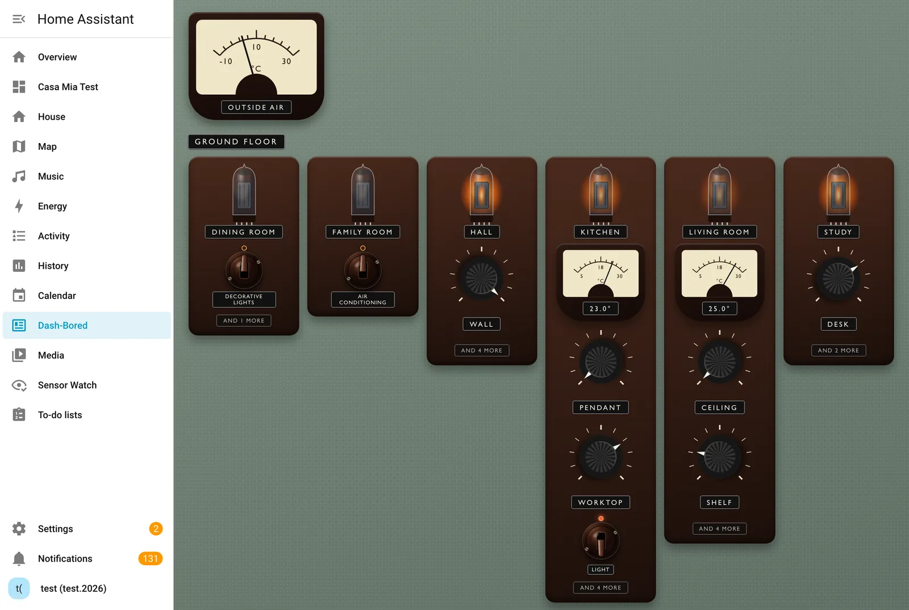</a>
<p><b><a href="#bakelite">Bakelite</a></b> · Being built: lights, switches and scenes so far<br>A 1950s instrument panel: glowing valves, moving-coil meters, fluted dimmer knobs, tumbler switches and knife switches for scenes.</p>
</td>
<td width="33%" valign="top">
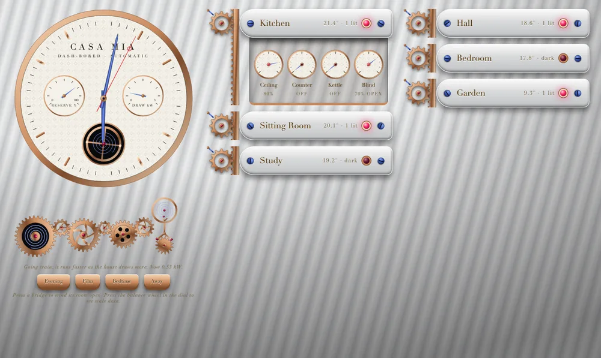
<p><b>Calibre</b> · Mock-up<br>A watch movement. Each room is a bridge wound open by a pinion and rack, the going train runs faster as the house draws more, and a lever escapement ticks while data is fresh.</p>
</td>
</tr>
<tr>
<td width="33%" valign="top">
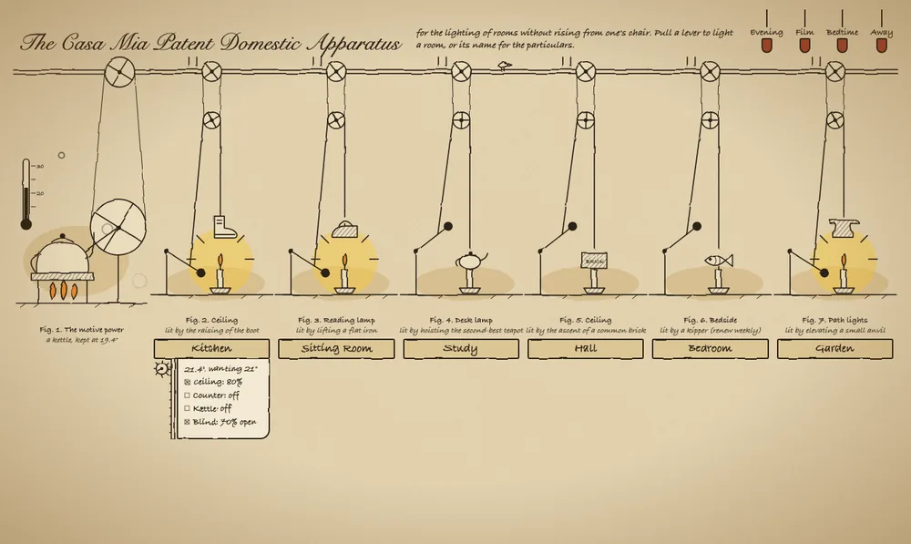
<p><b>Contraption</b> · Mock-up<br>A Heath Robinson apparatus in pen and wash. Pull a lever and a rope lifts a boot, a kipper or a small anvil off a candle to light the room.</p>
</td>
<td width="33%" valign="top">
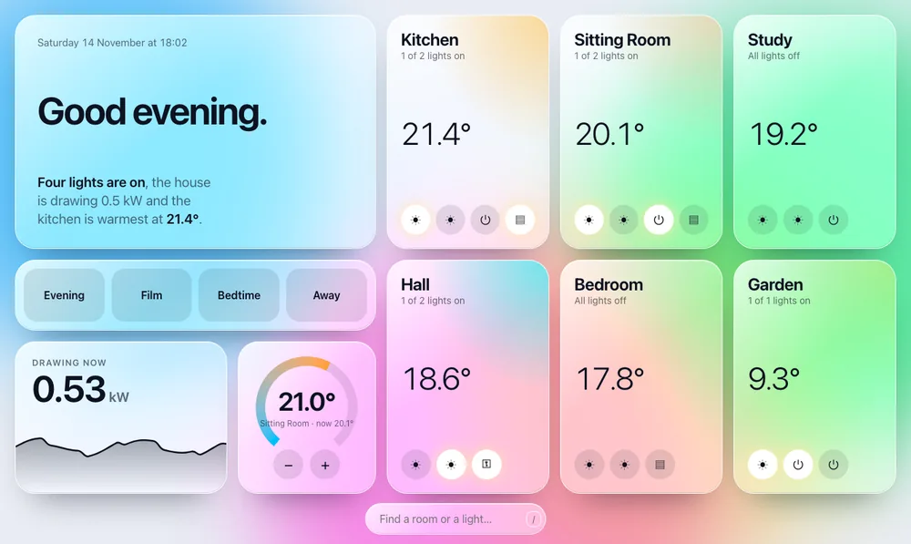
<p><b>Aurora</b> · Mock-up<br>Current web style: glass tiles in a bento grid over a sky that warms as lights come on. A room tile grows into a sheet of faders.</p>
</td>
<td width="33%" valign="top">
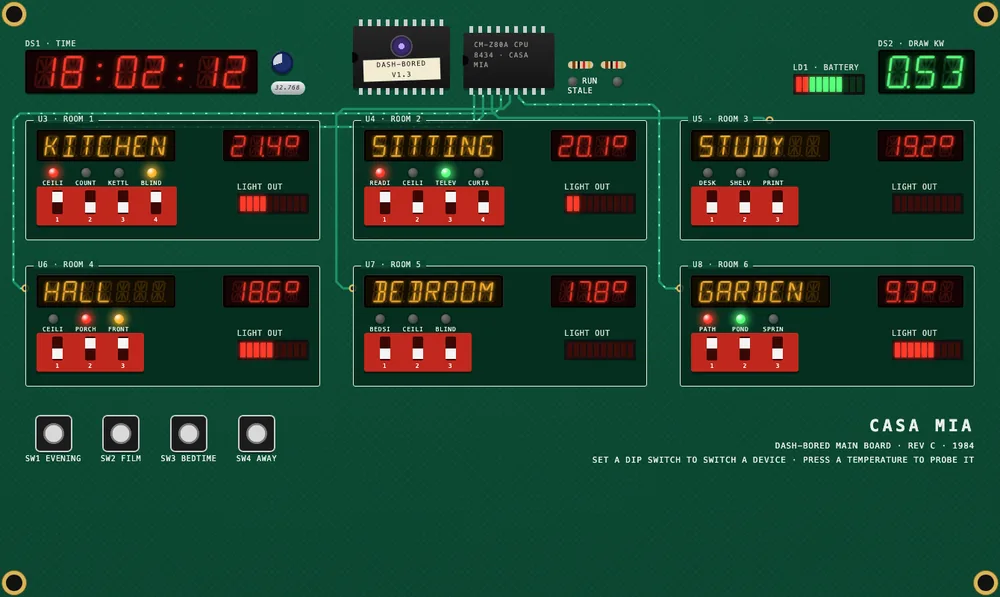
<p><b>Board</b> · Mock-up<br>A 1984 circuit board. Starburst and seven-segment LED displays, DIP switches for devices and traces that carry a signal while a room is on.</p>
</td>
</tr>
<tr>
<td width="33%" valign="top">
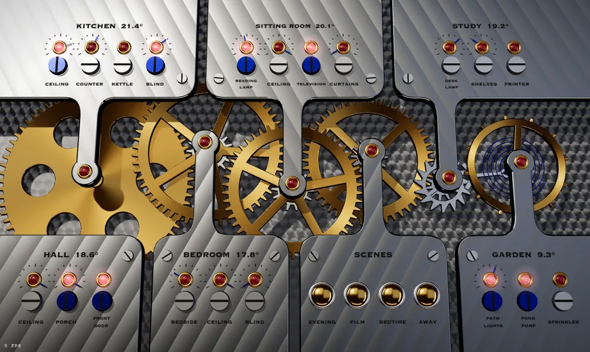
<p><b>Movement</b> · Mock-up<br>A watch movement that fills the screen, rendered as real 3D metal under one lamp. A going train, lever and balance run across the middle; each room is a bridge, with screws for switches and jewels for pilot lamps.</p>
</td>
<td width="33%" valign="top">
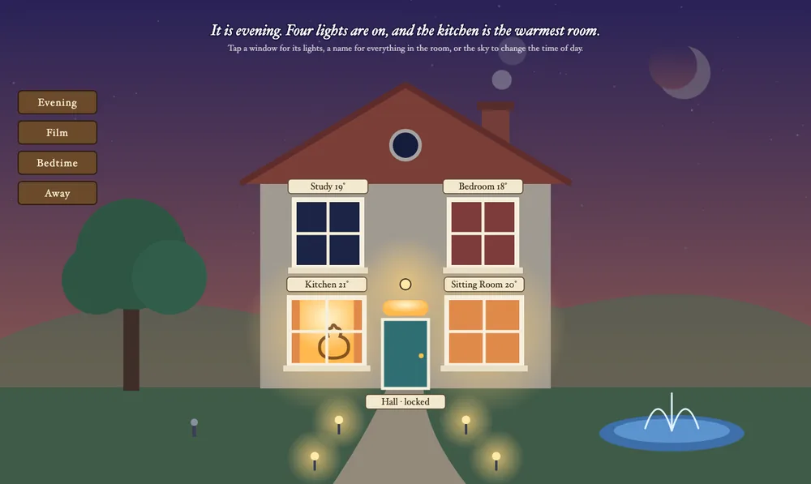
<p><b>Dusk</b> · Mock-up<br>A storybook picture of the house from the garden. Lit rooms have glowing windows, curtains draw, the door stands ajar when unlocked, and the sky follows the time of day.</p>
</td>
<td width="33%" valign="top">
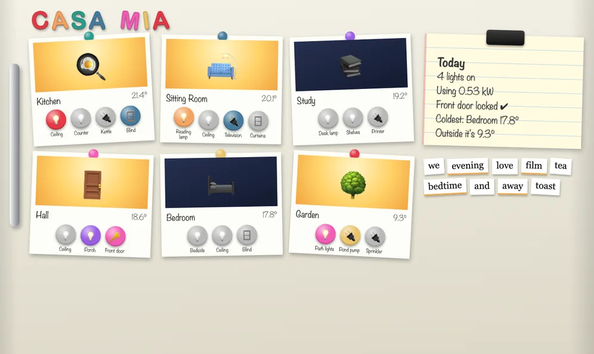
<p><b>Fridge</b> · Mock-up<br>The fridge door: a polaroid per room, button magnets for devices, a notepad of the day's facts and fridge-poetry words for scenes.</p>
</td>
</tr>
<tr>
<td width="33%" valign="top">
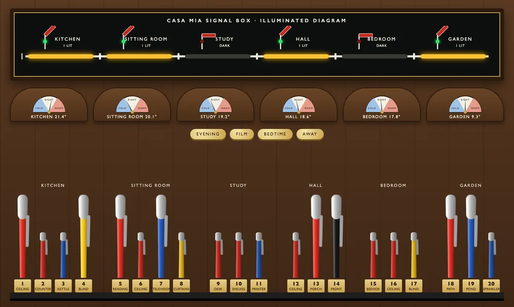
<p><b>Lever Frame</b> · Mock-up<br>A railway signal box: an illuminated diagram, block instruments for temperature and a frame of coloured levers to pull.</p>
</td>
<td width="33%" valign="top">
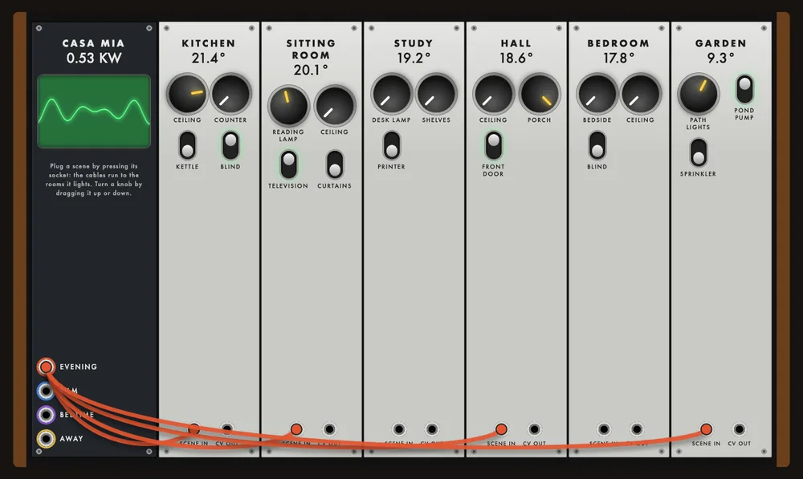
<p><b>Patch Bay</b> · Mock-up<br>A modular synthesiser. Knobs for lights, toggles for switches, and scenes patched to rooms with hanging cables.</p>
</td>
<td width="33%" valign="top">
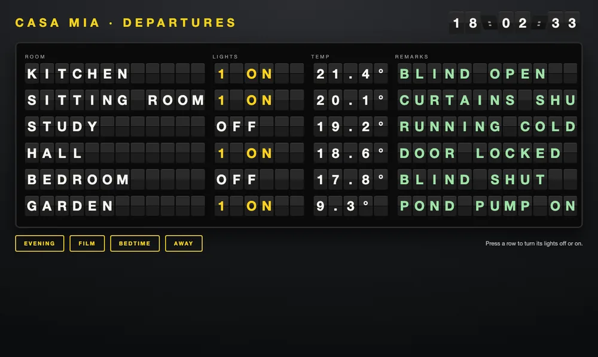
<p><b>Departures</b> · Mock-up<br>A split-flap station board that turns through every letter to reach the new state.</p>
</td>
</tr>
<tr>
<td width="33%" valign="top">
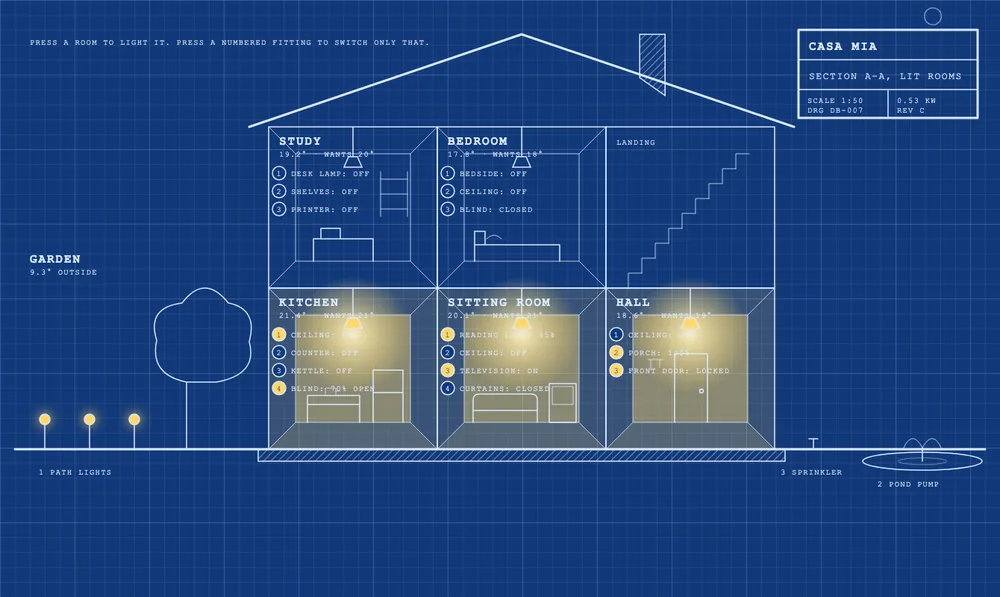
<p><b>Cutaway</b> · Mock-up<br>A blueprint section through the house. Lit rooms fill with warm light; fittings are numbered as on a drawing.</p>
</td>
<td width="33%" valign="top">
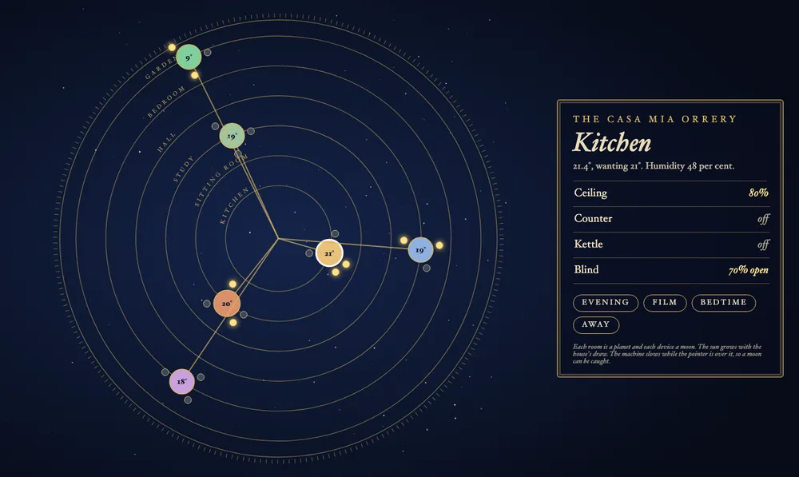
<p><b>Orrery</b> · Mock-up<br>Rooms as planets and devices as moons, on brass arms around a sun that grows with the power drawn.</p>
</td>
<td width="33%" valign="top">
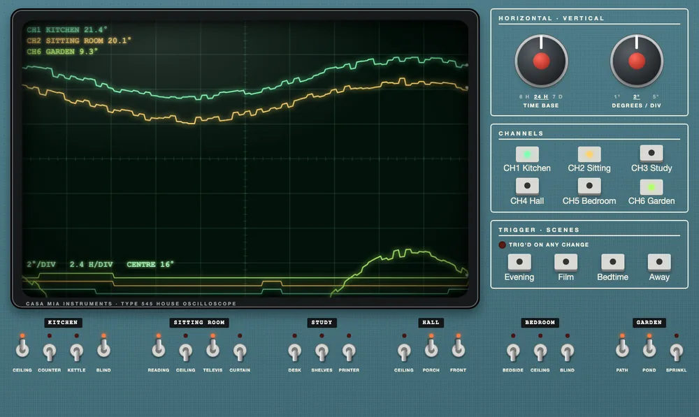
<p><b>Scope</b> · Mock-up<br>A 1970s bench oscilloscope. Each room is a channel: its temperature history as a phosphor trace, its lights as a square wave, with rotary switches for the time base and scale.</p>
</td>
</tr>
<tr>
<td width="33%" valign="top">
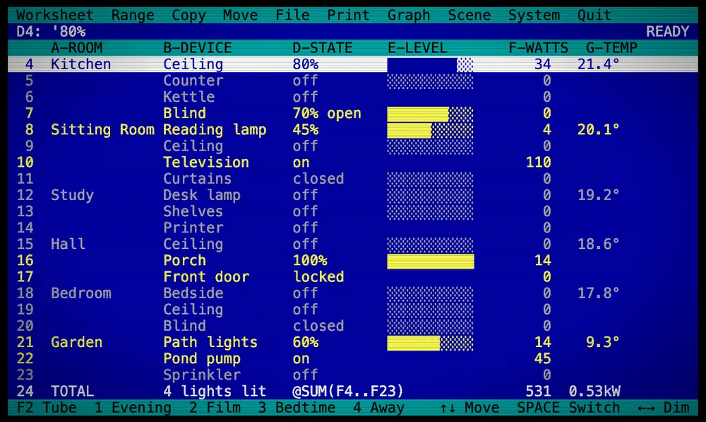
<p><b>Text Mode</b> · Mock-up<br>An 80 by 25 character worksheet driven from the keyboard, on a choice of four tubes: business blue, green, amber and white phosphor.</p>
</td>
<td width="33%" valign="top">
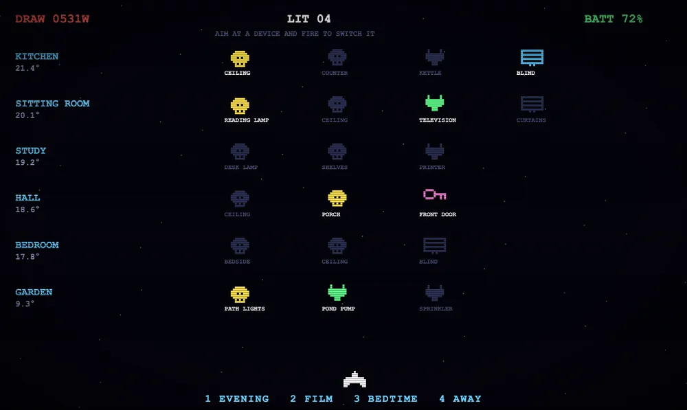
<p><b>Arcade</b> · Mock-up<br>A fixed-shooter cabinet. Devices hang in formation by room; aim and fire to switch one.</p>
</td>
<td width="33%" valign="top">
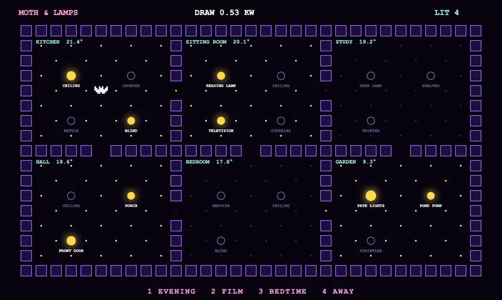
<p><b>Moth</b> · Mock-up<br>The house as a maze. Press a lamp and a moth flies to it through the doorways and switches it.</p>
</td>
</tr>
</table>

## Setting it up

Add **Dash-Bored** under **Settings → Devices & services → Add integration**. There is
nothing to fill in. A **Dash-Bored** entry appears in the sidebar for every user.

The page is built from your areas. Each area that has lights, switches, covers, locks or any of the
other devices listed below becomes a room, and those devices are what it reports on. Entities you have hidden, and
a device's configuration and diagnostic entities, are left out. If a room is missing,
give its devices an area in Home Assistant.

If your areas are on floors, the rooms are grouped under a heading for each floor, from
the lowest up, and the areas on no floor come last under **Elsewhere**. A device is named
without its room or its kind: "Kitchen Ceiling Light" in the kitchen is "Ceiling". To
keep a device off the page, give it the label **Dash-Bored hide** (see What your house is
missing).

## Choosing a family

The page opens as the Gazette. To change it, press twice quickly in the top right corner
of the page, on a part of it that is not a button or another control. A choice opens with
a small drawing of each family; press one and the page becomes it.

The choice is remembered by the browser it was made in. A tablet on the wall, a phone and
a desktop each keep their own. The Gazette's three papers are a separate choice, made on
the paper itself (see [Three papers](#three-papers)).

## The Gazette


The page works out what is worth saying about the house and puts the most important
thing at the top:

| Story | When |
|---|---|
| A Sensor Watch alert | A watched sensor is above its normal level. The worst ones lead. |
| A door found unlocked | Any lock that is unlocked. |
| Devices not answering | Any shown device that is unavailable, with since when. |
| A sensor back to normal | For ten minutes after a Sensor Watch alert clears. |
| An appliance at work | A switch that is the only one on its device, where that device also has a power sensor reading 1 kW or more. |
| Lights left on | Any lights on. "Ablaze" when it is seven or more and at least half of them. |
| | The story has two buttons. One puts the lights out. The other dims them: each lit light that can be dimmed and is brighter than 30 per cent is set to 30 per cent, and it is shown only when there is such a light. |
| A cold room | A room more than 0.8° below its thermostat's target. |
| Power in use | Only if the card names a power sensor (see below). |
| The weather | The outside temperature, from a weather entity. |

Under the main story is a report on every room. Each underlined fact is a switch: press
"the counter light is out" and the light comes on. **The switchboard** at the side has
every device as a plain button, and **Notices** has your scenes.

A house with more than 30 devices is reported differently, because a sentence for each
device would run to many screens. The report then covers only what is on, open, unlocked
or not answering, and ends with a count of the rooms where nothing is. A room with more
than three lights lit has them as one fact, such as "five lights are lit"; press it and
those lights go out. More than three switches running in a room are given as a count,
which can't be pressed. The switchboard
still has every device, and is set in columns across the foot of the page.

Some stories have a button that puts them right, such as **Lock it** or **Lights out**.

### Dimming a light, and part-opening a blind

A light that can be dimmed, or a blind that can be set to a position, has its level as a
separate press. In the report the level is underlined twice (highlighted in the red-top):
press "40 per cent" and a scale opens under the sentence. On the switchboard such a device's
tab shows its level and opens its clipping (see below), which has the same scale. That is how to
bring a light that is off on at a low level.

Over the scale is a readers' poll: a question, such as "Readers are invited to say whether
the ceiling light is too bright", and a vote each way. Each vote moves the level by 10 per
cent, which is easier than the handle on a wall tablet. The scale is for a large change.

Slide the handle, vote, or use the arrow keys, and the level is sent when you stop. The figure
beside the scale is what the device itself reports. Until it reports that it has moved,
the level you asked for is shown after an arrow, as in "40 per cent → 70". If that stays,
the device has not done as it was asked.

A garage door or a gate has no scale, for the reason given under
[What a press will never do](#what-a-press-will-never-do).

### Photographs

A camera that can tell what it has seen gets its picture in the paper. When one of its
detections fires, Dash-Bored takes a still from the camera at that moment and the Gazette
prints it with a headline for ten minutes.

Pressing a photograph opens it as a clipping, large and as it was taken, so that you can
look at what was seen. Pinch it with two fingers to go closer and drag it to move about;
a double tap, or the mouse wheel, zooms too. **See the camera as it is now** under it
opens the camera in Home Assistant's own dialog, with its live view. A closer look shows
more only as far as the photograph has detail, and one that came from UniFi Protect's
thumbnail may be smaller than a still from the camera.

Each camera has one story at a time: the most pressing thing it saw in the last ten
minutes. If a camera reports an animal just after a person, the person stays.

A column called **Thirty minutes ago** (**Rewind** in the red-top) lists the latest ten
sightings of the last half hour, newest first, each with its time, its camera and a small
photograph. Pressing one opens its photograph in the same way.

These detections take a photograph: somebody at the doorbell, a person, a vehicle, an
animal, and a smoke or carbon monoxide alarm heard by the camera. A doorbell story is near
the top of the page, a person is above the lights that are left on, and a vehicle or an
animal is lower down. Plain motion takes no photograph, because in a house with several
cameras it would fill the paper.

It works with any camera whose detections are binary sensors or event entities on the
same device as the camera entity, which is how UniFi Protect and Frigate set theirs up. The sort of detection is told
from English words in the detection's name.

If you run the Casa Mia app with Camera Commander, Dash-Bored first asks it for the
picture. Camera Commander is already fetching the cameras that its commanders show, at
their streams' full size, so a picture it has from the last five seconds is used and the
camera is not asked again. A camera that no commander being watched shows has no picture
that new, and is asked directly. Home Assistant's log says where each photograph came
from.

A UniFi Protect camera gets one thing more. Protect makes its own thumbnail of each
detection, choosing the frame itself. The sighting is printed at once with the photograph
taken at that moment, and Protect's thumbnail replaces it when Protect has it, within 15
seconds. If Protect has none, the first photograph stays.

Each such camera gets one new entity on its device, an image called **Last sighting**. It
holds the latest photograph and the sort of sighting, and you can use it on any other
dashboard. Its state is when the photograph last changed, and its `seen` attribute is when
the camera saw it. Things to know:

- The photographs are kept in memory: up to 40 sightings from the last half hour. After
  Home Assistant restarts there are none until the next detection.
- Two detections on one camera within five seconds share one photograph.
- If the camera does not answer, the story is printed without a photograph, and the reason
  is in Home Assistant's log.
- A camera added later gets its entity when Dash-Bored is next reloaded.
- The label **Dash-Bored hide** on the camera, its device or its area keeps its sightings
  off the page.

### What your house is missing

**Corrections and clarifications** lists what Home Assistant has not been told about the
house and the page needs. It is not shown when nothing is missing.

| It lists | What to do |
|---|---|
| Devices in no area | Give the device an area, or hide it. Until then it is not on the page. |
| Suspected plumbing | Things that by their names are settings or indicators, not devices in a room: a status LED, a relay, a screensaver switch. A guess from the name, in English only. See below. |
| Devices sharing a name | Two devices in one room whose names shorten to the same thing. Rename one. |
| Rooms on no floor | Only in a house that has floors. Give the area a floor. |
| Rooms without a thermometer | Set the area's temperature sensor, or put its thermostat in the area. |

Each line is a count that opens into a list. Press a device to open its dialog, or a room
to open its area's settings.

Home Assistant already has a way to say that an entity is a setting: its category,
configuration or diagnostic. Dash-Bored leaves those out, and so do Home Assistant's own
automatic dashboards. An integration sets the category, and it can't be changed in Home
Assistant's settings, so the suspected plumbing is grouped by integration:

- **ESPHome:** add `entity_category: config` (or `diagnostic`) to the light or switch in
  the device's YAML.
- **KNX:** add `entity_category: config` to the entity in the KNX YAML.
- **Anything else:** give it the label **Dash-Bored hide**, which Dash-Bored makes when it
  is set up. The label works on an entity, on a device (all its entities) and on an area
  (everything in it), and takes them off Dash-Bored's pages only. Hiding the entity in
  Home Assistant takes it off every dashboard.

### What a press will never do

A lock, a garage door, a gate, a valve or a siren is never operated by a press on a
sentence or on the switchboard, because a stray touch must not unlock the house, turn
the water on or set a siren off. Pressing one opens its
clipping, where unlocking, opening or sounding takes two presses: the button changes to **Press
again to confirm** for a few seconds. Locking and closing take one. A device that is not
answering opens its clipping too.

An alarm panel can't be set or unset from the page at all. The page is open to every
user and has no keypad, so that stays in Home Assistant's own dialog, which the
alarm's clipping links to. The **Lock it** button under an unlocked door does lock
it.

### Thermostats, media players and cameras

These are devices in their rooms too, but a press on one in a sentence or on the
switchboard switches nothing: it opens the device's clipping, so that a stray touch
doesn't stop the heating or the music.

- **A thermostat** is told with its target, as in "the thermostat is set to 21°". The
  target is a level like a light's: its poll asks whether it is set too warm, and each
  vote moves it half a degree. Its clipping gives its own reading, and has a button that
  turns it off or on. A thermostat that holds a range, not a single target, is told as
  "at work" and has no scale.
- **A media player** is told with its volume, as in "the player is playing at 40 per
  cent". Its poll asks whether it is too loud, in steps of five. Its clipping says what is
  playing, and its button pauses or plays.
- **A camera** is on the switchboard, and in the report only if it stops answering. Its
  clipping shows its latest picture, which opens large when pressed; **Home Assistant's
  own page** has the live view.

### The other devices

| Device | How it is told | What a press does |
|---|---|---|
| Fan | On or off, with its speed as a level: "the fan turns at 60 per cent". | Switches it. Its level has the scale and a poll. |
| Humidifier | On or off, with its target humidity as a level. | Switches it. Its level has the scale and a poll, in fives. |
| Water heater | Its target temperature, as a thermostat's is. | Opens its clipping, which has its own reading, the scale and poll (a degree a vote) and an on and off button. |
| Valve | Open, shut, or how far open. | Opens its clipping. Opening takes two presses. |
| Siren | Sounding or silent. | Opens its clipping. Sounding it takes two presses. |
| Vacuum, lawn mower | Cleaning or mowing, docked, on its way home, paused, or in trouble. | Opens its clipping, which starts it or sends it home. |
| Alarm panel | Set, not set, being set, about to sound, or sounding. | Opens its clipping, which has no button. An alarm that is sounding leads the paper, above everything else. |

### A device's clipping

Every device has a story of its own, laid over the page like a cutting. It opens from the
tab beside the device's button on the switchboard, and from a line about the device in
the late news.

The clipping says how the device stands and since when, and has a button that puts it the
other way. A light that can be dimmed or a blind that takes a position has its poll and
scale there. Under those is **The record**: a band for the last 24 hours, inked where the
device was on, open or locked, and its latest changes with their times. The record comes
from Home Assistant's history when the clipping is opened, and goes on as things happen.
Home Assistant's history keeps a blind's positions but not a light's brightness, so a
light's record is of when it was lit, and shows a dimming only if it happens while the
clipping is open.

**Home Assistant's own page** at the foot opens Home Assistant's dialog for the device,
for its settings. Escape, **Fold away** or a press outside the clipping closes it.

### Three papers

The names in the line under the masthead choose the paper, and all three are written
from the same stories. Each browser remembers its own choice.

- **Broadsheet**, The Casa Courier, is sober.
- **Red-top**, the Daily Fuse, is not.
- **Rolling news**, The Thermostat, is written and laid out as a news website: plain sentences
  in the present tense, blue where the other two are red, the headlines passing in a ticker under the dateline, and a
  clipping as a card with straight edges. If your device is set to reduce motion, the
  ticker stands still.

### Personal

A column of announcements about the household, each with its time, newest first:

- **Comings and goings.** Each person's latest move: arrived home, left the house, or
  arrived at one of your zones. It is read from Home Assistant's person entities, so it
  needs people with a device tracker.
- **Songs.** With [Love it or Loathe it](love-or-loathe.md), each song somebody loves or
  loathes: "Ann wishes it known that “Night Train” by The Sleepers is greatly to their
  liking". The column prints each person's latest word on a song, and a rating taken
  away takes its announcement with it.

An announcement stays for twelve hours and the column holds the latest eight. It is left
out while there is nothing to announce. A person with the label **Dash-Bored hide** is
left out of it.

Songs are kept in memory, so a restart of Home Assistant empties them. After a restart
Home Assistant also gives every person's state the time of the restart, so each is
announced as having arrived or left then.

The page is in the sidebar for every user, guests included, so this column tells anyone
who can open it who is at home.

### Amusements

A column of the last six things the house's media players played, newest first: the
song or programme, the room, and whether it is on now. It is called **Showbiz** in the
red-top. Speakers that began the same song within a minute of each other are one line
with all their rooms. Pressing a line opens that player's clipping.

With [Love it or Loathe it](love-or-loathe.md), a song is followed by who loved it and
who loathed it. These change as soon as somebody rates the song or takes a rating away.

- A player is listed only if it is a device on the page, and only when it gives a title.
  Many televisions tell Home Assistant their input or app and nothing else, and those
  are left out. A programme is named by its series, or by its channel if that is all
  there is.
- The list is kept in memory. A restart of Home Assistant empties it, and it then starts
  again with whatever is playing.
- The column is left out while there is nothing to list.

### The weather

A column with the weather now and the forecast for the next four days, each day with
its weather and its high and low. Each paper has its own words for the sky: rain is
"Rain" in the broadsheet and "Wet." in the red-top.

- It uses the weather entity the page reads the outside temperature from: the one a
  card names with `weather`, else `weather.home`, else the first it finds. With no
  weather entity there is no column.
- The forecast is the entity's forecast by the day, which Home Assistant sends to the
  page whenever it changes. An entity that gives only an hourly forecast, or none, gets
  the line about the weather now and no days.
- Temperatures are in whatever unit the entity uses.

### Sensor Watch

If you use [Sensor Watch](sensor-watch.md), a sensor that goes above its normal level is
breaking news: a banner across the top with the message you gave that sensor, and the
story placed by its level. A page opened later is still told of every alert that holds.
Dash-Bored works without Sensor Watch; there is then no breaking news.

### When something is wrong with the page itself

- If the connection to Home Assistant is lost, a red line says so and since when. What
  is shown below it is how things stood at that time.
- If Home Assistant refuses an action, a red line says which and why.

## Bakelite

The house as a 1950s instrument panel. It is in its first form and shows less of the house
than the Gazette does.


Along the top are a meter for the outside air, from a weather entity, a meter for the
house's power if a card names a power sensor, and a knife switch for each scene. Press a
knife switch and the scene is turned on; the blade closes for a moment and opens again.

Below is a chassis for each room, under a plate for each floor:

- **A valve**, which glows with the room's lights: brighter the more of them are lit and
  the higher they are set.
- **A meter** for the room's temperature, if the room has one.
- **A knob for each light that dims.** Drag it up to brighten the light and down to dim
  it; all the way down switches it off. A press on the knob without dragging switches the
  light on or off. With a keyboard, the arrow keys move it ten per cent at a time. A knob
  that was turned goes back to where the light really is if the light has not answered in
  five seconds.
- **A tumbler switch for each other light and each switch**, with a pilot lamp over it.
  Down is on. One whose device is not answering is faded, with its name struck through,
  and can't be pressed.

So far the panel has lights and switches only. Blinds, locks, the heating, players and the
other kinds are not on it, and nor are Sensor Watch's alerts, the cameras' sightings and
the Gazette's columns. A room with devices that are not shown has a small plate saying
how many, such as "and 4 more". If the connection to Home Assistant is lost, or Home
Assistant refuses a press, a red lamp and a plate at the top say so.

## The order of floors and rooms

Floors are shown from the lowest up and the rooms on each by name. To change that, open
**Settings → Devices & services → Dash-Bored → Configure**:

- **Floors, in the order to show them.** Any floor you don't list follows, from the
  lowest up. Home Assistant's floor picker can't be dragged, so to move a floor take it
  out and add it again.
- **Rooms to put first on their floor**, in the order you list them. Any room you don't
  list follows, by name. A room stays under its own floor: listing the kitchen first
  puts it first on the ground floor, not at the top of the page.

The order is for the whole house. Every Dash-Bored page and card uses it, and a page
that is open changes as soon as you save. Nothing is left out by it: to keep a room or a
device off the pages, give it the label **Dash-Bored hide**. Devices in a room are
always in the same order, by kind and then by name.

## As a dashboard card

The same page is a card, **Casa Mia Dash-Bored Gazette**. It wants room, so put it in a view of
type **Panel (single card)**.

```yaml
type: custom:dash-bored-gazette
style: tabloid            # optional: broadsheet, tabloid or rolling; fixes the paper for this card
power: sensor.house_power # optional: a whole-house power sensor, in W or kW
weather: weather.home     # optional: which weather entity gives the outside temperature
floors: [First floor]     # optional: show only these floors, in this order
rooms: [Kitchen, Hall]    # optional: show only these rooms, in this order on their floor
```

Bakelite is a card too, **Casa Mia Dash-Bored Bakelite** (`type: custom:dash-bored-bakelite`).
It takes `power`, `weather`, `floors` and `rooms` in the same way, and has no `style`.

`floors` and `rooms` are for a screen that should show part of the house, such as a
tablet upstairs. Each takes names or ids, and on that card they take the place of the
house's order. The cameras' sightings and the Personal column are still of the whole
house.

On a phone, or in a narrow column, the paper is a single column.

## Not built yet

- The order of the devices in a room.
- Changing the wording, and other languages. The text is English only.
- The rest of Bakelite, and the sixteen styles that are still mock-ups (see the list at the top).
