# Dash-Bored — YADD

**Yet Another Dashboard Designer**

> **Maturity: In development.** Being built: parts work, it changes often, and an update may break it. For the curious. ([The levels](../README.md#maturity))

> **This is a work in progress.** Of the eighteen, five run in Home Assistant today: the
> Gazette, Bakelite, the Fridge, Aurora and Digs. Contraption runs for one room. The other twelve are mock-ups:
> designs that work against an invented house but don't talk to Home Assistant yet. They
> are being built one at a time, and what is here changes often.

Aren't you bored with the endless proliferation of Home Assistant dashboards being churned
out by AI? Often by well-meaning folk, the systems they build are mostly similar, all beautiful, 
but sadly forgettable.

I know that I was.

But having a laugh is much more fun than shouting into the wind.

So I decided to have some fun.

I conceived the ideas and asked Claude to build these (currently) eighteen wildly different ways of controlling 
the same house. From a mechanical watch movement to a Heath Robinson contraption, a 1980s circuit board, a railway
departures device, a modular synthesiser, and even a newspaper that reports on the goings-on in your
house.

Some are beautiful. Some are bonkers. A few might actually be useful. 

And they're not just pictures. The switches switch, the levers lever, the lights light, and
the house responds.

We tried to maintain a sense of fun while building them, and where they looked like they might be genuinely 
useful, we took more care on the UX, but make no mistake, if you actually use any of these to control your 
house, you're daft ... just like us; we have the broadsheet gazette always on the wall tablet home page now.

Dash-Bored. Because the world clearly needed another dashboard designer.

Part of Casa Mia.

Dash-Bored is also an integration of its own. It installs without the Casa Mia app and without
the Casa Mia integration.

## The eighteen, and where each has got to

The Gazette, Bakelite, the Fridge, Aurora and Digs can be used. The pictures of the others, and Aurora's and Digs' for now, are of their mock-ups.

<table>
<tr>
<td width="33%" valign="top">
<a href="#the-gazette">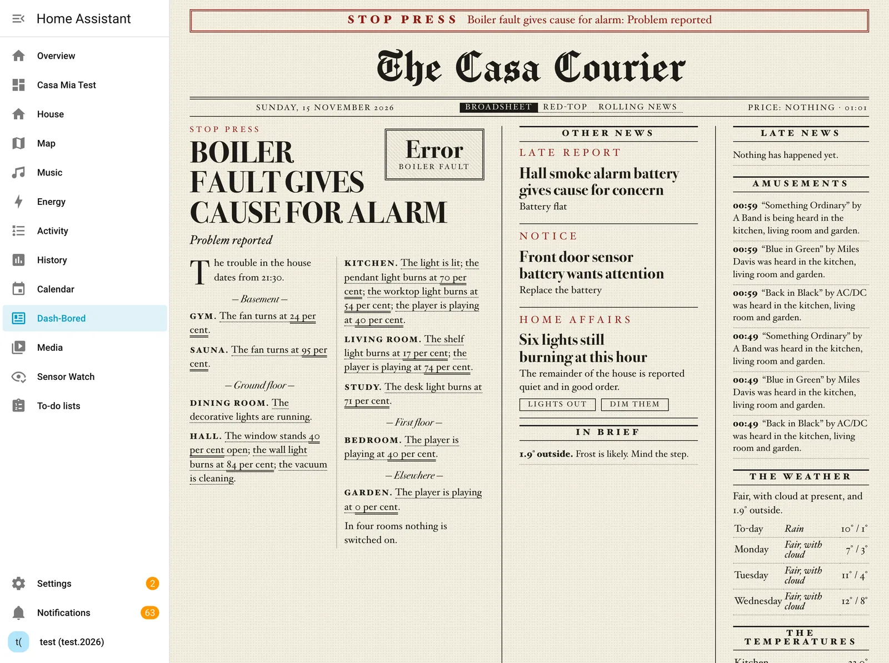</a>
<p><b><a href="#the-gazette">Gazette</a></b> · Being built<br>The house as a newspaper. Stories are ranked, so what matters most leads; a Sensor Watch alert is breaking news. Three papers from the same stories: a broadsheet, a red-top and a rolling news channel. One column on a phone.</p>
</td>
<td width="33%" valign="top">
<a href="#the-console">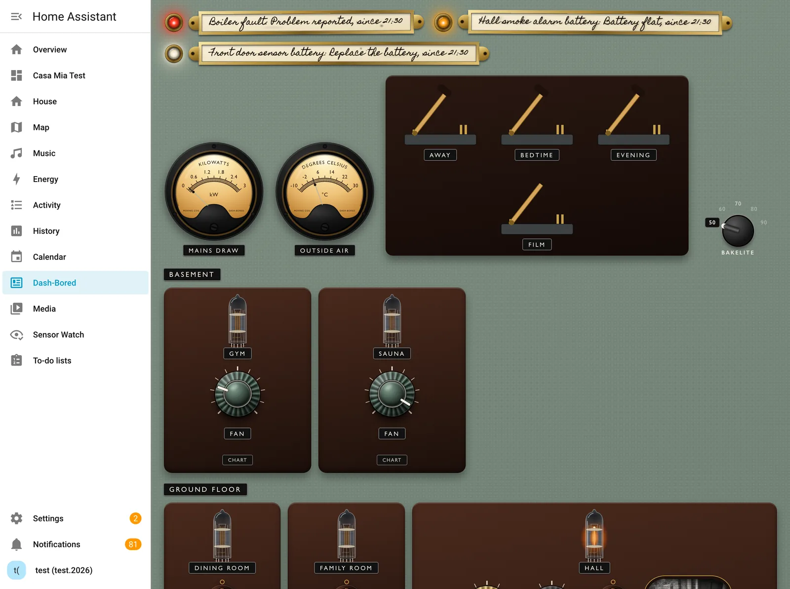</a>
<p><b><a href="#the-console">Bakelite</a></b> · Being built: every kind of device the Gazette shows. Now the first era of the Console, with Nixie (1960s), Silverface (1970s), Bargraph (1980s) and Beige (1990s) after it<br>A 1950s instrument panel: glowing valves, moving-coil meters, fluted dimmer knobs, tumbler switches and knife switches for scenes.</p>
</td>
<td width="33%" valign="top">
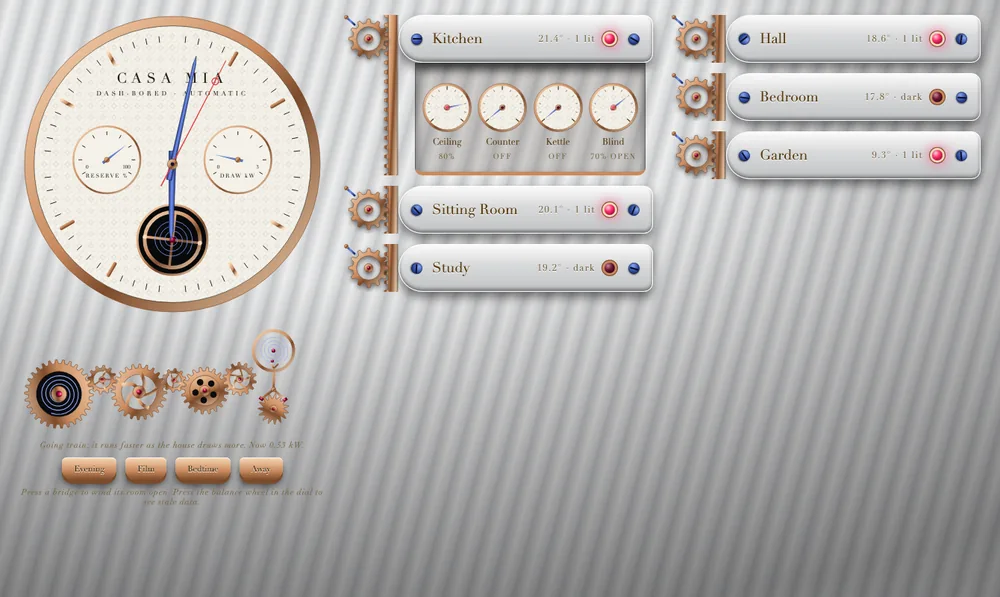
<p><b>Calibre</b> · Mock-up<br>A watch movement. Each room is a bridge wound open by a pinion and rack, the going train runs faster as the house draws more, and a lever escapement ticks while data is fresh.</p>
</td>
</tr>
<tr>
<td width="33%" valign="top">
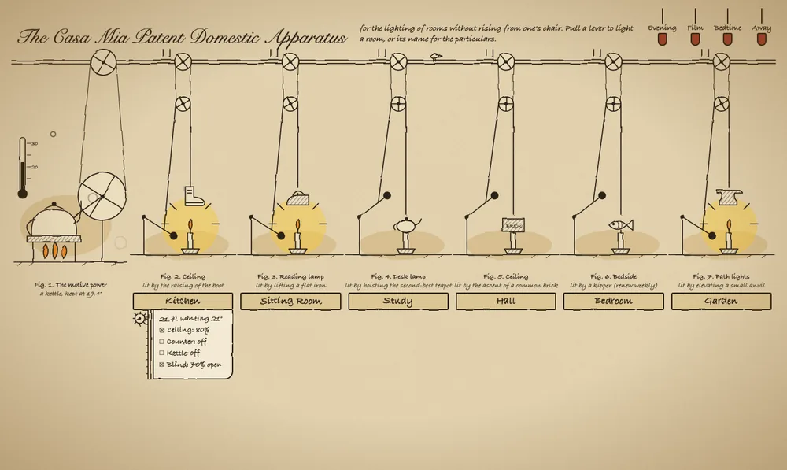
<p><b><a href="#contraption">Contraption</a></b> · Being built: one room so far (the picture is of an earlier mock-up)<br>A Heath Robinson apparatus in pen and wash. Pull a lever and a rope lifts a boot, a kipper or a small anvil off a candle to light the room.</p>
</td>
<td width="33%" valign="top">
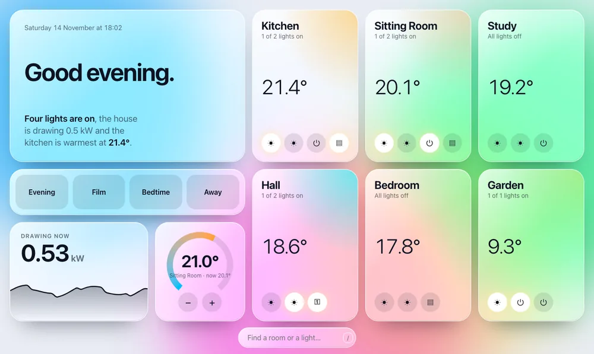
<p><b><a href="#aurora">Aurora</a></b> · Being built (the picture is of its mock-up)<br>Current web style: glass tiles in a bento grid over a sky that warms as lights come on. A room tile grows into a sheet of faders.</p>
</td>
<td width="33%" valign="top">
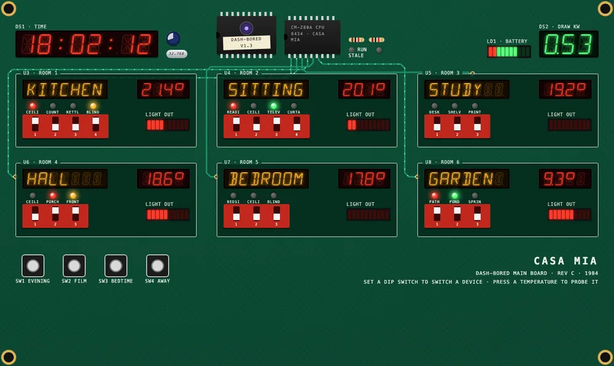
<p><b>Board</b> · Mock-up<br>A 1984 circuit board. Starburst and seven-segment LED displays, DIP switches for devices and traces that carry a signal while a room is on.</p>
</td>
</tr>
<tr>
<td width="33%" valign="top">
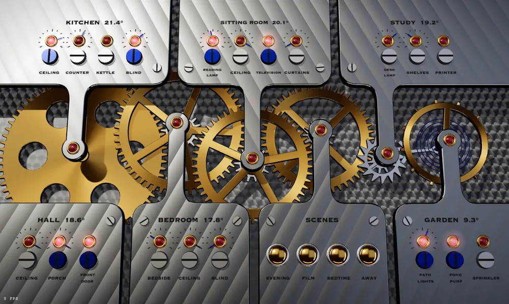
<p><b>Movement</b> · Mock-up<br>A watch movement that fills the screen, rendered as real 3D metal under one lamp. A going train, lever and balance run across the middle; each room is a bridge, with screws for switches and jewels for pilot lamps.</p>
</td>
<td width="33%" valign="top">
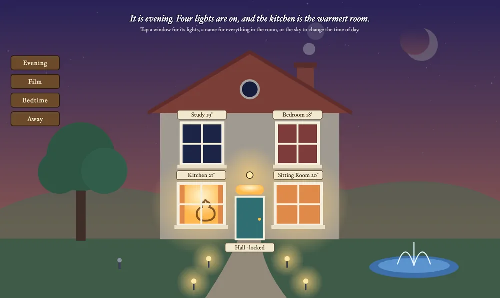
<p><b>Dusk</b> · Mock-up<br>A storybook picture of the house from the garden. Lit rooms have glowing windows, curtains draw, the door stands ajar when unlocked, and the sky follows the time of day.</p>
</td>
<td width="33%" valign="top">
<a href="#the-fridge">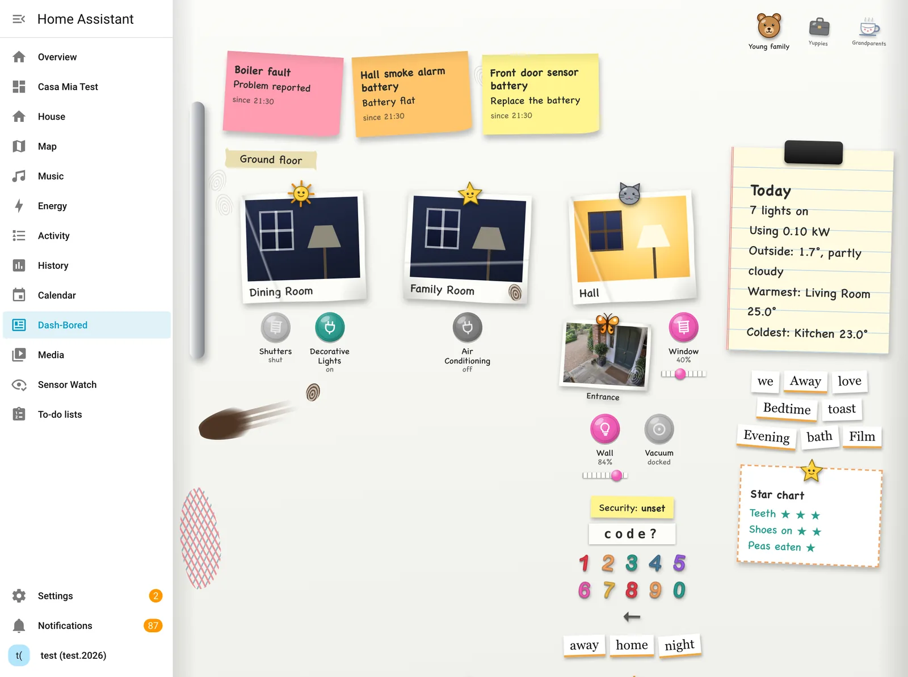</a>
<p><b><a href="#the-fridge">Fridge</a></b> · Being built: every kind of device, in three households<br>The fridge door: a polaroid per room, button magnets for devices, sticky notes for what is wrong, the cameras' pictures under a butterfly, a notepad of the day's facts and fridge-poetry words for scenes.</p>
</td>
</tr>
<tr>
<td width="33%" valign="top">
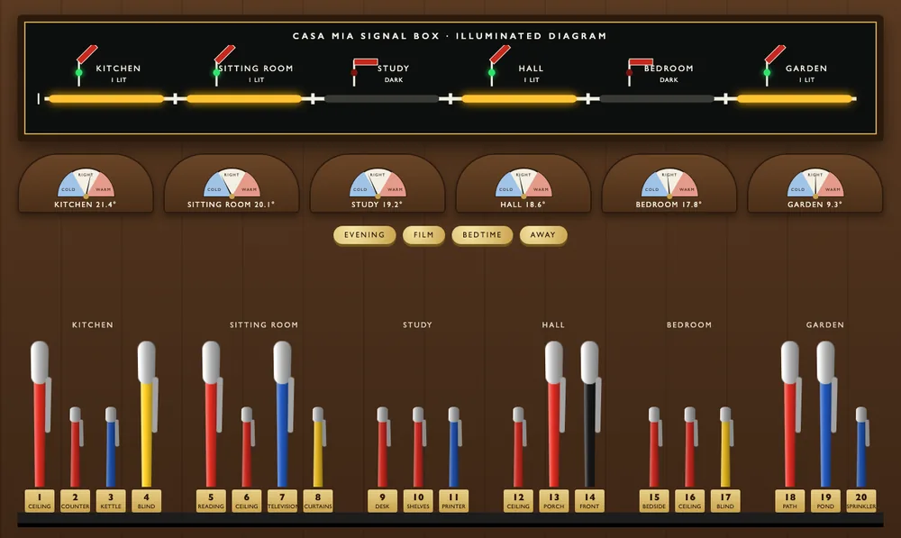
<p><b>Lever Frame</b> · Mock-up<br>A railway signal box: an illuminated diagram, block instruments for temperature and a frame of coloured levers to pull.</p>
</td>
<td width="33%" valign="top">
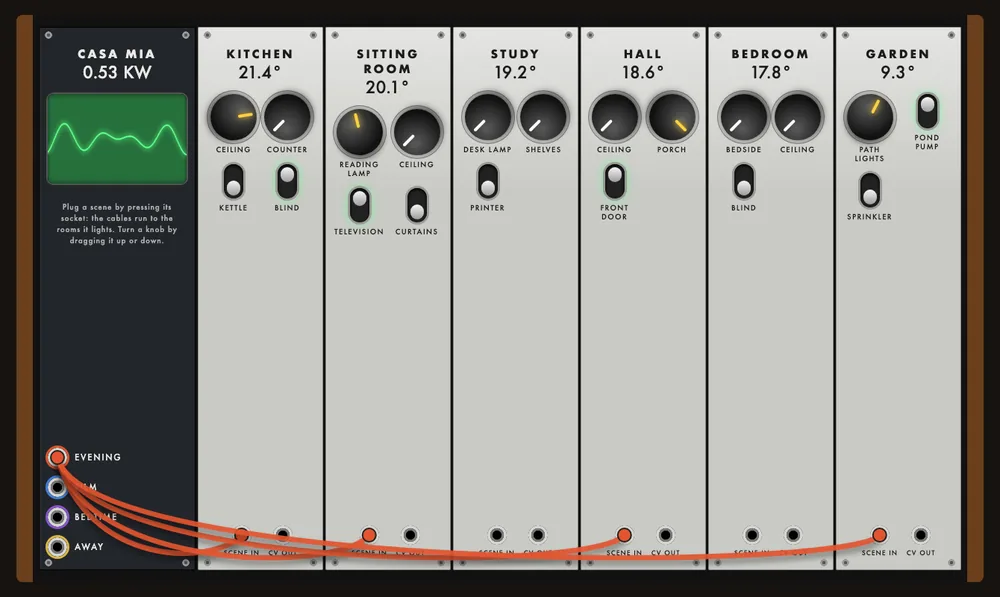
<p><b>Patch Bay</b> · Mock-up<br>A modular synthesiser. Knobs for lights, toggles for switches, and scenes patched to rooms with hanging cables.</p>
</td>
<td width="33%" valign="top">
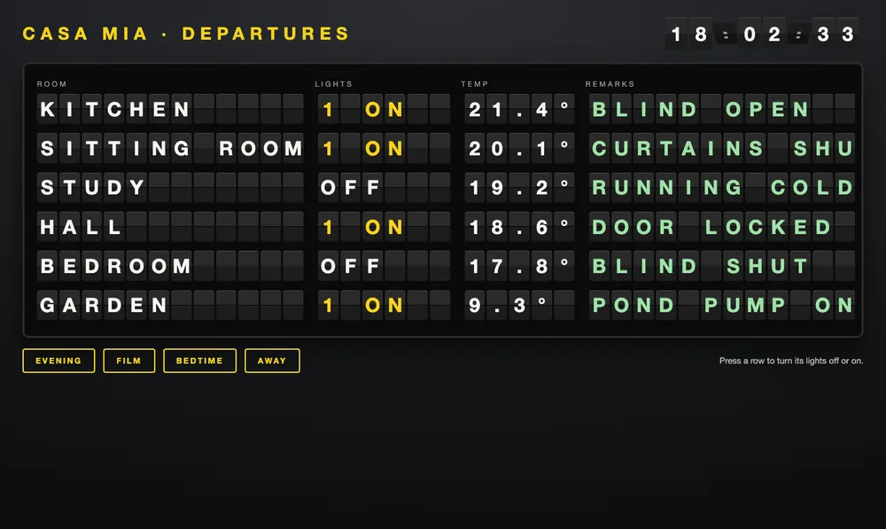
<p><b>Departures</b> · Mock-up<br>A split-flap station board that turns through every letter to reach the new state.</p>
</td>
</tr>
<tr>
<td width="33%" valign="top">
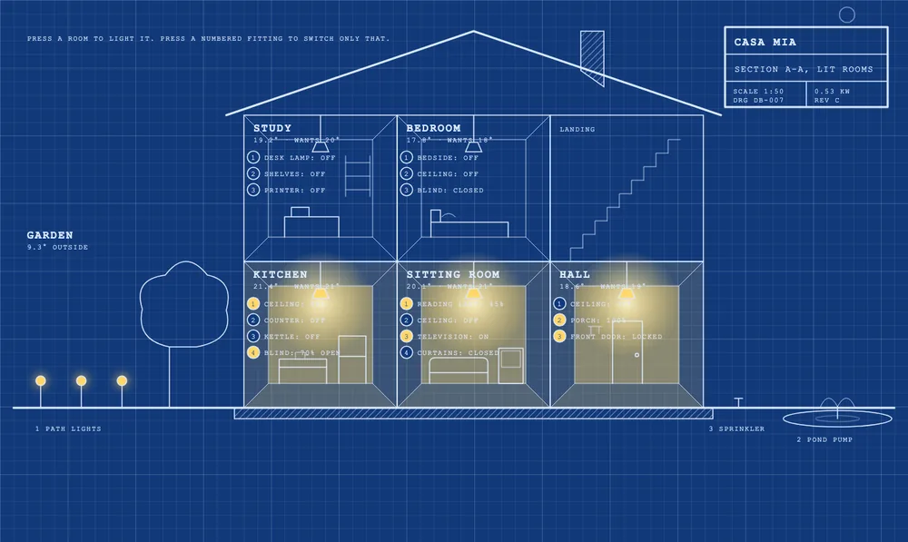
<p><b>Cutaway</b> · Mock-up<br>A blueprint section through the house. Lit rooms fill with warm light; fittings are numbered as on a drawing.</p>
</td>
<td width="33%" valign="top">
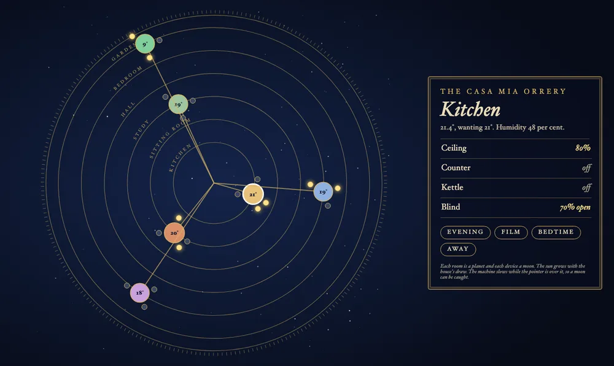
<p><b>Orrery</b> · Mock-up<br>Rooms as planets and devices as moons, on brass arms around a sun that grows with the power drawn.</p>
</td>
<td width="33%" valign="top">
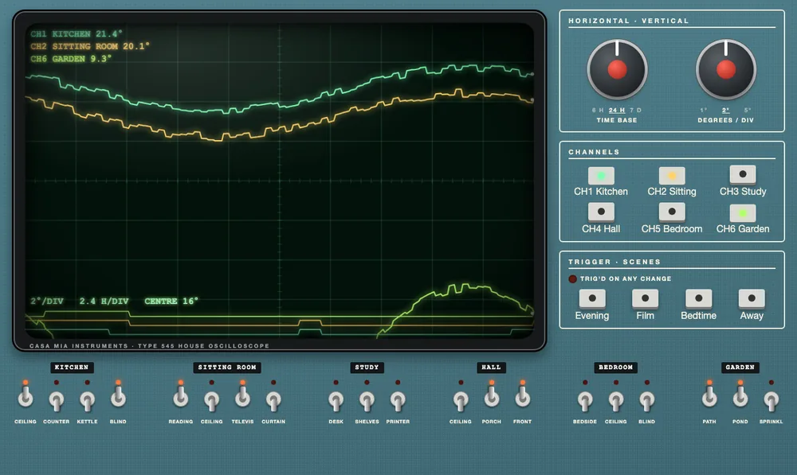
<p><b>Scope</b> · Mock-up<br>A 1970s bench oscilloscope. Each room is a channel: its temperature history as a phosphor trace, its lights as a square wave, with rotary switches for the time base and scale.</p>
</td>
</tr>
<tr>
<td width="33%" valign="top">
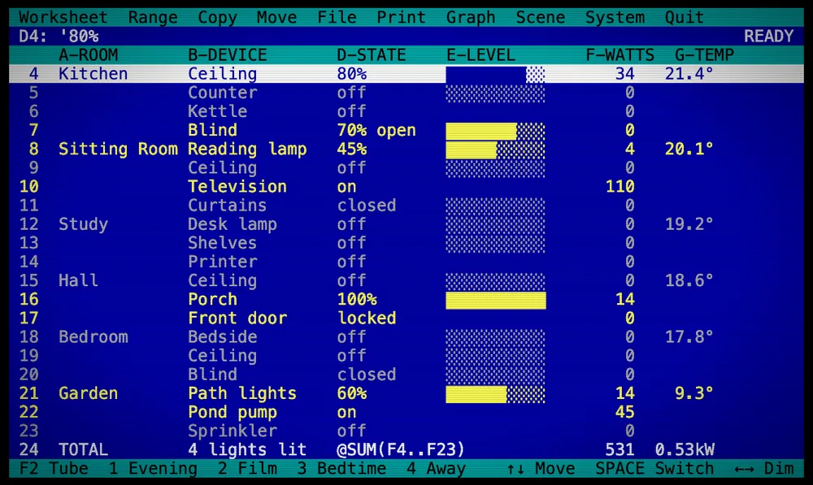
<p><b>Text Mode</b> · Mock-up<br>An 80 by 25 character worksheet driven from the keyboard, on a choice of four tubes: business blue, green, amber and white phosphor.</p>
</td>
<td width="33%" valign="top">
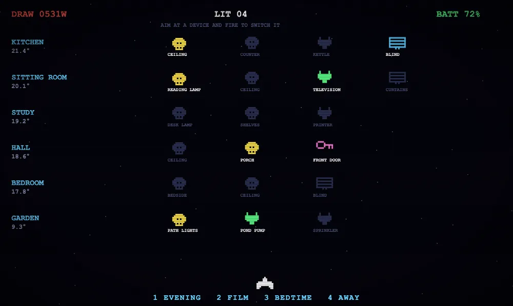
<p><b>Arcade</b> · Mock-up<br>A fixed-shooter cabinet. Devices hang in formation by room; aim and fire to switch one.</p>
</td>
<td width="33%" valign="top">
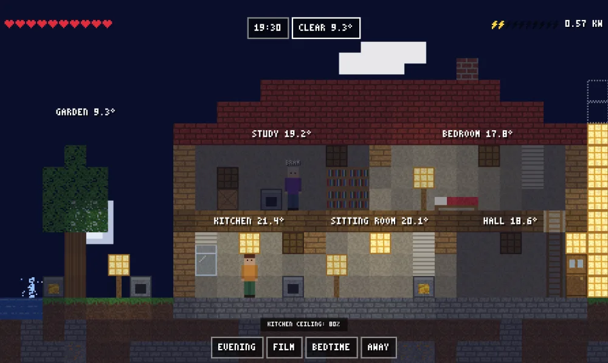
<p><b><a href="#digs">Digs</a></b> · Being built (the picture is of its mock-up)<br>The house in section, built of square blocks sixteen pixels across. A lamp lights the blocks round it, a level is a stack of ten blocks, hearts are the house's health and the sky keeps the real time. Unlocking the door takes two hits.</p>
</td>
</tr>
</table>

## Setting it up

Add **Dash-Bored** under **Settings → Devices & services → Add integration**. There is
nothing to fill in. A **Dash-Bored** entry appears in the sidebar for every user.

The page is built from your areas. Each area that has lights, switches, covers, locks or any of the
other devices listed below becomes a room, and those devices are what it reports on. Entities you have hidden, and
a device's configuration and diagnostic entities, are left out. If a room is missing,
give its devices an area in Home Assistant.

If your areas are on floors, the rooms are grouped under a heading for each floor, from
the lowest up, and the areas on no floor come last under **Elsewhere**. A device is named
without its room or its kind: "Kitchen Ceiling Light" in the kitchen is "Ceiling". To
keep a device off the page, give it the label **Dash-Bored hide** (see What your house is
missing).

## Choosing a family

The first time a browser opens the page it shows a choice, with a small drawing of each
family; press one and the page becomes it. If you close the choice without pressing one,
the page is the Gazette.

Each family has something on its page that opens the choice again:

| Family | What to press |
|---|---|
| The Gazette | The ruled box marked "Other editions", beside the paper's name |
| The Console | The maker's plate, after the era switch |
| The Fridge | The takeaway menu under a magnet, in the door's top right corner |
| Aurora | The four squares at the end of the bar |
| Digs | The signboard that says "Dash Bored" |
| Contraption | The lever marked "Change machine", at the end of the heading |

Pressing twice quickly in the top right corner of the page, on a part of it that is not a
button or another control, opens it in any of them. On a screen that is wider than it is
tall the choice is three families across, and on an upright one it is two.

The choice is remembered by the browser it was made in. A tablet on the wall, a phone and
a desktop each keep their own. There are six families: the Gazette, the Console, the
Fridge, Aurora, Digs and Contraption. The first three each have a choice of their own, made on the thing itself: the Gazette's three
papers (see [Three papers](#three-papers)), the Console's era, on a switch on the panel
(see [The Console](#the-console)), and whose fridge it is, on three magnets in the door's
corner (see [The Fridge](#the-fridge)).

## The Gazette


The page works out what is worth saying about the house and puts the most important
thing at the top:

| Story | When |
|---|---|
| A Sensor Watch alert | A watched sensor is above its normal level. The worst ones lead. |
| A door found unlocked | Any lock that is unlocked. |
| Devices not answering | Any shown device that is unavailable, with since when. |
| A sensor back to normal | For ten minutes after a Sensor Watch alert clears. |
| An appliance at work | A switch that is the only one on its device, where that device also has a power sensor reading 1 kW or more. |
| Lights left on | Any lights on. "Ablaze" when it is seven or more and at least half of them. |
| | The story has two buttons. One puts the lights out. The other dims them: each lit light that can be dimmed and is brighter than 30 per cent is set to 30 per cent, and it is shown only when there is such a light. |
| A cold room | A room more than 0.8° below its thermostat's target. |
| Power in use | Only if the card names a power sensor (see below). |
| The weather | The outside temperature, from a weather entity. |

Under the main story is a report on every room. Each underlined fact is a switch: press
"the counter light is out" and the light comes on. **The switchboard** at the side has
every device as a plain button, and **Notices** has your scenes.

A house with more than 30 devices is reported differently, because a sentence for each
device would run to many screens. The report then covers only what is on, open, unlocked
or not answering, and ends with a count of the rooms where nothing is. A room with more
than three lights lit has them as one fact, such as "five lights are lit"; press it and
those lights go out. More than three switches running in a room are given as a count,
which can't be pressed. The switchboard
still has every device, and is set in columns across the foot of the page.

Some stories have a button that puts them right, such as **Lock it** or **Lights out**.

### Dimming a light, and part-opening a blind

A light that can be dimmed, or a blind that can be set to a position, has its level as a
separate press. In the report the level is underlined twice (highlighted in the red-top):
press "40 per cent" and a scale opens under the sentence. On the switchboard such a device's
tab shows its level and opens its clipping (see below), which has the same scale. That is how to
bring a light that is off on at a low level.

Over the scale is a readers' poll: a question, such as "Readers are invited to say whether
the ceiling light is too bright", and a vote each way. Each vote moves the level by 10 per
cent, which is easier than the handle on a wall tablet. The scale is for a large change.

Slide the handle, vote, or use the arrow keys, and the level is sent when you stop. The figure
beside the scale is what the device itself reports. Until it reports that it has moved,
the level you asked for is shown after an arrow, as in "40 per cent → 70". If that stays,
the device has not done as it was asked.

A garage door or a gate has no scale, for the reason given under
[What a press will never do](#what-a-press-will-never-do).

### Photographs

A camera that can tell what it has seen gets its picture in the paper. When one of its
detections fires, Dash-Bored takes a still from the camera at that moment and the Gazette
prints it with a headline for ten minutes.

Pressing a photograph opens it as a clipping, large and as it was taken, so that you can
look at what was seen. Pinch it with two fingers to go closer and drag it to move about;
a double tap, or the mouse wheel, zooms too. **See the camera as it is now** under it
opens the camera in Home Assistant's own dialog, with its live view. A closer look shows
more only as far as the photograph has detail, and one that came from UniFi Protect's
thumbnail may be smaller than a still from the camera.

Each camera has one story at a time: the most pressing thing it saw in the last ten
minutes. If a camera reports an animal just after a person, the person stays.

A column called **Thirty minutes ago** (**Rewind** in the red-top) lists the latest ten
sightings of the last half hour, newest first, each with its time, its camera and a small
photograph. Pressing one opens its photograph in the same way.

These detections take a photograph: somebody at the doorbell, a person, a vehicle, an
animal, and a smoke or carbon monoxide alarm heard by the camera. A doorbell story is near
the top of the page, a person is above the lights that are left on, and a vehicle or an
animal is lower down. Plain motion takes no photograph, because in a house with several
cameras it would fill the paper.

It works with any camera whose detections are binary sensors or event entities on the
same device as the camera entity, which is how UniFi Protect and Frigate set theirs up. The sort of detection is told
from English words in the detection's name.

If you run the Casa Mia app with Camera Commander, Dash-Bored first asks it for the
picture. Camera Commander is already fetching the cameras that its commanders show, at
their streams' full size, so a picture it has from the last five seconds is used and the
camera is not asked again. A camera that no commander being watched shows has no picture
that new, and is asked directly. Home Assistant's log says where each photograph came
from.

A UniFi Protect camera gets one thing more. Protect makes its own thumbnail of each
detection, choosing the frame itself. The sighting is printed at once with the photograph
taken at that moment, and Protect's thumbnail replaces it when Protect has it, within 15
seconds. If Protect has none, the first photograph stays.

Each such camera gets one new entity on its device, an image called **Last sighting**. It
holds the latest photograph and the sort of sighting, and you can use it on any other
dashboard. Its state is when the photograph last changed, and its `seen` attribute is when
the camera saw it. Things to know:

- The photographs are kept in memory: up to 40 sightings from the last half hour. After
  Home Assistant restarts there are none until the next detection.
- Two detections on one camera within five seconds share one photograph.
- If the camera does not answer, the story is printed without a photograph, and the reason
  is in Home Assistant's log.
- A camera added later gets its entity when Dash-Bored is next reloaded.
- The label **Dash-Bored hide** on the camera, its device or its area keeps its sightings
  off the page.

### What your house is missing

**Corrections and clarifications** lists what Home Assistant has not been told about the
house and the page needs. It is not shown when nothing is missing.

| It lists | What to do |
|---|---|
| Devices in no area | Give the device an area, or hide it. Until then it is not on the page. |
| Suspected plumbing | Things that by their names are settings or indicators, not devices in a room: a status LED, a relay, a screensaver switch. A guess from the name, in English only. See below. |
| Devices sharing a name | Two devices in one room whose names shorten to the same thing. Rename one. |
| Rooms on no floor | Only in a house that has floors. Give the area a floor. |
| Rooms without a thermometer | Set the area's temperature sensor, or put its thermostat in the area. |

Each line is a count that opens into a list. Press a device to open its dialog, or a room
to open its area's settings.

Home Assistant already has a way to say that an entity is a setting: its category,
configuration or diagnostic. Dash-Bored leaves those out, and so do Home Assistant's own
automatic dashboards. An integration sets the category, and it can't be changed in Home
Assistant's settings, so the suspected plumbing is grouped by integration:

- **ESPHome:** add `entity_category: config` (or `diagnostic`) to the light or switch in
  the device's YAML.
- **KNX:** add `entity_category: config` to the entity in the KNX YAML.
- **Anything else:** give it the label **Dash-Bored hide**, which Dash-Bored makes when it
  is set up. The label works on an entity, on a device (all its entities) and on an area
  (everything in it), and takes them off Dash-Bored's pages only. Hiding the entity in
  Home Assistant takes it off every dashboard.

### What a press will never do

A lock, a garage door, a gate, a valve or a siren is never operated by a press on a
sentence or on the switchboard, because a stray touch must not unlock the house, turn
the water on or set a siren off. Pressing one opens its
clipping, where unlocking, opening or sounding takes two presses: the button changes to **Press
again to confirm** for a few seconds. Locking and closing take one. A device that is not
answering opens its clipping too.

An alarm panel can't be set or unset from the page at all. The page is open to every
user and has no keypad, so that stays in Home Assistant's own dialog, which the
alarm's clipping links to. The **Lock it** button under an unlocked door does lock
it.

### Thermostats, media players and cameras

These are devices in their rooms too, but a press on one in a sentence or on the
switchboard switches nothing: it opens the device's clipping, so that a stray touch
doesn't stop the heating or the music.

- **A thermostat** is told with its target, as in "the thermostat is set to 21°". The
  target is a level like a light's: its poll asks whether it is set too warm, and each
  vote moves it half a degree. Its clipping gives its own reading, and has a button that
  turns it off or on. A thermostat that holds a range, not a single target, is told as
  "at work" and has no scale.
- **A media player** is told with its volume, as in "the player is playing at 40 per
  cent". Its poll asks whether it is too loud, in steps of five. Its clipping says what is
  playing, and its button pauses or plays.
- **A camera** is on the switchboard, and in the report only if it stops answering. Its
  clipping shows its latest picture, which opens large when pressed; **Home Assistant's
  own page** has the live view.

### The other devices

| Device | How it is told | What a press does |
|---|---|---|
| Fan | On or off, with its speed as a level: "the fan turns at 60 per cent". | Switches it. Its level has the scale and a poll. |
| Humidifier | On or off, with its target humidity as a level. | Switches it. Its level has the scale and a poll, in fives. |
| Water heater | Its target temperature, as a thermostat's is. | Opens its clipping, which has its own reading, the scale and poll (a degree a vote) and an on and off button. |
| Valve | Open, shut, or how far open. | Opens its clipping. Opening takes two presses. |
| Siren | Sounding or silent. | Opens its clipping. Sounding it takes two presses. |
| Vacuum, lawn mower | Cleaning or mowing, docked, on its way home, paused, or in trouble. | Opens its clipping, which starts it or sends it home. |
| Alarm panel | Set, not set, being set, about to sound, or sounding. | Opens its clipping, which has no button. An alarm that is sounding leads the paper, above everything else. |

### A device's clipping

Every device has a story of its own, laid over the page like a cutting. It opens from the
tab beside the device's button on the switchboard, and from a line about the device in
the late news.

The clipping says how the device stands and since when, and has a button that puts it the
other way. A light that can be dimmed or a blind that takes a position has its poll and
scale there. Under those is **The record**: a band for the last 24 hours, inked where the
device was on, open or locked, and its latest changes with their times. The record comes
from Home Assistant's history when the clipping is opened, and goes on as things happen.
Home Assistant's history keeps a blind's positions but not a light's brightness, so a
light's record is of when it was lit, and shows a dimming only if it happens while the
clipping is open.

**Home Assistant's own page** at the foot opens Home Assistant's dialog for the device,
for its settings. Escape, **Fold away** or a press outside the clipping closes it.

### Three papers

The names in the line under the masthead choose the paper, and all three are written
from the same stories. Each browser remembers its own choice.

- **Broadsheet**, The Casa Courier, is sober.
- **Red-top**, the Daily Fuse, is not.
- **Rolling news**, The Thermostat, is written and laid out as a news website: plain sentences
  in the present tense, blue where the other two are red, the headlines passing in a ticker under the dateline, and a
  clipping as a card with straight edges. If your device is set to reduce motion, the
  ticker stands still.

### Personal

A column of announcements about the household, each with its time, newest first:

- **Comings and goings.** Each person's latest move: arrived home, left the house, or
  arrived at one of your zones. It is read from Home Assistant's person entities, so it
  needs people with a device tracker.
- **Songs.** With [Love it or Loathe it](love-or-loathe.md), each song somebody loves or
  loathes: "Ann wishes it known that “Night Train” by The Sleepers is greatly to their
  liking". The column prints each person's latest word on a song, and a rating taken
  away takes its announcement with it.

An announcement stays for twelve hours and the column holds the latest eight. It is left
out while there is nothing to announce. A person with the label **Dash-Bored hide** is
left out of it.

Songs are kept in memory, so a restart of Home Assistant empties them. After a restart
Home Assistant also gives every person's state the time of the restart, so each is
announced as having arrived or left then.

The page is in the sidebar for every user, guests included, so this column tells anyone
who can open it who is at home.

### Amusements

A column of the last six things the house's media players played, newest first: the
song or programme, the room, and whether it is on now. It is called **Showbiz** in the
red-top. Speakers that began the same song within a minute of each other are one line
with all their rooms. Pressing a line opens that player's clipping.

With [Love it or Loathe it](love-or-loathe.md), a song is followed by who loved it and
who loathed it. These change as soon as somebody rates the song or takes a rating away.

- A player is listed only if it is a device on the page, and only when it gives a title.
  Many televisions tell Home Assistant their input or app and nothing else, and those
  are left out. A programme is named by its series, or by its channel if that is all
  there is.
- The list is kept in memory. A restart of Home Assistant empties it, and it then starts
  again with whatever is playing.
- The column is left out while there is nothing to list.

### The weather

A column with the weather now and the forecast for the next four days, each day with
its weather and its high and low. Each paper has its own words for the sky: rain is
"Rain" in the broadsheet and "Wet." in the red-top.

- It uses the weather entity the page reads the outside temperature from: the one a
  card names with `weather`, else `weather.home`, else the first it finds. With no
  weather entity there is no column.
- The forecast is the entity's forecast by the day, which Home Assistant sends to the
  page whenever it changes. An entity that gives only an hourly forecast, or none, gets
  the line about the weather now and no days.
- Temperatures are in whatever unit the entity uses.

### Sensor Watch

If you use [Sensor Watch](sensor-watch.md), a sensor that goes above its normal level is
breaking news: a banner across the top with the message you gave that sensor, and the
story placed by its level. A page opened later is still told of every alert that holds.
Dash-Bored works without Sensor Watch; there is then no breaking news.

### Casa Mia's cameras

If the Casa Mia app is installed and you use its [Cameras](cameras.md) page, a camera
listed there is shown in place of the one Dash-Bored finds in Home Assistant. It has the
title you gave it on that page, and it brings what you set up for it there:

- its **PTZ presets**: the places it can be turned to;
- its **zoom**;
- its **page controls**: the things that belong with what it sees, such as a gate or a
  light.

In the Gazette these are in the camera's clipping, under its picture. A page control that
is a lock, a gate or a garage door opens its own clipping, where it takes two presses.
The Console has them on the camera's room: see [The Console](#the-console). The Fridge and
Aurora show the camera under its title, and do not have the presets, zoom or controls yet.

A camera is still shown in the room its area gives it, so one with no area in Home
Assistant is not on the page. A change on the Cameras page reaches an open Dash-Bored page
in a moment. Dash-Bored works without Casa Mia; the cameras are then the ones Home
Assistant has, under their own names.

### A column by the house's own agent (ZenOS-AI)

If the house runs [ZenOS-AI](https://github.com/nathan-curtis/zenos-ai), the Gazette has a
column in the middle of the page under the agent's own name. ZenOS writes a summary of the
whole house a few times an hour, and a short account of each part of it (it calls these
Katas). Each time a new summary arrives, Dash-Bored asks the model ZenOS uses to write the
column from it and from the Katas, once, in the style of all three papers. Every open page
is sent the new column straight away.

- The column has a headline, a short article and up to three one-line items about the
  parts of the house that most need attention.
- The by-line says when the summary it was written from was filed. When that is more than
  an hour old, it says "Nothing filed since" and the time.
- If the model fails or doesn't answer within two minutes, the last column stays, with a
  line saying why the next one is late and since when.
- Until the first column is written, the by-line says the copy is awaited.
- Dash-Bored only reads ZenOS's sensors. It never writes to ZenOS.

There is nothing to set up: Dash-Bored finds ZenOS's Kata sensor by the label ZenOS gives
it, and uses the model named in ZenOS's `input_text.zenos_ai_task_entity`. That is one call
to the model per summary, about 100 a day, which costs nothing on a local model but does on
a paid one. To stop it, switch off **Write the agent's column** in Dash-Bored's Configure
dialog; the Gazette then has no column. Giving the Kata sensor the Dash-Bored hide label
does the same. A house without ZenOS has no column.

### When something is wrong with the page itself

- If the connection to Home Assistant is lost, a red line says so and since when. What
  is shown below it is how things stood at that time.
- If Home Assistant refuses an action, a red line says which and why.

## The Console

The house as a control panel, in the style of a decade. It is to have five eras, one for
each decade from the 1950s to the 1990s. They are the same panel with the same controls
in the same places, drawn as the equipment of their time:

| Era | Decade | Stage |
|---|---|---|
| Bakelite | 1950s | Being built, and described below |
| Nixie | 1960s | Being built, and described below |
| Silverface | 1970s | Being built, and described below |
| Bargraph | 1980s | Being built, and described below |
| Beige | 1990s | Being built, and described below |

The era is chosen with the rotary switch at the top right of the panel, lettered 50 to
90: press a decade, or press the knob to step to the next. An era that is not built yet
shows a plate saying so. The choice is remembered by the browser it was made in, as the
family is.

In every era the controls are fixed to the panel. A switch, a knob or a display stays
exactly where it is whatever its lettering says: when a name grows to two lines, a
thermostat is switched off or a song starts, nothing moves.

A camera from [Casa Mia's Cameras page](#casa-mias-cameras) has more on its room's panel,
in every era. Its zoom is a knob, lettered with the camera's name. Its PTZ presets are a
selector switch with the camera's name over its legend: press a number, or its line of the
legend, to turn the camera there. Home Assistant does not say where a camera is pointing,
so the pointer shows the preset last chosen on this panel, and hangs straight down until
one is. Each of its page controls that the room does not already have is a switch: a knife
switch for a button or a script, and a guarded switch for a lock, a gate or a garage door.

### Bakelite

The Console of the 1950s. It shows every kind of device the Gazette does.


At the very top is a warning lamp for each sensor that [Sensor Watch](sensor-watch.md)
has above its normal level, the worst first. Beside each is a card in a brass holder,
handwritten in ink, giving the sensor's name, what is wrong and since when. The lamp is red for an error, red and flashing for a critical
one, amber for a warning and white for a task. When nothing is wrong there are no lamps.

Under the lamps are a meter for the outside air, from a weather entity, a meter for the
house's power if a card names a power sensor, and a knife switch for each scene that
belongs to the whole house. Press a knife switch and the scene is turned on; the blade
closes for a moment and opens again.

The weather has two more instruments beside the outside air meter, from the same weather
entity. On the 1950s panel they are these:

- **A barometer**, lettered Stormy, Rain, Change, Fair and Set fair. Its black hand points
  at the weather now. Its brass hand points at tomorrow's weather: on a real barometer
  that hand is set by the knob to mark an earlier reading. A slip in the window under the
  hands has Home Assistant's own word for the weather now, such as Snow or Fog, because
  the dial's five places cannot tell snow from rain.
- **A desk calendar** with a card for each of the next four days of the forecast: the
  day, a picture, the weather in a word, and the high and low.

On the other four panels the weather is a window with the same five words across it. Under
them is a row of lamps for now and a row for tomorrow, and under those Home Assistant's
own word for the weather now. The forecast is a second window with a column for each of
the next four days: the day, the high in the era's figures, the weather in a word and the
low.

| Era | The windows | The lamps | The figures |
|---|---|---|---|
| 1960s | Dark glass, with no pictures | Neon | Nixie tubes |
| 1970s | A tuner's lit dial | A red pointer for now, a black one for tomorrow | Red LED |
| 1980s | A fluorescent display | A green LED for now, an amber one for tomorrow | Fluorescent |
| 1990s | An LCD | Blocks of the LCD | LCD |

A weather entity that gives no forecast by the day has the weather now only: nothing for
tomorrow, and no forecast.

A scene that belongs to a room is on that room's chassis, and one that belongs to a floor
is a push button on that floor's plate. A scene belongs to a room if it is in the room's
area, or if its name begins with the room's name: "Kitchen - Dining" is the kitchen's
"Dining". It belongs to a floor if its name begins with the floor's name. The label
**Dash-Bored hide** on a scene keeps it off every page.

Below is a chassis for each room. The panel is a grid of columns, as many as fit across
it. A room with many controls has a chassis several columns wide, with its controls side
by side, and up to three small rooms stand one under another in one column. The widths
and the rows are chosen so that the page is as short as it can be. The rooms keep their
order.

A plate with the floor's name is over the first room of each floor. A floor does not
begin a new row: its first room follows the last room of the floor before, where there
is room, with a bar between the two floors (brass, in Bakelite). Where a column's chassis
are shorter than their row, a blanking plate with a vent in it fills the space under
them. Each chassis has:

- A selector switch for the room's scenes, if it has more than one: a pointer knob with
  a numbered stop for each scene, and a list under it that says which number is which.
  Press a number or a line of the list to turn the scene on. The pointer shows which of
  the room's scenes Home Assistant turned on last. It does not mean the room is still as
  that scene left it. A room with one scene has a knife switch for it, and a room with
  more than ten has a second selector.

- **A valve**, which glows with the room's lights: brighter the more of them are lit and
  the higher they are set.
- **A meter** for the room's temperature, if the room has one.
- **A knob for each light that dims.** Turn it as you would a real one: drag round it
  clockwise to brighten the light and anticlockwise to dim it. Turned right down, the
  light is switched off. A press on the knob without dragging switches the light on or
  off. With a keyboard, the arrow keys move it ten per cent at a time. A knob
  that was turned goes back to where the light really is if the light has not answered in
  five seconds.
- **A brass knob for each blind that takes a position.** It works as a light's knob does:
  clockwise opens the blind, anticlockwise closes it, and a press without dragging opens or closes it
  fully.
- **A tumbler switch for each other light, switch and blind**, with a pilot lamp over it.
  Down is on, or open. One whose device is not answering is faded, with its name struck
  through, and can't be pressed.
- **A tumbler switch under a red guard** for each lock, garage door, gate, valve and siren.
  The guard is shut only while the device is at rest: a lock locked, a door, gate or
  valve shut, a siren silent. To change that takes two presses: the first lifts the
  guard and the second, on the switch itself, throws it. If the second press is anywhere
  else, on the guard or on another part of the panel, the guard drops and nothing is
  changed. A guard that is lifted and then left alone drops again after six seconds. While the device is away from rest the guard stays up,
  with the switch thrown and its lamp lit, and one press puts it back: the guard is shut,
  which knocks the switch over. The guard shuts on the panel when the device says it is
  at rest again, so a garage door's stays up until the door has closed.
- **An alarm** has a plate saying how it stands (unset, arming, set, pending or sounding)
  and a push button for each way it can be set: Away, Home and Night, as the alarm has
  them. Once it is set there is one button, Unset. If the alarm takes a code in digits,
  there is a row of six brass thumbwheels above the buttons, like a combination padlock.
  Press the top half of a wheel to turn it on and the bottom half to turn it back, and
  the digits roll round to the next; set the
  code from the left and leave the other wheels blank, then press a button. The wheels
  go back to blank when the alarm answers, and after 30 seconds if nothing is pressed, so
  the code is not left on show. If the code is wrong or missing, Home Assistant's refusal
  is shown on the plate at the top of the panel, and the wheels stay as they are for you
  to correct. An alarm whose code is words, not digits, is not on the panel.
- **The heating and the hot water** each have a red knob for the temperature they are set
  to, which the plate under the knob gives ("Thermostat 21°"). A second, smaller plate
  gives what the thermostat reads now. Turn the knob to change the target; a press
  without turning switches the heating off or on.
- **A player** has an ivory knob for its volume, with a plate under it for what is
  playing. A press without turning pauses it or plays it.
- **A fan** has a grey-green knob for its speed, and **a humidifier** one for the humidity
  it is set to.
- **A vacuum and a mower** have a tumbler switch: down starts it, up sends it home. The
  plate says where it has got to, such as "Vacuum: returning".
- **A camera** has a small television screen showing its latest picture in black and
  white. If the camera saw something in the last half hour (a person, a vehicle, the
  doorbell), the screen shows that photograph and the plate says what and when. Press
  the screen for Home Assistant's own dialog, with the live picture. Something seen by a
  camera that is in no room has a screen at the top of the panel.
- **Chart**, the plate at the foot of each chassis, opens the room's chart recorder: a
  strip of paper for the last day with a line for each device, drawn up while it was on
  and at its level if it has one. The pen is lifted while a device was not answering.

The meters are lit from behind while Home Assistant is answering. If the connection is
lost their lamps go out and the faces turn grey, so a dark meter is one not to believe.

The Gazette's Personal and Amusements columns are not on the panel. A room with devices that are not shown has a small plate saying
how many, such as "and 4 more". If the connection to Home Assistant is lost, or Home
Assistant refuses a press, a red lamp and a plate at the top say so.

### Nixie

The Console of the 1960s, after the test instruments of the time. It has the same
controls as Bakelite in the same places, and each works the same way; what differs is how
they are drawn:

| Bakelite | Nixie |
|---|---|
| A Bakelite chassis on green enamel | A blue-grey plate with a screw in each top corner, on a wrinkle-finish rack |
| A valve that glows with the room's lights | A magic eye: two green bars that close on each other as the lights come up |
| A round moving-coil meter for a room's temperature | The temperature in nixie tubes. Each tube holds all ten figures, one behind another: the unlit ones can be seen as faint wire, and those in front of the lit one cross it as fine lines |
| The meters at the top of the panel | Clear-fronted meters with a cream face, whose needles waver three quarters as far |
| A fluted knob, coloured by its kind | An instrument knob on a pale skirt with an index line. Its middle is coloured: grey for a light, brass for a blind, red for the heating, ivory for a player, green for a fan |
| The setting engraved on the knob's plate | The setting in nixie tubes under the knob, which are there, dark, when the thermostat is off |
| A tumbler switch, down for on | A lever key, down for on, under a neon pilot lamp |
| A tumbler under a red guard | The key under a red cover, which lifts at the first press |
| A knife switch for a scene | A large round push that lights when pressed, with the scene's name on it |
| A pilot lamp and a handwritten card for an alert | A neon lamp, with what is wrong on a strip torn from a teleprinter |
| Brass thumbwheels for an alarm's code | Black thumbwheels with white figures |
| A black-and-white television for a camera | A black-and-white tube with rounder corners |
| A chart recorder on paper | An oscilloscope, with a green trace for each device |

### Silverface

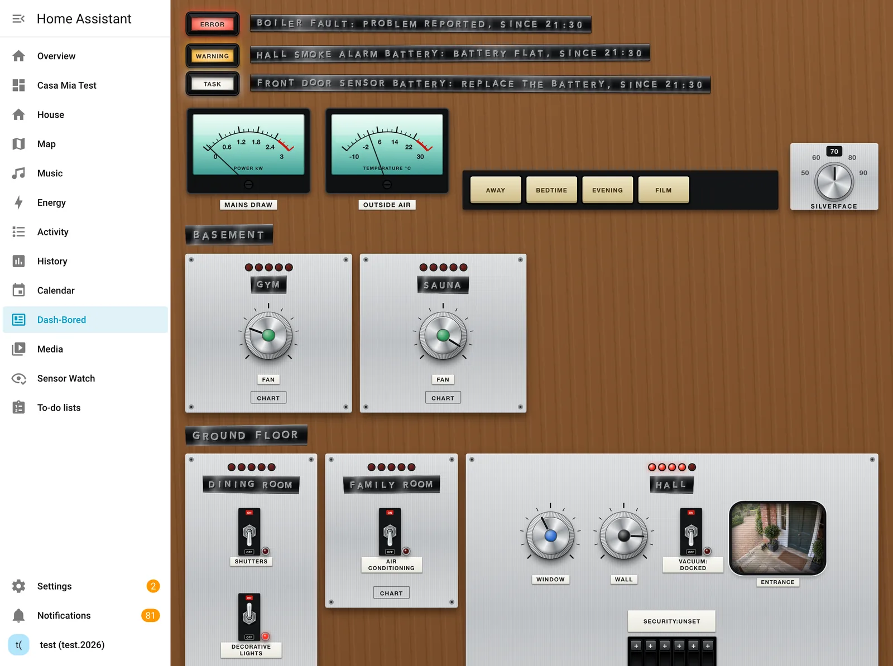

The Console of the 1970s, after the hi-fi and bench instruments of the time. It has the
same controls as Bakelite in the same places, and each works the same way; what differs is
how they are drawn:

| Bakelite | Silverface |
|---|---|
| A Bakelite chassis on green enamel | A brushed aluminium faceplate in a teak cabinet |
| A valve that glows with the room's lights | A row of five red LEDs: the more light, the more are lit |
| A round moving-coil meter, whose needle wavers | A rectangular meter with a lit blue-green face and the top of its scale in red, whose needle wavers half as far |
| A fluted knob, coloured by its kind | A machined aluminium knob with a coloured centre: black for a light, blue for a blind, red for the heating, amber for a player, green for a fan |
| The setting engraved on the knob's plate | The setting in red digits under the knob, on a display that always has the same number of digits and goes dark, in place, when the thermostat is off |
| A red knob for the heating | A dial of its own: a white face with its cooler half in green and its warmer half in red, a black pointer knob for the target and a thin red hand for what it reads now |
| Each device's name on an engraved black plate | Each device's name on a white engraved strip |
| A tumbler switch, down for on | A chrome toggle switch, up for on, with a red lamp beside it |
| A tumbler under a red guard | The toggle under a switch guard: a red cover on a hinged steel plate, which flips up at the first press. Its ends are lettered for what it works: OPEN and SHUT, UNLOCKED and LOCKED |
| A knife switch for a scene | A push button that lights when pressed, with the scene's name on it |
| A pilot lamp and a handwritten card for an alert | An annunciator window, a lit lens in a black bezel engraved error, warning or task, with what is wrong on a strip of embossed label tape |
| Engraved plates for the names of floors and rooms | Embossed label tape |
| Brass thumbwheels for an alarm's code | Black thumbwheels with white figures |
| A black-and-white television for a camera | A colour television |
| A chart recorder on paper | An oscilloscope, with a green trace for each device |

### Bargraph

The Console of the 1980s, after the black hi-fi separates of the time. It has the same
controls as Bakelite in the same places, and all but one work the same way: a level is set
with a fader, which is slid up and down, where the other eras have a knob that is
cranked. A press on a fader that does not move it switches its device, as a press on a
knob does.

| Bakelite | Bargraph |
|---|---|
| A Bakelite chassis on green enamel | A brushed black front, with the room's name in white italics over an orange line |
| A valve that glows with the room's lights | A bar of ten LEDs, green then amber then red: the more light, the more are lit |
| A round moving-coil meter, whose needle wavers | A black-faced meter lit warm from below, with a fine orange needle that wavers a quarter as far. Every third room has a fluorescent display in its place: large figures over a sweep of twenty segments, the last four red |
| A fluted knob, coloured by its kind | A fader with a ladder of ten LEDs beside it: orange for a light, green for a blind, ivory for a player, blue-green for a fan |
| A red knob for the heating | A smooth black knob in a ring of LEDs, lit as far as it is turned, with the setting in fluorescent figures under it. The display goes dark, in place, when the thermostat is off |
| A tumbler switch, down for on | A soft-touch key with a red LED in its corner |
| A tumbler under a red guard | The key under a flap of smoked perspex, which lifts at the first press |
| A knife switch for a scene | A tuner's preset key, numbered, with a bar over it that lights when it is pressed |
| A pilot lamp and a handwritten card for an alert | An LED, with what is wrong on a dot-matrix fluorescent line |
| Brass thumbwheels for an alarm's code | A fluorescent figure for each place, with a + key over it and a − key under it |
| A black-and-white television for a camera | A small colour monitor in a black case |
| A chart recorder on paper | A spectrum analyser: a row of columns for each device, one to a quarter of an hour, lit as high as the device stood |

The meters and displays go dark if the connection to Home Assistant is lost, as the
other eras' do.

### Beige

The Console of the 1990s, after the moulded plastic of the time: a desktop computer, or
the controller in a building's plant room. It has the same controls as Bakelite in the
same places, and each works the same way; what differs is how they are drawn. Nothing on
it moves unless it is pressed.

| Bakelite | Beige |
|---|---|
| A Bakelite chassis on green enamel | A recessed bay in beige plastic, with a row of cooling slots at its foot |
| A valve that glows with the room's lights | Five strength bars on a small LCD, as a mobile telephone shows its signal |
| A round moving-coil meter, whose needle wavers | An LCD: black figures on grey-green over a row of twenty blocks. The segments that are not lit can still be seen, and nothing wavers |
| A fluted knob, coloured by its kind | A jog dial, as a video recorder's: a ridged disc with a dimple for the finger that turns it |
| The setting engraved on the knob's plate | An LCD under every dial: the heating's setting in degrees, blank when it is off, and any other dial's level in per cent |
| A second plate under a knob, for what a player is playing | White labeller tape |
| A tumbler switch, down for on | A rocker marked I and O, with a green LED over it |
| A tumbler under a red guard | The rocker beside a keylock: the first press turns the key |
| A knife switch for a scene | A function key, F1 onwards, under a paper strip that says what it does |
| A pilot lamp and a handwritten card for an alert | An LED, with what is wrong on a yellow-green character LCD |
| Brass thumbwheels for an alarm's code | An LCD figure for each place, with a rubber key over it and one under it |
| A black-and-white television for a camera | A beige monitor with a green power LED, and its name on labeller tape |
| A chart recorder on paper | A chart in a window of a sixteen-colour desktop, with a line in its own colour for each device |

The LCDs go blank if the connection to Home Assistant is lost, as the other eras' meters
go dark.

## The Fridge


The house as what is stuck to a fridge door. It shows every kind of device the Gazette
does.

- **A polaroid for each room**, held up by a novelty magnet, with the room's name and
  temperature written under the picture. The picture is the area's own from Home
  Assistant if it has one, and a drawn window and lamp if not. It is dark while the room's
  lights are off and warm while any is on. Press it to turn the room's lights all off, or
  all on if none were.
- **A button magnet for each device**, under its room's polaroid, with a picture of what
  it is: a lamp, a plug, a blind, a padlock, a thermometer, a fan and so on. It is grey
  while its device is off and coloured while it is on, with the device's name and how it
  stands under it. Press it to switch the device; it wobbles.
- **A paper strip** under a magnet whose device has a level: a light's brightness, a
  blind's position, a fan's speed, a player's volume, the temperature the heating is set
  to. Slide the small magnet along it.
- **Locks, garage doors, gates, valves and sirens** take two presses to unlock, open or
  sound. The first lifts the magnet off the door and a note asks "again to open?"; the
  second does it. If nothing is pressed for six seconds the magnet drops back. Locking,
  shutting and silencing take one press.
- **A camera's latest picture** is a photograph held by a butterfly. With more than one
  camera, the others are held by a ladybird, a bee, a frog and the rest. If the camera
  saw something in the last half hour, the photograph is of that, and the writing under
  it says what and when. Press it for Home Assistant's own dialog, with the live picture.
- **An alarm** has a note of how it stands, number magnets to press its code out with if
  it takes one in figures (and an arrow to take the last one off), and a word magnet for
  each thing it can be told: away, home and night, or unset. The code is taken off the
  door when it is sent, and after 30 seconds if it is left. An alarm whose code is words
  is not on the door, and its room says so.
- **Sticky notes** along the top, one for each sensor that
  [Sensor Watch](sensor-watch.md) has above its normal level, the worst first: yellow for
  a task, orange for a warning, pink for an error, and a red one that won't keep still
  for critical.
- **A notepad** above the rooms with the day jotted on it: how many lights are on, what
  the house is using, the weather outside, the warmest and coldest rooms, who is in, and
  any lock that is undone.
- **Word magnets**, as for fridge poetry. The ones with a coloured edge are your scenes:
  press one to run it. The others are only words. A scene that belongs to a room (see
  [The Console](#the-console) for how that is decided) is under that room's magnets.

The rooms are in rows, a room with many magnets is wider, and small rooms are one
under another, so that the door is not much taller than it needs to be. A floor's name
is on its strip of tape over the first of its rooms, and a floor begins where the one
before it ends.

If the connection to Home Assistant is lost, or Home Assistant refuses a press, a torn
sheet in red at the top says so.

### Three households

The same door can be a young family's, a pair of yuppies' or grandparents'. Press one of
the three magnets in the top right corner: the teddy, the briefcase or the teacup. The
choice is remembered by the browser it was made in.

| | Young family | Yuppies | Grandparents |
|---|---|---|---|
| The door | White enamel | Brushed steel, which shows every finger | Cream enamel with a chrome pull |
| The writing | Felt pen | Printed, on labels | Joined-up handwriting |
| The magnets | Bright, and all the animals | Black and grey, with one orange | Muted, with the flowers |
| The notes | Sticky notes | White cards with a coloured edge | Lined paper from a pad |
| Also on it | A star chart, crayon, and chocolate spread | A shopping list | A postcard, and a tea ring on the pad |

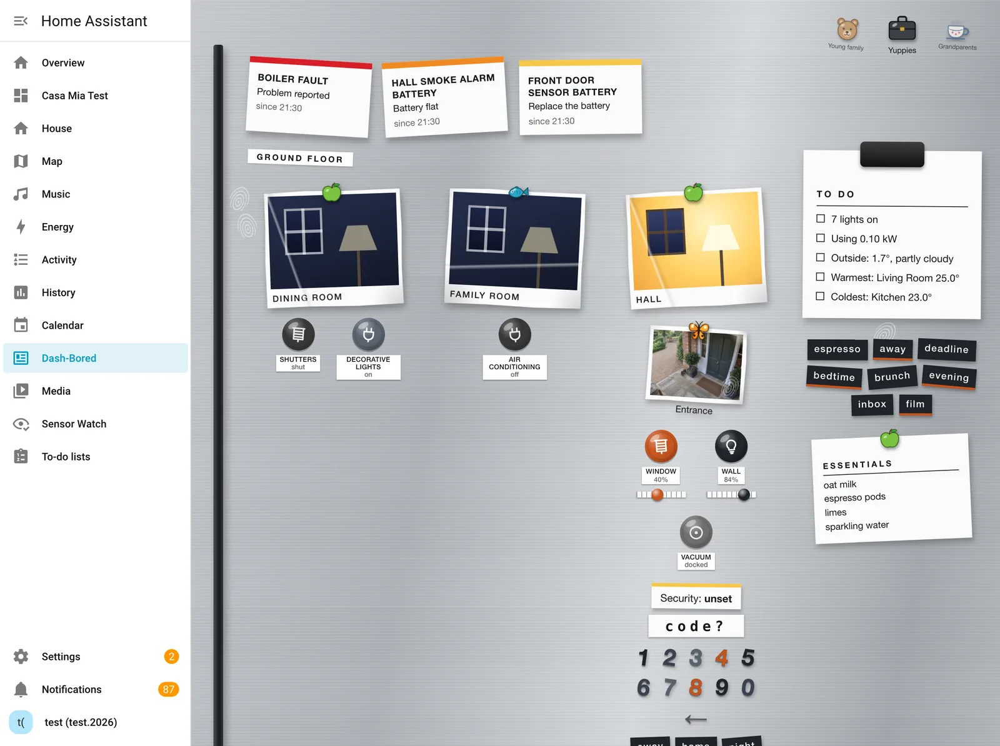

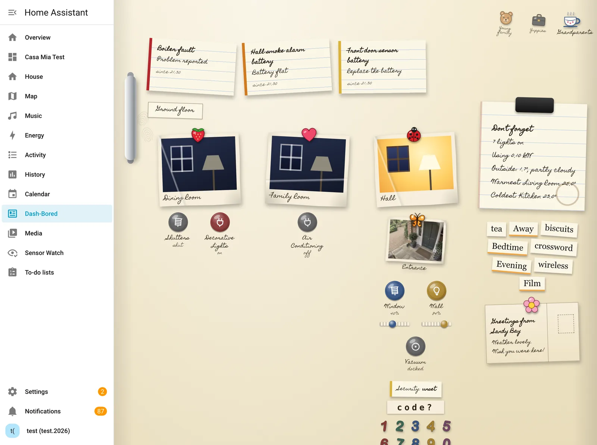

Nothing on the door is straight or clean. Everything is turned a little, each photograph
is creased in its own way, and the door has fingerprints by its handle.

## Aurora

The house in the style of today's web pages: tiles of glass over a coloured sky. It is
being built, and its picture in the table above is still of its mock-up.

The sky behind the tiles changes with how much light is on in the house. With everything
off it is blue, green and pink, and it turns warmer, towards amber, as lights come on. A
light at half brightness counts as half a light.

Aurora has seven skins, which are sets of colours: Aurora, Ember, Verdant, Cobalt, Rose,
Acid and Alloy. In the Aurora skin the sky turns from cold colours to warm ones as lights
come on; the others keep their colour and get brighter. The round button on the bar shows
the colours in use. Press it and the bar offers all seven; press Done to get the screens'
names back. The choice is kept by the browser, so a tablet and a phone can differ. A card
can name its skin instead, and then has no button:

```yaml
type: custom:dash-bored-aurora
style: cobalt
```

After the seven skins of colour, the bar offers nine for the seasons and the holidays:
Snow, Christmas, Fireworks, Valentine, Spring, Easter, Summer, Autumn and Halloween.
Each has its own colours and decorations. Something drifts over the page, such as
snowflakes, leaves or bats. A strip runs along the foot of the page either side of the
bar, such as a snowdrift, a meadow of daisies or the sea. A drawing stands in the top
right corner of the greeting, such as a snowman, a sandcastle or a hedgehog; the clock
in the Fireworks skin tells the time. Christmas has a string of fairy lights along the
top, Halloween a cobweb with a spider, and Summer the sun. The decorations can't be
pressed and cover nothing that can. If the device is set to reduce motion, nothing moves.

What drifts does not follow a fixed path. A leaf, a petal or a snowflake swings from side
to side as it comes down and is pushed about by a wind whose gusts never repeat. It
lands on the top of a tile, on the bar or on the ground. It lies there for a few seconds
and then becomes part of a heap, which grows as more lands. The tiles in the top row
hold nothing, because the machine below would have no room to stand on them.

Hovering over a tile or pressing it tips off whatever is on it, and so does swiping to
another screen. Every five to eight minutes a machine flies to each place that has
something on it and drives along it: a robot collects the leaves and petals, and a snow
blower throws the snow up behind it. The robot misses about one leaf in seven. Nothing
lies on a room's sheet, which the browser draws above everything else on the page. Hearts wobble as they rise, gulls
glide and bats flit.
Fireworks and Halloween are skins of the night, so their page is dark whichever theme
Home Assistant is using.

**Almanac**, between the two groups on the bar, wears the skin the date calls for:

| When | Skin |
|---|---|
| 1 to 26 December | Christmas |
| 31 December and 1 January | Fireworks |
| 14 February | Valentine |
| Good Friday to Easter Monday | Easter |
| 25 to 31 October | Halloween |
| 5 November in the United Kingdom, 4 July in the United States | Fireworks |
| Any other day | The season's: Snow from December, Spring from March, Summer from June, Autumn from September |

South of the equator the seasons are the other way round, by the latitude Home Assistant
has for the house. A card can name any of these as its `style`, `almanac` included.

A skin changes colours and decorations only. Every screen is laid out the same in each
of them.

Aurora is a set of screens, and each screen is filled with tiles of different sizes, with
no space left over. The page does not scroll down. To go from one screen to the next:

- **Swipe** sideways.
- **Press the tab** at the left or the right edge, which names the screen on that side.
  A phone has no tabs.
- **Use the bar** that floats at the foot of the page. It has an entry for the home
  screen and one for each screen of rooms, and the one you are on is filled in. A floor
  with more rooms than fit a screen has several screens, shown as spots under its name.
  Floors with few rooms share a screen when they fit one together, and it is named for
  all of them. When every room fits one screen it is called Rooms.

The first screen is the home screen:

- **The greeting**, with the date and the time, and a sentence that says how many lights
  are on, what the house is drawing if the card names a power sensor, and which room is
  warmest if more than one room has a thermometer.
- **Sensor Watch's alerts**, the worst first, each with what is wrong and since when. The
  tile says so when nothing needs attention, and when Sensor Watch is not installed.
- **The house's scenes**, a button each. A button that was pressed is dark for a moment,
  to show that the press was taken. A scene that belongs to a room (see
  [The Console](#the-console) for how that is decided) is on that room's sheet.
- **Drawing now**: the house's power, with a line of its last hour, if the card names a
  power sensor.
- **A thermostat's ring**, with − and + to change its target. It is the first thermostat
  in the house's order of rooms.
- **A tile for each floor**, with its rooms and how many lights are on in each. Press it
  to go to the screen that floor's rooms are on.

The other screens have a tile for each room, with its name, how many of its lights are
on and its temperature. The tile glows from one corner in proportion to the light that
is on in the room. How big a room's tile is depends on how much is in the room and on
how many rooms share the screen, and the tiles grow to fill it. On a big screen the
lettering and the controls on a tile are bigger too, up to 1.6 times their size.

A room with a camera has the camera's picture behind its tile, and a bigger tile to show
it. The home screen has a tile of every camera, with those that saw something in the
last half hour first. A picture is a still, not a live picture: under the camera's name
it says what the camera last saw and when, or the time the still was fetched. Press a
picture to see the camera live in Home Assistant's own dialog.

A room's sheet has each camera's picture at the top. Where the Casa Mia app is
installed, what its Cameras page set up for the camera is under the picture: a button
for each PTZ preset, a slider for the zoom, and the camera's page controls. Under the
room's faders and keys the sheet has a row of buttons for each setting that is a choice
from a list, with the one in use filled in: a thermostat's mode, preset and fan, a
player's source and sound mode, a fan's or a humidifier's mode, a water heater's mode, a
vacuum's suction and a light's effect.

- **A small tile** has a round button for each of its first few devices. Press one and
  its device is switched. Press anywhere else on the tile and it grows into a sheet with
  everything in the room.
- **A tile with the room for them** has the room's controls on it, as the sheet has, so
  there is nothing to open.

A room's controls, on its sheet or on its tile, are:

- **The room's scenes**, a button each (on the sheet only).
- **A fader** for anything with a level: a light's brightness, a blind's position, a
  fan's speed, a player's volume. Put a finger on it and the level follows the finger.
  The device is asked for the level once the finger is still. With a keyboard, the up and
  down arrows move it.
- **− and +** for a thermostat or a water heater.
- **A key** for everything else. Press it and the device is switched.

A lock, a garage door, a gate, a valve or a siren is not worked by its round button on a
tile. That button opens the sheet, and its key takes two presses to unlock, open or
sound. A camera or an alarm opens Home Assistant's own dialog.

The bar also has a search. It dims every room that doesn't match what you type: a room's
name, or the name of a device or a scene in it. Press Enter and it goes to the first
screen with a match. On a keyboard, `/` goes to the search. The last button on the bar
opens the choice of style, the same as pressing twice in the page's top right corner.

Aurora follows Home Assistant's light or dark theme, except in the Fireworks and
Halloween skins, which are always dark. If the page loses its connection, or
Home Assistant refuses something, it says so in a box at the top of the page.

Not on it yet: a device's history, a thermostat's modes, a player's source, the cameras'
sightings and the Gazette's columns.


## Digs

The house cut through from the side and built of square blocks, standing in its garden.
It is being built, and its picture in the table above is still of its mock-up. Its
textures are a pack called 4², because a block is sixteen pixels across. The page draws
every texture, figure and letter itself, so nothing in it comes from a game.

Each floor is a storey and each room is three blocks high, with its name and its
temperature over it. An area whose name says it is out of doors (garden, drive, patio,
yard, terrace, balcony, porch, deck, lawn or pond) is in the garden, to the left of the
house, with its name over it too. The page is as tall as the screen, and a house wider
than the screen is scrolled sideways. A house of three storeys has less sky over it, so
that its blocks can be as big as a smaller house's.

Digs goes by the floors that Home Assistant has for your areas, and a house whose areas
are not yet on floors is still drawn:

- An area on no floor whose name says it is an outbuilding (garage, barn, shed, workshop,
  stable, annexe, studio, lodge, cabin, greenhouse or summer house) is a building by
  itself, to the right of the house.
- The other areas on no floor are one more building, in up to three storeys, so that
  they are not one very long row. Give an area a floor in Home Assistant and it moves
  into the house.
- A board in the garden says how many rooms are on no floor and how many devices are in
  no area. Pressing it says so in full at the foot of the screen. Devices in no area
  have no block.

A room's name is pressed twice in the same way: the first press says how many of its
lights are on, and the second switches them all off, or on if none were on.

A room with more than eight lights has one chandelier for them all, which glows when any
is on and lights the room by how many are. A room with more than eight switches, or with
scenes of its own, has a chest. Pressing the chandelier or the chest opens a list of
everything in the room: each device's block with its name and how it stands, and the
room's scenes. In the list each block has its name beside it, so one press switches it.

When the house is wider than the screen there is a map of all of it over the scenes,
with a light for each lamp that is on and a frame round the part on the screen. Pressing
the map goes to that part of the house.

Each device is a block. The blocks have no names on them, so the first press on a block
only chooses it: it gets a white edge and its name over it, and the line at the foot of
the screen says what it is and how it stands. A press on the chosen block switches it,
and each press after that switches it again. A block stays chosen for eight seconds
after the last press.

- **A light** is drawn as the kind of lamp its name says. A name with "lamp", "floor
  light" or "uplighter" in it is a standing lamp on the floor; "spot", "spotlight" or
  "downlight" is a spotlight in the ceiling; "strip", "plinth" or "under cupboard" is a
  strip of light under the ceiling; any other light is a pendant hanging from the
  ceiling. Out of doors every light is a lantern on a post. The names are read in
  English. When a light is on it casts a pool of light, and it lights the blocks round it
  in its own room and the walls, but not the room next door. A dimmed lamp gives less
  light.
- **A blind or a curtain** is a window, with its slats as far down as it is closed. A room
  with a blind open is lighter by day.
- **A lock** is a door, and so is a garage door or a gate.
- **A thermostat or a water heater** is a stove, with a fire in it while it is heating.
- **A switch** is a lever. A switch that Home Assistant says is an outlet is a machine, as
  is a player, a fan, a vacuum and anything else.
- **A camera** (one press, since it changes nothing) is a picture in a frame, three blocks wide and two tall, on the wall of
  its room or on a post in the garden. The picture is the camera's latest still, drawn
  as coarsely as the blocks are, with the camera's name under it, so that one camera can
  be told from another. Pressing it opens Home Assistant's own dialog, where the camera
  is live. A camera whose still can't be fetched has a cracked grey picture.
- **An alarm** is a block that opens Home Assistant's own dialog for it.

A lock, a garage door, a gate, a valve and a siren take one press more to unlock, open
or sound. The press that would switch another block cracks this one and the line at the foot of the screen says "Hit
again to unlock". If the next press does not come within three seconds the crack goes.
Locking, closing and silencing need no extra press.

When you choose a device whose level can be set (a dimmable light, a blind, a thermostat's
target, a player's volume), a stack of ten blocks appears at the right of the screen.
Pressing a block in the stack sets the level to that tenth of its range.

A device that is not answering is a cracked grey block. Pressing it does nothing but say
so in the line at the foot of the screen.

Around the house:

- **Hearts**, top left, are the house's health. There are ten, and one is lost for each
  door left unlocked, each alert from Sensor Watch and each device not answering. Press
  the hearts to be told what each lost heart is for, one at a time.
- **The power bar**, top right, is the power in use, at 300 W to a bolt, with the figure
  beside it. It is there when the house has a power sensor.
- **The clock and the weather** are at the top. The sky is light by day and dark at night,
  with a sun or a moon, and it rains or snows on the house when Home Assistant's weather
  entity says so.
- **The forecast** is a row of signs in the garden, one for each of the next four days,
  with the day, a picture of its weather and its high.
- **Your scenes** are the buttons along the bottom: the house's and its floors'. The one
  set most recently has a white edge. A room's own scenes are in its chest.
- **The people** are figures with their names over their heads. They walk from room to
  room, climb the ladders, and go out through a door at each end of the ground floor
  into the garden and over to the outbuildings, staying 10 to 40 seconds wherever they
  get to. Home Assistant knows only that somebody is at home, not which room they are
  in, so most of their trips end in a room with a light on, and nobody goes out of doors
  after dark or in rain or snow. Somebody Home Assistant tracks is drawn while they are
  at home: they walk off the left of the garden when they leave, and walk in from there
  when they come back. Somebody it has no way of placing, such as a child with no phone,
  is always drawn.
- **Children** are drawn smaller when Casa Mia's People has their date of birth (see
  the People guide): a child of 5 to 12 is shorter than a grown-up, and a child of 2 to
  4 shorter still, walking more slowly. A baby sits, or crawls about the floor it is on,
  never taking a ladder or going out of doors. On a person's birthday they wear a party
  hat. Only
  the age band and the birthday reach the page, never the date. Without Casa Mia
  everybody is drawn grown.
- **The signpost** in the garden, lettered DASH BORED, opens the choice of family. Two
  presses in the top right corner of the page do the same.

Every few minutes an imp turns up with a crate of TNT, puts it down somewhere on the
part of the house that is on the screen, runs off and blows a hole in it. A repair bot
then flies in and mends the hole a block at a time. It is only a show: it switches
nothing in your house, hides no device's block and takes no press, and it does not
happen while a room's list is open or where the browser asks for less movement. The
first one comes twenty seconds after the page is opened, and the rest three to six
minutes apart. It can't be turned off yet.

When nobody has touched the page for a minute, the view follows one of the people about
the house, and goes over to whoever sets off when the one it follows stops. When the
imp turns up the view goes to him, even if the page was touched in the last minute.
While it is following someone, the line at the foot of the screen says whom. Any touch,
scroll wheel or key gives the view back at once. It does this on the Dash-Bored page
only, not on a dashboard's card or a room's card, and not where the browser asks for
less movement.

Digs does not yet have what a camera last saw, Casa Mia's presets, zoom and
controls for a camera, a thermostat's modes or a player's source, an alarm's code on the
page, or a device's history.


## Contraption

Contraption is being built. So far it draws one room as a machine that ducks go through:
the kitchen, which it finds as the area with "kitchen" in its name. If there is none it
draws the first room.

A dumb waiter carries ducks up a shaft in the middle of the room. At each level an arrow
sends one out along a wing to the right, one to the left and one on up. Along a wing the
stream climbs and drops by escalators, slides and a lift. Where several devices come
together it parts: an arrow sends a duck out by each of two or three ways, and further
on a roundabout lets one duck through and sends the rest down a hole. A wing ends at a
hole too. The dim dashed tubes behind the machine are tunnels, which take the ducks
that go down one hole to the hole they come up at. The longest of them starts at the
top of the dumb waiter and takes its ducks back to the foot. It forks, wanders through
the empty parts of the sheet and winds into a spiral on the way.

Each device is a tile, and the duck passing through a tile is that device's engine. For a
light, the duck runs on a belt, jumps on a sprung board or walks in a treadwheel, and
that turns a dynamo. The light being on is its clutch being in, so a tap on the tile
throws the clutch and switches the light. A dimmable light keeps its duck at work for
longer the brighter it is, and has a voltmeter. A light with a colour glows in it. Lights
in a Home Assistant light group are one machine with a shared shaft and a clutch for each.
Where the stream goes down or up past a light, the light stands upright: a duck going
down turns a paddle wheel, and one going up climbs a ladder that runs down under it.

A device that is not a light is a packing crate for now, with the kind of thing written
on it. Its flag is up and its lamp is lit while it is on. A tap on a lock, a garage door,
a camera or an alarm opens Home Assistant's own dialog and changes nothing.

A device that stops answering is put under a dust sheet, with a sign that says since
when, and its ducks go through a tube so that the rest of the machine keeps running. When
it answers again the sign says so, and the sheet stays until the bot has pulled it off.
If the page loses its connection the ducks go to sleep, the sheet is dimmed and a notice
says since when.

Now and then a duck leaves a poop, which the ducks behind hop over until the bot has
shovelled it into the compost bin at the foot of its pole. Tongs on a rail along the top
sometimes pull a duck out of a hole and carry it to the hole it was going to.

The buttons at the top choose a skin: patent engraving, blueprint or tin toy. The slider
sets how big a tile is drawn. A sheet wider than the screen is scrolled sideways.

It is a card too, **Casa Mia Dash-Bored Contraption** (`type: custom:dash-bored-contraption`).
Give it `rooms` with one room's name to draw that room, and `style` (`patent`, `blueprint`
or `tin`) to fix its skin.

Contraption does not yet have the rest of the house, scenes, a way to set a level, or
anything the other families show besides a room's devices.

## The order of floors and rooms

Floors are shown from the lowest up and the rooms on each by name. To change that, open
**Settings → Devices & services → Dash-Bored → Configure**:

- **Floors, in the order to show them.** Any floor you don't list follows, from the
  lowest up. Home Assistant's floor picker can't be dragged, so to move a floor take it
  out and add it again.
- **Rooms to put first on their floor**, in the order you list them. Any room you don't
  list follows, by name. A room stays under its own floor: listing the kitchen first
  puts it first on the ground floor, not at the top of the page.

The order is for the whole house. Every Dash-Bored page and card uses it, and a page
that is open changes as soon as you save. Nothing is left out by it: to keep a room or a
device off the pages, give it the label **Dash-Bored hide**. Devices in a room are
always in the same order, by kind and then by name.

## As a dashboard card

The same page is a card, **Casa Mia Dash-Bored Gazette**. It wants room, so put it in a view of
type **Panel (single card)**.

```yaml
type: custom:dash-bored-gazette
style: tabloid            # optional: broadsheet, tabloid or rolling; fixes the paper for this card
power: sensor.house_power # optional: a whole-house power sensor, in W or kW
weather: weather.home     # optional: which weather entity gives the outside temperature
floors: [First floor]     # optional: show only these floors, in this order
rooms: [Kitchen, Hall]    # optional: show only these rooms, in this order on their floor
```

The Fridge is a card too, **Casa Mia Dash-Bored Fridge** (`type: custom:dash-bored-fridge`).
Give it `style: family`, `style: yuppies` or `style: grandparents` and it is that household's
with no magnets to choose another.

Aurora is a card too, **Casa Mia Dash-Bored Aurora** (`type: custom:dash-bored-aurora`). It
takes `power`, `floors` and `rooms` in the same way, and has no `style`.

Digs is a card too, **Casa Mia Dash-Bored Digs** (`type: custom:dash-bored-digs`). It takes
`power`, `weather`, `floors` and `rooms` in the same way, and has no `style`. As a card its
blocks are 32 pixels across, and its signpost is not pressed.

The Console is a card too, **Casa Mia Dash-Bored Console** (`type: custom:dash-bored-console`),
with its era switch. Give it `era: bakelite`, `era: nixie`, `era: silverface`, `era: bargraph` or `era: beige` and it is that era with no
switch; the first is
also what the older `type: custom:dash-bored-bakelite` is. That card still works on a
dashboard that has it, but it is no longer offered when you add a card.
It takes `power`, `weather`, `floors` and `rooms` in the same way, and has no `style`.

When you add a card, Home Assistant shows a preview of each one. The Gazette, the Fridge,
the Console, Aurora and Digs preview with one room and a few of its devices, so that you can see the
look without the whole house being drawn in a narrow column. The card you add shows the
whole house.

Three smaller cards show part of the Console, each with an editor, and a fourth shows an
electricity meter in the Console's style ("A meter panel", below). Each takes `era` as the
Console does. Without it, the card is drawn in the era last chosen on the Console in that
browser, and changes when the Console's switch is turned.

```yaml
type: custom:dash-bored-console-instrument  # Casa Mia Dash-Bored Console instrument
entity: light.den_lamp
era: nixie        # optional
backing: false    # optional: on the dashboard's own card, not on its era's panel
---
type: custom:dash-bored-console-room        # Casa Mia Dash-Bored Console room
room: den         # the room's id or name
---
type: custom:dash-bored-console-lamps       # Casa Mia Dash-Bored Console warning lamps
```

An instrument is the entity's control as it is on the panel: a knob, a switch (under its
guard for a lock, a valve, a siren or a garage door), a camera's screen, an alarm's
thumbwheels or a scene's knife switch. A temperature sensor has a meter from 5 to 30 °C, a
humidity sensor one from 0 to 100 %, and a power sensor the mains meter. An entity that is
hidden from Dash-Bored, or in no room, is still shown on its own card. Without its era's
panel behind it, the instrument's lettering is in the dashboard's colour, except where its
era prints it on a plate.

The warning lamps card shows a green lamp when Sensor Watch has nothing to warn of. Until
Sensor Watch has answered, it says it is waiting.

### A meter panel

A fourth card shows something that is not on the Console's own page: an electricity meter,
as a chassis of the era's meters. It is for an ordinary dashboard, beside your other cards.
It is in the card picker as **Casa Mia Dash-Bored Console meter panel**, and has an editor.

```yaml
type: custom:dash-bored-console-meters
devices:                 # chosen in the editor: each device that is a meter
  - 0123456789abcdef0123456789abcdef
era: silverface          # optional, as on the other cards
show: [voltage, current, power, energy]   # optional: this is what is shown without it
limits:                  # optional
  voltage: { min: 200, max: 260 }
  current: { max: 32 }
```

You choose the device and the card works out the rest. Nothing has to be said about the
make or model of meter. It uses the device's sensors by their device class:

- **Voltage, current and power** each have a meter. Add `apparent_power`, `power_factor`
  or `frequency` to `show` for a meter of those too.
- **Energy** sensors are registers, in kWh to one decimal place: counter wheels in
  Bakelite, nixie tubes in Nixie and figures of seven bars in the later eras.
- A sensor belongs to a **phase** when its name or entity id has `L1`, `L2` or `L3` in it
  (or `Phase 1` to `Phase 3`). A meter with phases has a column of meters for each phase,
  side by side, so the three voltmeters are in a row. The readings that are of the whole
  meter (total power, the registers) are in a column of their own beside them.
- A meter with no phases is laid out as a row, with its registers after it.

Several devices on one card are several chassis, side by side where there is room.

**The size of the meters.** A chassis is drawn to fit the width its card gives it. The
whole of it is made smaller or larger together, from six tenths of its natural size to
one and six tenths, so the meters fill a wide card and still fit side by side on a phone.
When a three-phase chassis would be too small with everything side by side, the whole
meter's column moves under the phases. When that is too small as well, or a meter with no
phases is in a very narrow card, every meter stands in a single column at its natural
size. On a phone the lettering under the meters is small.

**The limits of a scale.** All the phases of one quantity share a scale, so the needles
can be compared. Without `limits`, a voltage is on the scale of the mains voltage it is
near (105 to 130 V, 210 to 260 V or 360 to 460 V), a power factor is from 0 to 1 and a
frequency from 45 to 65 Hz. Current and power go from nothing to the first round number
that holds the reading. That top only goes up while the card is on the page, so the scale
does not jump when a load switches off. To fix a scale, give its ends in `limits`, in
volts, amps, watts, volt-amps or hertz. Either end may be left out.

A sensor that is not answering has a dark meter lettered "not answering", and a device
that is gone, or has no sensor the card can show, has a chassis that says so.

**With Sensor Watch.** The card works without Sensor Watch. Where it is installed, the
card asks it about each sensor that has a meter, and is told at once when anything changes:

- A sensor watched by bands takes its scale from them, so you need give no `limits`. The
  scale covers the bands and is moved out to five round steps. Your own `limits` still
  come first.
- When Sensor Watch's level for a sensor is not nominal, the era's warning lamp is lit
  under that meter. Hover over it for what Sensor Watch says.
- A sensor that Sensor Watch calls stale has a dark meter, because its reading is an old
  one.
- If Sensor Watch stops answering, the scales and lamps stay as it last said, and the
  panel says so, with the time it stopped.

The bands are not drawn on the scales as coloured zones yet.

### A card for one room

Each family except the Gazette has a card that shows one room and nothing else. It is
for a dashboard page that is about that room, and it is the size of an ordinary card, so
it can stand among the page's other cards. Each has an editor, where you choose the room.

```yaml
type: custom:dash-bored-fridge-room       # Casa Mia Dash-Bored Fridge room
room: kitchen     # the room's id or name
style: yuppies    # optional
---
type: custom:dash-bored-aurora-room       # Casa Mia Dash-Bored Aurora room
room: kitchen
---
type: custom:dash-bored-digs-room         # Casa Mia Dash-Bored Digs room
room: kitchen
---
type: custom:dash-bored-contraption-room  # Casa Mia Dash-Bored Contraption room
room: kitchen
```

The Console's is `dash-bored-console-room`, above.

- **Fridge room:** the room's polaroid on a piece of the door, with a magnet for each of
  its devices and its scenes as word magnets. It has no notepad and no sticky notes.
- **Aurora room:** the room's sheet of controls, on the card and always open: a fader or
  a key for each device, the room's scenes, its cameras and its devices' settings. The
  sky behind warms with that room's lights alone. `style` takes a skin's name in small
  letters (`ember`, `cobalt`), or `almanac`.
- **Digs room:** the room cut out of the house, with its walls, its roof and the ground
  under it. The blocks are as big as the card's width allows. The room's scenes are
  along the bottom, and a level's stack is down the right edge. It has no hearts, no
  household walking about and no imp.
- **Contraption room:** the room's machine under its title, drawn to fit the card, with
  no slider. `style` is `patent`, `blueprint` or `tin`.

Without `style`, a room card is in the style last chosen on Dash-Bored's page in that
browser. A room card shows a room's devices, levels, scenes, cameras and temperature. It
does not show the weather, the power in use, Sensor Watch's alerts or anything else that
is about the whole house. A lost connection, or an action Home Assistant refused, is
still said on the card.

The Gazette has no room card. A newspaper is an overview of the house, and each room
already has its own heading in it.

`floors` and `rooms` on a whole-house card are for a screen that should show part of
the house, such as a tablet upstairs. The house's furniture stays round those rooms (the
masthead, the notepad, the home screen); for one room alone, use its room card. Each takes names or ids, and on that card they take the place of the
house's order. The cameras' sightings and the Personal column are still of the whole
house.

On a phone, or in a narrow column, the paper is a single column.

## Not built yet

- The order of the devices in a room.
- Changing the wording, and other languages. The text is English only.
- The rest of Bakelite, and the sixteen styles that are still mock-ups (see the list at the top).

## Inspiration

There are so many to mention who have given inspiration to this [and I'm not without
a nice dose of irony flooding my system as I called out how ]

| System | Main inspiration |
|---|---|
| [HomeDeck](https://github.com/rodrigo-wa/homedeck) | Automatic room dashboards, visual editing, seasonal decorations and Pro features |
| [Seasonal Glass](https://github.com/pietroguidetti02/ha-seasonal-glass) | Holiday themes, snow, Halloween effects and seasonal calendars |
| [Ultra Card](https://github.com/WJDDesigns/Ultra-Card) | Visual card builder, extensive controls, free-form layouts and Pro modules |
| [CardBuilder Pro](https://www.cardbuilder.pro/) | Block-based card design, reusable bindings, styling and animation |
| [Casora](https://github.com/SH1FT-W/casora) | Automatic room layouts, visual Studio and device previews |
| [Oriel Dashboard](https://github.com/TheDave94/oriel-dashboard) | Automatic generation with extensive visual configuration |
| [Dwains Dashboard Next](https://github.com/dwainscheeren/dwains-dashboard-next) | Whole-house generation, navigation and reusable blueprints |
| [Dwains Dashboard 3](https://github.com/dwainscheeren/dwains-lovelace-dashboard) | Earlier automatic dashboard approach |
| [SMARTi](https://github.com/Prosono/SMARTi_BaseComponent) | Automatic dashboards, themes, kiosk and paid functionality |
| [Mushroom Strategy](https://github.com/DigiLive/mushroom-strategy) | Automatic dashboards using Mushroom cards |
| [Bonbon Strategy](https://github.com/trashbytes/bonbon-strategy) | Automatic Bubble Card dashboards |
| [Linus Dashboard](https://github.com/Thank-you-Linus/Linus-Dashboard) | Automatic floor, room and device organisation |
| [Simon42 Dashboard Strategy](https://github.com/TheRealSimon42/simon42-dashboard-strategy) | Metadata-driven dashboard generation |
| [Hass Dashboard Pro](https://github.com/SecSunshine/hass-dashboard-pro) | Automatic area pages and visual theme editing |
| [HA Fusion](https://github.com/knowald/ha-fusion) | Drag-and-drop dashboard application |
| [Dashboard Studio](https://github.com/leofleischmann/Home-Assistant-Dashboard-Studio) | Code-based dashboard design with live preview |
| [LCARdS](https://lcards.unimatrix01.ca/cards/layout-view/) | Visual grid editing and console-style interfaces |