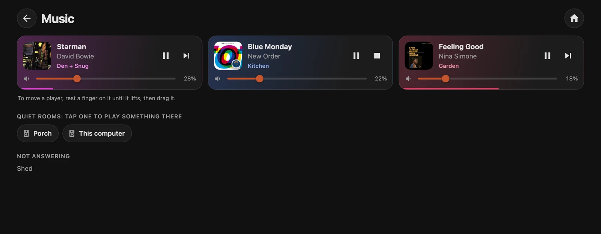
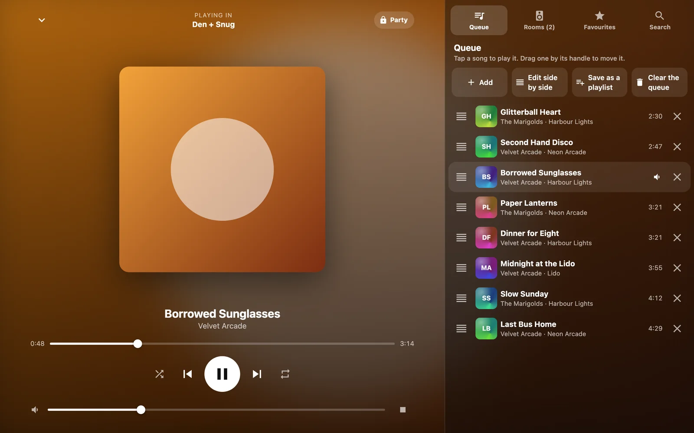
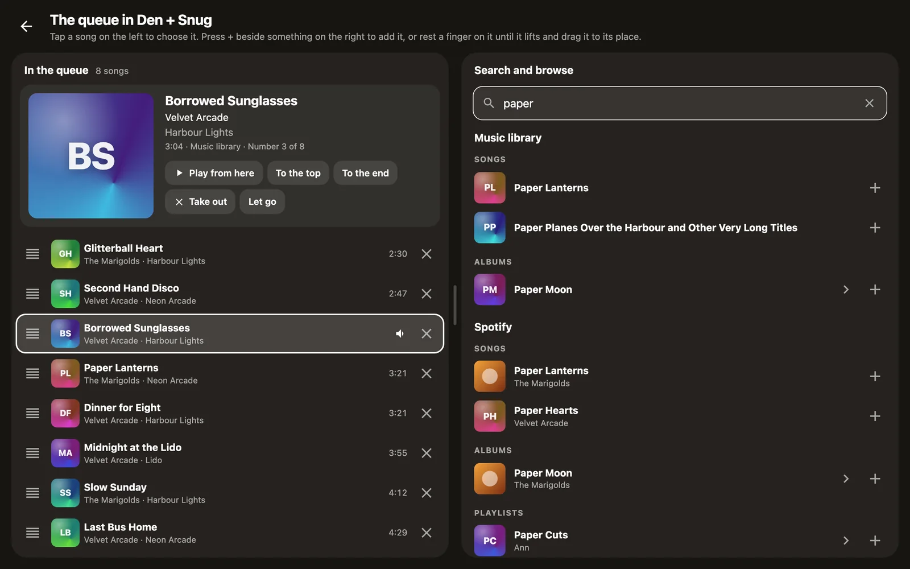
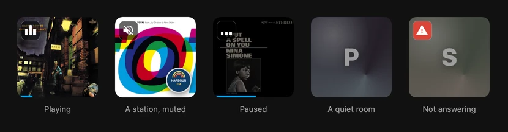

# Jukebox

A page for the music on your Sonos speakers, and announcements on them with a chime, a
volume for each room and quiet hours.

> **Maturity: Alpha.** Does its job every day in the author's house, but hasn't been tried in many others. Expect rough edges and changes. ([The levels](../README.md#maturity))

Jukebox is meant to become one place to manage the house's music across Sonos, Spotify
and a local library. Built so far: its page with a player for each thing playing; the
rooms and a volume for each; the queue; favourites and Sonos playlists, which you can
look into and change; a search of the music library and Spotify; cards for your own
dashboards; a lock that stops guests changing the music at a party; and announcements.



It adds no media players. Each room stays the one entity that Home Assistant's Sonos
integration makes, and Jukebox, the Sonos app and your dashboards all use that entity.

## What you need

- Home Assistant's own Sonos integration, with your speakers set up in it.
- Sonos S2 speakers. An announcement is played as a clip over the music, which S1
  speakers can't do. An S1 speaker is refused with a result that says so; support for
  S1 is planned.
- A text-to-speech engine in Home Assistant, such as Piper or Home Assistant Cloud, if
  you want messages said. Sounds need none.

## Installing it

The Casa Mia app installs the integration for you: there is nothing to download, and
you go straight to "Setting it up". Jukebox needs nothing else from Casa Mia.

### With HACS or the Marketplace

Jukebox is also published by itself, at
[gazoodle/casa-mia-jukebox](https://github.com/gazoodle/casa-mia-jukebox), for a house
without Casa Mia. Add that repository in HACS, or in Home Assistant's Marketplace
(2026.11 and later), as a custom repository of the type Integration; its page says how.
Everything in this guide works that way except the Jukebox tile on Casa Mia's own page,
which needs the app. It is the same integration either way, so the two can meet in one
house:

- **Installed from a store first, Casa Mia added later.** The app takes over keeping it
  up to date. If its copy is newer than the store's, it installs it and a Repair asks
  for a restart. Your settings and the order of your players carry on, and there is
  nothing for you to do.
- **The store still offers an update.** A store goes by the version it installed itself
  and doesn't see what the app wrote, so it offers a release the app has already
  brought. Installing it writes the same files again and loses nothing.
- **A store's version newer than the app's** is left alone, with a warning in the app's
  log. The app installs its own again once that is the newer one.
- **Remove in HACS deletes the integration's files,** even while it is set up. If you
  remove it there while the Casa Mia app is installed, it stops at the next restart of
  Home Assistant, until the app starts again and puts the files back. The Marketplace
  refuses to remove it while it is set up.

Love it or Loathe it's thumbs and its line on the player are shown where that
integration is installed too; without it, Jukebox leaves them out.

## Setting it up

1. Go to **Settings → Devices & services → Add integration** and choose **Jukebox**.
2. Open its **Configure** dialog and fill in:
   - **Rooms:** the speakers an announcement goes to when the action names none.
   - **Speech engine:** the text-to-speech engine that says a message. After this
     dialog Jukebox asks for its **Language**, then one of that language's **Voices**.
     Leave the voice empty to use the engine's own default, the one Assist uses too
     (for Piper, set in the Piper app's configuration). Choosing one here gives
     announcements a voice of their own whatever Assist uses. If the engine later loses
     that voice, an announcement is refused with the reason, and nothing is played.
   - **Chime:** the sound played before each announcement. Jukebox's own chime is
     filled in. Put a web address or a media id there for a different one, or empty the
     box for none.
   - **Quiet hours:** an entity that is on while announcements should be kept back. A
     schedule helper suits it; a toggle or a binary sensor works too.
   - **Who may run a party** and **The house's own screens:** see
     [The party lock](#the-party-lock). The two lists are also who may change
     playlists: save the queue as one, change one's songs, or delete one. The people
     on the first list may at any time. A screen on the second, such as a wall tablet,
     may whenever no party is on anywhere in the house, so that you can sit at a tablet
     and put a playlist together; while a party is on, when guests are at the tablets,
     it can't. Administrators always may, and any other login never can.

Each room you choose gets a number, **announcement volume**, on Jukebox's device page.
It starts at 25%. It is separate from the volume of the room's music: a clip carries its
own volume, and the speaker's volume is left as it was.

## The page

Once Jukebox is set up, **Jukebox** appears in Home Assistant's sidebar for everyone
who is signed in. There is nothing to configure: the page shows every speaker of the
Sonos integration.

- **A player for each thing playing**, with its picture, the rooms it is playing in,
  pause, skip and one volume for all of those rooms. The speaker beside the volume
  mutes all of those rooms, and is crossed out while they are muted. Where there is no next song to skip
  to (a station, or music that is paused) the second button is Stop. To change their order, rest a
  finger on a player until it lifts, then drag it to its new place. The order is kept
  for every screen in the house.
  A speaker that is playing is always shown as a player. If Home Assistant has no name
  or picture for the station it is on, which happens with some speakers a song or two
  after a station is started, Jukebox asks the speaker and shows what it says.
- **Quiet rooms** are listed below. Tap one to choose a favourite to play there.
- **A speaker that isn't answering** is listed too, so you know why it is missing.

Tap a player to open it over the whole screen. There you have:

- **Play, pause, skip, shuffle and repeat**, and a slider to move within a song.
- **Stop**, the square beside the volume. It ends the music there, empties the queue and
  puts the rooms back with the quiet ones, after asking. Pause keeps the player and
  what it was playing; Stop clears it.
- **Queue:** the songs lined up, each with its picture, artist and album, and the one
  that is playing marked. Tap a song to
  play it, drag one by the handle on its left to move it, or press the cross to take
  it out. The first 2,000 songs are shown. **Add** opens Search with an empty box, and
  brings you back to the queue once you have added something. While a radio station
  is playing and the queue has songs in it, **Play the queue** starts the queue in
  the station's place. Above the songs, **Save…** keeps
  the queue as a new Sonos playlist under a name you give it, or saves it over one of
  the playlists you have, which are listed under the name box. If the queue was
  started from a playlist in Jukebox, that playlist is first in the list, as **Save
  back to …**. Before a playlist is replaced Jukebox asks, and says how many songs it
  holds now and how many the queue has: what it held can't be got back. Jukebox
  doesn't know which playlist a queue came from when it was started in another app,
  or after Home Assistant restarts. **Clear…**
  empties the queue, after asking again. **Save…** is shown only to the people
  who may change playlists (see [Setting it up](#setting-it-up)).
- **Rooms:** tap a room to add it to what is playing, and again to take it out. Each
  room in the group has its own volume and its own mute. A room that is playing something else is
  brought over to this music.
- **Favourites:** the stations, playlists and songs saved as favourites in Sonos. A
  station plays at once and leaves the queue as it is. For a playlist or a song you
  choose **Play next**, **Add to the end of the queue**, or **Play now and replace
  the queue**, which asks again before the queue is lost. A Sonos playlist also has
  **Delete this playlist**, which removes it from Sonos for good and asks first. It
  is shown only to the people who may change playlists. **See what is in it** lists a
  playlist's songs before you play it. There, the people who may change playlists can
  drag a song to move it, take one out with the cross, and press **Add** to put
  something on the end: a song or an album from the music library, or a song, an
  album or a playlist from Spotify. Tapping a song there offers **Move to another
  playlist…** and **Copy to another playlist…**, and then lists your other playlists,
  with the one last chosen on that screen first, and a box to name a new playlist
  instead. The song goes at the end of the playlist you choose; if that playlist has
  the song already, you are asked first. A moved song is added there before it is taken out here, so if
  something goes wrong in between it is in both playlists, and Jukebox says so. If
  someone else has changed the playlist since you opened it and another song is in
  that place, nothing is changed and you are told. Each heading in Favourites folds
  its section away. A playlist's tile shows the covers of the first four albums in it,
  and is drawn again after the playlist has been changed.


- **Edit…** (on a wide screen only, on the Queue tab and on a playlist's
  songs) opens an editor over the whole screen: the queue or the playlist on the left,
  Search and Browse on the right. The arrow at the top left, or Escape, closes it.
  - **Choosing a song:** tap a song on the left. It is shown at the top with its
    cover and its title, artist and album in full, which a row cuts short, and with
    its length, where it is from and its place in the list. Tap the cover to see it
    large. The buttons beside it move the song to the top or the end, take it out,
    or (in the queue) play from it. In a playlist, two more move or copy it to
    another playlist. **Let go** unchooses it.
  - **Adding:** press **+** beside something on the right. With a song chosen you are
    asked whether it goes after that song, before it, or at the end; the song you
    added after is then the chosen one, so several things added one after another
    stay in the order you added them. With no song chosen it goes to the end.
  - **Dragging:** rest a finger on a song or an album on the right until it lifts,
    then drag it across and let go where it should go. A line shows the place; an
    album's songs all go in there. Let go anywhere else and nothing is added.
  - **Sort…** (a playlist only) puts its songs in order of title, of artist then
    album, or of album. A number in a title is counted, so songs named "01 …", "02 …"
    fall in order, and within an album the songs go by their track numbers where the
    speaker has them. The songs are moved in Sonos itself. **Put it back** returns
    the order the playlist had, until you change the playlist or close the editor.
    A playlist can't be sorted by the date a song came out: the speaker doesn't
    say it.
  - **Duplicates…** (a playlist only) takes out every song that is in the playlist
    more than once, keeping the first of each, after asking. They can't be put back.
- **The width of the panels:** on a wide screen there is a thin bar between the cover
  and the panel beside it, and between the editor's two lists. Drag it to give one
  side more room. The width is remembered in that browser. Once you have moved it, a
  small round button on the bar puts it back; so does a double tap on the bar.



- **Search:** one box searches the Sonos music library and Spotify together, and shows
  what each found under its own heading. Press **+** beside a result to play it, play
  it next or add it to the end of the queue. An album, an artist or a playlist can be
  opened to see what is in it. While the box is empty you can browse the music library
  and Spotify instead. Spotify is searched with Jukebox's own sign-in to Spotify
  ([Songs from Spotify](#songs-from-spotify) has the steps). What it finds is opened
  and played through Home Assistant's
  [Spotify integration](https://www.home-assistant.io/integrations/spotify), which
  must be set up too, and Spotify must be linked to Sonos as a music service for its
  music to play. If one of the two can't be searched, the player says
  why and still shows the other's results.

On a phone the queue, rooms, favourites and search open as a sheet over the player. On a wide screen,
such as a wall tablet, they sit beside it.

The page's heading has a back button and a home button, because a wall tablet running
without Home Assistant's sidebar has no other way to leave. To reach the page from a
tablet's dashboard, add any button that navigates to `/jukebox`.

Everything the page does goes through Jukebox and is written to Home Assistant's log
with the name of who did it.

## Listening on your own phone

The device you are holding is listed with the quiet rooms, as **This phone** (or **This
tablet**, or **This computer**). Tap it and choose something from Favourites or Search,
as you would for a room. It plays through the device's own speaker, or the earbuds
connected to it, and nothing changes on the Sonos speakers.

It has a player and a queue like any room's: play next, add to the end, move a song,
take one out, shuffle and repeat. It plays:

- a Sonos playlist or favourite, and anything found by Search;
- songs from the music library;
- songs from Spotify;
- radio stations, from TuneIn or with a web address of their own, when a Sonos room is
  playing the station or it is one of the Sonos favourites.

A song from any other music service can't be played on a phone. It is left out, and
the player says how many were.

Some things are different from a Sonos room:

- The queue is kept by the page, on the device, so it is still there when you open
  Jukebox again. Another phone has its own.
- The device's own volume buttons set how loud it is. There is no volume slider,
  because a web page can't set an iPhone's volume.
- It plays by itself. It can't be joined to the Sonos rooms, and there is no party
  lock for it.
- The lock screen shows the song, and its buttons, like the buttons on earbuds, play,
  pause and skip through Jukebox's queue.
- A station shows its name, but not the song it is playing.
- A login listed under **The house's own screens**, such as a wall tablet's, isn't
  offered itself as a room.

If a song can't be played, the player says which and why, and goes on to the next.
After three in a row it stops.

### Songs from the music library

A phone can't reach the share your music is on, so Home Assistant sends it the file.
For that the share has to be among Home Assistant's media: add it under **Settings →
System → Storage → Add network storage**, with **Media** as its usage. Any name will
do. Jukebox finds a song there by its folders and file name.

Until then, a library song is refused with a message that says so.

### Songs from Spotify

Spotify plays on a phone through Spotify's own player for web pages, which runs in a
frame of Spotify's, kept apart from Home Assistant's page. That needs a
Spotify Premium account, a page reached over `https`, and a sign-in of Jukebox's own:
Home Assistant's Spotify integration is a remote control, and Spotify doesn't let its
sign-in play music.

1. Open your Spotify developer app, the one you made for Home Assistant's Spotify
   integration, on Spotify's developer dashboard. Make sure **Web Playback SDK** is
   ticked among the APIs it uses.
2. In Home Assistant, go to **Settings → Devices & services → Jukebox**, open the
   entry's menu and choose **Reconfigure**.
3. The first time, Home Assistant asks for application credentials. Enter that
   developer app's client ID and client secret.
4. Sign in on Spotify's page with the account the house uses, and agree.

Search and the covers of songs on the radio use the same sign-in. They don't need
Spotify Premium.

Only administrators can then listen to Spotify on their own device. The page is given
a key to the Spotify account to play with, and whoever holds it can act as that
account, so it isn't given to the logins listed under **Who may run a party** either.
The library and radio stations need no sign-in and are for everyone.

Spotify plays in one place at a time for one account. If the same account starts
playing on the speakers, it stops on the phone, and the player says so.

## The party lock

Anyone on the house's network can change the music with the Sonos app, and Sonos has no
way to stop them. The party lock doesn't stop them either: it puts back what they
change.

Press **Party** at the top of the big player. Only the people who may run a party see
the button: administrators, and the logins you choose under **Who may run a party** in
Jukebox's Configure dialog. While it is on for those rooms:

- **The queue** is kept as you made it. A song a guest adds is taken out, one they take
  out is put back in its place, and songs they move go back to their order.
- **What is playing from** is kept. If a guest starts music from another app, the
  speakers are returned to the queue, at the song they were on.
- **The rooms** are kept. A room taken out of the group is brought back, and one added
  is taken out.
- **The volume** of each room is kept, including a change made with the buttons on a
  speaker.

During a party the speaker keeps a copy of the queue, as a Sonos playlist called
"Jukebox party copy" with the room's name. You will see it in the Sonos app; Jukebox
doesn't list it. When a song has been taken out, or the queue replaced, the speaker
loads the copy back, and the music carries on from about where the other app cut in.
The copy is deleted when the party ends.

A change is put back a few seconds after it is made, once the other app has finished
making it, and each one is listed with its time when you press **Party on**. If the
change stopped the music, it is started again at the song it was on. End the party from the same place.

### Who can change the music during a party

A guest could otherwise walk up to a wall tablet, end the party there and carry on from
the Sonos app. So during a party Jukebox itself is limited too:

| Who | During a party |
|---|---|
| The people who may run a party | Change anything from Jukebox, and end the party. |
| A screen, such as a wall tablet | Looks only, until someone running the party turns on **Let the wall tablets change the music**. Then it can change the music, but never the party. |
| Any other login, such as a guest's | Looks only. |

The screens are the logins you choose under **The house's own screens** in the
Configure dialog. Whatever the switch says, a screen can't change a playlist while a
party is on. The switch is on the sheet that **Party on** opens. It
is off at the start of every party, and can be turned on and off as the party goes.
With it on, anyone standing at a wall tablet can change the music; the log names the
tablet, not the person.

This is checked by Jukebox where a change is carried out, so it also covers the
Shortcut card and the `casa_mia_jukebox.play` action pressed from a dashboard. An
automation is never refused. A change that is refused says why on the page and is
written to Home Assistant's log with the login that tried.

A wall tablet can still reach a speaker without Jukebox, through another card or the
speaker's own dialog, because Home Assistant doesn't limit that. Those changes are put
back like any other made outside Jukebox.

Skipping a song, pausing and moving within a song are left alone, because they can't be
told from the music moving on by itself.

For automations there are two entities and an event:

| Entity or event | What it says |
|---|---|
| **Party** (binary sensor) | On while a party is on anywhere. Its `rooms` attribute lists each party's rooms. |
| **Changes put back** (sensor) | How many changes have been put back since Home Assistant started, with the last one and when. |
| `casa_mia_jukebox_put_back` (event) | Fired for each change put back, with `rooms` and `what`. |

For example, to run a disco ball for as long as the party lasts, switch it on when
**Party** turns on and off when it turns off.

Limits:

- A party ends when Home Assistant restarts. Its copy of the queue is then left among
  the Sonos playlists until the next party in that room replaces it, or you delete it.
- If someone deletes the copy during a party, the page says so, and songs are put back
  one at a time with fewer of their details.
- The room that leads the group (the one the party was started from, in Sonos's terms
  the coordinator) can't be taken out of the group until the party is ended.
- Songs moved in another app are noticed through the leading speaker's own report of
  its queue. If that is lost, the player says since when, and a move is then noticed
  only at the next change it does hear of.
- While a radio station is playing, a speaker doesn't report changes to its queue, so
  those are put back when the next thing happens that it does report.

## The cover of a song on the radio

While a station plays, a player's picture is the station's own. Where Jukebox is signed
in to Spotify ([Songs from Spotify](#songs-from-spotify)), it also looks the song up on
Spotify, by the title
and artist the station sends, and shows the song's cover with the station's picture on
it as a small round badge. The badge is how you tell a station from a queue.

- A cover is shown only when Spotify has a song whose title and artist both agree with
  the station's. Otherwise you see the station's picture alone, as before.
- Spotify often has a song on several records. Jukebox takes the cover of one by the
  song's own artist before a collection by various artists, and the single before the
  album. Between two of the same kind it takes the earlier one.
- Some stations send the artist and the title the wrong way round, and some send
  "Artist - Title" as the title. Jukebox tries both ways.
- A show's name or an advert, with no artist, isn't looked up.
- Each song is looked up once, when a speaker starts playing it, with three searches
  sent together. The title and artist of every song your stations play are sent to
  Spotify as searches from your account.
- Without that sign-in nothing changes.

### Adding a song on the radio to a playlist

The people who may change playlists (see [Setting it up](#setting-it-up)) have **Add
to a playlist** under the song's title on the big player while a station plays. It
lists the Sonos playlists, with the one last chosen on that screen first, and adds the
song to the end of the one you choose.

- What is added is the song found on Spotify, the one whose cover is shown, so the
  speakers need Spotify added as a music service in the Sonos app to play it.
- The song is the one that was playing when you pressed the button, even if the station
  has moved on by the time you choose a playlist.
- When there is no song to add, the button is dimmed, and pressing it says why: the
  station sent no artist and title, Spotify has no song that matches, the song is still
  being looked for, or Jukebox isn't signed in to Spotify.
- When there is no song to add, pressing the button also looks for it on Spotify once
  more. If Spotify didn't answer the first time, the song can be added once it has.
- To start a new playlist with the song, type a name under the list and press **New
  playlist**. A name that a playlist already has is refused.
- If the playlist you choose has the song in it already, Jukebox says so and asks
  before adding it a second time.

## With Love it or Loathe it

Where [Love it or Loathe it](love-or-loathe.md) is installed and watches a speaker,
Jukebox works with it. The two share no settings; there is nothing to set up.

- **The thumbs** are under the song's title on the big player and on the Now playing
  card. They are Love it or Loathe it's own, so they follow its rules: they show only
  for a login that may rate.
- **Why a player was changed.** When Love it or Loathe it mutes a song, changes its
  volume, switches station or skips it, the big player says what it did and why, under
  the title: "Muted until the next track, because “Last Christmas” by Wham! is in the
  loathed group “Christmas”". It stays while that is in force. A mute or a change of volume
  ends with its song, so the line goes when the next song starts. A skip, or a return
  from another station, is still shown through the song it brought, for up to ten
  minutes, or until you put other music on from Jukebox. A small player says what was done for as long as it
  is in force.
- **At a party**, what Love it or Loathe it does is not taken for a guest's change. The
  volume and the station are left alone until it has put them back.

## The cards

Jukebox's page is made of pieces, and each piece is also a card. If you want a page of
your own, with your own buttons or other cards beside the music, make a dashboard view
and add the pieces you want. Each is in the card picker under "Casa Mia Jukebox".

| Card | What it shows | Options |
|---|---|---|
| **Players** | A small player for each thing playing, in the order you dragged them into. With no room chosen you can change the order on the card as well, the same way as on Jukebox's page. | A room, to show only that room's music. |
| **Micro player** | Only the picture of what a room is playing, small enough for a sidebar. It has no controls. Small bars on the picture move while music is playing and stand still while it is paused, when the picture also loses its colour. A crossed speaker is shown when the room is muted, and a warning sign when the room isn't answering or Home Assistant can't be reached. A room playing nothing is shown as a speaker. | A room; with none chosen it shows one picture for each thing playing. The size: small (120 px), medium (184 px) or large (248 px). Where the picture sits in its card, chosen from a grid of nine places. Whether it is the picture alone, with no card round it. What a tap does. An icon or a picture of your own for a room playing nothing. |
| **Quiet rooms** | A chip for each room playing nothing, which opens its favourites, and any speaker that isn't answering. | Whether to show its heading, and whether to list the speakers that aren't answering. |
| **Shortcut** | One button that plays one favourite in the rooms you choose. | The favourite's name, the rooms, and optionally what the button says, an icon, and whether to play it next or add it to the end of the queue. |
| **Now playing** | The whole player for one room, in place: artwork, controls, queue, rooms, favourites, search and the party lock. | The room. |



Every card is set up with a form in the dashboard editor, with the usual Layout and
Visibility tabs beside it; none needs YAML.

A tap on a small player, a micro player or a quiet room opens the big player over the
screen, as on Jukebox's page. A micro player with no room chosen opens Jukebox's page
when nothing is playing.

The micro player is drawn in a card with the background and border of Home Assistant's
own cards. Turn on **The picture alone** to take the card away and leave only the
picture, as the Markdown card's text only does for words. In a card with a border the
picture is 16 px smaller than the size chosen, so the card still fills whole rows.

The micro player's picture keeps its size whatever the width of its card, so a card as
wide as a sidebar can hold a small picture in its middle. Each size is a whole number of
rows of a section (two, three or four), so the picture lines up with the cards beside it.
A room that is playing nothing is shown as a speaker. Under **A room that is playing
nothing** in the card's editor you can choose an icon for it, or give the address of a
picture, such as `/local/quiet.png` for a file in Home Assistant's `www` folder. Either
is drawn at the size you chose, in the same place and the same card. A picture is shown
whole and in its own colours; the speaker and an icon are dimmed, as a paused cover is.

Its tap action is Home Assistant's usual one. Left at its default it opens the big
player. To open Jukebox's page instead, choose Navigate and enter `/jukebox`. The setting
belongs to the card, so if some tablets should do one thing and some another, add the
card twice and show each to the right tablets with its Visibility tab. The Now playing card needs room: give it at least half the width of a
tablet and most of its height.

### Opening the big player from a card of your own

If you want a look that Jukebox's cards don't have, use any other card (Home Assistant's
Tile, Button or Picture card, or one from the Marketplace) and give it this tap action:

```yaml
tap_action:
  action: fire-dom-event
  casa_mia_jukebox:
    room: media_player.kitchen
    tab: favourites        # optional: queue, rooms, favourites or search
```

A tap then opens the big player for that room, as a tap on Jukebox's own cards does. If
the action names no room, or a tab that isn't one of the four, Home Assistant shows a
message saying so. Such a card shows what Home Assistant knows of the speaker, so on a
station it has the station's picture and not the song's cover.

Which cards a tablet or a person sees is Home Assistant's to decide: each card has a
Visibility tab in the dashboard editor. If your own view replaces Jukebox's page, turn
off **Show Jukebox in the sidebar** in Jukebox's Configure dialog (Settings, Devices &
services, Jukebox). The page is still there at `/jukebox`.

## Playing a favourite from a button or an automation

The Shortcut card uses an action that you can also call from an automation, a script
or a voice command:

```yaml
action: casa_mia_jukebox.play
data:
  favourite: Harbour FM
  rooms:
    - media_player.kitchen
```

`favourite` is the name of a favourite or a Sonos playlist as it is written in
Jukebox's Favourites; capitals don't matter. With more than one room, the first leads
and the others join it. Add `enqueue: next` or `enqueue: add` to line it up in the
queue; without it, it plays now. A station always plays now.

Use this action and not the speaker's own `media_player.play_media`: it goes through
Jukebox, so it is written in the log with who asked, and when a party is on it isn't
put back as a guest's change.

## Announcing

```yaml
action: casa_mia_jukebox.announce
data:
  message: Dinner is ready
```

| Field | What it does |
|---|---|
| `message` | Words to say, in the voice you chose. |
| `media` | A sound to play: a web address or a media id. With a message too, the sound comes first. |
| `players` | The speakers to announce on. Left out, it is all the rooms in the Configure dialog. |
| `chime` | `false` leaves the chime out of this announcement. |
| `volume` | A volume for this announcement in every room, in place of each room's own. |
| `priority` | `true` plays it in quiet hours too. |

An announcement needs a message, a sound, or both.

The announcement plays over the music, which carries on when it ends. Nothing about
the speaker changes: not its volume, what it is playing or its group. So
automations that watch the player, and Love it or Loathe it, don't see an announcement.

## One after another

A Sonos speaker that is sent a second clip while one is playing cuts the first off.
Jukebox keeps a queue for each speaker, so a chime is followed by its message and two
announcements at the same moment are played in turn. It knows a clip has ended because
it listens to the speaker itself while the clip plays.

An announcement that has waited 30 seconds for the ones before it is dropped, because
by then "someone is at the door" is no longer true. Its result is `too_late`.

Each room plays for itself, so the same announcement in two rooms next to each other
can be heard slightly out of step.

## What happened to an announcement

The action answers with a result for the whole announcement and one for each room:

```yaml
result: partly
rooms:
  media_player.kitchen:
    result: played
  media_player.garden:
    result: unavailable
```

| A room's result | What it means |
|---|---|
| `played` | The speaker reported that every clip finished. |
| `quiet_hours` | Kept back by quiet hours. |
| `unavailable` | The speaker is off or out of reach. |
| `not_sonos` | The player isn't one of the Sonos integration's. |
| `no_audio_clips` | The speaker can't play a clip over its music (Sonos S1). |
| `no_answer` | The speaker didn't answer on its control port, or never said the clip had ended. |
| `interrupted` | Something else sent the speaker a clip and cut this one off. |
| `too_late` | It waited more than 30 seconds for earlier announcements. |
| `failed` | Home Assistant or the speaker refused the clip. The `reason` says more. |

The whole announcement is `played` when every room that was meant to play did,
`partly` when some did, and `nothing` when none did. A room in quiet hours was not
meant to play, so it doesn't make an announcement partial.

The same answer is on the **Last announcement** sensor, with each room's result in its
attributes, and goes out as the `casa_mia_jukebox_announced` event. Every room that
didn't play is also written to Home Assistant's log as a warning, with the reason.

To be told when an announcement doesn't reach a room:

```yaml
triggers:
  - trigger: state
    entity_id: sensor.jukebox_last_announcement
    to:
      - partly
      - nothing
```

## Limits

- Sonos S2 only, for now.
- Jukebox talks to each speaker directly on port 1443 while a clip plays, to hear when
  it ends. Home Assistant must be able to reach the speakers on that port, which it
  already must for the Sonos integration's own announcements.
- If the quiet-hours entity is missing or unavailable, announcements are played.

## Why not Music Assistant?

[Music Assistant](https://www.music-assistant.io/) does far more than Jukebox, and if
it suits your house, use it. Jukebox was written for one person in the author's house,
who wanted to find a song and add it to what is playing, and who found Music Assistant
too much to learn for something she uses now and then. Music Assistant may be able to
be set up to work the same way. If it can, the author didn't find out how.

These are the differences that mattered there:

- **The queue is the speaker's own.** Jukebox puts songs into the Sonos queue, so the
  Sonos app, the buttons on a speaker and Jukebox all show and change the same list.
  Music Assistant's documentation describes it handing the speaker its next song
  shortly before the one playing ends.
- **Home Assistant isn't in the path of the sound.** The speaker fetches each song
  itself, from the music library or from Spotify. The music carries on while Home
  Assistant restarts or is updated, and Jukebox's page shows the same queue when it
  comes back. Music Assistant is a server of its own that sends the sound to the
  speaker.
- **It does one job.** One box searches the music library and Spotify, and a tap adds
  what it found to the queue. Jukebox has no podcasts or audiobooks and keeps no
  library of its own.
- **There is no server to run.** It is one integration, and it uses the Sonos and
  Spotify integrations you already have, with a sign-in of its own to Spotify.

[Listening on your own phone](#listening-on-your-own-phone) is the exception to the
first two: there the queue is kept by the page, and Home Assistant sends the phone its
library songs.

Music Assistant is the one to use if:

- you have speakers that aren't Sonos, or want different makes to play together;
- you use a music service other than Spotify, or listen to podcasts or audiobooks;
- you want the music from several services kept as one library.
