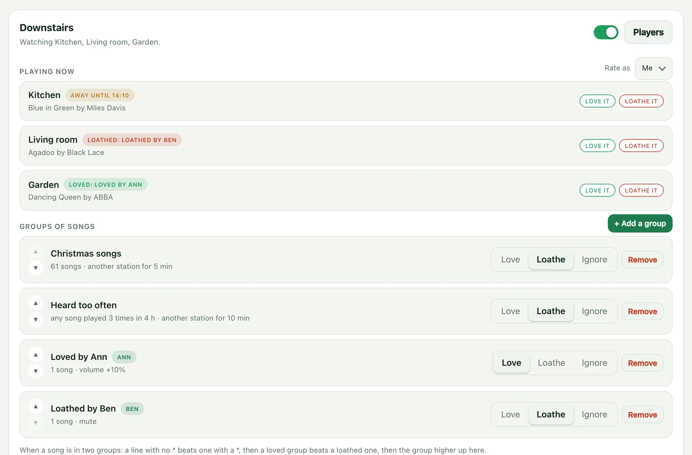
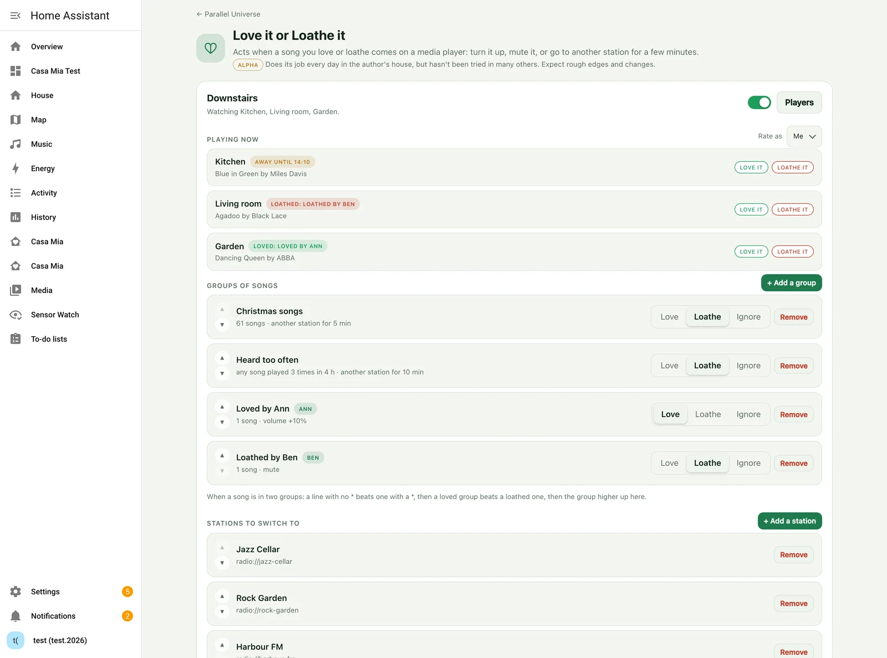
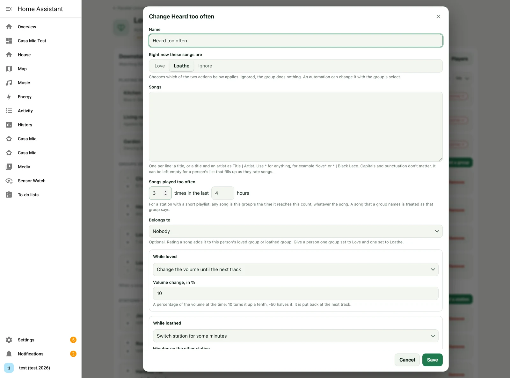
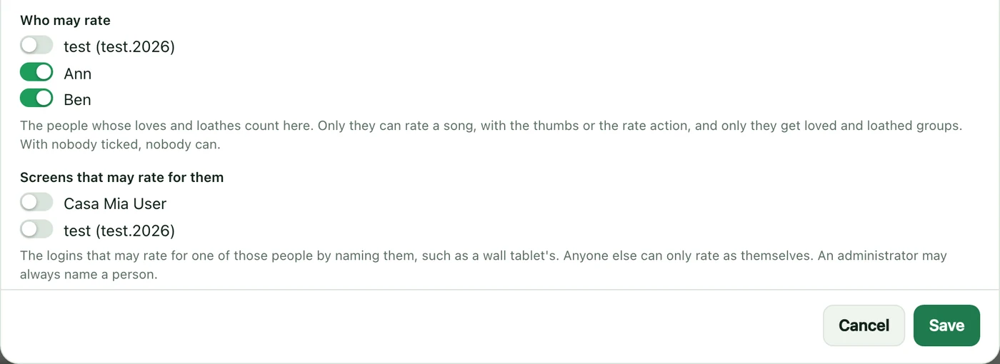
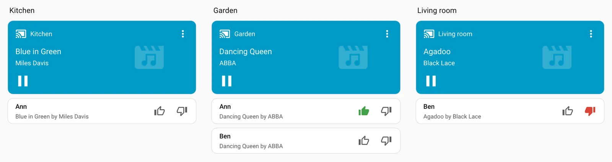
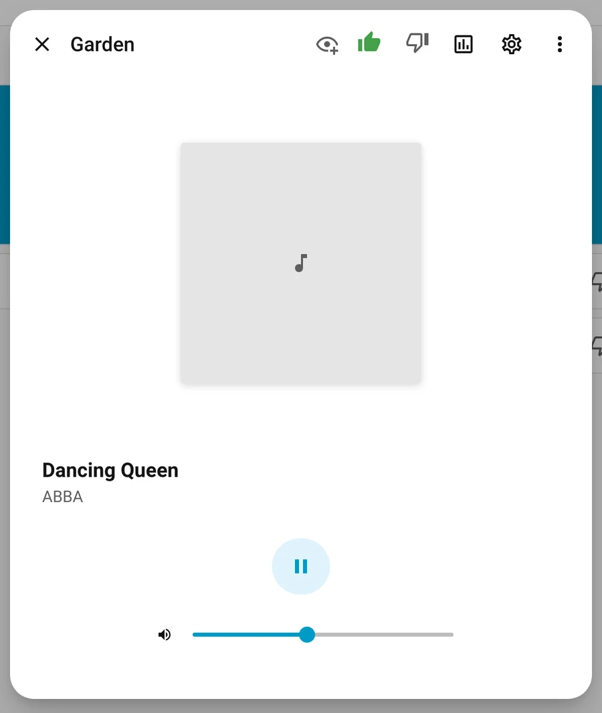
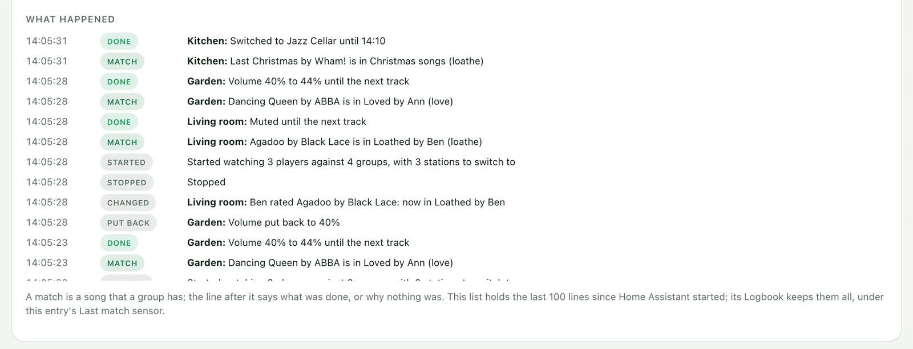

# Love it or Loathe it?

An automatic media watcher that boosts the volume for a song you love, or changes the
radio station for one you loathe.

> **Maturity: Alpha.** Does its job every day in the author's house, but hasn't been tried in many others. Expect rough edges and changes. ([The levels](../README.md#maturity))

Sick of Xmas songs in November, yet love them in December? Then this is for you. But
that's not all: you can mark songs as loved or loathed, live, as they are playing.

Bored of radio stations with a short playlist? Then ask this integration to watch for
songs repeated within a period of time, and use those as triggers to change station too.

Or maybe you don't want the adverts? Shunt them too.

Pair it with Casa Mia's local radio station system and you can fade across to songs you
truly love to hear.

A full integration with events, so you can trigger your own automations too, including
notifications of what happened!



**Not built yet:** shunting the adverts, and the fade. Casa Mia's local radio station
is a Casa Mia feature still to come, not part of this integration: when it exists, it
is one more station to switch to. The rest of this guide describes what works today.

## What it's for

A radio station plays a mix you mostly like, with some songs you would rather skip and a
few you want louder. Love it or Loathe it watches the title and artist your media players
report, and acts when a track matches one of your groups of songs:

- change the volume by a percentage until the next track,
- mute until the next track,
- switch to another station for some minutes, then go back,
- or only fire an event, for an automation to act on.

How you feel about a group of songs can change. Each group is loved, loathed or ignored
at the moment, with an action for loved and another for loathed, and an automation can
change the feeling. The shipped list of Christmas songs is the example: loathed in
November, when a station starts playing them too early, and loved in December.

Each person in the house can have their own loved and loathed groups, and add the song
that is playing to them with a button on a dashboard.

It is an integration of its own, **Love it or Loathe it**. It runs wholly in Home
Assistant and needs neither the Casa Mia app nor the Casa Mia integration. Installed by
itself, from HACS or the Marketplace, it is set up and changed with Home Assistant's own
screens. With the Casa Mia app it also has a page there, which changes the same
settings. [Two ways to change its settings](#two-ways-to-change-its-settings) lists
both.

## What it needs from a player

A player must report the title of what it is playing (`media_title`, and `media_artist`
when it has one). Most do, for radio streams as well as for your own music. Check a
player under Developer tools → States while a song is on.

To change the volume, mute or switch station, the player must support Home Assistant's
`volume_set`, `volume_mute` and `play_media` actions.

## Installing it

The Casa Mia app installs the integration for you: there is nothing to download, and
you go straight to "Setting it up".

### With HACS or the Marketplace

Love it or Loathe it is also published by itself, at
[gazoodle/casa-mia-love-or-loathe](https://github.com/gazoodle/casa-mia-love-or-loathe),
for a house without Casa Mia. Add that repository in HACS, or in Home Assistant's
Marketplace (2026.11 and later), as a custom repository of the type Integration; its
page says how. Everything in this guide works that way except the page in Casa Mia,
which needs the app. It is the same integration either way, so the two can meet in one
house:

- **Installed from a store first, Casa Mia added later.** The app takes over keeping it
  up to date. If its copy is newer than the store's, it installs it and a Repair asks
  for a restart. Your groups, stations and ratings carry on, and there is nothing for
  you to do.
- **The store still offers an update.** A store goes by the version it installed itself
  and doesn't see what the app wrote, so it offers a release the app has already
  brought. Installing it writes the same files again and loses nothing.
- **A store's version newer than the app's** is left alone, with a warning in the app's
  log. The app installs its own again once that is the newer one.
- **Remove in HACS deletes the integration's files,** even while it is set up. If you
  remove it there while the Casa Mia app is installed, it stops at the next restart of
  Home Assistant, until the app starts again and puts the files back. The Marketplace
  refuses to remove it while it is set up.

## Setting it up

1. Settings → Devices & services → **Add integration** → **Love it or Loathe it**. Give
   it a name and choose the media players to watch. One entry watches as many players
   as you give it: after you choose the first, the box offers another.
2. On the integration's page, **Add a station** for each station you are happy to be
   switched to. Give it a name, choose a player to browse on, and choose the station.
   The station is kept without the player, so it can be played on any of them.
3. **Add a group of songs** for each set of songs.

The groups and stations you add belong to that entry and apply to all its players. To
give other players different groups or stations, add the integration again with those
players. A player can be in only one entry.

The **Delay** set with the players is the number of seconds to wait after a player
reports a new track before acting. Leave it at 0 unless a player changes its title
before the song itself changes.

## Two ways to change its settings

The settings are kept in Home Assistant, whichever way the integration was installed.
There are two places to change them, and both change the same thing:

- **Home Assistant's own screens.** This is the only way for the integration installed
  by itself, and it is always there with Casa Mia too. Everything is on the
  integration's page: Settings → Devices & services → **Love it or Loathe it**.
- **The page in Casa Mia**, for a house with the Casa Mia app. It has everything on one
  screen, and a few things Home Assistant's screens can't do.

| To | In Home Assistant | On the page in Casa Mia |
|---|---|---|
| Add an entry, or delete one | **Add integration**; an entry's menu → Delete | Not on the page: it links to Home Assistant |
| Change an entry's players and delay | The entry's **Configure** | **Players** |
| Choose who may rate | The entry's **Configure** | **Players** |
| Add a group of songs | **Add a group of songs** | **+ Add a group** |
| Change a group | The group's menu → **Reconfigure** | Click the group |
| Change a group's feeling | The group's select, or its form | Love, Loathe or Ignore on its row |
| Add a station | **Add a station**, which browses for it | **+ Add a station**, taken from what a player is on |
| Remove a group or a station | Its menu → Delete | **Remove** |
| Put groups or stations in order | Not possible: they stay in the order made | The up and down buttons |
| Switch an entry off | Its **Watching** switch | The switch beside its name |
| Rate the song playing | The thumbs card, the thumbs in a player's dialog, or the `rate` action | The same, and **Love it** and **Loathe it** on the page |
| See what happened | The Logbook, under the entry's Last match sensor | **What happened** |

The rest of this guide gives Home Assistant's screens first, since everyone has them,
and says where the page in Casa Mia differs.

## Its page in Casa Mia

Everything below can be done with Home Assistant's own screens. Where the Casa Mia app
is installed as well, its Home page has a **Love it or Loathe it** tile once the
integration has been added, and the tile opens a page with all of it on one screen:



- **Playing now:** each player, the song it is on, and the group that has the song.
  **Love it** and **Loathe it** rate the song, as yourself or as a person who has
  groups there (**Rate as**). **Make it a station** adds what the player is on as a
  station to switch to.
- **Groups of songs:** each group with its feeling to click, and its form when the row
  is clicked. The up and down buttons change the order, which decides which group has
  a song that is in two. Home Assistant's own screens can't change the order.
- **Stations to switch to**, in the order they are tried, with the same buttons.
- **Players** changes an entry's name, its players and its delay, and the switch
  beside it turns the entry's watching off and on.
- **What happened:** what the entry did, line by line.

The page keeps nothing of its own. It changes what Home Assistant holds, so a group
made on the page is the same group on Home Assistant's screens, with the same select,
and a save is refused for the same reasons. Adding the integration, adding it again for
other players and deleting an entry are done in Home Assistant.

The page can't browse for a station. Tune a player to the station and use **Make it a
station**, or add the station from the integration's page in Home Assistant, which can
browse.

## Groups of songs

A group has a name, its songs, how you feel about them now (**Loved**, **Loathed** or
**Ignored**), and two actions: what to do when one comes on while the group is loved,
and what to do while it is loathed. Ignored, the group does nothing.

**Songs** takes one pattern per line:

| Pattern | Matches |
|---|---|
| `Agadoo` | That title, by anyone. |
| `Agadoo \| Black Lace` | That title by that artist. |
| `*love*` | Any title with "love" in it. |
| `* \| Black Lace` | Everything by that artist. |

Capitals, accents and punctuation don't matter. Text in brackets after a title, such as
"(Remastered 2011)", is ignored unless your pattern has it too. A radio stream that sends
"Artist - Title" as the title is understood.

When you add a group you are first asked what to start with: an empty list, or a
shipped list. A shipped list is put into the **Songs** box on the next screen, and from
then on the songs are yours: add lines, or delete the ones you don't want. There is one
shipped list so far, **Christmas songs**: titles with "Christmas", "Xmas", "Santa
Claus", "sleigh" and the like, the carols, and the seasonal songs with no such word in
the title ("Stay Another Day" by East 17, "Fairytale of New York").

When a song is in more than one group:

1. A line with no `*` beats a line with one, whichever groups they are in.
2. If that doesn't settle it, a loved group beats a loathed one.
3. If that doesn't either, the group that comes first has it: the one made first,
   unless the order was changed on the page in Casa Mia.

So to loathe `*christmas*` but keep "Last Christmas", put `Last Christmas` in a loved
group. Ignored groups take no part.

### Songs played too often

For a station with a short playlist, a group can also have any song that has been
played a number of times in the last so many hours, whatever the song. On its form this
is **Songs played too often**: **Times played** and **In the last** (hours, up to 48).
Set to 3 times in 4 hours, a song is the group's the third time it comes round in four
hours, and the group's action is taken then. At 0 times this is off.

A group for this needs no songs of its own: call it "Heard too often", leave **Songs**
empty, set it to Loathed and its action to switch station.



- A song that any group names is treated as that group says, however often it is
  played. Only songs that no group names are counted against this.
- The count is kept for each entry, over all its players, and through a restart of
  Home Assistant. Two players on the same station hear a song once, not twice.
- What a player plays while it is away on another station counts as well.
- Only tracks that report a title are counted.

A song that is already playing counts too: add it to a group's list and save, or change
the group's feeling, and it is acted on at once.

### What happens when one comes on

- **Change the volume until the next track.** **Volume change** is a percentage of the
  volume at the time: 10 turns 40% up to 44%, and -50 halves it. At the next track the
  volume is put back, unless someone has moved it since.
- **Mute until the next track.**
- **Switch station for some minutes.** The player is switched to the first station in
  your list that isn't the one playing (the list is in the order the stations were
  added, unless changed on the page in Casa Mia). If that station is playing a loathed song as
  well, it moves on to the next. When every station has been tried, the song is muted
  instead. After **Minutes on the other station**, counted from the first switch, the
  player goes back to what it was playing.
- **Only fire the event.**

A switch can't end at the next track, as a mute does, because once the player has left
a station nothing reports what that station is playing.

The player is not switched back if someone chose something else while it was away, or
if it is no longer playing. A restart of Home Assistant while a player is away doesn't
lose the return.

For speakers playing as one group, only the group's leader acts.

## Changing how you feel about a group

Each group has a select, named after the entry and the group
(`select.love_it_or_loathe_it_<group>` when the entry has the name it is offered), with
the options `love`, `loathe` and `ignore`. It shows the same feeling as the group's
form, and choosing one acts at once on whatever is playing.

An automation can set it. For Christmas songs that are loathed until December, loved
during it and ignored afterwards:

```yaml
automation:
  - alias: How we feel about Christmas songs
    triggers:
      - trigger: time
        at: "00:00:00"
      - trigger: homeassistant
        event: start
    actions:
      - action: select.select_option
        target:
          entity_id: select.love_it_or_loathe_it_christmas
        data:
          option: >-
            {{ 'love' if now().month == 12
               else 'loathe' if now().month == 11
               else 'ignore' }}
```

## Each person's own songs

A group can belong to a person (**Belongs to** on its form): one set to Loved and one
set to Loathed. You can make them yourself, or leave it to the first rating: a person's
first loved song makes a group "Loved by" them, and their first loathed song a group
"Loathed by" them, with the usual actions (volume up 10% for loved, mute for loathed),
which you can then change.

### Who may rate

Nobody may rate until you say who. Each entry has two lists, on its **Players** dialog
on the page in Casa Mia and under **Configure** on the integration's page in Home
Assistant:

- **Who may rate:** the people whose loves and loathes count. Only they can rate a
  song, and only they get loved and loathed groups.
- **Screens that may rate for them:** the logins that may rate for one of those people
  by naming them, such as a wall tablet's. Any other login can only rate as the person
  it belongs to. An administrator may always name a person, and so may an automation.



So a guest's login can't rate: it belongs to nobody on the first list, and it isn't on
the second, so it can't name someone who is. A rating that isn't allowed is refused with
the reason, the thumbs card says the same, and the thumbs are left out of the media
player's dialog.

This covers ratings. Home Assistant itself doesn't limit which actions a login without
administrator rights may call, so a group's select or an entry's Watching switch can
be changed by anyone who is shown it. Leave them off a guest's dashboard.

### The thumbs card

The integration brings a dashboard card with it, **Casa Mia Love it or Loathe it**: a
thumb up and a thumb down for the song a media player is playing. Add it from the
dashboard's card picker and choose the player.



- A tap on a thumb rates the song for whoever is signed in. The thumb then stays lit
  for that person whenever the song is on.
- A tap on the lit thumb takes the rating away.
- The thumbs are greyed out when they can't be used, and the card says why: the
  player isn't one the integration watches, whoever is signed in may not rate, nothing
  is playing, or the player reports no title.
- **Whose song it is** names a person, for a shared screen such as a wall tablet,
  which is signed in as nobody in particular. Give each person a card there, and add
  the tablet's login to **Screens that may rate for them**.
- **Only the thumbs** leaves out the name and the song, for beside a media card that
  already shows them.

```yaml
type: custom:casa-mia-love-or-loathe
entity: media_player.kitchen
```

A thumb is lit only for a song that one of the person's groups names. A song that a
line with a `*` takes in is not a rating of that song, so its thumb is not lit.

### The thumbs in a media player's own dialog

The same thumbs are in the top of Home Assistant's dialog for a media player, the one
that opens when you tap a player on any card. So every card that shows a watched player
has them one tap away, and no dashboard needs editing.



They are added only for a player the integration watches, and only for a login that
may rate. Another player's dialog, a guest's, and a wall tablet signed in as nobody are
left as they were.

### The action behind it

The action `casa_mia_love_or_loathe.rate` adds the song a player is playing to the
person's loved or loathed group, as a line `Title | Artist`, and takes it out of their
other group if it was named there. The song is then acted on at once.

| Field | Holds |
|---|---|
| `entity_id` | The media player. It must be one the integration watches. |
| `feeling` | `love` or `loathe`; or `clear`, to take the song out of both of the person's groups. |
| `person` | Optional. Whose song it is. |

Without `person`, the action uses the person whose login pressed the button. The card
uses this action; ordinary buttons can too, and the same two then work for everyone
who signs in to Home Assistant as themselves:

```yaml
type: horizontal-stack
cards:
  - type: button
    icon: mdi:thumb-up
    name: Love it
    tap_action:
      action: perform-action
      perform_action: casa_mia_love_or_loathe.rate
      data:
        entity_id: media_player.kitchen
        feeling: love
  - type: button
    icon: mdi:thumb-down
    name: Loathe it
    tap_action:
      action: perform-action
      perform_action: casa_mia_love_or_loathe.rate
      data:
        entity_id: media_player.kitchen
        feeling: loathe
```

A shared screen, such as a wall tablet, is signed in as nobody in particular. There,
give each person their own pair of buttons with `person: person.ann` added to `data`,
and add the tablet's login to **Screens that may rate for them**.

The action refuses, and says why, when the login belongs to no person and none is
named, when the person isn't one who may rate, when the login names someone else and
isn't a screen that may, and when the player has no title to rate. So a group is only
ever made for a person you chose.

A person's groups count for every player in the entry, whoever is listening. To stop
them counting while the person is out, set their groups to `ignore` with an automation
on the person's state, and back when they return. A group that is ignored is still that
person's loved or loathed list, so rating into it still works.

## Worked examples

### Christmas songs: too soon in November, welcome in December

1. **Add a station** or two that you are happy to be sent to, if you have none yet.
2. **Add a group of songs**, starting with the shipped list **Christmas songs**. Set it
   to **Loathed**. **While loathed:** switch station for 5 minutes. **While loved:**
   change the volume by 10.
3. Add the automation under [Changing how you feel about a
   group](#changing-how-you-feel-about-a-group), with your group's select in it. It
   sets the group to loathe in November, love in December and ignore for the rest of
   the year.

In November "Last Christmas" sends the kitchen to the other station for five minutes
and brings it back. From the first of December the same song is turned up a little.
To keep one song whatever the month, put its title in another group that is loved:
a song named outright beats `*christmas*`.

### A station with a short playlist

1. **Add a group of songs** called *Heard too often*, starting with an empty list, and
   leave **Songs** empty.
2. Under **Songs played too often**, set 3 times in the last 4 hours.
3. Set it to **Loathed**, and **While loathed** to switch station for 10 minutes.

The third time any song comes round in four hours, the player goes to another station
for ten minutes. Songs you have named in other groups are not counted: a favourite is
still turned up however often it is played.

### Thumbs for the family

1. On the page in Casa Mia, open the entry's **Players** and tick the family under
   **Who may rate**.
2. Add the **Casa Mia Love it or Loathe it** card to a dashboard each of them uses,
   and choose the player. Or add nothing: the thumbs are in the player's own dialog.
3. Ann taps the thumb up while a song she likes is on. The group *Loved by Ann* is made
   with that song in it, and the song is turned up 10% until the next track.
4. Ben taps the thumb down on another. *Loathed by Ben* is made, and the song is muted.

A group made this way has the usual actions. Open *Loathed by Ben* and change **While
loathed** to switch station, if a mute isn't what Ben wants. Each person's groups count
for everyone who is listening; to count them only while that person is at home, set the
groups to `ignore` from an automation on the person's state.

### Thumbs on a wall tablet

A wall tablet is signed in as nobody in particular, so it has to say whose song it is.

1. In the entry's **Players**, tick the tablet's login under **Screens that may rate
   for them**.
2. On the tablet's dashboard, add one card for each person, with **Whose song it is**
   set to that person and **Only the thumbs** ticked, beside the media card:

```yaml
type: horizontal-stack
cards:
  - type: custom:casa-mia-love-or-loathe
    entity: media_player.kitchen
    person: person.ann
    compact: true
  - type: custom:casa-mia-love-or-loathe
    entity: media_player.kitchen
    person: person.ben
    compact: true
```

A guest who finds the tablet can press those thumbs, and what they press counts as Ann's
or Ben's. The same guest signed in on their own phone can't rate at all.

### Tell my phone only when something goes wrong

1. Settings → Automations & scenes → Blueprints → **Notify on Love it or Loathe it** →
   **Create automation**.
2. Tick **Only when it failed**, and give your phone's notify action.

You hear nothing while it works. A player that refuses a volume change, or that can't be
switched back to its station, sends a notification with the song, the player and the
reason. For the whole story of one evening, read **What happened** on the page.

### Leave the music alone tonight

Each entry's **Watching** switch stops it acting. Turn it off by hand for a party, or
from an automation:

```yaml
automation:
  - alias: Leave the music alone while we have guests
    triggers:
      - trigger: state
        entity_id: input_boolean.guests
    actions:
      - action: "switch.turn_{{ 'off' if trigger.to_state.state == 'on' else 'on' }}"
        target:
          entity_id: switch.love_it_or_loathe_it_watching
```

## Seeing what it did

**Last match** (`sensor.love_it_or_loathe_it_last_match`; each entry has its own) holds the song last acted on.
Its attributes:

| Attribute | Holds |
|---|---|
| `entity_id`, `title`, `artist` | The player and the track. |
| `group`, `feeling`, `action` | The group it matched, whether it was loved or loathed at the time, and the action taken. |
| `result` | What was done, or `failed:` and the reason. |
| `repeats` | How many times the song has been played in the group's hours, when that is why the group had it; 0 when the group names the song. |
| `at` | When. |
| `away` | Each player now on another station, and when it goes back. |
| `no_titles` | Players that are playing but report no title, so nothing can be matched. |

Each match also fires the event `casa_mia_love_or_loathe`, with the same fields as far
as `at`, so an automation can do anything else:

```yaml
triggers:
  - trigger: event
    event_type: casa_mia_love_or_loathe
    event_data:
      feeling: love
```

A rating fires an event of its own, `casa_mia_love_or_loathe_rated`, when somebody loves
or loathes a song, or takes their rating away:

| Field | What it holds |
|---|---|
| `entity_id` | The player the song was on. |
| `person` | The person's entity. |
| `name` | The person's name. |
| `feeling` | `love`, `loathe`, or `clear` for a rating taken away. |
| `title`, `artist` | The song. |

[Dash-Bored](dash-bored.md) announces these in its Personal column.

Every match, action and return is in Home Assistant's log.

### What happened, line by line

A match is a song that a group has. What was then done is a separate fact, and there
are reasons for nothing to be done: the player is not the leader of its speaker group,
the track changed within the entry's delay, or the group's action only fires the event.
So each entry keeps a record with a line for each of these:

- its watching started, or stopped (at every save, and at a restart),
- a song a group had, and why if it was for being played too often,
- what was done to the player, or why nothing was,
- what was put back at the next track, or that someone had changed it since,
- a return from another station, or why there was none,
- anything that failed,
- a change to a group, a station or the entry, and each song rated.

The page in Casa Mia shows the last 100 lines since Home Assistant started, under
**What happened**. Every line also goes to Home Assistant's Logbook, under the entry's
Last match sensor: open the sensor, or the entry's device, to read them there. The
Logbook keeps them for as long as it keeps anything.



## Switching an entry off

Each entry has a switch, **Watching** (`switch.love_it_or_loathe_it_watching` when the
entry has the name it is offered), and the same switch is beside the entry's name on
the page in Casa Mia. Off, nothing is matched and nothing is done to the entry's
players. A player that is away on another station at the time still comes back.

A group has no switch of its own. Set it to Ignore, with its select or on the page.

## Being told what it did

The integration installs a blueprint, **Notify on Love it or Loathe it** (Settings →
Automations & scenes → Blueprints). An automation made from it sends each match to a
notify action, to Home Assistant's own notifications, or both: the song, the player,
what was done and the group. It can be limited to loved songs, to loathed songs, or to
the times something failed, and it can run more actions of your own with the same
facts. The integration replaces the blueprint's file when it changes, so copy it under
another name before changing it.

## What it can't do

- Go back to what was playing when the player doesn't say what that was (no
  `media_content_id`) and it isn't one of your stations. The log and `result` say so,
  and the player stays on the other station.
- Tell a person's choice from a station whose `media_content_id` changes with every
  track. Such a player is not switched back.
- Fade between stations. The switch is immediate.
- Tell an advert from a song. A group can only match what a station reports as the
  title.
- Change a group's feeling by the calendar. That is an automation's work: the example
  under "Changing how you feel about a group" does it for Christmas.
- Put the thumbs on other cards themselves. They are a card of their own, to place
  beside a media card, and they are in a media player's own dialog.
- Know who is in the room. A person's groups count wherever the entry's players are.
