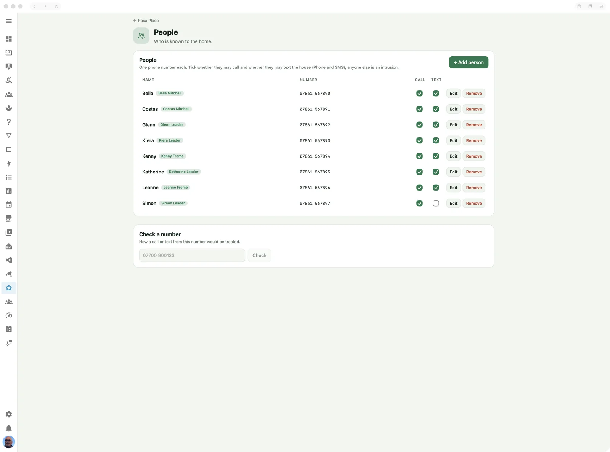

# People

Who is known to the home.

> **Maturity: Alpha.** Does its job every day in the author's house, but hasn't been tried in many others. Expect rough edges and changes. ([The levels](../README.md#maturity))



## What it's for

Keep the list of phone numbers allowed to call or text your home through
[Phone and SMS](phone-and-sms.md), and the number plates of the cars allowed to open the
gates. Each person has a phone number, number plates or both, with separate permissions
for calls, texts and the gates. Numbers outside the list, withheld numbers and calls or
texts without the corresponding permission are reported as intrusions.

This is Casa Mia's permission list. Linking an entry to a Home Assistant person
does not create a user, change that user's permissions or set up presence tracking.

## Switching it on

People is always available in the Casa Mia panel; there is no People switch in the
app's Configuration tab. Open **People** and add the people who should be known.

To receive calls or texts, set up the FONA hardware and enable **Phone and SMS (FONA)**.
You can prepare and check the permission list before the hardware is connected.

## On the page

### People

Press **+ Add person** and enter:

- **Name:** the name shown in events and, for a known number, the app's PONG reply.
- **Phone number:** one number, such as `07700 900123` or `+44 7700 900123`. Leave it
  empty for someone you only know by their car.
- **May call** and **May text:** independent permissions. New entries start with both
  ticked; clear either one if it is not wanted.
- **Number plates:** the person's cars, separated by commas, such as `ZZ00 ZZZ, ZZ51 ZZZ`.
- **May open the gates:** whether their cars open the gates (see
  [Opening the gates](#opening-the-gates)). New entries start with it clear.
- **Home Assistant person:** an optional link to an existing person in Home Assistant.

A person needs a phone number, a number plate or both. Press **Save** in the dialog.
**Edit** changes the name, number, plates or link; the **Call**, **Text** and **Gates**
ticks in the list save immediately. **Remove** deletes the Casa Mia entry after
confirmation, so its future calls and texts become intrusions and its cars no longer open
the gates. It does not delete the linked Home Assistant person.

UK national and international forms match the same stored number. Numbers beginning
with `0` are treated as UK numbers; for other countries, enter the full international
number with `+` and its country code. A number can belong to only one entry, and so can a
plate.

### Check a number

Enter a number and press **Check** to see how a call and a text would each be treated,
including the normalised number and any reason for refusal. This is a lookup: it does
not make a call or send a text. For example, Ann can be allowed to text while a call
from the same number is an intrusion.

### Check a number plate

Enter a plate and press **Check** to see what `check_plate` would answer: whether the
gates open, and whose car it is. Like the number check, it changes nothing.

## Opening the gates

Cameras that read number plates (UniFi Protect and Frigate both can) give Home Assistant
the plate as text. The **Check number plate** action (`casa_mia.check_plate`) tells you
whether it belongs to someone allowed to open the gates. Your automation does the opening:

```yaml
triggers:
  - trigger: state
    entity_id: sensor.drive_camera_number_plate  # your camera's plate reading
actions:
  - action: casa_mia.check_plate
    data:
      plate: "{{ trigger.to_state.state }}"
    response_variable: car
  - condition: template
    value_template: "{{ car.allowed }}"
  - action: cover.open_cover
    target:
      entity_id: cover.gates
```

The answer has `allowed` (true or false), `who` (the person's name) and `reason` (why it
was refused: `unknown plate`, `not allowed to open the gates` or `no plate read`).

Cameras misread plates, so spaces and dashes are ignored, and O and 0, I and 1, and S and
5 are taken as the same character. Otherwise the whole plate has to match.

Each check asks the app, so a change on this page applies to the next car. If the app
doesn't answer, the action fails with an error, which the automation's trace shows, and
the gates stay shut.

**How safe is it?** Not very, and that's a deliberate choice. Anyone can have a copy of a
plate made, and a camera can misread one as another. What a fake plate gets someone is the
drive, not the house. If your gates guard more than that, don't open them on a plate
alone.

## In Home Assistant

The optional person link is stored with the entry. The phone permissions are used by
FONA's **Call** and **Text** events, and the gates permission by the **Check number
plate** action; they do not create separate entities for each person. Your automations
choose what to do with an authorised event or an intrusion.

## Troubleshooting

- **A known number is an intrusion.** Use **Check a number** with the number reported
  by FONA. Check the Call or Text tick and the country code. The result distinguishes
  `unknown number`, `not allowed to call`, `not allowed to text` and `number withheld`.
- **The number cannot be saved.** Use a dialable number in national UK or international
  form. The page reports invalid numbers and a number already belonging to another
  person; edit that entry instead of adding a duplicate.
- **Home Assistant's people cannot be read.** The optional link field shows the error.
  You can still save an unlinked phone entry; check Home Assistant's connection before
  trying to select a person again.
- **The page says people.json could not be read.** The app deliberately authorises
  nobody and refuses edits rather than overwriting the unreadable store. The log says
  `cannot read …, nobody is authorised` with the cause. Restore the app's data from a
  backup or repair the file, then restart. Removing the file starts an empty list, so
  keep a recovery copy before doing that.
- **A family car doesn't open the gates.** Use **Check a number plate** with the plate as
  the camera read it (the automation's trace shows it). Check the **Gates** tick. The app's
  log has a `plate …` line for every check, with its answer.

Changes are logged as `saved … (calls …, texts …, … plates, gates …)`. The FONA log records
each real call or text and its verdict. Remove names, phone numbers, plates and message
contents before sharing logs in a public issue.
