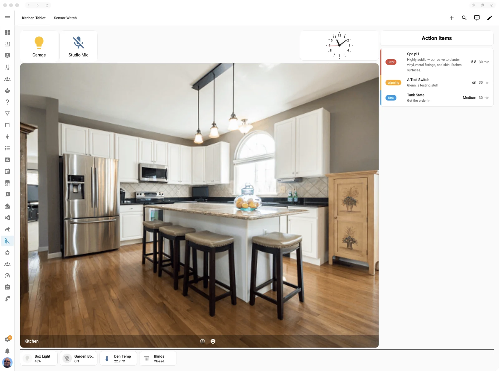
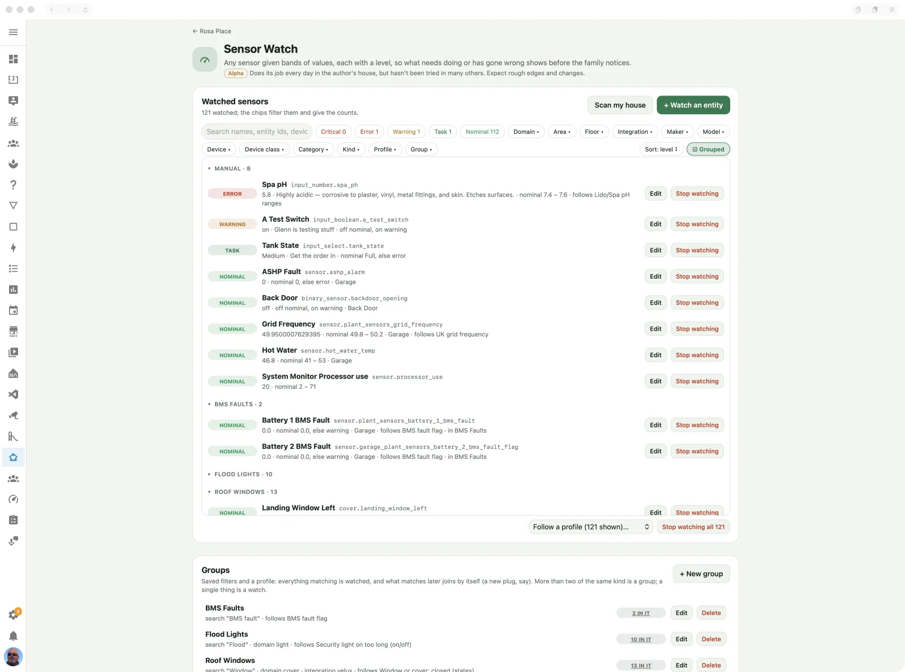
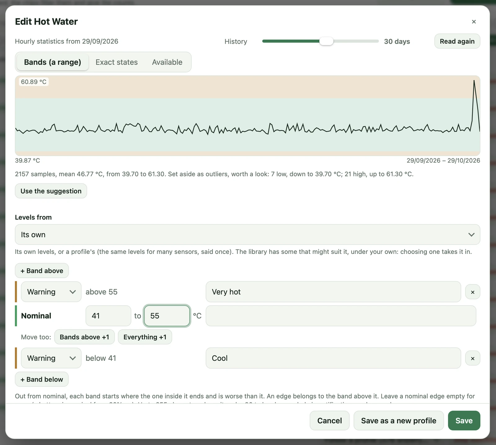
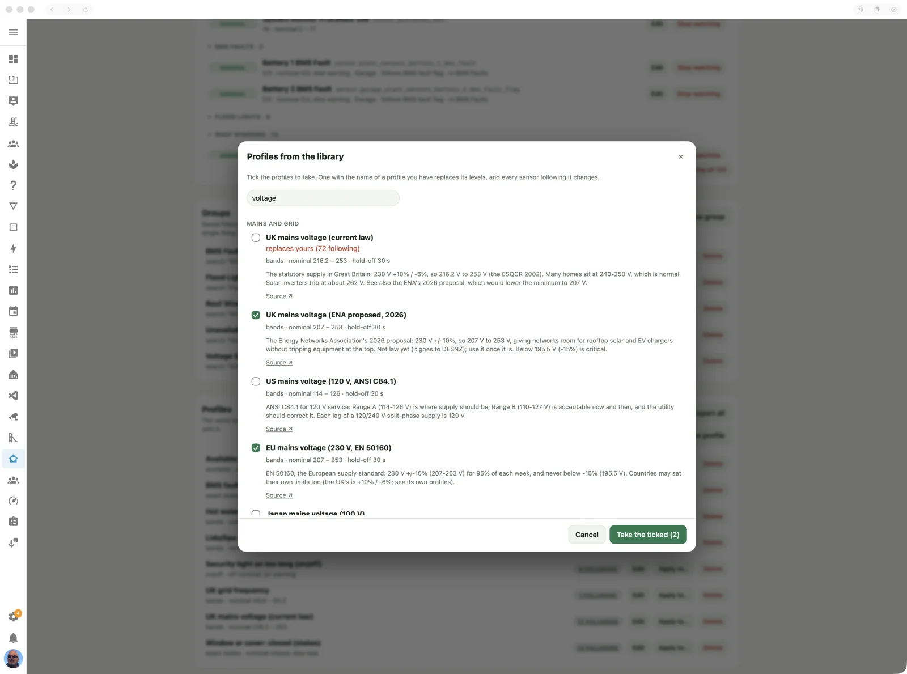
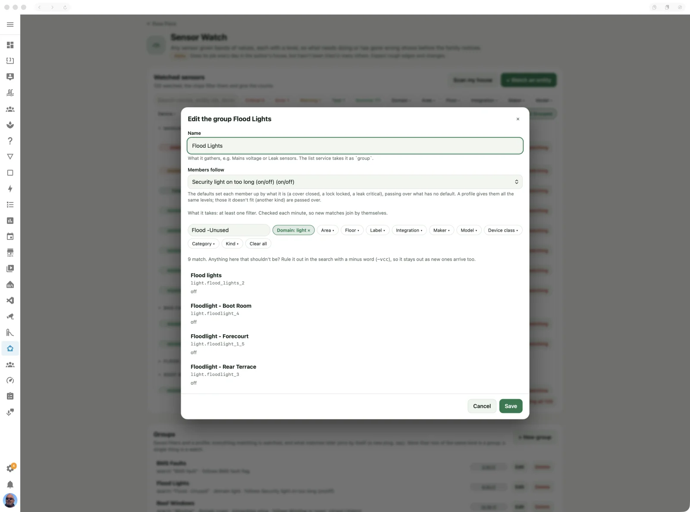
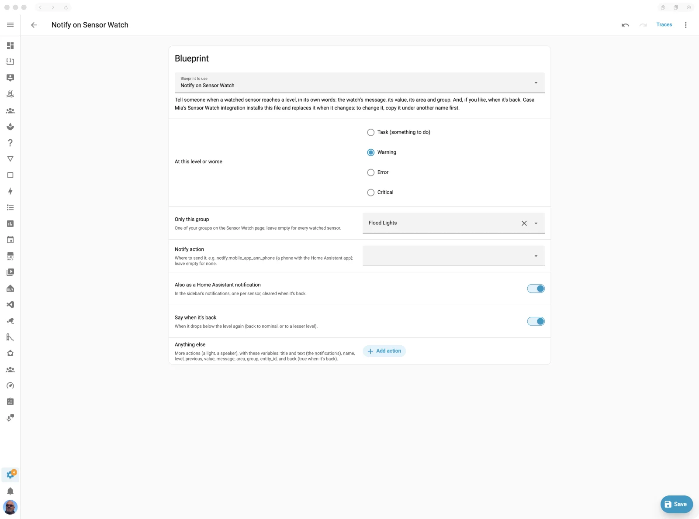
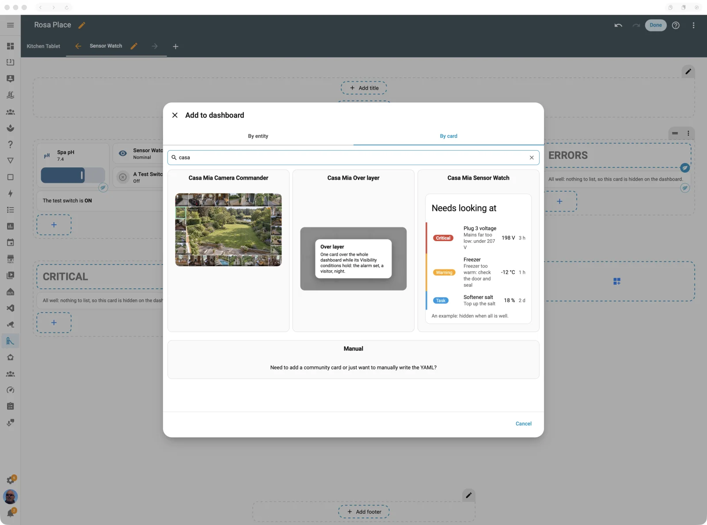

# Sensor Watch

Tell it once what normal looks like, for every sensor in the house, and it tells you only when something isn't: what needs doing, or has gone wrong, before the family notices.

> **Maturity: Alpha.** Does its job every day in the author's house, but hasn't been tried in many others. Expect rough edges and changes. ([The levels](../README.md#maturity))



## What it's for

Home Assistant is great when it's all working. When it isn't, it's a pain, and only then
do you discover the things that have been in error for ages: a sensor unavailable since
the spring, an integration that never came back after an update, a battery long flat.

Has anyone else looked at 30 Hue bulbs and 20 Shelly switches and decided not to bother
with an automation for each one dropping out of range? Or built a dashboard panel for
the things that need attention, knowing all the while that something was missed? Sensor
Watch is for that. Tell it once what normal looks like, sensor by sensor or with a scan
of the whole house (it suggests the bands from history, and knows what a leak sensor or
a low battery means without being told), and it keeps watching, Home Assistant itself
included: its Recorder, and every integration that fails to set up.

It isn't a replacement for automations: it's a grown-up notification system that you
configure once. Automations are for taking action; Sensor Watch is the trigger that
starts them. On each change of level it fires an event, and its status, counts and List
service always say what's wrong, so you choose what happens next:

- **Tell someone:** a notification when anything becomes a task, a warning to the phone
  of whoever's home, critical to everyone. The **Notify on Sensor Watch** blueprint does
  this in a few clicks ([The event](#the-event)).
- **Show it:** a panel of what needs attention on the wall tablets. Pair it with
  [garnish](../../README.md#garnish-for-every-dashboard), so the panel's heading
  disappears with it on a quiet day, rather than a proud *WARNINGS* over nothing.
- **Look into it:** hand the list to an AI agent (Home Assistant's AI tasks, say) to
  investigate what has gone wrong and why, before you even reach for the laptop.
- **Keep a to-do list for the house:** each task (top up the salt, change a battery, a
  filter due) added to a Home Assistant to-do list, and ticked off by itself when the
  sensor is nominal again.
- **Escalate:** a warning nobody has dealt with in a day becomes a text, through
  [Phone and SMS](phone-and-sms.md), which works even when the internet doesn't.
- **Say it with a light:** the hallway lamp glows amber while anything is a warning.
- **Put it over everything:** a critical comes up on every wall tablet, over whatever
  it's showing, with the [Over layer](../over-layer.md).
- **Brief the morning:** the voice assistant reads out the day's tasks at breakfast.
- **Watch the trends:** the counts are measurements, so Home Assistant's own history
  shows which integration falls over most often, and when.

Each sensor gets a level:

| Level | Means | Example |
|---|---|---|
| **Nominal** | All is well. | The salt is above 25%. |
| **Task** | Something to do, not a fault. | Top up the salt. |
| **Warning** | Worth a look. | The freezer is at −14 °C. |
| **Error** | Something is wrong. | The freezer is at −8 °C, or its sensor is unavailable. |
| **Critical** | Drop everything. | A leak sensor is wet. |

A sensor that goes **unavailable** is part of this, not an afterthought: by default it
counts as an error, because a sensor that has stopped reporting is often the first sign
of a broken integration or a flat battery.

## Half an hour to a watched house

1. **Groups for the big classes of thing.** Every Shelly plug's voltage, every leak
   sensor, every battery, every Hue light, every window: a group is a saved filter and a
   profile (or the defaults, by what each thing is). Everything matching is watched now,
   and whatever matches later joins by itself, so the plug you put in next month is
   watched without you remembering. The rule of thumb: **more than two of the same kind
   is a group; a single thing is a watch.**
2. **Check the bands.** A group follows a profile, and the library has 82 to start from,
   each saying where its numbers come from: mains voltage and frequency by country,
   inverter trip limits, batteries, broadband, pool and hot tub chemistry, indoor air,
   freezers, heating, the garden, computers, and plain "is it there?".
3. **Watches for the one-offs:** the freezer, the softener's salt, the boiler pressure,
   with bands suggested from each one's own history.
4. **One automation,** from the **Notify on Sensor Watch** blueprint: your phone, at the
   level you choose or worse, in each watch's own words.

That's plant-level monitoring and signalling for the whole house, and the card on the
wall tablet shows what needs attention, and nothing at all on a quiet day.

## Why not Home Assistant's own features?

You could, and for one thing you should: a single freezer only needs a threshold helper.
Sensor Watch is for when there are fifty of them.

**Say it once, not fifty times.** Home Assistant often makes you repeat yourself: a
threshold helper per sensor, an alert per entity, an automation per device, the same
"unavailable" check copied for every bulb and switch. Sensor Watch lets you say it once:
what a leak sensor means is set for every leak sensor, a profile says "UK mains" once for
every plug that follows it, a group takes in every plug there will ever be, and the Home
Assistant checks cover every integration.

**Finding them is half the battle.** The pieces exist, but they're scattered, and most
people never come across them:

| What you want | What already exists | Where it stops |
|---|---|---|
| A value outside a range | The [Threshold](https://www.home-assistant.io/integrations/threshold) helper | One sensor and one range each, on or off: no levels, nothing suggested, nothing in bulk. |
| Nagging until it's dealt with | The [Alert](https://www.home-assistant.io/integrations/alert/) integration | YAML only, an alert per entity. |
| Low batteries | Sbyx's [low battery blueprint](https://community.home-assistant.io/t/258664); [Battery Notes](https://codechimp.org/HA-Battery-Notes/) | Batteries only (both are excellent at that). |
| Missing or unavailable entities in your config | [Watchman](https://github.com/dummylabs/thewatchman); [Spook](https://spook.boo) | Your configuration, on demand, rather than live states. |
| Integrations that failed to set up | **Failed to set up** on Settings → Devices & services, and some Repairs | Seen only if you go and look. |
| Showing only what needs attention | [auto-entities](https://github.com/thomasloven/lovelace-auto-entities), conditional cards | A display: it doesn't know what normal is. |

**Point and click, not expert Home Assistant.** Doing all of this natively without
repeating yourself is possible, but it takes expert skills: labelling every entity, then
templates that read the labels (`label_entities`), loops with a `namespace` to pick out
the ones in trouble, the `this` trick to count them, a second template for every extra
level, and `for:` on every trigger so a blip doesn't count. Sensor Watch is mostly point
and click: scan, tick, accept, and one automation on its event.

If one of these is all you need, use it. Sensor Watch puts them in one place, configured
once: levels (a task isn't a critical), normal suggested from history, what a sensor
means known from its device class, a whole house scanned and filtered rather than one
entity at a time, Home Assistant's own health in the same picture, and one event and one
service to hang every automation on.

**What it won't do: complex conditions.** Sensor Watch judges one entity (its state or one attribute) at a
time, against its levels. It isn't trying to replace the freedom Home Assistant gives
you to describe when something is wrong: "the freezer is above −15 °C *and* its door has
been shut for ten minutes, unless it's defrosting" is a template's job, and it won't
grow a language for that. Write the condition where Home Assistant already lets you
(Settings → Devices & services → Helpers → **Template**), then watch the helper:

- **A template binary sensor** (on when your condition holds): watch it, set **When on**
  to the level you want and its message, and you're done. All the logic is yours; Sensor
  Watch adds the level, the hold-off, the summary, the event and the card.
- **A template sensor giving a number** (a difference, a ratio, a minutes-since): watch
  it with bands, and range-check it like any other reading, history suggestions and all.

## Better together

Sensor Watch tells; the rest of Casa Mia shows, and only when there's something to show:

- **The integration's summary sensors** (Status, Tasks, Warnings, Errors, Critical,
  Problem) are what a dashboard keys on: a card's visibility, a badge, a colour. One
  entity says whether anything needs attention, whatever the size of the house.
- **[The Sensor Watch card](#the-card):** what needs looking at, worst first, with each
  watch's message and its value live; hidden altogether when all is well.
- **[Tablet Layout](../tablet-layout.md):** a panel on an edge of the wall tablet's screen
  for what needs attention, sized to its cards, and hidden when they are.
- **[Garnish](../../README.md#garnish-for-every-dashboard):** the panel's heading is garnish,
  so it never holds the panel open on its own. Things go wrong, the panel and its heading
  appear; they're dealt with, and the panel goes, gap and all: no proud *WARNINGS* over
  nothing.
- **[The Over layer](../over-layer.md):** a critical comes up over whatever the tablet is
  showing, and goes when it's sorted.
- **The Home tile** in the Casa Mia panel shows the house's health at a glance: the
  worst level, the counts and the worst culprit.

## Switching it on

1. Turn on **Sensor Watch** in the app's Configuration tab (Settings → Apps → Casa Mia →
   Configuration) and save. The app restarts.
2. Restart Home Assistant when the Repair asks. The **Casa Mia** integration then has a
   **Sensor Watch** device with its status, counts and problem sensor; there's nothing
   else to add. (Until 2026.10.10 Sensor Watch was its own integration, Casa Mia Sensor
   Watch; Casa Mia takes its entities over, same entity ids, and removes it.)
3. Open **Sensor Watch** in the Casa Mia panel and choose what to watch.

## Worked examples

### Every mains plug, a panel and a phone call

Twenty Shelly plugs all measure the mains, so watch them as one.

1. **Profiles → From the library…**, search "UK mains" (or your country) and tick **UK mains voltage (current law)**.
2. **Groups → + New group**: name it *Mains voltage*; filter by integration *Shelly*,
   device class *voltage* and category *primary* (which leaves out an ESP board's own
   VCC reading); members follow *UK mains voltage (current law)*. The preview lists what matches:
   anything that shouldn't be there, rule out with a minus word in the search
   (`-vcc`).
3. **The card:** add a Sensor Watch card to the wall tablet's dashboard with group
   *Mains voltage*. It shows a plug in trouble, its message and its live value, and
   hides when they're all fine.
4. **The phone:** an automation from **Notify on Sensor Watch**: level *Critical*, group
   *Mains voltage*, notify action your phone. "🚨 Plug 3 voltage: critical", "Mains far
   too low (198 V) · Barn · Mains voltage".

### Every light, there or not

A bulb has nothing to go wrong but dropping off the network, and a breaker trip takes a
dozen with it.

1. **Profiles → From the library…**, tick **Available (a task after an hour)** under
   Availability.
2. **Groups → + New group**: *Lights*, domain *light* (or integration *Hue*), following
   it. A lamp switched off at the wall is forgiven for an hour; after that it's a task.
3. Trip a breaker, and an hour later the card lists every light it took with it. Lights
   you've retired and want to stay gone: **Stays gone** turns it round.

### A thermostat that isn't keeping up

A thermostat's state is only its mode (heat, off, auto), which says nothing about whether
the room is warm.

1. **+ Watch an entity**, pick the thermostat, and in **Watch** choose its
   `current_temperature`.
2. Bands are suggested from its history; or **Follows** *Room temperature (°C)* from the
   library. A room under 16 °C is a task, under 12 °C a warning.

### A hot tub: its reminders, its water and its errors

A spa run by a Gecko controller (in.touch2) comes into Home Assistant through the
[Gecko integration](https://github.com/gazoodle/gecko-home-assistant), and it keeps
reminders of its own: **Rinse filter**, **Clean filter**, **Change water**, **Check spa**,
**Change ozonator** and **Change Vision cartridge**, each a date entity saying when it's
due. Sensor Watch reads a date as the days until it, so:

1. **Groups → + New group**: *Spa reminders*, domain *date* (and the spa's device, or
   a search for "due"), members follow **the defaults, by what it is**, which for a date
   is **Reminder due (days)**: a task in the fortnight before, a warning in its week, an
   error once it's passed, critical a month after. Or follow that profile from the
   library, under Reminders and due dates.
2. **The water:** watch the spa's water temperature (its temperature sensor, or the
   thermostat's `current_temperature` attribute) with bands: say under 35 °C a task
   ("Spa cooling: is it heating?") and under 30 °C a warning. A hold-off of half an hour
   lets a lid left open off.
3. **Its errors:** watch the spa's **Error(s)** sensor by exact states: *None* nominal,
   anything else an error. The row and the notification show the spa's own words.

With the Notify on Sensor Watch blueprint at *Task*, the phone says "🔵 Rinse filter due:
task" a fortnight out, and the card shows it until the filter is rinsed and the date set
again (on the spa, or the date entity in Home Assistant). They're judged every ten minutes
as time passes, so a reminder comes due without anything in Home Assistant changing.

### The security light that stayed on

**Security light on too long** (under Outdoors and garden) is a warning when the light
has been on for half an hour: its sensor is stuck, someone left the switch on, or
something keeps setting it off. Apply it to the lights with **Apply to…**, or make a
group by label so new ones join. Change the hold-off to suit the light's own timer.

### A fault only two sensors can show

The supply into the house and a meter downstream both read voltage; if they differ by
more than a few volts, something between them is wrong. Neither sensor alone can say
so, so make the difference a template sensor (Settings → Devices & services → Helpers →
Template → Sensor: `{{ (states('sensor.supply_voltage') | float(0) -
states('sensor.barn_meter_voltage') | float(0)) | abs }}`), then watch it with bands:
nominal under 3 V, a warning to 8 V, an error beyond.

## On the page

### Watched sensors



Every watched sensor, its level now (the **status pill** at the start of its row) and its
value, with a search and filter **chips** along the top (a level, an area, a group…) so a
house with hundreds of them stays manageable. **Edit** changes a sensor's bands;
**Stop watching** removes it.
**Grouped** (beside Sort) puts them under a heading per group, and Manual for those
watched one by one; the sort applies within each.

**Disabled** in a watch's editor keeps it, with its levels and its group, but stops
watching it: no level, no event, not counted. Disabled ones are listed together at the
foot, greyed, each with an **Enable** chip that watches it again, back in its group
(or untick Disabled in its editor). Handy for a sensor that's
being repaired, or a screenshot.

The list is live: a value or level changes on the page the moment Home Assistant has it
(the app holds a subscription, as a dashboard does). A level waits out its hold-off
first, so set it to 0 while trying a sensor out.

### Watch an entity



Any entity can be watched: a sensor, but also an `input_number` you type a reading into
(a pool's pH from a test strip), a `number`, a `switch` that should stay on, a `select`.
A **date** (a reminder's due date, a `date` entity, a timestamp sensor) is read as the days
until it, negative once it's passed, so its bands are days (**A date: days until it**
under the bands; a `date` entity starts that way, with Reminder due's bands). Sensor Watch
judges date watches again every ten minutes, as a date comes due without its state
changing.
How it's watched follows its state: a number gets bands, `on` and `off` get on/off, and
anything else exact states.

Search for it by name, entity id or its device's name (every word, in any order; a
word with a minus, `-vcc`, rules out what has it), or
narrow the list by **domain**, **area**, **floor**, **label**, **integration**,
**maker** and **model** (the device's: "every Shelly Plus Plug S", not "every voltage"),
**device** (only those with entities matching the other filters, so choosing ESPHome
lists only ESPHome devices), **device class**, **category** (primary, diagnostic or
config: an ESP board's own VCC reading is usually diagnostic, so *primary* leaves it out)
or kind (numeric, on/off, or states). Pick one, and Sensor
Watch reads its history (30 days unless you choose otherwise) and suggests its bands:

- **Numeric sensors:** the history's spread gives the nominal band, rounded outwards to a
  tidy step, with a warning band either side and error beyond. Values far outside the
  rest (more than three standard deviations from the mean) are set aside and listed: they
  may be incidents worth a look, and the suggestion assumes they were. Change any band,
  its level and its message (the message is what a task or a warning says, such as "Top
  up the salt") before saving. **+ Below** inserts a band after one, spanning the gap to
  the next; bands are kept in order of their From. A message may be up to 255
  characters, but past 80 notifications and cards may cut it short (the page shows
  the count once you pass 80). Saving refuses a From or To that isn't a number (use a
  point for decimals) and bands that overlap, and asks first when a range between two
  bands is left uncovered.
- **On/off sensors:** two rows, **When off** and **When on**, each with its own level
  and message, so it reads as it means: a leak sensor is Nominal when off and Critical
  when on ("Leak detected"); a pump that should run is Nominal when on and an Error when
  off ("Pump stopped"); or neither is nominal (a task when off, an error when on). From
  history, the state it spends most of its time in is suggested as nominal and the
  other as a warning.
- **Exact states:** for a sensor whose state should be one exact thing rather than within
  a range (an alarm number that should be `0`, a washing machine that should be `idle` or
  `standby`), and for text and enum sensors, which have no range at all. List the
  nominal states; anything else gets one level and a message. Numbers compare as numbers,
  so `0` matches `0.0`. A numeric sensor offers **Bands (a range)** or **Exact states**;
  the states it has spent most of its time in are shown (an enum's own states, for an
  enum), to tick into the list.

**By what it is.** Some sensors say what they mean, so Sensor Watch sets them up by
their kind and device class rather than their history (change anything you like):

| What | Nominal | Otherwise |
|---|---|---|
| Leak, smoke, gas, carbon monoxide, safety | off | critical |
| Problem | off | error |
| Connectivity | on (connected) | error |
| Tamper | off | warning |
| Low battery (on/off) | off | task: Replace the battery |
| Door, window, garage door, opening | closed | task |
| Battery (%) | 20 and above | task below 20, warning below 5 |
| Covers (windows, blinds, garage doors) | closed | task |
| Locks | locked | task (unlocked); error when jammed |
| Updates | none waiting | task: Update available |
| Vacuums and mowers | docked, working, returning, paused | error |
| Alarm panels | disarmed, armed, arming, pending | warning; critical when triggered |

Leak, smoke, gas, carbon monoxide, safety and alarm panels have no hold-off: they count
the moment they change. Everything else waits 60 seconds by default.

Valves have no fixed meaning (a water main is usually open, a garden valve closed), so
they go by their history. A scan takes the sensors with a meaning without reading any
history, so they come through even when history can't be read.

In **Exact states**, a state can also have a level and message of its own (**+ A state
with its own level**): a lock is a task when unlocked but an error when jammed.

**Available** watches only whether it's there, whatever its state, for anything with
nothing else to go wrong (a bulb, a plug) or that something depends on: **When
available** and **When unavailable**, each with a level and message. Unknown counts as
there; gone from Home Assistant (renamed, its integration removed) counts as
unavailable. It works either way round: set When available to a warning and When
unavailable to nominal to hear if something retired comes back. Any entity can be
watched this way, whatever its kind; a group following an Available profile covers
every Hue light, new ones included. A long hold-off forgives a lamp switched off at
the wall.

**Watch** an attribute instead of the state, when the state doesn't say how it is: a
thermostat's state is only its mode (heat, off, auto), so watch its
`current_temperature` (bands: a room too cold or too hot) or `hvac_action`; a cover's
`current_position` rather than open or closed. The choice lists the attributes that
hold a number or a short word, with their values now, and the suggestion comes from
that attribute's own history (state history, so 10 days by default). One watch per
entity: its state or one attribute.

Sensors with long-term statistics (most measurements) are read from them, which Home
Assistant keeps for good. Others are read from their state history, which Home
Assistant keeps for 10 days by default, so a 30-day ask may get less; the page says
from when.

Each sensor also has:

- **Outside every band:** the level of a value no band covers (an error by default).
- **When unavailable:** a level, or **Ignore** to have no opinion while it is.
- **Hold-off:** how long a new level must last before it counts (60 seconds by default),
  so a blip, or Home Assistant starting up, doesn't raise the alarm.

### Profiles

A profile is a set of levels said once for many sensors: twenty plugs on the same mains
want the same bands (critical below 207 V, a warning below 216 V), not twenty slightly
different suggestions. Make one in the **Profiles** section with **+ New profile** (a
name, then its bands, on/off or exact states), or, in a sensor's editor, **Save as a new
profile** makes its levels a profile it then follows; **Follows** picks a profile for it (or its own levels again).
Editing a follower's levels changes the profile, and so every sensor that follows it,
after asking. A number can follow a bands or an exact-states profile; on/off and exact
states only their own kind.

To have many follow one at once: **Apply to…** on the profile lists the sensors of a kind
it fits, watched or not, to tick (those not watched yet start being watched); in **Scan
my house**, choose **Use the profile … for the ticked**; or, on the watched list, filter
to them and choose **Follow a profile** under it.

The **Profiles** section lists each with how many follow it in its status pill: tap
**N following** to see them in the watched list. **Edit** changes its name and levels (every follower with it);
**Delete** removes it (its followers keep a copy of its levels as their own).



**From the library…** offers profiles that ship with Casa Mia, each with what it's for
and where its numbers come from:

- **Mains voltage and grid frequency** for the UK (current law, and the ENA's 2026
  proposal), the US (120 V, ANSI C84.1; 60 Hz), the EU (230 V, EN 50160; 50 Hz), Japan
  (100 V), China (220 V; 50 Hz) and Australia (230 V; 50 Hz).
- **UK inverter trips (G98/G99):** how close the supply's voltage and frequency are to
  tripping a grid-tied inverter, such as a Sunsynk.
- **Safety; doors, windows and covers; locks, alarms and appliances:** the defaults by
  what a thing is (above) as on/off and exact-states profiles, to Duplicate… and tweak
  (a skylight whose open is a warning, say).
- **Batteries:** replaceable cells; rechargeable packs kept to 20–80%, 85%, 90% or (for
  LiFePO4) 100%; a home battery reaching its reserve; 12 V lead-acid and LiFePO4 by
  voltage, and a LiFePO4 cell.
- **Broadband:** a speed test's download against your plan (ADSL, FTTC 40 and 80, fibre
  100 to 900, Starlink 100 to 300): fine at 70% of the plan, a warning under half.
- **Water:** pool or hot tub pH, free chlorine for a pool and a hot tub, hot tub bromine,
  a tropical or cold-water aquarium, a water softener's salt.
- **Indoor air:** CO₂, humidity, PM2.5, radon.
- **Cold and hot storage:** freezer, fridge, hot water cylinder.
- **Heating:** boiler pressure, room temperature.
- **Outdoors and garden:** frost risk, pipes in an unheated space, soil moisture.
- **Computers and network:** Wi-Fi signal, CPU temperature, CPU and memory use, disk
  use. (A host's CPU and memory as entities: Home Assistant's System Monitor
  integration, or the Supervisor integration's per-app sensors; both start disabled.)
- **Reminders and due dates:** a date something is due, as days until it (a spa's
  filter, a service, a renewal).

Nothing starts ticked: search (a country, "voltage", "pH") and tick what you have.

<details>
<summary>Every profile in the library, with its levels</summary>

Numbers are in the sensor's own unit (volts, hertz, %, °C, ppm); "after" is the
hold-off, how long a new level must last before it counts.

<!-- library table: tools/library_table.py --update -->

| Profile | Category | Mode | Behaviour |
| --- | --- | --- | --- |
| Available (a task after an hour) | Availability | available | there nominal · unavailable task; after 1 h |
| Available (critical) | Availability | available | there nominal · unavailable critical; after 1 min |
| Stays gone | Availability | available | there warning · unavailable nominal; after 5 min |
| Battery, replaceable (%) | Batteries | bands | under 5 warning · 5–20 task · 20 and over nominal; after 10 min |
| Home battery at its reserve (%) | Batteries | bands | under 10 task · 10 and over nominal; after 30 min |
| Lead-acid 12 V battery (V) | Batteries | bands | under 11.8 error · 11.8–12.2 warning · 12.2–12.4 task · 12.4–14.8 nominal · 14.8–15.5 warning · 15.5 and over error; after 10 min |
| LiFePO4 12 V battery (V) | Batteries | bands | under 12 error · 12–12.8 task · 12.8–14.6 nominal · 14.6–15 warning · 15 and over error; after 10 min |
| LiFePO4 cell (V) | Batteries | bands | under 2.5 critical · 2.5–3 task · 3–3.5 nominal · 3.5–3.65 task · 3.65 and over critical; after 10 min |
| Low battery (on/off) | Batteries | on/off | off nominal · on task; after 1 min |
| Rechargeable battery, 20-100% (LiFePO4) (%) | Batteries | bands | under 10 error · 10–20 task · 20 and over nominal; after 10 min |
| Rechargeable battery, 20-80% (%) | Batteries | bands | under 10 error · 10–20 task · 20–80 nominal · 80 and over task; after 10 min |
| Rechargeable battery, 20-85% (%) | Batteries | bands | under 10 error · 10–20 task · 20–85 nominal · 85 and over task; after 10 min |
| Rechargeable battery, 20-90% (%) | Batteries | bands | under 10 error · 10–20 task · 20–90 nominal · 90 and over task; after 10 min |
| Broadband download: ADSL (16 Mbps) | Broadband | bands | under 1.6 error · 1.6–8 warning · 8–11.2 task · 11.2 and over nominal; after 3700 s |
| Broadband download: FTTC 40 (40 Mbps) | Broadband | bands | under 4 error · 4–20 warning · 20–28 task · 28 and over nominal; after 3700 s |
| Broadband download: FTTC 80 (80 Mbps) | Broadband | bands | under 8 error · 8–40 warning · 40–56 task · 56 and over nominal; after 3700 s |
| Broadband download: Fibre 100 (100 Mbps) | Broadband | bands | under 10 error · 10–50 warning · 50–70 task · 70 and over nominal; after 3700 s |
| Broadband download: Fibre 300 (300 Mbps) | Broadband | bands | under 30 error · 30–150 warning · 150–210 task · 210 and over nominal; after 3700 s |
| Broadband download: Fibre 500 (500 Mbps) | Broadband | bands | under 50 error · 50–250 warning · 250–350 task · 350 and over nominal; after 3700 s |
| Broadband download: Fibre 900 (900 Mbps) | Broadband | bands | under 90 error · 90–450 warning · 450–630 task · 630 and over nominal; after 3700 s |
| Broadband download: Starlink 100 (100 Mbps) | Broadband | bands | under 10 error · 10–50 warning · 50–70 task · 70 and over nominal; after 3700 s |
| Broadband download: Starlink 200 (200 Mbps) | Broadband | bands | under 20 error · 20–100 warning · 100–140 task · 140 and over nominal; after 3700 s |
| Broadband download: Starlink 300 (300 Mbps) | Broadband | bands | under 30 error · 30–150 warning · 150–210 task · 210 and over nominal; after 3700 s |
| Freezer (°C) | Cold and hot storage | bands | under -18 nominal · -18–-15 task · -15–-5 warning · -5 and over critical; after 30 min |
| Fridge (°C) | Cold and hot storage | bands | under 0 warning · 0–5 nominal · 5–8 task · 8–12 warning · 12 and over error; after 30 min |
| Hot water cylinder (°C) | Cold and hot storage | bands | under 46 warning · 46–50 task · 50–80 nominal · 80 and over warning; after 1 h |
| CPU temperature (°C) | Computers and network | bands | under 70 nominal · 70–80 task · 80–85 warning · 85 and over error; after 10 min |
| CPU use (%) | Computers and network | bands | under 80 nominal · 80–95 task · 95 and over warning; after 15 min |
| Disk used (%) | Computers and network | bands | under 80 nominal · 80–90 task · 90–95 warning · 95 and over error; after 10 min |
| Memory use (%) | Computers and network | bands | under 80 nominal · 80–90 task · 90 and over warning; after 15 min |
| Wi-Fi signal (dBm) | Computers and network | bands | under -85 error · -85–-75 warning · -75–-67 task · -67 and over nominal; after 10 min |
| Door (on/off) | Doors, windows and covers | on/off | off nominal · on task; after 1 min |
| Garage door (on/off) | Doors, windows and covers | on/off | off nominal · on task; after 1 min |
| Opening (on/off) | Doors, windows and covers | on/off | off nominal · on task; after 1 min |
| Window (on/off) | Doors, windows and covers | on/off | off nominal · on task; after 1 min |
| Window or cover: closed (states) | Doors, windows and covers | exact states | closed nominal · else task; after 1 min |
| Boiler pressure (bar) | Heating | bands | under 0.5 error · 0.5–1 task · 1–2 nominal · 2–2.5 task · 2.5 and over warning; after 30 min |
| Room temperature (°C) | Heating | bands | under 12 warning · 12–16 task · 16–25 nominal · 25–28 task · 28 and over warning; after 30 min |
| Indoor CO2 (ppm) | Indoor air | bands | under 380 task · 380–1000 nominal · 1000–1500 task · 1500–2500 warning · 2500 and over error; after 15 min |
| Indoor humidity (%) | Indoor air | bands | under 30 task · 30–60 nominal · 60–70 task · 70 and over warning; after 1 h |
| PM2.5 (µg/m³) | Indoor air | bands | under 15 nominal · 15–35 task · 35–55 warning · 55 and over error; after 30 min |
| Radon (Bq/m³) | Indoor air | bands | under 100 nominal · 100–200 task · 200 and over warning; after 24 h |
| UK inverter trips: frequency (G98/G99) | Inverters | bands | under 47 critical · 47–47.5 error · 47.5–49.8 warning · 49.8–50.2 nominal · 50.2–51.5 warning · 51.5–52 error · 52 and over critical; after 5 s |
| UK inverter trips: voltage (G98/G99) | Inverters | bands | under 184 critical · 184–200.1 error · 200.1–216.2 warning · 216.2–253 nominal · 253–262.2 warning · 262.2–273.7 error · 273.7 and over critical; after 5 s |
| Alarm panel (states) | Locks, alarms and appliances | exact states | disarmed, armed_home, armed_away, armed_night, armed_vacation, armed_custom_bypass, arming, pending, disarming nominal · triggered critical · else warning; at once |
| Connected (on/off) | Locks, alarms and appliances | on/off | off error · on nominal; after 1 min |
| Lock: locked (states) | Locks, alarms and appliances | exact states | locked nominal · jammed error · else task; after 1 min |
| Robot mower (states) | Locks, alarms and appliances | exact states | docked, mowing, returning, paused nominal · else error; after 1 min |
| Robot vacuum (states) | Locks, alarms and appliances | exact states | docked, cleaning, returning, idle, paused nominal · else error; after 1 min |
| Update available (on/off) | Locks, alarms and appliances | on/off | off nominal · on task; after 1 min |
| Australia grid frequency (50 Hz) | Mains and grid | bands | under 49 critical · 49–49.5 error · 49.5–49.85 warning · 49.85–50.15 nominal · 50.15–50.5 warning · 50.5 and over error; after 30 s |
| Australia mains voltage (230 V, AS 60038) | Mains and grid | bands | under 207 critical · 207–216.2 warning · 216.2–253 nominal · 253–262 warning · 262 and over critical; after 30 s |
| China grid frequency (50 Hz, GB/T 15945) | Mains and grid | bands | under 49.5 error · 49.5–49.8 warning · 49.8–50.2 nominal · 50.2–50.5 warning · 50.5 and over error; after 30 s |
| China mains voltage (220 V, GB/T 12325) | Mains and grid | bands | under 187 critical · 187–198 warning · 198–235.4 nominal · 235.4–242 warning · 242 and over critical; after 30 s |
| EU grid frequency (50 Hz) | Mains and grid | bands | under 49 critical · 49–49.5 error · 49.5–49.8 warning · 49.8–50.2 nominal · 50.2–50.5 warning · 50.5 and over error; after 30 s |
| EU mains voltage (230 V, EN 50160) | Mains and grid | bands | under 195.5 critical · 195.5–207 warning · 207–253 nominal · 253–264.5 warning · 264.5 and over critical; after 30 s |
| Japan mains voltage (100 V) | Mains and grid | bands | under 90 critical · 90–95 warning · 95–107 nominal · 107–110 warning · 110 and over critical; after 30 s |
| UK grid frequency | Mains and grid | bands | under 48.8 critical · 48.8–49.5 error · 49.5–49.8 warning · 49.8–50.2 nominal · 50.2–50.5 warning · 50.5 and over error; after 30 s |
| UK mains voltage (ENA proposed, 2026) | Mains and grid | bands | under 195.5 critical · 195.5–207 warning · 207–253 nominal · 253–262 warning · 262 and over critical; after 30 s |
| UK mains voltage (current law) | Mains and grid | bands | under 207 critical · 207–216.2 warning · 216.2–253 nominal · 253–262 warning · 262 and over critical; after 30 s |
| US grid frequency (60 Hz) | Mains and grid | bands | under 59.3 critical · 59.3–59.5 error · 59.5–59.9 warning · 59.9–60.1 nominal · 60.1–60.5 warning · 60.5 and over error; after 30 s |
| US mains voltage (120 V, ANSI C84.1) | Mains and grid | bands | under 104 critical · 104–110 error · 110–114 warning · 114–126 nominal · 126–127 warning · 127–132 error · 132 and over critical; after 30 s |
| Frost risk (°C) | Outdoors and garden | bands | under -5 warning · -5–3 task · 3 and over nominal; after 30 min |
| Security light on too long (on/off) | Outdoors and garden | on/off | off nominal · on warning; after 30 min |
| Soil moisture (%) | Outdoors and garden | bands | under 15 warning · 15–20 task · 20–60 nominal · 60–80 task · 80 and over warning; after 1 h |
| Unheated space, pipes (°C) | Outdoors and garden | bands | under 0 error · 0–3 warning · 3 and over nominal; after 30 min |
| Reminder due (days) | Reminders and due dates | bands | under -30 critical · -30–0 error · 0–7 warning · 7–14 task · 14 and over nominal; at once |
| Carbon monoxide (on/off) | Safety | on/off | off nominal · on critical; at once |
| Gas (on/off) | Safety | on/off | off nominal · on critical; at once |
| Leak (on/off) | Safety | on/off | off nominal · on critical; at once |
| Problem (on/off) | Safety | on/off | off nominal · on error; after 1 min |
| Safety (on/off) | Safety | on/off | off nominal · on critical; at once |
| Smoke (on/off) | Safety | on/off | off nominal · on critical; at once |
| Tamper (on/off) | Safety | on/off | off nominal · on warning; after 1 min |
| Aquarium, cold water (°C) | Water | bands | under 4 warning · 4–10 task · 10–22 nominal · 22–26 task · 26 and over warning; after 30 min |
| Aquarium, tropical (°C) | Water | bands | under 20 error · 20–23 warning · 23–24 task · 24–27 nominal · 27–29 task · 29–31 warning · 31 and over error; after 30 min |
| Hot tub bromine (ppm) | Water | bands | under 2 error · 2–4 task · 4–8 nominal · 8–10 task · 10 and over error; after 5 min |
| Hot tub free chlorine (ppm) | Water | bands | under 1 error · 1–3 task · 3–5 nominal · 5–10 task · 10 and over error; after 5 min |
| Pool free chlorine (ppm) | Water | bands | under 0.5 error · 0.5–1 task · 1–3 nominal · 3–5 task · 5–10 warning · 10 and over error; after 5 min |
| Pool or hot tub pH | Water | bands | under 7 warning · 7–7.2 task · 7.2–7.8 nominal · 7.8–8 task · 8 and over warning; after 5 min |
| Pool or hot tub pH (detailed) | Water | bands | under 5 critical · 5–7 error · 7–7.2 warning · 7.2–7.4 task · 7.4–7.6 nominal · 7.6–7.8 task · 7.8–8 warning · 8–9 error · 9 and over critical; after 5 min |
| Water softener salt (%) | Water | bands | under 10 warning · 10–25 task · 25 and over nominal; after 1 h |

<!-- end of library table -->

</details>

**Duplicate…** in a profile's editor starts a new one from its levels, to change what differs:
one room temperature profile per floor, say, as each floor up runs a little warmer.

Tick the ones you want. **Export all** saves all your
profiles as a JSON file to share, and **Export…** in a profile's editor just that one; **Import…** takes one (yours, or someone else's). A
profile with the name of one you have replaces its levels, so its followers change
with it: the import starts those unticked, and says so.

### Groups



A group is a saved set of filters (domain, area, label, integration, device, device
class, kind, a search) and what its members follow: a profile, or **the defaults, by
what it is** (each member set up as Watch an entity would: a cover closed, a lock
locked, a leak critical; what has no default is passed over). Every roof window is
domain `cover` and the defaults: no profile needed. Everything matching is watched, following the
profile, and **whatever matches later joins by itself**: put in a new plug and it's
watched within a minute, no setting up. Make one with **+ New group**: as you choose the
filters it lists what they match (up to 200), so you see what it takes before it takes
it. Something there that shouldn't be (an ESP board's own VCC reading in a mains voltage
group, say)? Rule it out in the search with a minus word, `-vcc`: it stays out as new
devices arrive too. The rule of thumb is that more than two of the same kind
is a group, a single thing is a watch.

- Members the profile doesn't fit (another kind) are passed over; sensors already
  watched keep their own levels.
- **Edit** it and members the filters no longer take stop being watched.
- **Stop watching** a member and the group remembers it, so it isn't pulled back;
  **Let them back** on the group undoes that.
- **N in it**, the group's status pill, shows the members in the watched list (a Group
  chip there too).
- **Delete** a group and its members stay watched, as they are; new ones stop joining.
- The `list` service takes `group` (the group's name): only its members, and its own
  worst level, for a panel or an automation about just the mains plugs.

**Watch anything from Home Assistant's own pages, with a label.** Make a group whose
filter is a label (say *Watch*), following the defaults or a profile. Then, from any
entity's settings in Home Assistant (its dialog's cog), give it that label: within a
minute it's watched. A label or two more (*Watch: mains*, following UK mains voltage)
cover most cases, and taking the label off doesn't stop the watch: Stop watching does.

### Scan my house

Suggest bands for everything that isn't watched yet, at once: narrow it by area,
floor, label, integration, maker, model, device, device class or category, or scan everything. Without a **domain**, a scan
looks at sensors, binary sensors, updates, covers, locks, valves, vacuums, mowers and alarm panels, not
every light, switch and helper; choose a domain to scan others (all your `number`s, say). A scan reads 500 sensors a
round, and the page says how many remain; **Scan the next 500** carries on where it
stopped. Tick the suggestions you want and press **Watch the ticked**: nothing is
watched until you accept it.

## In Home Assistant

The **Sensor Watch** device has:

- **Status:** the worst level now (nominal, task, warning, error or critical). Its
  attributes hold `watching` (how many sensors) and, for each level, the ten longest
  standing culprits (`task_list`, `warning_list`, `error_list`, `critical_list`: each
  with its entity, name, value, message and since when).
- **Tasks**, **Warnings**, **Errors** and **Critical:** how many sensors are at each level.
- **Problem:** on while any sensor is at warning or worse (a task alone isn't a problem).

### Home Assistant's own health

Sensor Watch also watches Home Assistant itself, counted like any watched sensor (in the
status, the counts, the problem sensor, the event and the list service), so it never
says all is well while Home Assistant is broken:

- **Recorder** and **History** not running: **critical**. Without them there is no
  history or statistics at all (Home Assistant's own History panel and graphs stop too).
  A common cause is the Recorder's database being out of reach when Home Assistant
  starts (a database on another machine that was down): the Recorder doesn't try again
  by itself, so fix the database, then restart Home Assistant.
- An **integration that has failed to set up** (setup error, retrying, migration error,
  or not loaded), for more than five minutes: **error**, named by its title and
  integration, with Home Assistant's reason. Disabled integrations don't count. When it
  recovers, the event says so (level nominal) and it leaves the list.

A discovery you told Home Assistant to **Ignore** is kept as an entry that never loads,
by design, so it never counts.

The page's **Home Assistant itself** section lists these rows, with a switch for each
kind (**The Recorder and History**, **Integrations that fail to set up**) and an
**Ignore** on each failing integration (one you know about and don't need, say); the
ignored ones are listed underneath, each with **Watch again**.

These are checked once Home Assistant has started, and each minute after. In the event
and the list service their `entity_id` is `homeassistant.recorder`,
`homeassistant.history` or `integration.<its entry id>`.

There is no entity per watched sensor: the summary, the event and the service below tell
the rest of Home Assistant which ones they are.

### The event

Each change of level (after its hold-off) fires `casa_mia_sensor_watch`, with
`entity_id`, `name`, `level`, `previous`, `value` and `message`, and `group` (its group's
name), `area` and `attribute` (the attribute watched) when it has them.

**The easy way: the blueprint.** The integration installs **Notify on Sensor Watch**
(Settings → Automations & scenes → Blueprints; it's in
`blueprints/automation/casa_mia/`). Make an automation from it and choose:

- **At this level or worse:** task, warning (the default), error or critical.
- **Only this group:** one of your groups (a dropdown), or empty for everything watched.
- **Notify action:** a dropdown of your notify actions (each phone with the Home
  Assistant app has one, e.g. `notify.mobile_app_ann_phone`), or empty for none.
- **Also as a Home Assistant notification:** one per sensor in the sidebar, replaced as
  its level changes and cleared when it's back.
- **Say when it's back:** when it drops below the level again.
- **Anything else:** more actions (a light, a speaker), with `title`, `text`, `name`,
  `level`, `previous`, `value`, `message`, `area`, `group`, `entity_id` and `back` to
  use in them.

Its title leads with the level's colour (🔵 task, 🟠 warning, 🔴 error, 🚨 critical,
🟢 back to nominal): for example "🚨 Plug 3 voltage: critical", "Mains far too low (198) · Barn ·
Mains voltage". The integration replaces the file when it changes, so to change the
blueprint itself, copy it under another name first.



*A screenshot of these notifications is coming soon.*

**By hand,** an automation on the event:

```yaml
triggers:
  - trigger: event
    event_type: casa_mia_sensor_watch
    event_data:
      level: task
actions:
  - action: notify.mobile_app_ann_phone
    data:
      message: "{{ trigger.event.data.message or trigger.event.data.name }}"
```

### The List service

`casa_mia.sensor_watch_list` returns every watched sensor at the levels you ask for
(everything that isn't nominal by default), worst first, then longest standing; use it
with a response variable and loop over it in a template:

```yaml
actions:
  - action: casa_mia.sensor_watch_list
    data:
      levels: [warning, error, critical]
    response_variable: watch
  - action: notify.mobile_app_ann_phone
    data:
      message: >-
        {{ s.name }}: {{ s.level }} ({{ s.value }})
        
```

Add `group: Mains voltage` to ask about one group only (and its own worst level).

### The card



**Casa Mia Sensor Watch** (in the card picker) lists what isn't nominal, worst first,
each with its level, message, value (live from the entity) and how long it has stood;
tap a row for the entity's details. Options: a title, a **group** (chosen from your
groups, ✕ for every watched sensor), the levels to list, at most how many, what to do
when all is well (**hide**, the default, or say so), and what **each row shows**: its
level, name, message, value and how long, any of them (a row of just names and values
for a narrow panel, say).

Hidden, it takes its panel with it in a Tablet Layout: put it in a side panel with a
garnish heading ("Needs looking at") and the panel appears only when something does.

## Thanks

To **Erik Lemcke** for the [Salt Sentry](https://www.tindie.com/products/ErikLemcke/salt-sentry-water-softener-monitor/),
the little laser-ranging gadget that tells Home Assistant how much salt is left in the
water softener, and the example that gave Sensor Watch its **task** level.
