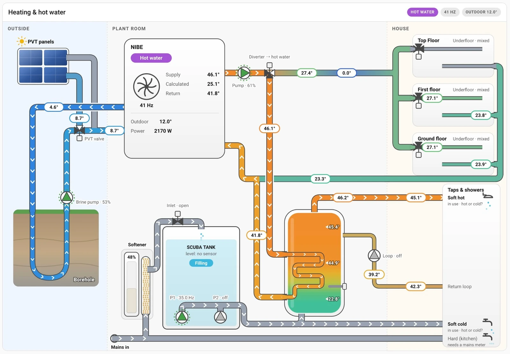
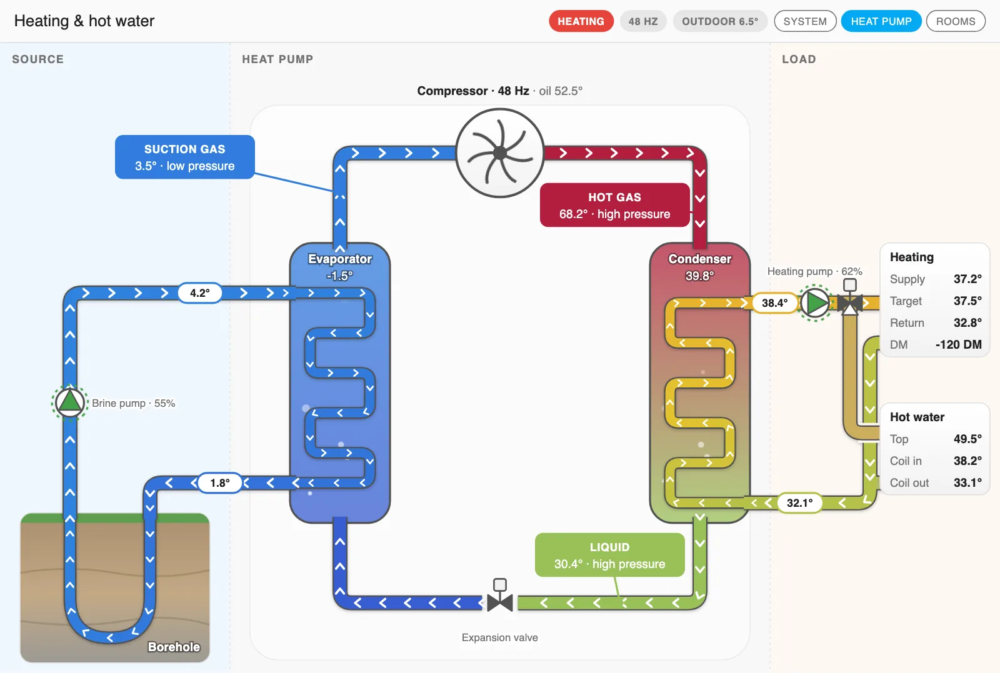
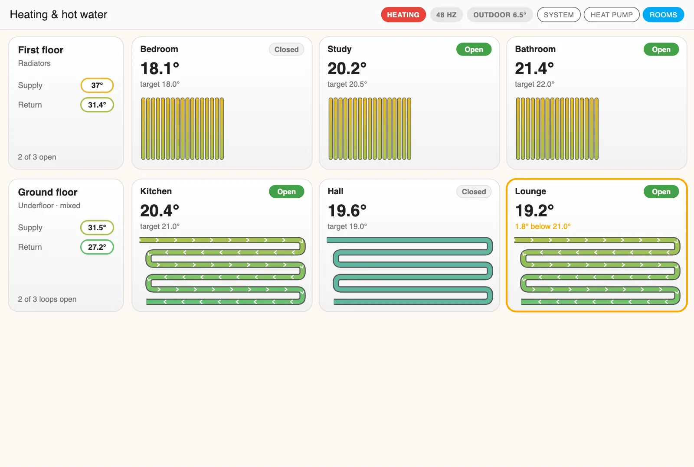

# Heating Flow card

A card that draws your heating and hot water as a live diagram: the heat source, the heat
pump, the pipes to each floor, the tank, the softener and the taps. A pipe's colour shows its
temperature, moving markers show where water is flowing, and a reading that isn't up to date
is marked on the part it belongs to.



The idea comes from slipx06's
[Sunsynk Power Flow Card](https://github.com/slipx06/sunsynk-power-flow-card), a live diagram
of an inverter's power flows.

The card draws what you tell it you have, and works with whatever your heat pump's
integration provides. You don't need every sensor: a part you don't name is left out, or
drawn without a reading.

## Adding it

It comes with Casa Mia's integration, so there's nothing to switch on. On a dashboard, add
a card and choose **Casa Mia Heating Flow**. Everything is set in the card's editor, one
fold per part of the system, so you need no YAML.

A new card starts as a borehole, a hot water tank and two floors. Then:

1. **Heat pump → Priority** first. It decides which circuits flow, so without it the heating
   stays still however many sensors you add (see [What flows, and when](#what-flows-and-when)).
2. **Source → Kind**, then the rest of **Source** and **Heat pump**.
3. **Lowest floor**, **Next floor up** and **Top floor**: name the floors you have, and clear
   the name of any you don't.
4. **Hot water** and **Water**, if you want them.

A new card takes the full width of a section, and a whole panel in the
[Tablet Layout](tablet-layout.md). The drawing keeps its shape and scales with the width, so
give it plenty of room.

## The three views

Tabs at the top of the card switch between them. **Opens on** sets which comes first, and
**Title** sets the heading.

**System** is the whole installation, in three areas: outside, the plant room and the house
(the picture above). Name the areas under **Look**.

**Heat pump** is a cutaway of the refrigerant cycle, as the textbook diagrams draw it: the
source through the evaporator on the left, the compressor and expansion valve in the middle,
and the load through the condenser on the right. In defrost, the cycle runs backwards.



**Rooms** is a tile per room for each floor, top floor first: its temperature, its target,
whether its loop is open, and the loop or radiator itself.



## Setting it up, part by part

### Source

| Option | What it does |
|---|---|
| **Kind** | **Borehole**, **Horizontal ground loop**, **Air** or **None**. **None** draws no source. |
| **Outdoor temperature** | A pill in the card's header, and a row in the heat pump's panel. With an air source, also on the fan. |
| **Pump** | A speed or on/off. The markers on the brine run faster with a higher speed. |
| **Out to the ground** | The brine leaving the heat pump: a reading on its pipe. |
| **Back from the ground** | The brine's colour where it comes back. A reading only with PVT panels. |
| **Into the heat pump** | The brine arriving at the heat pump: a reading on its pipe. |
| **PVT panels** | Draws them, with their valve. Ground sources only. |
| **PVT out** | The brine leaving the panels. |
| **PVT valve** | Open or on: the brine goes through the panels. |

With an air source, only **Outdoor temperature** applies. The fan turns while the compressor
runs.

### Heat pump

| Option | What it does |
|---|---|
| **Heat pump's name** | Its panel's title. Without one, "Ground source heat pump" or "Air source heat pump". |
| **Priority** | What it's doing now. Sets the header's first pill, the diverter and what flows. |
| **Compressor** | A frequency or on/off. Its impeller turns faster with the frequency. Without one, it runs whenever the priority is known and isn't off. |
| **Supply**, **Calculated supply**, **Return** | Rows in the panel. **Supply** and **Return** also colour the pipes leaving and returning. |
| **Pump** | A speed or on/off. Without one, it's taken to run whenever the priority needs it. |
| **Power in**, **Heat out**, **COP**, **Aux heater**, **Degree minutes** | Rows in the panel. A row shows only when you name its sensor. |
| **Alarm** | A state such as `0`, `ok`, `none`, `off`, `normal` or `no alarm` is quiet. Anything else is a pulsing red **Alarm** and a pill in the header with its words. |
| **Compressor oil temperature** | Beside the compressor, on the Heat pump view. |

**Refrigerant**, used by the Heat pump view:

| Option | What it does |
|---|---|
| **Suction gas**, **Hot gas**, **Liquid** | A callout pointing at each pipe, in the reading's colour. |
| **Evaporating**, **Condensing** | The reading on each vessel. |
| **Reversing valve** | Air sources: draws the valve, for a tap to open. Whether it says defrost comes from **Priority**, not from this entity. |

### Heating runs

| Option | What it does |
|---|---|
| **Supply sensors in the plant room** | In the order the water passes them. The card spaces them along the run. |
| **Return sensors in the plant room** | In order, from the house back to the heat pump. |
| **Supply arriving at the house**, **Return leaving the house** | On the System view these only colour the pipe, with no reading. The Heat pump view shows them as numbers. |

### Floors

Up to three, from the bottom up: **Lowest floor**, **Next floor up**, **Top floor**. A floor
appears once it has a name, a sensor, a loop or a room.

| Option | What it does |
|---|---|
| **Name** | The floor's title. |
| **Emitters** | **Underfloor** or **Radiators**. |
| **Mixed down** | Underfloor only: draws the floor's own mixing valve. |
| **Supply**, **Return** | The floor's readings. |
| **Loop actuators** | One per underfloor loop or radiator valve, open when on. A percentage shows as itself. |
| **Rooms** | A thermostat or a temperature sensor per room, in the same order as the loops: room 1 is on loop 1. A thermostat also gives the target. A room's name is its entity's name. |
| **Loop returns** | Each loop's return temperature, in the same order. Without one, the floor's **Return**. |

The two views draw a floor differently. Rooms shows every loop. System shows a dot for the
first six actuators of an underfloor floor (its "3 of 8 loops open" counts them all), and
always three radiators for a radiator floor.

### Hot water

| Option | What it does |
|---|---|
| **Hot water tank** | Draws the tank. When it's off, the tank isn't drawn, even if its sensors are set. |
| **Coil in**, **Coil out** | Readings on the coil's pipes. |
| **Tank sensors** | Top first. They're spaced evenly down the tank, and shade the water between them. |
| **Hot sensors in the plant room**, **Hot sensors in the house** | Along the hot run from the tank, in order. |
| **Return loop pump** | On/off. Naming this or a loop sensor draws the return loop. |
| **Return loop sensors in the house**, **…in the plant room** | Along the loop, from its far end, in order. |
| **Immersion heater** | A power or on/off. The rod glows while it's above zero. |

### Water

The mains coming in, and **Taps & showers** in the house, are always drawn on the System
view. The rest is optional.

| Option | What it does |
|---|---|
| **Softener** | Draws it, between the mains and the house. |
| **Salt level** | A percentage: the level shown in its cabinet. |
| **Needs salt** | On: the softener pulses amber, and the header says **Softener: top up salt**. |
| **Storage tank**, **Storage tank's name** | Draws a soft water tank that the house is pumped from. |
| **Storage inlet** | Open: the tank says **Filling**, and water pours in. |
| **Storage level** | A percentage: the water's height in the tank. |
| **Storage pumps** | One or two. Any beyond two aren't drawn. |
| **Mains flow meter** | Above zero: mains water is flowing. |
| **Mains temperature** | The colour of the cold pipes, with a reading on them. |

## Reading the picture

### Colour

Each sensor is a stop on its pipe's colour, so a pipe shades from one reading to the next.

| Temperature | Colour |
|---|---|
| −15° and below | Off-black |
| −10° | Indigo |
| −5° | Deep blue |
| 5° | Blue |
| 15° | Teal |
| 25° | Green |
| 35° | Yellow |
| 45° | Orange |
| 55° | Red |
| 65° and above | Crimson |

Water that isn't flowing is shown in a dimmed colour. A pipe with no reading is grey.
**Glass** pipes show their water faintly, except below −5°, where they fill in to full
strength by −10°, so the coldest brine can't be mistaken for that grey. The scale is in
Celsius: a sensor in Fahrenheit shows its number correctly, but gets the wrong colour.

**Colours → By circuit** gives each circuit one colour instead, so you can follow the
plumbing rather than the temperature: brine blue, PVT amber, heating red, the coil purple,
hot water pink, cold water light blue, refrigerant grey.

### What flows, and when

Markers move along a pipe only while water is flowing in it, and move faster when its pump
runs faster. Most of this depends on the heat pump's **Priority**, read from the words in its
state:

| The state has | The header says | What flows |
|---|---|---|
| `water`, `dhw` or `hot` | **Hot water** (purple) | The coil; the diverter points to the tank |
| `defrost` | **Defrost** (blue) | The heating; the refrigerant cycle runs backwards |
| `cool` | **Cooling** (teal) | Neither the heating nor the coil |
| `heat` | **Heating** (red) | The heating, and each floor's loops that are open |
| `off`, `idle`, `stand` or `none` | **Off** (grey) | Neither |

Only those English words count. A state like `Heizen` shows in the header as it is, but
nothing heating-related flows. If your heat pump reports another language or a number, add a
[template sensor](https://www.home-assistant.io/integrations/template/) that turns it into
one of these words, and use that.

The rest:

- **Brine** flows while its pump runs, or with the compressor if you named no pump.
- **PVT** flows while the brine does and its valve is open.
- **The return loop** flows while its pump runs.
- **Soft water** flows while the storage pumps run. With no storage tank, while the mains
  flow meter reads above zero.
- **Hot water to the house** flows while the return loop runs or soft water is in use, as the
  cold refilling the tank pushes hot out of the top.
- **Hard water** flows only with a storage tank: if mains water is flowing while the tank
  isn't filling, it must be going to the hard water tap.

The card can't tell whether soft water in use is going to a hot tap or a cold one, so **Taps
& showers** says "in use · hot or cold?" against both.

A sensor counts as running when it's a number above zero, or `on`, `open`, `opening`, `true`,
`home`, `heat`, `heating` or `running`. Any other word counts as stopped.

### Parts

- **Pumps:** a green triangle and a turning ring while running, with the speed beside them.
  An amber pulsing ring on the brine pump means it has stopped while the compressor runs,
  which is a fault.
- **Valves:** a triangle per port, filled where it's open.
- **Rooms:** an amber ring and "1.8° below 21.0°" when a room with its loop flowing is more
  than a degree below its target.

### When something isn't right

A sensor that's unavailable or unknown shows `— 23 min` in amber, with how long, and drops
out of its pipe's colour. An entity that no longer exists shows `— missing`.

A sensor that has simply stopped reporting looks normal on the card, because Home Assistant
only records a state when it changes, and a pump that's off all night doesn't change. Spotting a
sensor that has stopped reporting is [Sensor Watch](applets/sensor-watch.md)'s job.

## The look

Under **Look**:

| Option | Choices |
|---|---|
| **Pipes** | **Outline**, **Glass**, **Conduit** or **Neon** |
| **Flow markers** | **Chevrons**, **Arrows** or **Bubbles** |
| **Colours** | **By temperature** or **By circuit** |
| **Readings** | **Pills on the pipe**, or **Text beside the pipe** (one that isn't current is always a pill) |
| **Outside area's name**, **Plant area's name**, **House area's name** | The headings on the System view |

## Low-powered tablets

The diagram is a lot of moving parts for a wall tablet. Turn off **Look → Enable animations**
and the card stops animating: the markers stay where they are on the pipes that are flowing,
and the spinning, pulsing and dripping stops. It still updates when a reading changes. A browser or device set to
reduce motion gets the same still picture, whatever the option says.

The option belongs to the card, so to keep the animation on your desktop, give the tablet's
dashboard its own copy with animations off.

## Tap, hold and double tap

A part with an entity is a target: its reading, pump, valve or room tile. A tap opens the
entity's more-info dialog by default, and hold and double tap do nothing. Change any of them
under **Tap, hold and double tap**, with Home Assistant's usual actions. They apply to every
part of the card.

## When it doesn't look right

| What you see | Why, and what to do |
|---|---|
| Sensors read fine, but nothing moves on the heating | **Priority** isn't set, or its state doesn't hold one of [the words](#what-flows-and-when). |
| The header says **Unknown** | **Priority** isn't set, or it's unavailable. |
| A floor has heat but a loop stays still | Its actuator reads as stopped. See what [counts as running](#what-flows-and-when). |
| Rooms are on the wrong loops | **Rooms**, **Loop actuators** and **Loop returns** are matched by their order. |
| **Hard (kitchen)** never lights up | It needs a **Mains flow meter** and a **Storage tank**. |
| A tank or storage level looks wrong | Levels are read as 0–100. |
| Rooms says "No floors set" | Give at least one floor a name, a sensor, a loop or a room. |

## In YAML

You don't need this, but here's a small card for reference. The editor saves only what
differs from the defaults.

```yaml
type: custom:casa-mia-heating-flow
source:
  type: air
  outdoor: sensor.outdoor_temperature
heat_pump:
  label: Heat pump
  priority: sensor.hp_priority
  compressor: sensor.hp_compressor
  supply: sensor.hp_supply
  return: sensor.hp_return
floor_1:
  name: Ground floor
  supply: sensor.ground_supply
  return: sensor.ground_return
  loops:
    - switch.loop_kitchen
    - switch.loop_hall
  rooms:
    - climate.kitchen
    - climate.hall
dhw:
  enabled: true
  tank:
    - sensor.tank_top
    - sensor.tank_bottom
animations: false
```
