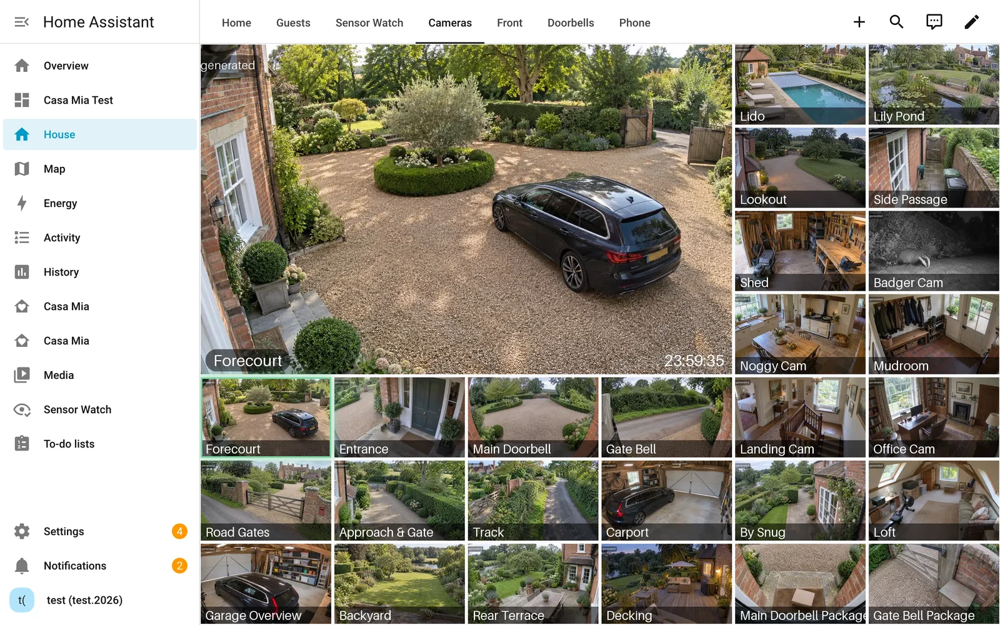
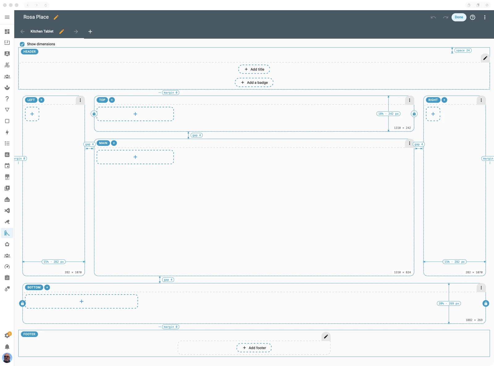

# A camera commander on your home page

This guide starts with a Home Assistant that has cameras and no Casa Mia, and ends with a
camera commander filling a dashboard that fits the screen, set as your home page. It takes
about twenty minutes, most of it waiting for a restart.

A commander is one picture of all your cameras, drawn by the Casa Mia app: a large main
camera with the others as tiles round it. You put it on a dashboard with the **Camera
Commander card**. In this guide the card goes in a **Tablet Layout** view, which is a
view that is always exactly the size of the screen.

You don't need Auto Dashboards for any of this. It makes a separate dashboard with a page
for each camera, and isn't how a commander is shown. Leave it off for now.

## 1. Install the app and switch on Camera Commander

Follow steps 1 and 2 of the [installation](../../README.md#installation) to add the
repository and install the app. Then, on the app's **Configuration** tab:

1. Give your house its name.
2. Switch on **Camera Commander**.
3. Press **Save**.

On the **Info** tab, switch on **Show in sidebar** and press **Start**.

## 2. Restart Home Assistant

The first time it starts, the app copies its integrations into Home Assistant, and Home
Assistant only finds them after a restart: **Settings → System → ⋮ → Restart Home
Assistant**.

This step is easy to miss, and nothing in the later steps works without it. The card and
the Tablet Layout view both come from the integration, so until it is running they are
not in Home Assistant's lists.

## 3. Add the two integrations

Go to **Settings → Devices & services → Add integration**, search for **Casa Mia** and
press **Submit**. It finds the app by itself.

Shortly afterwards **Casa Mia Camera Commander** appears under **Discovered** on the same
page. Press **Add**. This is the one that gives each commander its device, and the card
needs it.

Now reload the browser tab, so the page picks up the card and the view.

## 4. Choose your cameras

Open **Casa Mia** from the sidebar and go to **Cameras**. Press **+ Add cameras** and
pick the cameras you want from Home Assistant's. A camera with several channels, such as a
UniFi Protect one, is added once with its channels filled in.

Each camera's **Title** is the name shown on its tile. Changes here are saved at once.
More about this page is in [Cameras](../applets/cameras.md).

## 5. Make the commander

Go to **Camera Commander** in the Casa Mia panel. There is one commander to begin with.

1. Set **Layout** to **Responsive**. You then give it one list of cameras and it works out
   the arrangement for whatever space it is given.
2. Add your cameras to its list, in the order their tiles should fill.
3. Press **Save**.

The preview above the settings shows the commander as it will be drawn. The buttons over
it (Wide, Tablet, Phone upright and so on) show it in other spaces. If you'd rather place
each camera by hand, [Fixed or Responsive?](../applets/camera-commander.md#fixed-or-responsive)
explains the other layout.

## 6. Make a dashboard with a Tablet Layout view

In Home Assistant, go to **Settings → Dashboards → Add dashboard**, choose **New dashboard
from scratch**, give it a name such as Home, and open it.

1. Enter edit mode (the pencil at the top right).
2. Edit the view that is there (the pencil beside its name), or add one.
3. Set **View type** to **Tablet (Casa Mia)** and save.

In edit mode the view now shows a main panel with an edge on each side: top, left, right
and bottom. Each is named on a chip.

## 7. Put the commander in the main panel

1. In the **main** panel, press **+** to add a card.
2. Choose **Casa Mia Camera Commander**.
3. Under **Commander**, pick the one you made, and save.
4. Leave edit mode.

The commander now fills the screen, and stays that way if the window or the tablet
changes shape. The edges are empty, so they take no room. Tap a tile and that camera
becomes the main one.

The edges are for whatever else belongs on the page: a row of buttons along the bottom,
the weather down one side. [Tablet Layout](../tablet-layout.md) covers them. On a phone
the same view becomes Home Assistant's ordinary sections view, and the commander is laid
out for the narrower space.

## 8. Make it your home page

Home Assistant decides which dashboard opens first, and the setting is its own. Depending
on your version it is in **Settings → Dashboards**, where a dashboard can be set as the
default, or under your user profile as **Dashboard**. Choose the dashboard you just made.

On a wall tablet, set it on the tablet itself, signed in as the tablet's user.

## If something isn't there

- **Tablet (Casa Mia) isn't in the View type list**, or **Casa Mia Camera Commander isn't
  among the cards:** the Casa Mia integration isn't running, or the browser tab was open
  before it started. Check step 2 (the restart) and step 3 (both integrations added),
  then reload the tab. The Home Assistant log says `dashboard cards loaded (cm-cards.js)`
  when the integration has loaded them.
- **Casa Mia Camera Commander isn't under Discovered:** Camera Commander isn't switched
  on in the app's Configuration tab, or the Casa Mia integration hasn't been added yet.
- **The card shows no picture:** check the commander has
  cameras and was saved on its page. The [Camera Commander](../applets/camera-commander.md#troubleshooting)
  guide has more.
- **You have a dashboard of camera pages you didn't make:** that is the one
  [Auto Dashboards](../applets/auto-dashboards.md) deploys. It holds a live page for each
  camera, which the card's tap on the main camera can open. It is not where a commander
  is shown, and changing its view type won't make it one.

## Where next

- [Camera Commander](../applets/camera-commander.md): everything the commander and its
  card can do, including Track motion, the Security look and talking to a doorbell.
- [Tablet Layout](../tablet-layout.md): sizing the edges, and showing and hiding panels.
- [Show the doorbell on every tablet when it rings](doorbell-over-every-tablet.md).
